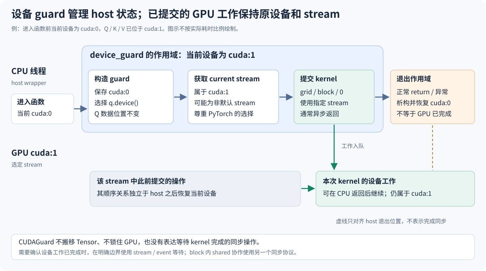
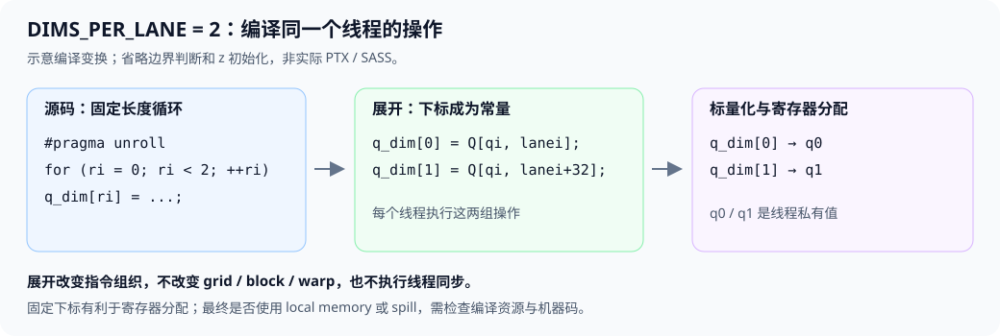
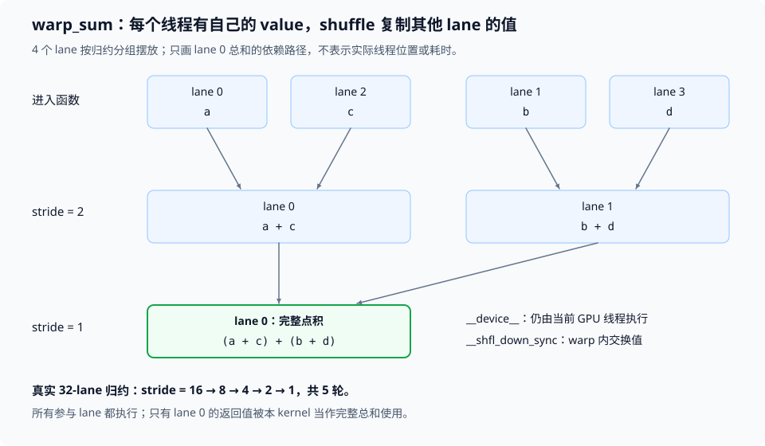

# 1. V1 CUDA 初学者 FAQ：函数执行空间、warp 归约与内存

本文整理阅读 V1 源码时提出的 `__device__` 函数声明、warp 点积归约、设备 guard、kernel 发射参数、静态/动态 shared memory、循环展开与寄存器、索引与常量命名问题，并补充理解它们所需的编译、执行、内存与同步背景。最后说明测试、版本记录、Git 文件组织和 VSCode 语义配色问题。

建议先读 [基本概念](#concepts)，再按 [设备与 CUDAGuard](#device-guard) → [kernel 发射参数](#launch) → [shared memory](#shared-memory) → [同步与资源](#synchronization) 的顺序阅读。算法推导见 [优化设计](optimization-design.md)，实际运行见 [编译执行](build-and-run.md)，性能结果见 [perf_v1.md](perf_v1.md)。

阅读 `q_dim[]` 或 `#pragma unroll` 时，可直接跳到 [循环展开与寄存器分配](#loop-unroll)。

阅读 `__device__ float warp_sum(...)` 时，先读 [函数执行空间与编译](#function-execution)，再读 [线程私有部分和与 warp 归约](#warp-reduction)。这两节分别回答“函数在哪里执行”和“多个线程如何交换并合并数据”。

计划后续配置编辑器时，可直接阅读 [VSCode 主题与语义高亮配置](#semantic-highlighting)。

源码链接中的“开发源码”指当前 `cpp_cuda/fa2/v1/fa2_forward.cu`；“测量快照”指本轮归档版本。两者可能有排版或后续开发差异，性能结论以测量快照、实际二进制和原始结果为准。本文的示例代码用于解释机制，不是新增的 FA2 优化实现。

<a id="concepts"></a>

## 1.1 先理解 CPU、GPU、grid、block、warp 和 stream

### 1.1.1 `.cu` 文件里的代码都在 GPU 上执行吗？

不是。`.cu` 文件可以同时包含 CPU 侧代码和 GPU 侧代码，运行位置由函数声明与调用方式决定。

| 本项目中的代码 | 执行位置 | 作用 |
|---|---|---|
| `fa2_forward_cuda(...)` | CPU，也称 host | 检查 Tensor、选择设备、分配输出、设置 launch 参数 |
| `launch_forward<2>(...)` | CPU | 发射选定模板实例的 kernel |
| `__global__ void fa2_forward_fp32_kernel(...)` | GPU，也称 device | 由大量 GPU 线程执行 attention |
| `__device__ float warp_sum(...)` | GPU | 供 kernel 内的 GPU 线程调用，完成 warp 内归约 |

因此 `CUDAGuard` 是 CPU 上的局部对象，而 `threadIdx.x`、`blockIdx.x` 与 `__shfl_sync` 属于 GPU 执行阶段。对应源码见 [host wrapper](../../../../cpp_cuda/fa2/v1/fa2_forward.cu#L134-L152)、[launch helper](../../../../cpp_cuda/fa2/v1/fa2_forward.cu#L115-L122) 和 [GPU kernel](../../../../cpp_cuda/fa2/v1/fa2_forward.cu#L29-L96)。CUDA 对函数执行空间和发射方式的定义见 [CUDA 12.8 编程指南](https://docs.nvidia.com/cuda/archive/12.8.0/cuda-c-programming-guide/index.html#function-execution-space-specifiers)。

### 1.1.2 grid、block、warp、lane 分别是什么？

一次 kernel launch 启动一个 grid；grid 包含多个 thread block，常简称 block 或 CTA；一个 block 包含多个线程。GPU 将线程按 32 个一组组织为 warp，warp 内线程的位置称为 lane。block 是 CUDA 编程模型中的协作单位，warp 是这里使用的调度与寄存器通信单位。

V1 的配置是 128 threads/block，即四个 warp；每个 warp 独立处理一个 query 行。对 `S=16384`，grid 有 `ceil(16384/4)=4096` 个 block。它们不会全部同时占用 GPU，而是受 SM 数量、线程、寄存器和 shared 资源限制，分批调度。

```cpp
const int warpi = threadIdx.x / WARP_SIZE;
const int lanei = threadIdx.x % WARP_SIZE;
const int qi = blockIdx.x * WARPS_PER_BLOCK + warpi;
```

这段映射见 [V1 线程所有权](../../../../cpp_cuda/fa2/v1/fa2_forward.cu#L34-L39)，已有 [warp/query 映射图](assets/warp-query-mapping.svg) 展示了 V0 与 V1 的区别。

### 1.1.3 stream 是另一组 GPU 线程吗？

不是。stream 表示提交给设备的一条有序工作队列，工作可以是 kernel、数据拷贝或 event。block/warp 描述一次 kernel 内部的线程组织；stream 描述多个设备操作之间的提交顺序，两者属于不同层次。

同一 stream 中，设备操作遵守相应的顺序关系，例如先生成输入，再执行消费这些输入的 kernel。不同 stream 的工作可能并发，也可能受依赖和资源限制而串行；不能仅创建多个 stream 就保证并发。PyTorch 为每个设备维护当前 stream，见 [PyTorch 2.6 的 CUDAStream 定义](https://github.com/pytorch/pytorch/blob/v2.6.0/c10/cuda/CUDAStream.h#L36-L47) 与 [当前 stream 接口](https://github.com/pytorch/pytorch/blob/v2.6.0/c10/cuda/CUDAStream.h#L236-L243)。

### 1.1.4 索引变量为什么统一以 `i` 结尾？

这是本项目的命名约定，用名称区分“位置索引”和“长度、数量、步长”。V1 开发源码中，`warpi` 是 block 内的 warp 索引，`lanei` 是 warp 内的 lane 索引，`qi/ki` 是 query/key 行索引，`ri` 是线程私有条带数组的槽位索引，`dimi` 是向量维度索引。

例如 `dimi = lanei + ri * WARP_SIZE` 表示正在访问哪个维度，`head_dim` 表示一行总共有多少维，`DIMS_PER_LANE` 表示每个 lane 有多少槽位，`stride` 表示归约每级的间距。后三者是长度、数量或步长，不追加索引后缀。`q_dim` 保存的是 Q 的分量值，也不是索引；CUDA 的 `threadIdx.x` 等内建名称保持原写法。

测量快照仍保留当时的 `warp/lane/r/dim` 命名，性能报告中引用它们时遵循原文。开发源码的重命名不改变计算、线程映射或通信行为。

### 1.1.5 全局常量和模板参数为什么使用全大写？所有 `const` 都应大写吗？

本项目采用 `UPPER_SNAKE_CASE` 表示全局常量和整数非类型模板参数，以区分编译期配置与运行时数据，例如：

```cpp
constexpr int WARP_SIZE = 32;
constexpr int WARPS_PER_BLOCK = 4;

template <int DIMS_PER_LANE>
__global__ void kernel(/* 普通运行时参数 */);
```

`WARP_SIZE` 是 `constexpr` 变量，编译时确定为 32；`DIMS_PER_LANE` 是非类型模板参数，每个实例由 `kernel<1>`、`kernel<2>` 等传入固定值。模板参数没有写 `const`，但整数模板参数在实例中可以参与数组长度等常量表达式，也不能像普通局部变量那样赋值修改。

`const int head_dim` 则只限制这次调用内部不修改参数值，它仍由运行时 Tensor 形状提供。因此保留 `head_dim/seq_len/scale` 的小写命名；`const int lanei` 同样保留索引后缀，不将它改为全大写。全大写是项目风格，不是 C++ 语法要求，也不意味着使用 `#define`；另一种常见风格是原来的 `kWarpSize`。V0 代码和测量快照维持历史名称，V1 开发源码统一采用新约定。

<a id="function-execution"></a>

### 1.1.6 `__device__` 必须写吗？在 `warp_sum` 上起什么作用？

对于当前这个普通自由函数，必须声明它具有 device 执行空间，保留 `__device__` 是合适的写法：

```cpp
__device__ float warp_sum(float value) {
    for (int stride = WARP_SIZE / 2; stride > 0; stride /= 2) {
        value += __shfl_down_sync(FULL_WARP_MASK, value, stride);
    }
    return value;
}
```

这里的 `__device__` 是 CUDA C++ 的函数执行空间修饰符，不是标准 C++ 的 `device` 关键字。它告诉编译器：该函数在 GPU 上执行，只能由 GPU 代码调用。`float` 是返回类型，`value` 是当前调用线程按值传入的参数；它们都不因 `__device__` 而成为共享变量。声明见 [开发源码 L22～L27](file:///home/dengxiao/code_repos/institutionalized/stanford_cs336/assignments/assignment2-systems/FA/cpp_cuda/fa2/v1/fa2_forward.cu#L22-L27)。

如果直接删掉 `__device__`，这个函数默认只编译为 host 函数，不会因为它位于 `.cu` 文件、或调用者是 kernel，就自动变成 GPU 函数。一方面 kernel 不能这样跨执行空间调用它；另一方面函数体里的 `__shfl_down_sync` 是 device intrinsic，host 函数也不能调用它。这里确实需要 GPU 函数，不能靠删修饰符或换成普通 `inline` 解决。

用 CUDA 12.8、`-O2 -arch=sm_61` 在临时目录编译原样 `warp_sum` 与一个最小调用 kernel 时，带 `__device__` 的版本通过；仅删除修饰符后，编译器报告：

```text
calling a __device__ function("__shfl_down_sync(...)")
from a __host__ function("warp_sum") is not allowed
```

上面省略了诊断中的参数类型与临时文件路径，只保留错误含义；它验证的是执行空间规则，不是新一轮 FA2 性能测量。默认 host、device-only 和跨执行空间调用的定义见 [CUDA 函数执行空间规范](https://docs.nvidia.com/cuda/archive/12.8.0/cuda-c-programming-guide/index.html#function-execution-space-specifiers)。

### 1.1.7 `__host__`、`__device__`、`__global__` 有什么区别？

| 函数声明 | 执行位置 | 合法调用方式 | 本项目中的角色 |
|---|---|---|---|
| 普通 `float f(...)` 或 `__host__ float f(...)` | CPU | CPU 普通函数调用 `f(...)` | 输入检查、wrapper、launch helper |
| `__device__ float f(...)` | GPU | GPU 普通函数调用 `f(...)` | `warp_sum` |
| `__global__ void f(...)` | GPU | 通过 `f<<<...>>>(...)` 发射 kernel | `fa2_forward_fp32_kernel` |
| `__host__ __device__ float f(...)` | CPU 与 GPU 各自有可用版本 | 从哪一侧调用，就执行那一侧的版本 | 可复用的纯计算辅助函数 |

`__global__` 声明的是 kernel 入口，必须返回 `void`，调用时必须提供执行配置。它虽然在 GPU 上执行，通常由 CPU 发射；CUDA dynamic parallelism 还允许设备代码发射另一个 kernel，但那仍是带 `<<<...>>>` 的新发射，不是 `warp_sum(value)` 这种普通调用。本项目没有使用动态并行。

`__device__` 不表示“每调用一次就启动一个 GPU 线程”，也不表示“自动让整个 warp 调用”。它只决定函数执行与调用空间。当前线程到达调用语句后，在自己的执行上下文中运行函数，返回后继续执行 kernel。规范见 [CUDA `__global__`、`__device__` 与 `__host__`](https://docs.nvidia.com/cuda/archive/12.8.0/cuda-c-programming-guide/index.html#function-execution-space-specifiers)。

### 1.1.8 `.cu` 同时包含 CPU/GPU 代码，编译器如何处理？能把 `warp_sum` 改成双端函数吗？

`nvcc` 编译 CUDA 源码时会处理 host/device 两侧的代码：host 部分交给 host C++ 工具链，device 部分生成面向 GPU 的代码并打包进最终产物。CPU 侧的 kernel 发射代码通过 CUDA 运行时提交相应 GPU 入口；CPU 不会直接把 GPU 指令当作 CPU 指令执行。流程见 [NVCC Compilation Trajectory](https://docs.nvidia.com/cuda/archive/12.8.0/cuda-compiler-driver-nvcc/index.html#the-cuda-compilation-trajectory)。

CPU 上调用 `warp_sum(1.0f)` 不会自动把执行迁移到 GPU。类似地，`__host__ __device__` 的含义是让同一份定义具备两个执行空间的版本，而不是运行时跨设备远程调用。适合双端使用的例子是：

```cpp
__host__ __device__ float square(float x) {
    return x * x;
}
```

`warp_sum` 依赖 warp lane 和 `__shfl_down_sync`，不能直接加 `__host__` 就得到有意义的 CPU 求和版本。若确实需要两端复用，必须用适当的编译条件提供各端合法实现，并明确 CPU 版本的输入与求和语义；这里没有这个需求，保留 device-only 函数即可。双端函数与 `__CUDA_ARCH__` 条件分支的规则见 [CUDA `__host__` 说明](https://docs.nvidia.com/cuda/archive/12.8.0/cuda-c-programming-guide/index.html#host)。

### 1.1.9 `__device__` 等于内联吗？为什么函数调用没有 `<<<...>>>`？

两者解决不同问题。`__device__` 指定执行空间；内联是编译器把函数体放入调用位置的代码变换，目的是消除调用/返回并提供进一步优化机会。编译器会在适当时内联 device 函数，但 `__device__` 本身不保证生成代码一定没有函数调用。

例如 `__device__ __forceinline__ float f(...)` 进一步要求内联；只写标准 C++ 的 `inline float f(...)`，不会把默认 host 函数改成 device 函数。C++ `inline` 还涉及跨翻译单元定义规则，不能仅把它理解为执行位置或必然的机器码展开。CUDA 的相关定义见 [CUDA `__noinline__` 与 `__forceinline__`](https://docs.nvidia.com/cuda/archive/12.8.0/cuda-c-programming-guide/index.html#noinline-and-forceinline)。

本项目的调用层次是：

```text
CPU: fa2_forward_cuda → launch_forward<N>
                            │ kernel<<<grid, block, 0, stream>>>(...)
                            ▼
GPU: 已启动的线程执行 fa2_forward_fp32_kernel<N>
                            │ 普通调用 warp_sum(reduction)
                            ▼
GPU: 同一个线程执行 warp_sum，再返回 kernel
```

只有 kernel 发射建立这次 grid/block 的线程布局；`warp_sum` 不产生另一个 grid，不申请 shared memory，也不自动同步整个 block。

### 1.1.10 在变量前写 `__device__`，也表示放进寄存器吗？

不是。同一个修饰符用于函数与变量时，含义不同：函数上的 `__device__` 指定执行空间；文件或命名空间作用域的 `__device__` 变量声明设备侧存储，未搭配其他存储空间修饰符时通常属于 global memory。

```cpp
__device__ float global_counter; // 设备上的全局变量；不是每线程一份

__global__ void example(float* output) {
    float partial = 0.0f;        // 线程私有自动变量；可能分配到寄存器
    // ...
}
```

`q_dim`、`z`、`reduction` 这样的 kernel 局部状态不需要再写 `__device__`。它们属于当前 GPU 线程的自动变量，具体存储仍由编译器决定，详见 [寄存器与 local memory](#loop-unroll)。`__device__` 全局变量也不自动成为线程安全的计数器，跨线程更新需要另行设计并发协议。变量声明规则见 [CUDA Variable Memory Space Specifiers](https://docs.nvidia.com/cuda/archive/12.8.0/cuda-c-programming-guide/index.html#variable-memory-space-specifiers)。

<a id="device-guard"></a>

## 1.2 `CUDAGuard`：在函数作用域内选择正确设备

### 1.2.1 `const c10::cuda::CUDAGuard device_guard(q.device());` 起什么作用？

它创建一个设备作用域保护对象，在函数内部将当前 CPU 线程使用的 CUDA 设备设为 Q 所在设备，并在对象销毁时恢复原来的设备。代码位置见 [开发源码中的设备 guard](../../../../cpp_cuda/fa2/v1/fa2_forward.cu#L136)。

```cpp
const c10::cuda::CUDAGuard device_guard(q.device());
```

可以按三个步骤理解：

1. 构造时记录调用前的当前 CUDA 设备。
2. 将当前设备设为 `q.device()`，在随后的 host 代码中使用它。
3. 离开作用域时析构，恢复调用前的设备。

例如调用前当前设备是 `cuda:0`，Q/K/V 位于 `cuda:1`，函数内部就使用 `cuda:1` 获取 stream 并发射 kernel，函数退出后恢复 `cuda:0`。这避免扩展改变调用方后续代码的设备选择。定义与实现分别见 [CUDAGuard 构造函数](https://github.com/pytorch/pytorch/blob/v2.6.0/c10/cuda/CUDAGuard.h#L19-L37)、[内部设备交换](https://github.com/pytorch/pytorch/blob/v2.6.0/c10/core/impl/InlineDeviceGuard.h#L71-L77) 和 [析构恢复](https://github.com/pytorch/pytorch/blob/v2.6.0/c10/core/impl/InlineDeviceGuard.h#L112-L114)。



图 1：设备选择与异步执行的边界。上下两条线没有按真实耗时比例绘制；CPU 恢复当前设备不意味着 GPU kernel 已执行完。

### 1.2.2 RAII 是什么？为什么没有手动恢复设备？

RAII 是 C++ 中利用对象生命周期管理资源或状态的方式：构造时获取或设置，析构时释放或恢复。对自动存储期的局部对象，正常 `return` 或 C++ 异常导致的栈展开都会执行析构，因此不必在每条退出路径手写恢复代码。

这里的资源是“当前设备状态”。它与 `std::lock_guard` 管理锁、`std::unique_ptr` 管理内存使用类似的生命周期模式，但 `CUDAGuard` 本身不锁住 GPU。进程被强制终止等不执行正常析构的情况，不属于普通作用域恢复机制。

`device_guard` 变量虽然没有被再次显式调用，却通过构造与析构产生必要行为，不能将它当作无用变量删除。PyTorch 对这一生命周期的说明见 [InlineDeviceGuard 类注释](https://github.com/pytorch/pytorch/blob/v2.6.0/c10/core/impl/InlineDeviceGuard.h#L17-L30)。

### 1.2.3 `const` 会不会阻止析构？guard 会不会把 Q 搬到另一张 GPU？

`const` 不会阻止析构。它限制通过这个变量修改对象，例如不能调用改变 guard 设备状态的非 const 成员函数；对象离开作用域后仍然销毁并恢复设备。

guard 也不会搬移 Q/K/V。`q.device()` 查询的是 Tensor 已经所在的设备；guard 调整 CPU 线程的当前设备选择。若要将 Tensor 从 `cuda:0` 搬到 `cuda:1`，需要显式的 Tensor 设备转换或拷贝，它属于另一种操作。

本项目在创建 guard 之前已 [检查 Q/K/V 同设备](../../../../cpp_cuda/fa2/v1/fa2_forward.cu#L98-L113)。如果三个 Tensor 分别位于不同设备，正确处理方式是拒绝调用或按明确定义转换输入；guard 不会自动修复它们。

### 1.2.4 为什么要先 guard，再获取 current stream？

因为这里的 [stream 获取](../../../../cpp_cuda/fa2/v1/fa2_forward.cu#L145) 没有显式指定设备编号：

```cpp
const c10::cuda::CUDAGuard device_guard(q.device());
const cudaStream_t stream = at::cuda::getCurrentCUDAStream();
```

`getCurrentCUDAStream()` 默认查询当前设备的当前 PyTorch stream。guard 先选定 Q 的设备，后续查询才得到该设备的 stream。若当前设备和 Q 的设备不一致，又省略 guard，裸 kernel 发射可能使用错误设备或不匹配的 stream/指针，导致失败或错误行为。

当前 stream 不一定是默认 stream；调用者可能在 `torch.cuda.stream(...)` 作用域里使用另一个 stream。扩展尊重 PyTorch 当前 stream，才能自然接入调用方的顺序关系。`CUDAGuard` 只选择设备，不把该设备的 stream 强制改为默认 stream；需要同时临时选择设备和指定 stream 时，PyTorch 另有 `CUDAStreamGuard`。参见 [CUDAStream 接口说明](https://github.com/pytorch/pytorch/blob/v2.6.0/c10/cuda/CUDAStream.h#L228-L255)。

### 1.2.5 函数返回后恢复设备，尚未完成的 kernel 会不会跑到别的 GPU？

不会。kernel 一旦提交，就关联到发射时的设备与 stream；恢复 CPU 线程的当前设备不改变已提交任务的归属。guard 的作用域结束和 GPU kernel 的执行结束是两个不同事件。

guard 没有表达“等待这个 kernel 完成”的同步操作，也不取消已提交工作。即使发生普通 host 异常，析构恢复设备也不等于回滚之前的 GPU 提交。调用者仍需保证输入数据在异步工作执行期间有效，尤其不要在另一个 stream 上无依赖地修改它们。

对于当前单张 GTX 1060，当前设备通常已经是 `cuda:0`；guard 大多无需改变设备，但其语义仍保障多 GPU 调用和作用域恢复。

<a id="launch"></a>

## 1.3 `<<<grid, block, 0, stream>>>`：如何读取 kernel 发射语法

### 1.3.1 `block` 后面的 `0` 是什么意思？

它表示本次发射为每个 block 额外申请的**动态 shared memory 大小为 0 字节**。完整语法是：

```cpp
kernel<<<grid, block, dynamic_shared_bytes, stream>>>(kernel_arguments...);
```

| 位置 | 本项目的值 | 含义 |
|---|---|---|
| 第一个 | `grid` | 发射多少个 block，可用三维 `dim3` 表示 |
| 第二个 | `block` | 每个 block 有多少线程，可用三维 `dim3` 表示 |
| 第三个 | `0` | 每 block 的动态 shared memory 字节数 |
| 第四个 | `stream` | 将 kernel 提交到哪条 CUDA stream |
| 后面的圆括号 | `q.data_ptr<float>()` 等 | kernel 的普通函数参数 |

第三个参数的单位是字节，不是 `float` 个数，也不是全 grid 的总量。V1 使用寄存器与 shuffle，没有申请动态 shared，所以这里填 `0`。对应 [开发源码 launch](../../../../cpp_cuda/fa2/v1/fa2_forward.cu#L115-L122)，规范定义见 [CUDA 12.8 §10.37 Execution Configuration](https://docs.nvidia.com/cuda/archive/12.8.0/pdf/CUDA_C_Programming_Guide.pdf#page=288)。

### 1.3.2 第三个参数和第四个参数都可以是 `0`，含义相同吗？

不相同，必须按位置解释：

```cpp
kernel<<<grid, block, 0, stream>>>(...); // 动态 shared 为 0，使用指定 stream
kernel<<<grid, block, bytes, 0>>>(...);  // 动态 shared 为 bytes，使用默认 stream 语义
```

第三、第四个参数都可省略，默认值为 0。但在 PyTorch 扩展里，省略第四个参数不等于“自动使用 PyTorch 当前 stream”。默认 stream 的具体行为还涉及 CUDA 的 legacy/per-thread default stream 配置；本项目显式传入 PyTorch 当前 stream，避免依赖隐含选择。

### 1.3.3 `<DIMS_PER_LANE>` 和 `<<<...>>>` 有什么区别？

前者是 C++ 模板参数，编译时决定每个 lane 持有几个维度槽位；后者是 CUDA 发射配置，每次调用时决定线程布局、动态 shared 大小和 stream。

```cpp
fa2_forward_fp32_kernel<2><<<grid, block, 0, stream>>>(...);
```

这里 `<2>` 选择已编译的“两维度/每 lane”实例，不表示动态 shared 的大小。`d=64` 时，lane \(\lambda\) 处理维度 \(\lambda\) 与 \(\lambda+32\)；每个 lane 需要的槽位数为 `ceil(head_dim / WARP_SIZE)`。

开发源码直接计算这个数量，再查表选择已编译的模板入口：

```cpp
const int dims_per_lane = 1 + (head_dim - 1) / WARP_SIZE;
FORWARD_LAUNCHERS[dims_per_lane - 1](
    q, k, v, o, seq_len, head_dim, scale, is_causal, grid, block, stream);
```

`FORWARD_LAUNCHERS` 按顺序保存 `launch_forward<1>` 到 `launch_forward<4>`，见 [模板入口表](../../../../cpp_cuda/fa2/v1/fa2_forward.cu#L124-L130) 和 [计算与调用](../../../../cpp_cuda/fa2/v1/fa2_forward.cu#L147-L150)。运行时变量 `dims_per_lane` 不能直接写成 `launch_forward<dims_per_lane>`，因为整数模板实参必须是编译期常量；查表将运行时选择与编译期实例分开，无需重复列出 head dimension 的区间条件。

### 1.3.4 `q.data_ptr<float>()` 会复制 Tensor 吗？

不会。它取得 Tensor 数据区的指针，并按 `float*` 类型传给 kernel。对于这里经过检查的 CUDA Tensor，该指针指向设备上的数据；Q/K/V 数据不会因为传递一个指针就自动复制到 host、另一张 GPU 或 shared memory。

host wrapper 操作 Tensor 句柄并传递设备指针，GPU kernel 再通过这些指针加载元素。[输入检查](../../../../cpp_cuda/fa2/v1/fa2_forward.cu#L98-L113) 确认 FP32、连续布局和维度范围，kernel 才能按 `qi * head_dim + dimi` 计算线性地址。加载 Q 的位置见 [Q 条带初始化](../../../../cpp_cuda/fa2/v1/fa2_forward.cu#L41-L48)。

<a id="shared-memory"></a>

## 1.4 静态与动态 shared memory

### 1.4.1 shared memory 共享给谁？与显存、寄存器有什么区别？

普通 CUDA shared memory 是 block 内线程可共同读写的片上存储，每个 block 有自己的实例，生命周期随 block 执行。它不表示整个 grid、多个 GPU 或 CPU/GPU 共享同一个数组。本 FAQ 针对 GTX 1060 的常规 block 模型，不涉及新架构 thread block cluster 的 distributed shared memory。

| 存储 | 常见内容 | 对本项目最重要的访问范围 |
|---|---|---|
| Global memory | Tensor 的 Q/K/V/O | GPU 线程按有效指针访问；跨 block 共享数据需另行建立依赖 |
| Shared memory | 显式加载的 tile、block 归约工作区 | 同一 block 内线程协作访问 |
| Registers | 线程计算状态、Q/Z 分量 | 线程私有；需要 warp 间或 lane 间通信时使用明确机制 |

shared 不会自动缓存所有 global load，需程序显式加载与写入。已有 [GPU 内存路径 SVG](../v0/assets/gpu-memory-path.svg) 展示 global、cache、寄存器与 shared 的关系。普通 shared 的对象范围与生命周期见 [CUDA 12.8 §10.2.3](https://docs.nvidia.com/cuda/archive/12.8.0/pdf/CUDA_C_Programming_Guide.pdf#page=180)。

### 1.4.2 静态和动态 shared memory 的核心区别是什么？

**使用的内存空间相同，区别在于大小何时确定、如何告诉 CUDA。**

| 对比项 | 静态 shared | 动态 shared |
|---|---|---|
| 声明 | `__shared__ float buf[128];` | `extern __shared__ float buf[];` |
| 大小确定时间 | 编译时 | 每次 kernel 发射时 |
| 大小来源 | 编译期常量或模板参数 | `<<<...>>>` 的第三个参数，单位为字节 |
| block 内共享范围 | 同一 block 的线程 | 相同 |
| 生命周期 | 该 block 执行期间 | 相同 |
| 初始化与同步 | 需要程序建立 | 相同 |
| 访问性能 | 取决于访问模式与资源使用 | 不因“动态”这个声明方式天然更慢 |

“静态”指大小确定方式，不表示所有 block 共用一个永久数组；“动态”指发射时配置大小，不表示在 kernel 中调用 `malloc`。定义见 [CUDA shared 声明](https://docs.nvidia.com/cuda/archive/12.8.0/pdf/CUDA_C_Programming_Guide.pdf#page=180)，例子见 [NVIDIA Using Shared Memory in CUDA C/C++](https://developer.nvidia.com/blog/using-shared-memory-cuda-cc/)。

### 1.4.3 静态 shared 的大小必须写死成数字吗？

不必写成数字字面量，但必须是编译时可确定的常量。例如：

```cpp
constexpr int kTileSize = 128;

__global__ void fixed_kernel() {
    __shared__ float buf[kTileSize];
}

template <int N>
__global__ void templated_kernel() {
    __shared__ float buf[N];
}
```

`templated_kernel<64>` 与 `templated_kernel<128>` 是不同编译实例，每个实例的 shared 大小都固定。反过来，kernel 的普通参数 `int n` 是运行时值，不能用它声明标准 CUDA C++ 的 `__shared__ float buf[n]`；需要动态 shared 或编译期模板分派。

V0 的 `__shared__ float reduction[kThreadsPerBlock]` 属于静态 shared，`kThreadsPerBlock=128` 在编译时已知，见 [V0 声明](../../../../cpp_cuda/fa2/v0/fa2_forward.cu#L15-L25)。

### 1.4.4 动态 shared 怎么声明、分配和使用？

kernel 声明未指定长度的 `extern __shared__` 数组，host 在发射时提供字节数，kernel 用普通参数知道自己的有效元素数量：

```cpp
__global__ void dynamic_reverse(const float* input, float* output, int n) {
    extern __shared__ float buf[];
    const int t = threadIdx.x;

    if (t < n) {
        buf[t] = input[t];
    }
    __syncthreads(); // block 的所有线程到达这里

    if (t < n) {
        output[t] = buf[n - 1 - t];
    }
}

// 示例前提：1 <= n <= 128；input/output 是有效设备数组。
const int n = 64;
const size_t bytes = static_cast<size_t>(n) * sizeof(float);
dynamic_reverse<<<1, 128, bytes, stream>>>(input, output, n);
```

该例每 block 申请 256 B 动态 shared。`n` 作为普通参数传入，不会让 CUDA 自动推断 shared 字节数；调用者必须保证 `bytes` 足够。第三个参数若错误地传成 `n`，这里只申请 64 B，后续 float 访问就可能越界。

如果改成 `__shared__ float buf[128];`，同样的数据交换可以使用静态 shared，并用 `<<<1,128,0,stream>>>` 发射。这个静态数组名义上需要 512 B；有效 n 仍可为 64。示例中的 barrier 放在条件体外，避免仅部分线程到达 block 同步。

### 1.4.5 `extern` 是不是表示别处有一个全局数组？

在 `extern __shared__ float buf[];` 这个 CUDA 用法中，它表示由发射配置提供大小的动态 shared 区域。它没有把 shared 改成 global memory，也没有让其他 block 访问同一数据。

多个 `extern __shared__` 声明不能当成多个自动独立分配的数组；它们对应同一个动态 shared 区域的起点。要放 K/V 两块数据，应显式划分一个区域：

```cpp
extern __shared__ float workspace[];
float* k_tile = workspace;
float* v_tile = workspace + k_elements;
```

host 至少提供 `(k_elements + v_elements) * sizeof(float)` 字节；所有偏移以元素还是字节计量必须一致。混合 `float`、`double` 或向量类型时，还要保证各分区起点满足类型对齐，不能随意把 byte 指针强转后使用。共享起点与对齐规则见 [CUDA §10.2.3 示例](https://docs.nvidia.com/cuda/archive/12.8.0/pdf/CUDA_C_Programming_Guide.pdf#page=180)。

### 1.4.6 动态 shared 是不是 kernel 内临时申请，可以随时扩容？

不是。大小在 host 发射时决定，CUDA 为实际驻留的 block 提供相应 shared 工作区；kernel 开始后不能通过改变 `n` 或指针自行扩大这块区域。它也不需要线程在结束时调用 `free`。

改变同一个已编译 kernel 下一次 launch 的第三个参数，可以改变下一次每 block 的动态 shared 大小。例如本次 256 B，下次 512 B；每次发射自己的所有 block 使用该发射指定的字节数。block 内不同线程不会各获得一份 `bytes` 大小的 shared。

### 1.4.7 静态和动态 shared 可以同时使用吗？第三个参数为 `0` 能否说明没有 shared？

可以同时使用，每个 block 的 shared 资源需求包含两者：

\[
B_{\mathrm{shared,block}}
=B_{\mathrm{static}}+B_{\mathrm{dynamic}}.
\]

例如一个 kernel 声明 `__shared__ float scalar[16]`，又声明动态 `workspace[]`，发射时给动态区 256 B，则源码对应的 shared 需求为 64 B + 256 B；实际编译资源还应检查编译器结果与分配粒度。第三个参数只控制动态部分，传 `0` 不会取消静态声明。

V0 正是反例：launch 第三个参数为 0，仍有 128 个 float 归约槽位及三个 shared 标量，声明量为 `(128+3)*4=524 B`。V1 没有 shared 声明，第三个参数也为 0，本轮 [资源统计](data/resources.txt) 才进一步确认四个模板的 `SHARED:0`。总量关系见 [CUDA 12.8 资源与驻留说明](https://docs.nvidia.com/cuda/archive/12.8.0/pdf/CUDA_C_Programming_Guide.pdf#page=157)。

### 1.4.8 “动态”会更慢吗？什么时候用哪一种？

不能仅凭声明方式比较快慢。两者都访问 shared memory，性能主要取决于有用的数据复用、访问与 bank conflict、同步频率、地址计算和资源占用。动态长度可能引入运行时索引或布局计算，静态长度可能便于编译器优化，但并不构成“动态 shared 本身访问更慢”的固定规律。

当数组大小由固定算法或模板决定时，静态 shared 更直观；希望同一编译实例支持多种 tile 大小时，动态 shared 更灵活。对 `Br/Bc/d` 的组合已做模板特化，也可以使用静态 tile。选择依据是数据布局与实现需求，收益应由 SASS、资源和计时验证。

所谓 bank conflict 是多个 lane 的不同地址竞争同一个 shared bank，可能使访问拆成多次服务；同址读取的广播有不同处理。它是访问模式的问题，静态/动态 shared 都可能遇到。入门解释见 [NVIDIA shared memory 的 bank conflict 章节](https://developer.nvidia.com/blog/using-shared-memory-cuda-cc/)。

<a id="synchronization"></a>

## 1.5 shared、stream 和 host 同步不是一回事

### 1.5.1 shared 内存会自动初始化为零吗？其他线程写完就能直接读吗？

不要依赖未初始化 shared 的内容。每次使用都应由程序写入需要的值，并建立跨线程的先写后读关系。

如果线程 A 读取线程 B 写入的 shared 数据，必须有恰当的同步。常见 block 协作使用 `__syncthreads()`，它等待该 block 的线程到达并建立相应内存可见性；不能把它放进只有部分仍参与 block 的线程会执行的分支。仅一个 warp 通过内存交换数据时，也应考虑 `__syncwarp(mask)` 的参与与内存排序要求，不能依赖“warp 总是隐式同步”。

静态/动态 shared 在这方面没有区别。定义见 [CUDA 12.8 §10.6 Synchronization Functions](https://docs.nvidia.com/cuda/archive/12.8.0/pdf/CUDA_C_Programming_Guide.pdf#page=189)。

### 1.5.2 V1 为什么没有 `__syncthreads()`？shuffle 是否可以替代所有同步？

V1 的四个 query warp 没有共同的可写数据。每个线程保存自己的 Q/Z 分量，点积和权重在同一个 warp 内通过显式 shuffle 交换寄存器；其他 query warp 不读取这些状态。因此当前协议不需要 CTA 屏障，详见 [通信正确性证明](optimization-design.md#correctness)。

但 shuffle 的同步语义只服务于其指定的寄存器通信，不提供通用 shared/global memory 排序保证。如果后续把 K/V tile 放进 shared、由一个 warp 写而另一个 warp 读，就必须重新设计屏障和生命周期，不能把 V1 的“无 barrier”直接复制过去。

对于 Pascal，mask 指定的 lane 还需在同一通信位置收敛执行。V1 让无效 query 按整 warp 退出，而维度越界只屏蔽加载和更新，完整 warp 仍参加 shuffle，见 [warp 参与规则](optimization-design.md#warp-communication)。

### 1.5.3 `CUDAGuard`、`__syncthreads()`、stream 同步各解决什么问题？

| 操作 | 作用范围 | 它所解决的问题 |
|---|---|---|
| `CUDAGuard` | 当前 host 线程的设备选择 | 这段 host 代码应把任务提交到哪张 GPU |
| `__syncthreads()` | 一个 GPU block | block 内线程何时可以使用共同内存数据 |
| `__syncwarp(mask)` | 指定 warp lane | warp 内参与线程的汇合与内存排序 |
| `cudaStreamSynchronize(stream)` | host 等待一条 stream | 何时可以确认此前提交到这条 stream 的任务已完成 |
| `cudaDeviceSynchronize()` | host 等待当前设备此前的工作 | 调试或明确需要设备范围等待时确认完成 |

guard 不是 barrier，block barrier 不会让 CPU 等待，stream 顺序也不代替 kernel 内线程协作的屏障。把它们混用可能产生错误，或引入不必要的串行等待。

### 1.5.4 `C10_CUDA_KERNEL_LAUNCH_CHECK()` 是不是保证计算已经完成？

不是。当前 PyTorch 宏展开为检查 `cudaGetLastError()`，用于尽早报告 CUDA launch 相关错误，也可能看到此前尚未处理的错误。它不调用 `cudaDeviceSynchronize()`，不能在这一行保证 GPU 已完成全部计算，异步执行中的非法地址等问题可能在之后的同步或其他 API 调用处才暴露。

代码位置见 [V1 launch 检查](../../../../cpp_cuda/fa2/v1/fa2_forward.cu#L150)，宏定义见 [PyTorch 2.6 CUDAException.h](https://github.com/pytorch/pytorch/blob/v2.6.0/c10/cuda/CUDAException.h#L66-L69)。调试时可在明确边界等待或使用 Compute Sanitizer；性能计时则使用已有 Event 方案，避免每次 launch 后加入额外同步改变运行方式。

### 1.5.5 shared 占用为什么会影响同时驻留的 block 数？

一个 SM 的 shared 容量有限，驻留 block 各自需要自己的工作区。只考虑 shared 限制，可以写出一个上界：

\[
N_{\mathrm{resident\ blocks}}
\le
\left\lfloor
\frac{B_{\mathrm{shared,SM}}}
{B_{\mathrm{shared,block,allocated}}}
\right\rfloor,
\qquad B_{\mathrm{shared,block,allocated}}>0.
\]

这里分母是按硬件分配粒度计算的每 block 占用，未必恰好等于源码字节数。实际驻留数量还受到 registers/thread、threads/block、warp/block 和硬件 block 数上限限制，不能只看 shared。

本项目 GTX 1060 的 V0 设备记录为每 SM 96 KiB shared、每 block 最大 48 KiB，见 [设备属性原始记录](../v0/data/evidence.json)；两者不是同一个上限。V1 的 shared 为零意味着这一项没有提出额外限制，不表示 block 可以无限驻留。较新 GPU 有不同上限，某些大动态 shared 配置还需显式 opt-in，不能把 GTX 1060 参数直接推广到其他架构。

### 1.5.6 `q_dim[]` 和 `z[]` 是静态 shared 吗？

不是。是否属于 shared 由 `__shared__` 存储空间声明决定，不由“数组长度是否是模板常量”决定：

```cpp
float q_dim[DIMS_PER_LANE];
float z[DIMS_PER_LANE];
```

这些是线程私有的自动变量。固定长度和循环展开使编译器有机会将数组各元素放进寄存器，但仅看源码不能保证没有 local memory 或 spill。本轮 [ptxas/资源记录](data/resources.txt) 表明 V1 模板的 `LOCAL:0`、`STACK:0`，Q/Z 状态由寄存器承载；后续代码改变后应重新确认。

这也说明 GPU 线程的“局部变量”与 CUDA 的“local memory 空间”不是同一个概念：私有变量可以在寄存器中，也可能因地址使用、动态索引或寄存器压力落到设备 local memory。

<a id="loop-unroll"></a>

### 1.5.7 `#pragma unroll` 是干什么的？这段循环会变成什么？

它是给 CUDA 编译器的循环展开指令，放在循环紧前面，只作用于紧随其后的那个循环。对于这里次数在编译期已知的 `ri` 循环，不带数字的 `#pragma unroll` 要求完全展开：编译器将循环体按各次迭代复制，用固定下标代替循环计数器。它在编译阶段起作用，不是 GPU 运行时调用的函数。定义见 [CUDA 12.8：`#pragma unroll`](https://docs.nvidia.com/cuda/archive/12.8.0/cuda-c-programming-guide/index.html#pragma-unroll)。

例如 [Q/Z 初始化循环](file:///home/dengxiao/code_repos/institutionalized/stanford_cs336/assignments/assignment2-systems/FA/cpp_cuda/fa2/v1/fa2_forward.cu#L41-L48) 在 `DIMS_PER_LANE=2` 时：

```cpp
#pragma unroll
for (int ri = 0; ri < DIMS_PER_LANE; ++ri) {
    const int dimi = ri * WARP_SIZE + lanei;
    q_dim[ri] = dimi < head_dim ? q[qi * head_dim + dimi] : 0.0f;
    z[ri] = 0.0f;
}
```

可以按下面的等价操作理解展开结果；这是说明用的 C++，不代表实际生成的 PTX 或 SASS：

```cpp
// 第一次迭代：ri = 0
q_dim[0] = lanei < head_dim ? q[qi * head_dim + lanei] : 0.0f;
z[0] = 0.0f;

// 第二次迭代：ri = 1
q_dim[1] = lanei + 32 < head_dim ? q[qi * head_dim + lanei + 32] : 0.0f;
z[1] = 0.0f;
```

于是这段短循环不再需要运行时维护 `ri`、判断 `ri < 2` 和跳回循环开头。`head_dim` 仍是普通运行时参数，所以展开本身不能消除所有 `dimi < head_dim` 边界判断；例如 `head_dim=33` 选择两槽位模板，但第二个槽位只有 lane 0 有效。



图 2：循环展开、固定下标与寄存器分配的关系。图中省略了边界判断和 Z 初始化，仅表示编译变换，不包含性能预测。

### 1.5.8 循环展开为什么有利于把 `q_dim[]`、`z[]` 放进寄存器？

普通数组表达式 `q_dim[ri]` 看起来需要按下标选择元素；GPU 通用寄存器不能像内存数组那样通过任意运行时地址访问。完全展开后，访问变成 `q_dim[0]`、`q_dim[1]` 等固定槽位，编译器可以将数组拆成独立标量，例如 `q0/q1`，然后为这些值分配线程私有寄存器。这一变换称为标量化。

这里不仅 [初始化循环](file:///home/dengxiao/code_repos/institutionalized/stanford_cs336/assignments/assignment2-systems/FA/cpp_cuda/fa2/v1/fa2_forward.cu#L43-L48) 展开，[点积循环](file:///home/dengxiao/code_repos/institutionalized/stanford_cs336/assignments/assignment2-systems/FA/cpp_cuda/fa2/v1/fa2_forward.cu#L56-L62)、[Z 更新循环](file:///home/dengxiao/code_repos/institutionalized/stanford_cs336/assignments/assignment2-systems/FA/cpp_cuda/fa2/v1/fa2_forward.cu#L79-L85) 和 [输出循环](file:///home/dengxiao/code_repos/institutionalized/stanford_cs336/assignments/assignment2-systems/FA/cpp_cuda/fa2/v1/fa2_forward.cu#L89-L95) 也分别带有指令，使数组在这些使用位置都能以固定下标处理。Q 分量加载后反复参与不同 `ki` 的点积，Z 分量则逐个 key 更新；这两组状态适合留在寄存器中。

但 `#pragma unroll` 不是“保证使用寄存器”的声明。是否标量化、是否因寄存器压力发生 spill，仍由整个 kernel 的编译结果决定。CUDA 对 local memory 的说明列出了不能确定常量索引的数组、过大的数组和寄存器溢出等情形，见 [CUDA 12.8：设备内存访问中的 Local Memory](https://docs.nvidia.com/cuda/archive/12.8.0/cuda-c-programming-guide/index.html#device-memory-accesses)。

本轮已归档的 `sm_61` 二进制 [资源记录](data/resources.txt) 给出了以下结果；寄存器数是整个 kernel 的每线程总量，不是 `q_dim` 单独占用的数量：

| `DIMS_PER_LANE` | 每线程寄存器数 | `LOCAL` | `STACK` |
|---|---:|---:|---:|
| 1 | 21 | 0 | 0 |
| 2 | 23 | 0 | 0 |
| 3 | 23 | 0 | 0 |
| 4 | 27 | 0 | 0 |

这些记录支持测量版本的 Q/Z 状态由寄存器承载，不能自动证明以后修改的源码仍具有相同资源使用。重新构建时，[构建参数](file:///home/dengxiao/code_repos/institutionalized/stanford_cs336/assignments/assignment2-systems/FA/cpp_cuda/fa2/build_extension.py#L48-L51) 已启用 `--ptxas-options=-v`，可检查 registers、stack frame、spill stores/loads；需要追踪具体变量时再看 PTX/SASS，不能仅用总寄存器数推断每个变量的位置。

### 1.5.9 `#pragma unroll`、`#pragma unroll 4`、`#pragma unroll 1` 有什么区别？

| 写法 | 含义 |
|---|---|
| `#pragma unroll` | 若循环次数是编译期常量，完全展开 |
| `#pragma unroll 4` | 指定展开因子为 4；长循环通常仍保留处理后续组的循环控制 |
| `#pragma unroll 1` | 禁止该循环的展开 |
| 不写 pragma | 由编译器自行选择；已知次数的小循环默认也可能展开 |

数字位置可以使用整数常量表达式，例如模板参数；它表示展开因子，不是线程数。展开因子不需要恰好整除循环次数，编译器仍需保留原循环的有效迭代范围，不会凭空增加越界迭代。语法和默认行为见 [CUDA `#pragma unroll` 规范与示例](https://docs.nvidia.com/cuda/archive/12.8.0/cuda-c-programming-guide/index.html#pragma-unroll)。

本项目的 `DIMS_PER_LANE` 在 [模板入口表](file:///home/dengxiao/code_repos/institutionalized/stanford_cs336/assignments/assignment2-systems/FA/cpp_cuda/fa2/v1/fa2_forward.cu#L124-L130) 中分别实例化为 1～4，因此适合完全展开。删除 pragma 后，编译器也可能生成相同机器码，不能把“写了 pragma”直接等同于“产生了额外加速”。外层 [key 循环](file:///home/dengxiao/code_repos/institutionalized/stanford_cs336/assignments/assignment2-systems/FA/cpp_cuda/fa2/v1/fa2_forward.cu#L52-L54) 的次数取决于运行时 `key_limit`，不具有同样的固定短循环条件；内层的 pragma 也不会自动作用于外层。

### 1.5.10 展开等于并行吗？会不会总是更快？

展开不增加 GPU 线程，不改变 grid/block/warp 映射，也不执行同步。每个线程仍负责自己的所有 `ri` 槽位；编译器将操作显式列出后，可能更容易安排独立指令，减少循环控制，并完成常量折叠与数组标量化。这属于同一个线程内的指令优化，不是把两次迭代分给两个 lane 执行。

在初始化和输出中，不同槽位的操作较独立；点积循环的 `reduction` 有累加依赖，外层 key 循环的 `m/l/z` 也有递推依赖。展开不会自动消除这些数据依赖，更不会把 online softmax 的所有 key 更新变成独立计算。

代价是静态指令数量增多，也可能提高同时存活的值和寄存器占用。寄存器增加可能限制每个 SM 同时驻留的 warp/block，甚至产生 spill；较长循环完全展开还可能增加指令缓存压力。因此这里选择展开每 lane 只有 1～4 次的短循环，是否加速仍需同条件比较机器码、资源使用和计时。

若每 lane 有 \(R=\lceil d/32\rceil\) 个槽位，展开前后一次槽位遍历的有效工作量仍为 \(O(R)\)，全 attention 的算术工作量仍为 \(O(S^2d)\)，线程私有 Q/Z 状态仍为 \(O(R)\)。因果模式减少有效 key 数，但不改变这个渐近阶。展开改变的是控制开销、代码体积与存储分配机会，不改变算法复杂度；现有资源记录也不能单独量化 pragma 带来的性能收益。

<a id="warp-reduction"></a>

### 1.5.11 `reduction = warp_sum(reduction)` 在合并什么？`reduction` 是共享变量吗？

它把当前 warp 的 32 个线程各自计算的部分点积合成完整点积；完整结果只由 lane 0 使用。`reduction` 是线程私有变量，每个线程有自己的一份，函数参数 `value` 也是每个调用线程私有的一份。源码只写了一次声明，是因为 CUDA kernel 描述的是每个线程要执行的程序，而不是为 32 个线程分别写 32 份源码。SIMT 与线程寄存器状态的背景见 [CUDA SIMT Architecture](https://docs.nvidia.com/cuda/archive/12.8.0/cuda-c-programming-guide/index.html#simt-architecture)。

同一个 warp 处理一个固定 query 行 `qi`，一起遍历同样的 key 行 `ki`，但不同 lane 持有不同维度：

\[
\operatorname{dimi}=32\,\operatorname{ri}+\operatorname{lanei}.
\]

因此 [点积的内层 `ri` 循环](file:///home/dengxiao/code_repos/institutionalized/stanford_cs336/assignments/assignment2-systems/FA/cpp_cuda/fa2/v1/fa2_forward.cu#L54-L63) 只计算分配给当前 lane 的维度。以 `head_dim=64` 为例：

| 当前线程 | 它负责的维度 | 归约前私有的 `reduction` |
|---|---|---|
| lane 0 | 0、32 | `Q[qi,0]*K[ki,0] + Q[qi,32]*K[ki,32]` |
| lane 1 | 1、33 | `Q[qi,1]*K[ki,1] + Q[qi,33]*K[ki,33]` |
| … | … | … |
| lane 31 | 31、63 | `Q[qi,31]*K[ki,31] + Q[qi,63]*K[ki,63]` |

令 lane \(\lambda\) 的部分和为 \(u_\lambda\)，这行代码在 lane 0 最终得到：

\[
\sum_{\lambda=0}^{31}u_\lambda
=\sum_{j=0}^{d-1}Q_{qi,j}K_{ki,j}
=Q_{qi}\cdot K_{ki}.
\]

这个等式说明维度覆盖与数学目标；实际 FP32 加法存在舍入，不保证与其他求和顺序逐 bit 相同。计算分成两层：`ri` 循环先在每个线程内部累加，`warp_sum` 再通过线程间通信合并。当前行仍是未缩放点积，之后 lane 0 才 [乘 `scale`](file:///home/dengxiao/code_repos/institutionalized/stanford_cs336/assignments/assignment2-systems/FA/cpp_cuda/fa2/v1/fa2_forward.cu#L65-L74) 得到 attention score。

### 1.5.12 `__shfl_down_sync` 如何取到别的线程的值？为什么需要五轮？

`__shfl_down_sync(mask, value, stride)` 从同一 warp 中编号更高的 lane 复制 `value`。在源 lane 位于有效范围且参与这次调用时，当前 lane \(\lambda\) 读取的来源是 \(\lambda+\operatorname{stride}\)。这次复制不通过 shared memory，不改变来源线程的变量，也不会把所有值自动相加；加法来自外面的 `value += ...`。准确语义见 [CUDA Warp Shuffle Functions](https://docs.nvidia.com/cuda/archive/12.8.0/cuda-c-programming-guide/index.html#warp-shuffle-functions)。

可以将单轮代码按以下顺序理解：

```cpp
const float received = __shfl_down_sync(FULL_WARP_MASK, value, stride);
value = value + received;
```

所有参与 lane 交换的是各自在本轮调用时提交的旧 `value`，然后各自完成加法。它不是 CPU 按 lane 0、lane 1、lane 2 的顺序修改同一个数组；不能让后执行的 lane 读取本轮已经更新后的值来推导结果。

先用四个 lane 缩小演示，初始部分和为 `a/b/c/d`，相应 stride 为 2、1：

| 阶段 | lane 0 的 `value` | lane 1 的 `value` | 当前总和依赖路径 |
|---|---|---|---|
| 初始 | `a` | `b` | lane 2 持有 `c`，lane 3 持有 `d` |
| `stride=2` 后 | `a+c` | `b+d` | lane 0 读取 lane 2；lane 1 读取 lane 3 |
| `stride=1` 后 | `(a+c)+(b+d)` | 不作为总和使用 | lane 0 读取上一轮 lane 1 的 `b+d` |



图 3：缩小后的总和依赖路径。每轮所有参与 lane 都执行指令；图中省略未用于最终总和的中间值，不表示这些 lane 已退出。四 lane 只是解释用的逻辑模型，本项目仍使用完整 32-lane warp。

真实代码 [`warp_sum` 的 stride 循环](file:///home/dengxiao/code_repos/institutionalized/stanford_cs336/assignments/assignment2-systems/FA/cpp_cuda/fa2/v1/fa2_forward.cu#L22-L27) 依次取 `16 → 8 → 4 → 2 → 1`。令 \(u_j\) 是 lane \(j\) 的初始部分和，lane 0 的依赖覆盖如下：

| 完成的 stride | lane 0 结果所覆盖的初始 lane | 贡献数 |
|---|---|---:|
| 尚未开始 | 0 | 1 |
| 16 | 0、16 | 2 |
| 8 | 0、8、16、24 | 4 |
| 4 | 0、4、8、12、16、20、24、28 | 8 |
| 2 | 0、2、4、…、30 | 16 |
| 1 | 0、1、2、…、31 | 32 |

以 `stride=8` 为例，lane 0 已持有 `u0+u16`，此时读到的 lane 8 已持有 `u8+u24`，相加就合并四份贡献。下一轮重复同样的分组逻辑，所以五轮后 lane 0 覆盖全部 32 个 lane。每轮都在多个 lane 上并行完成，但下一轮依赖上一轮的结果。

### 1.5.13 只有 lane 0 得到总和，为什么其他 lane 也要调用？越界来源会怎样？

这是一个“归约到 lane 0”的 helper，不是“把总和返回给每个 lane”的 all-reduce。函数在每个线程都返回一个 `float`，只是当前算法仅保证 lane 0 的返回值是完整总和，其他 lane 的值不能当作相同总和使用。

所有 32 个 lane 都要执行调用，因为它们既提供初始贡献，也在中间轮提供需要被其他 lane 读取的部分和。若改为：

```cpp
// 错误：当前 helper 使用 FULL_WARP_MASK，却只有 lane 0 参与。
if (lanei == 0) {
    reduction = warp_sum(reduction);
}
```

lane 0 将缺少合法的来源线程，同时违反 mask 的参与规则。正确顺序是全部 lane 先完成 [warp 归约](file:///home/dengxiao/code_repos/institutionalized/stanford_cs336/assignments/assignment2-systems/FA/cpp_cuda/fa2/v1/fa2_forward.cu#L63-L74)，然后仅 lane 0 用总和更新 `m/l/alpha/p_tilde`；最后所有 lane 共同执行 [广播](file:///home/dengxiao/code_repos/institutionalized/stanford_cs336/assignments/assignment2-systems/FA/cpp_cuda/fa2/v1/fa2_forward.cu#L75-L77)，取得 lane 0 计算出的权重。

还需区分两种情况。对于 `__shfl_down_sync`，若 `lanei + stride` 超出当前 width 的范围，来源编号不回绕，shuffle 返回调用线程自身提交的值；于是外面的无条件加法可能使这个 lane 的 `value` 加倍，不能误认为自动补零。若来源编号在范围内，但来源线程未参与调用，读取的值则是未定义的。这两条规则见 [CUDA shuffle 描述](https://docs.nvidia.com/cuda/archive/12.8.0/cuda-c-programming-guide/index.html#warp-shuffle-functions)。

前一种情况不破坏 lane 0 总和：在每一轮，最终总和所依赖的低编号有效结果都从范围内的合法来源取得；高编号 lane 的无用结果不会进入后续 lane 0 的依赖树。图 3 正是只保留这条依赖树。若需要所有 lane 得到完整点积，可以在正确归约后再让全部 lane 执行 `__shfl_sync(FULL_WARP_MASK, total, 0)` 广播；当前 kernel 只由 lane 0 计算 score，因此没有额外广播点积。

### 1.5.14 `FULL_WARP_MASK` 与 `_sync` 是什么意思？维度不足 32 时还能这样归约吗？

`FULL_WARP_MASK = 0xffffffffu` 的低 32 位全为 1，每一位对应一个 lane，表示这次通信的参与集合为完整 warp。它不是 Q/K 的维度 mask，也不是“有值的元素数量”；第四个可选参数 `width` 才控制逻辑 lane 分组宽度，当前省略它，使用默认 `warpSize=32`。

每个调用线程自己的 bit 必须包含在 mask 中，被 mask 指定且尚未退出的线程必须执行相同的 intrinsic 并使用相同 mask；读取的来源也必须实际参与。当前 GTX 1060 属于 Pascal，还需遵守参与 lane 在同一通信位置收敛执行的限制，mask 的并集须等于 warp 的 active mask。因此不能随意在只有部分 lane 进入的分支里使用完整 mask。参与规则见 [CUDA Warp Shuffle Functions](https://docs.nvidia.com/cuda/archive/12.8.0/cuda-c-programming-guide/index.html#warp-shuffle-functions) 和 [CUDA Independent Thread Scheduling 中的 Pascal 限制](https://docs.nvidia.com/cuda/archive/12.8.0/cuda-c-programming-guide/index.html#independent-thread-scheduling)。

本项目通过两种边界处理维持这个前提：

1. `qi >= seq_len` 对同一个 warp 的 32 个线程具有相同结果，所以 [query 越界会让整个 warp 一起退出](file:///home/dengxiao/code_repos/institutionalized/stanford_cs336/assignments/assignment2-systems/FA/cpp_cuda/fa2/v1/fa2_forward.cu#L34-L39)，不会只留下部分 lane。
2. `dimi >= head_dim` 只跳过该维度的加载与乘加，线程仍执行 [条件体之外的 `warp_sum`](file:///home/dengxiao/code_repos/institutionalized/stanford_cs336/assignments/assignment2-systems/FA/cpp_cuda/fa2/v1/fa2_forward.cu#L54-L63)。例如 `head_dim=20` 时，lane 20～31 的 `reduction` 保持 0，仍参加归约；完整 warp 的总和因此包含 20 份有效贡献与 12 份零。

所以“维度不足 32”不等于“只有 20 个线程参与”。不能为节省无效维度线程就让 lane 20～31 提前返回，再原样沿用完整 mask 与当前归约树。换成不完整 mask 也不会自动把缺席来源补零；需要重新设计逻辑分组与归约。

`_sync` 提供的是这次 warp 数据交换所要求的线程汇合。它不是整个 block 的 `__syncthreads()`，不让 CPU 等待，也不保证 shared/global memory 的一般内存排序。若要用 shared memory 交换不同线程写入的数据，应单独建立内存同步，详见 [同步范围区别](#synchronization)。

### 1.5.15 归约的工作量、并行性和浮点结果有什么限制？

若 warp 宽度为 \(W\)，这种树形求和需要 \(\log_2 W\) 轮依赖阶段；对当前 \(W=32\) 就是五轮 shuffle/add。每个 lane 执行五次 shuffle 和加法，按源码计全 warp 共 160 次 lane 加法，其中一部分高编号 lane 的计算不用于最终总和。因此其源码总工作量为 \(O(W\log W)\)，并行依赖深度为 \(O(\log W)\)；不能把“只有五轮”误写成所有线程合计只做五次加法，也不能把 SIMD/SIMT 指令轮数直接换算成耗时。

每个 lane 的私有乘加需要 \(O(R)\) 工作，\(R=\lceil d/W\rceil\)；合并一对 query/key 的概念依赖深度为 \(O(R+\log W)\)。同一 warp 的不同 lane 并行处理维度，V1 不同 warp 并行处理不同 query 行，而同一 query 的外层 `ki` 更新受 `m/l/z` 递推依赖约束。具体时间还受指令吞吐、内存访问、寄存器占用和调度影响；这里给出的是工作与依赖分析，不是性能预测。

FP32 加法不满足严格结合律：改变求和分组可能改变舍入结果，乘加还可能被编译为 FMA。树形归约实现的是同一个点积数学目标，却未必与 CPU 顺序求和或另一个 GPU kernel 逐 bit 一致。正确性验证应使用适当精度的参考与误差容限，而不是仅比较字节是否完全相同。机制背景见 [NVIDIA Floating Point：Dot Product](https://docs.nvidia.com/cuda/archive/12.8.0/floating-point/index.html#dot-product-an-accuracy-example)；本项目已有 [CUDA forward 测试](../../../../tests/test_cuda_fa2_forward.py)。

<a id="workflow"></a>

## 1.6 与初学者实验相关的工程问题

### 1.6.1 长序列抽样检查和 metadata 各做什么？为什么放在现有模块？

长序列测试使用 CPU FP64 参考检查选定的 query 行，避免为了验证 `S=16384` 生成完整 \(S^2\) 参考矩阵。它已合并到 [现有 CUDA 测试文件](../../../../tests/test_cuda_fa2_forward.py#L145-L189)，用 `--long-sequence` 开启，默认不执行长序列检查；抽样通过只证明这些被检查行，不等于全部行都逐一对照。

metadata 记录实际加载扩展的模块名、路径和 SHA-256，防止“改了源码却仍加载旧 `.so`”造成错误结论。它已合并为 [加载模块中的函数](../../../../src/cuda_fa2_forward.py#L88-L100)，benchmark 和 profile 在计时/capture 范围外调用，不参与 attention 计算。两个职责保留，但不为它们分别增加独立文件。

### 1.6.2 为什么同时保留开发源码、核心快照和测量二进制？

开发源码用于继续修改；`snapshot/fa2_forward.cu` 固定某次实验对应的核心实现；`binaries/` 固定实际被测扩展。编译 flags、工具链、模板实例和原始结果记录在 manifest 与 data 中，形成可核对的版本身份。

快照不复制公共绑定、所有 Python 包或测试文件，避免冗余。`.so` 的哈希用于识别测量对象；不能仅凭 Git HEAD 或当前 `.cu` 的内容断定加载的二进制已同步更新。详细布局见 [编译执行说明](build-and-run.md)。

### 1.6.3 为什么开发 `.so` 不跟踪，归档 `.so` 却保留？

`src/*.so` 是随开发重新构建的运行产物，`build/`、临时 `profiles/` 和 SQLite 导出同样可以生成，默认忽略。版本目录内的实际测量二进制、原始 profiler 报告、CSV/JSON 和验证日志则固定实验身份与结果，是本项目刻意保留的测量证据。

V0 计时与 counters 已归档，常规优化直接引用它们，只测量新版本；不在每轮重复运行 V0。报告使用 `perf_v0.md`、`perf_v1.md` 命名，目录文件不带日期。组织约定见 [测量索引与 Git 跟踪范围](../README.md)。

<a id="semantic-highlighting"></a>

### 1.6.4 VSCode 能否用颜色区分 `const`、全局变量、局部变量和参数？

可以，关键是**语言扩展提供语义标记，主题或自定义规则为标记配色**。普通语法高亮主要识别关键字、字符串和语法结构；语义高亮利用语言服务对符号的理解，让同一个变量的声明和后续引用按其角色、作用域及只读属性显示。仅更换主题不能补出语言服务没有提供的属性。

本节保存后续配置方案，尚未修改编辑器设置或切换主题。推荐优先尝试以下两种主题：

| 主题 | 适用特点 |
|---|---|
| [Microsoft C/C++ Themes](https://marketplace.visualstudio.com/items?itemName=ms-vscode.cpptools-themes) | 为 C/C++ 增强配色设计，适合区分全局变量、局部变量、参数与成员；可选择 `Dark (Visual Studio - C/C++)` |
| [One Dark Pro](https://marketplace.visualstudio.com/items?itemName=zhuangtongfa.material-theme) | 支持语义高亮，适合喜欢 One Dark 配色的人；与 `Atom One Dark` 是不同主题 |

此前检查发现 Linux 的 VSCode 扩展目录中有 C/C++ Themes；这不保证当前连接所用的本地 Mac 客户端已经安装或启用该主题。Remote SSH 模式下，主题通常安装在显示编辑器界面的本地客户端，C/C++ 语言服务安装在远程工作区一侧；可在扩展面板分别查看两侧状态。

后续操作顺序：

1. 在扩展面板确认主题可用，通过命令面板的 `Preferences: Color Theme` 切换主题。
2. 确认 Microsoft C/C++ 扩展在当前工作区启用，`.cu` 文件被识别为 CUDA C++，IntelliSense 能解析相关头文件与编译参数。
3. 执行 `Preferences: Open User Settings (JSON)`，将下面的条目合并到已有设置对象中。建议先使用用户设置保存个人配色，不需要为项目新增配置文件。
4. 执行 `Developer: Inspect Editor Tokens and Scopes`，逐个检查 `WARP_SIZE`、`lanei`、`head_dim` 等变量，再按实际标记调整规则。

命令面板在 macOS 上用 `Cmd+Shift+P` 打开，Windows/Linux 用 `Ctrl+Shift+P`。以下配色针对深色主题；已有设置中若存在相同键，应合并内容，避免重复键。

```json
{
    "editor.semanticHighlighting.enabled": true,
    "C_Cpp.enhancedColorization": "enabled",
    "editor.semanticTokenColorCustomizations": {
        "rules": {
            "variable": "#9CDCFE",
            "variable.global": {
                "foreground": "#C586C0",
                "underline": true
            },
            "variable.readonly": {
                "foreground": "#CE9178",
                "bold": true
            },
            "variable.global.readonly": {
                "foreground": "#CE9178",
                "bold": true,
                "underline": true
            },
            "parameter": "#4EC9B0",
            "parameter.readonly": {
                "foreground": "#4EC9B0",
                "bold": true
            },
            "typeParameter": "#B5CEA8"
        }
    }
}
```

这套规则用颜色区分类别、粗体表示只读、下划线表示全局，明确处理“全局且只读”的组合。Microsoft C/C++ 扩展提供 `global/local` 修饰标记；`readonly` 是 VSCode 的标准语义修饰标记。`variable.global.readonly` 匹配同时带有两种修饰的变量，不是按变量名是否大写来判断。

| 示例 | 语言服务提供相应标记时的预期效果 |
|---|---|
| `WARP_SIZE` | 全局且只读：橙色、粗体、下划线 |
| `lanei` | 只读局部变量：橙色、粗体 |
| `m`、`z` | 可修改变量：浅蓝色 |
| `head_dim` | 只读参数：青绿色、粗体 |
| `DIMS_PER_LANE` | 由扩展分类决定；若标为 `typeParameter`，显示浅绿色 |

具体分类以 token 检查器为准，整数非类型模板参数不保证被所有扩展标成 `typeParameter`。如果变量没有显示预期颜色，先检查语义高亮开关、文件语言模式、IntelliSense 状态和实际 token，而不是反复换主题。`global/local` 属于 Microsoft C/C++ 的扩展标记；若以后换用 clangd，应根据其 `globalScope/fileScope/functionScope` 等标记重新配规则。

颜色不能表达完整 C++ 类型系统。例如 `const float* q` 限制通过指针修改所指数据，`float* const q` 限制指针自身重新赋值，二者不同；`readonly` 的呈现取决于扩展如何分类，不能仅凭颜色判断指针的全部 const 属性。按每个变量的 `int/float/指针` 等任意具体类型分别配色，也不属于通用语义高亮规则保证的能力，完整类型仍通过悬停查看。

配置定义见 [VSCode 语义高亮规则](https://code.visualstudio.com/api/language-extensions/semantic-highlight-guide)，C/C++ 的 token 分类见 [增强配色说明](https://code.visualstudio.com/docs/cpp/colorization-cpp)，clangd 的分类差异见 [Semantic Highlighting](https://clangd.llvm.org/features#semantic-highlighting)。

<a id="references"></a>

## 1.7 机制来源与代码入口

| 来源 | 支持的内容 |
|---|---|
| [V1 开发 wrapper 与 launch](../../../../cpp_cuda/fa2/v1/fa2_forward.cu#L115-L152) | guard、当前 stream、模板入口表与发射位置 |
| [V1 `warp_sum`](file:///home/dengxiao/code_repos/institutionalized/stanford_cs336/assignments/assignment2-systems/FA/cpp_cuda/fa2/v1/fa2_forward.cu#L22-L27) / [部分点积、归约与广播](file:///home/dengxiao/code_repos/institutionalized/stanford_cs336/assignments/assignment2-systems/FA/cpp_cuda/fa2/v1/fa2_forward.cu#L54-L77) | device helper、线程私有状态与五轮 shuffle |
| [V1 测量核心快照](snapshot/fa2_forward.cu) / [资源统计](data/resources.txt) | 本轮实际实现与 shared/local/register 证据 |
| [PyTorch 2.6 CUDAGuard](https://github.com/pytorch/pytorch/blob/v2.6.0/c10/cuda/CUDAGuard.h#L19-L37) | 按设备创建 guard 的接口 |
| [PyTorch 2.6 InlineDeviceGuard 构造](https://github.com/pytorch/pytorch/blob/v2.6.0/c10/core/impl/InlineDeviceGuard.h#L71-L77) / [析构](https://github.com/pytorch/pytorch/blob/v2.6.0/c10/core/impl/InlineDeviceGuard.h#L112-L114) | 保存/切换和作用域恢复 |
| [PyTorch 2.6 CUDAStream](https://github.com/pytorch/pytorch/blob/v2.6.0/c10/cuda/CUDAStream.h#L228-L255) | 默认与当前 stream、设备与 stream 选择的区别 |
| [PyTorch 2.6 launch check](https://github.com/pytorch/pytorch/blob/v2.6.0/c10/cuda/CUDAException.h#L66-L69) | `cudaGetLastError` 检查，不是完成同步 |
| [CUDA 12.8 §10.37，印刷页 272](https://docs.nvidia.com/cuda/archive/12.8.0/pdf/CUDA_C_Programming_Guide.pdf#page=288) | launch 配置的四个参数与动态 shared 字节数 |
| [CUDA 12.8 §10.2.3，印刷页 164](https://docs.nvidia.com/cuda/archive/12.8.0/pdf/CUDA_C_Programming_Guide.pdf#page=180) | shared 的范围、动态数组布局与对齐 |
| [CUDA 12.8 §10.6，印刷页 173](https://docs.nvidia.com/cuda/archive/12.8.0/pdf/CUDA_C_Programming_Guide.pdf#page=189) | block/warp 同步与内存可见性 |
| [CUDA 12.8 资源与驻留，印刷页 141](https://docs.nvidia.com/cuda/archive/12.8.0/pdf/CUDA_C_Programming_Guide.pdf#page=157) | 静态与动态 shared 总量、驻留与资源限制 |
| [CUDA 12.8：`#pragma unroll`](https://docs.nvidia.com/cuda/archive/12.8.0/cuda-c-programming-guide/index.html#pragma-unroll) | 指令作用范围、完全展开、展开因子与禁止展开 |
| [CUDA 12.8：设备内存访问中的 Local Memory](https://docs.nvidia.com/cuda/archive/12.8.0/cuda-c-programming-guide/index.html#device-memory-accesses) | 数组索引、数组大小和寄存器 spill 与 local memory 的关系 |
| [CUDA 12.8：函数执行空间](https://docs.nvidia.com/cuda/archive/12.8.0/cuda-c-programming-guide/index.html#function-execution-space-specifiers) / [内联](https://docs.nvidia.com/cuda/archive/12.8.0/cuda-c-programming-guide/index.html#noinline-and-forceinline) | 默认 host、device、kernel、双端函数与内联的区别 |
| [NVCC：编译流程](https://docs.nvidia.com/cuda/archive/12.8.0/cuda-compiler-driver-nvcc/index.html#the-cuda-compilation-trajectory) | `.cu` 的 host/device 两侧编译与产物 |
| [CUDA 12.8：变量存储空间](https://docs.nvidia.com/cuda/archive/12.8.0/cuda-c-programming-guide/index.html#variable-memory-space-specifiers) | `__device__` 全局变量与线程私有自动变量 |
| [CUDA 12.8：SIMT](https://docs.nvidia.com/cuda/archive/12.8.0/cuda-c-programming-guide/index.html#simt-architecture) / [Warp Shuffle Functions](https://docs.nvidia.com/cuda/archive/12.8.0/cuda-c-programming-guide/index.html#warp-shuffle-functions) | 每线程状态、shuffle 交换、来源范围与 mask 参与规则 |
| [NVIDIA：浮点点积](https://docs.nvidia.com/cuda/archive/12.8.0/floating-point/index.html#dot-product-an-accuracy-example) | 求和顺序、舍入与 FMA 对结果的影响 |
| [NVIDIA：Using Shared Memory in CUDA C/C++](https://developer.nvidia.com/blog/using-shared-memory-cuda-cc/) | 静态/动态示例、线程协作、bank conflict |

NVIDIA 文档与 PyTorch 实现定义机制，本项目源码和资源记录确认这些机制在 V1 中的具体使用。图 1 是执行关系示意，图 2 是编译变换示意，图 3 是归约依赖示意，均不包含预测时间或新性能测量结果。
