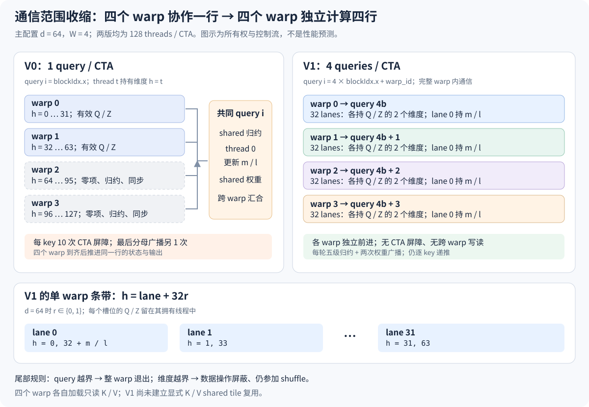
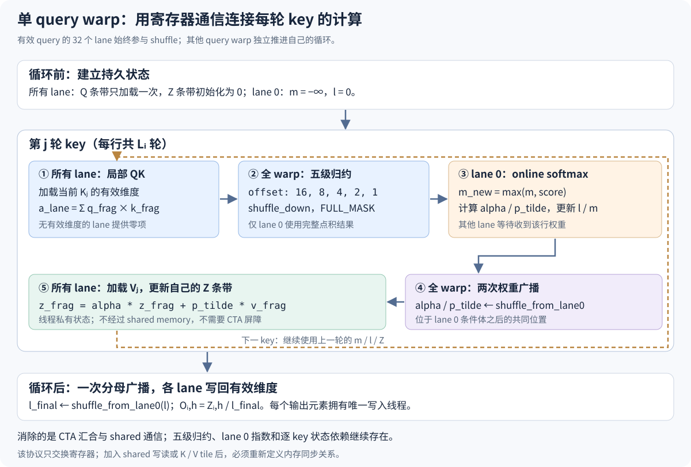

# 1. V1 优化设计：warp 内归约与多 query 工作分配

**本文保留优化前的理论设计与假设。** V1 的实际代码、编译运行与测量见 [编译执行文档](build-and-run.md) 和 [V1 性能分析](perf_v1.md)。父版本为 [V0 性能基线](../v0/perf_v0.md)，本设计展开其中 [第一阶段优化点 §1.7.1](../v0/perf_v0.md#L216-L220)。目标是在 FP32、逐 key online softmax 的算法框架内，将“一个 CTA 的四个 warp 协作处理一行”改为“每个 warp 独立处理一行，一个 CTA 处理四行”，以消除跨 warp 的归约、权重广播和 CTA 屏障。

本文使用 \(S\) 表示序列长度、\(d\) 表示 head dimension、\(W\) 表示每个 CTA 的 warp 数；主配置为 GTX 1060、CC 6.1、\(S=16384,d=64,W=4\)。文中的“多 query”指同一 CTA 处理多个 query **行**，与多查询注意力 MQA 的 K/V head 共享机制无关。V1 保持相同的 attention 数学定义，重新安排数据所有权与通信范围；浮点求和顺序会改变，数值验收采用既有容差。

建议按 [问题与证据](#problem) → [数学模型](#mathematical-model) → [线程映射](#mapping) → [warp 通信](#warp-communication) → [正确性证明](#correctness) → [复杂度与性能假设](#complexity) → [验证协议](#validation) 的顺序阅读。所有 V0 算法引用使用固定源码快照；后续开发源码的行号用于定位当前修改位置，不承担版本固定作用。

<a id="problem"></a>

## 1.1 问题定义与证据基础

### 1.1.1 V0 的计算粒度与通信粒度不匹配

V0 的 [线程映射](../v0/snapshot/fa2_forward.cu#L15-L35) 使用 128 threads，即 4 个 warp，处理一个 query 向量。每个线程持有一个维度的 Q 和输出分子；\(d=64\) 时，只有前 64 个线程参与有意义的 QK 乘法和输出向量更新，另外两个 warp 仍参加归约控制和同步。长度为 64 的点积最终只有一个标量结果，却要通过整个 CTA 的 shared memory 和屏障传播。

[逐 key 循环](../v0/snapshot/fa2_forward.cu#L37-L64) 的同步结构为：写入 shared 后 1 次屏障，128 项树形归约的 7 级各 1 次屏障，thread 0 更新 softmax 后 1 次屏障，各线程更新输出分子后再 1 次屏障，合计每个 query-key 对 10 次 CTA 屏障。[最终分母广播](../v0/snapshot/fa2_forward.cu#L66-L72) 另有 1 次屏障。现有 [SASS](../v0/data/sass.txt#L48-L236) 确认循环内保留了 10 个 `BAR.SYNC` 和 10 个 `MEMBAR.CTA` 静态位置。

这里的形式化问题是：attention 的不同输出行互相独立，但 V0 将同一行的少量计算分散到多个 warp，从而人为引入跨 warp 汇合。对于本阶段支持的 \(d\le128\)，一个 warp 可以让每个 lane 持有最多四个维度，完成该行的点积、标量递推和向量更新。通信范围因而可以收缩到 warp，CTA 内的其他 warp 可承担独立输出行。

### 1.1.2 优化动机与实测口径

以下均为已归档的 V0 数据，来源见 [V0 版本清单](../v0/manifest.json)、[正式 benchmark](../v0/perf_v0.md#formal-benchmark)、[stall 原因分布](../v0/perf_v0.md#stall-distribution) 和 [资源与发射分析](../v0/perf_v0.md#L190-L210)。

| 观察项 | V0 custom | 对 V1 设计的含义 |
|---|---:|---|
| 单次 forward CUDA Event 均值 | 2922.297 ms | 作为同形状、同口径比较的历史基线 |
| `stall_sync` | 45.266341% | 优先减少 barrier 及其形成的汇合等待 |
| `stall_exec_dependency` | 20.619948% | 移除 barrier 后，递推和 shuffle 依赖仍可能限制性能 |
| achieved occupancy | 99.7961% | 驻留 warp 已充足，优化目的在于改善有效工作与就绪程度 |
| eligible warps / active cycle | 3.110919 | 关注可发射工作是否增加 |
| issue slot utilization | 54.201824% | 检查发射利用率能否随工作组织改善 |
| 声明 shared / CTA | 524 B | V1 可以消除这部分 shared 通信工作区 |
| 寄存器 / thread | 17 | 作为 V1 编译资源的参照，不能直接推算 V1 寄存器数 |

`stall_sync` 是停顿原因统计中的比例，不是墙钟时间的 45.266341%。warp 的等待与其他 warp 的执行可以重叠，移除 barrier 还会改变指令数、依赖链和调度。因此不能用该比例套入 Amdahl 定律计算 V1 加速比，也不能把 2922.297 ms 乘以该比例作为同步的绝对耗时。指标定义见 [V0 stall 解释](../v0/nvprof-readable.md#stall-metrics)。

### 1.1.3 本阶段设计边界

V1 的首个实现固定 \(W=4\)、128 threads/CTA。一个 warp 对应一个 query，Q 与输出分子在线程寄存器中保持，QK 使用 warp shuffle 归约，softmax 由 lane 0 更新，权重和最终分母通过 shuffle 广播。输入继续采用连续二维 FP32 Q/K/V，支持 causal/non-causal 和 \(1\le d\le128\)。

逐 key 遍历、每 key 一次的 softmax 状态更新、K/V 的逐行逻辑重读、`expf` 以及最终归一化均沿用原框架。K/V shared tiling、tile softmax、异步预取、快速指数、其他 \(W\) 配置属于后续独立实验变量。这里的设计与 [FlashAttention-2 §3.3 的 query 分区原则](https://arxiv.org/html/2307.08691v1#S3.SS3) 一致；完整 FA2 还包含 tiling、矩阵计算和其他优化，论文在 A100 上的速度不能作为本 V1 在 Pascal 上的预测。

<a id="mathematical-model"></a>

## 1.2 数学模型与计算契约

### 1.2.1 输入、索引与输出

令 \(Q,K,V\in\mathbb{R}^{S\times d}\)，行与维度索引从零开始。对于 query 行 \(i\)，可访问的 key 集合及其长度定义为：

\[
J_i=\{0,\ldots,L_i-1\},\qquad
L_i=
\begin{cases}
S,&\text{non-causal},\\
i+1,&\text{causal}.
\end{cases}
\tag{1}
\]

缩放点积和输出定义为：

\[
s_{ij}=\frac{1}{\sqrt d}\sum_{h=0}^{d-1}Q_{ih}K_{jh},\qquad
O_{ih}=
\frac{\sum_{j\in J_i}\exp(s_{ij})V_{jh}}
{\sum_{j\in J_i}\exp(s_{ij})}.
\tag{2}
\]

不存在 dropout、任意外部 mask、batch/head 维度或 backward。本阶段保持 [V1 C++ 输入检查](snapshot/fa2_forward.cu#L98-L113) 与 [Python 支持检查](../../../../src/cuda_fa2_forward.py#L35-L57) 的既有契约：Q/K/V 同形状、同设备、连续 FP32，\(S,d>0\)，\(d\le128\)，元素数符合当前 32 位线性索引限制；输出由 `empty_like` 单独分配，输入仅被读取。

### 1.2.2 形式化证明的数值定义域

下文的算法等价证明在实数算术、有限 scores、有限 V 的条件下成立。实际 FP32 运算还需保证点积、状态及输出累积未溢出，正确性通过既有误差标准验收。仅“输入元素有限”不能保证 FP32 点积有限：极大的有限 Q/K 仍可能使乘法或求和溢出；归一化输入通常改善数值范围，但当前接口没有强制其来自 RMSNorm。

初始化的 \(m=-\infty\) 是算法哨兵，并不表示允许输入 NaN 或无穷大。V1 保留 V0 的 `isfinite(m)` 初始缩放处理；这一判断不能修复 \(s=+\infty\) 导致的 `inf-inf`，也不能定义 NaN 的 softmax 语义。非有限输入不在本设计的数值等价保证内，若将来要求支持，应另行定义契约与参考结果。

### 1.2.3 Online softmax 状态

处理该行前 \(n\) 个 key 后，状态为标量 \(m_i^{(n)}\)、\(\ell_i^{(n)}\) 与向量 \(z_i^{(n)}\in\mathbb{R}^d\)。初始值：

\[
m_i^{(0)}=-\infty,\qquad
\ell_i^{(0)}=0,\qquad
z_{ih}^{(0)}=0.
\tag{3}
\]

令当前 key 为 \(j=n\)。单步更新为：

\[
\begin{aligned}
m_i^{(n+1)}&=\max(m_i^{(n)},s_{in}),\\
\alpha_i^{(n)}&=
\begin{cases}
0,&n=0,\\
\exp(m_i^{(n)}-m_i^{(n+1)}),&n>0,
\end{cases}\\
\widetilde p_i^{(n)}&=\exp(s_{in}-m_i^{(n+1)}),\\
\ell_i^{(n+1)}&=\alpha_i^{(n)}\ell_i^{(n)}+\widetilde p_i^{(n)},\\
z_{ih}^{(n+1)}&=\alpha_i^{(n)}z_{ih}^{(n)}
                  +\widetilde p_i^{(n)}V_{nh}.
\end{aligned}
\tag{4}
\]

结束时 \(O_{ih}=z_{ih}^{(L_i)}/\ell_i^{(L_i)}\)。代码变量 `m/l/z/alpha/p_tilde` 分别对应 \(m/\ell/z/\alpha/\widetilde p\)；`l` 是字母 ell。V1 改变状态的物理所有权：`m/l` 属于该 query 的 lane 0，`z` 的各维度分属该 warp 的 lane，其他 query 的 warp 不访问这些状态。

<a id="mapping"></a>

## 1.3 CTA、warp、lane 与向量维度的映射

### 1.3.1 输出行的唯一所有权

设 CTA 编号为 \(b\)，CTA 内线程编号为 \(t\)，定义：

\[
T=32W=128,\qquad
w=\left\lfloor\frac t{32}\right\rfloor,\qquad
\lambda=t\bmod32,\qquad
i=bW+w.
\tag{5}
\]

其中 \(w\in\{0,1,2,3\}\) 是 warp 编号，\(\lambda\in\{0,\ldots,31\}\) 是 lane 编号。launch 的 grid 大小为 \(G=\lceil S/W\rceil\)。给定任意合法行 \(i\)，欧几里得除法唯一确定 \(b=\lfloor i/W\rfloor\)、\(w=i\bmod W\)，所以每行只由一个 warp 计算。



图 1：固定 128 threads/CTA 时的所有权变化。V1 的四个 warp 各自读取 K/V，图中的共用输入表示只读数据相同，不表示 shared tile 已实现。

### 1.3.2 lane 的维度分配与寄存器条带

令 \(R=\lceil d/32\rceil\le4\)。lane \(\lambda\) 负责的维度集合为：

\[
D_\lambda=\{\lambda+32r\mid 0\le r<R,\ \lambda+32r<d\}.
\tag{6}
\]

给定合法维度 \(h\)，唯一表示为 \(\lambda=h\bmod32,r=\lfloor h/32\rfloor\)。因此各 \(D_\lambda\) 两两不相交，且并集为全部 \(d\) 个维度。每个 lane 持有 `q_frag[r]` 和 `z_frag[r]`，Q 在进入 key 循环前加载，Z 初始化为零后持续累积。

| head dimension | 每 lane 的条带槽位 \(R\) | 有效维度示例 | 尾部处理 |
|---|---:|---|---|
| \(1\le d\le32\) | 1 | \(h=\lambda\) | \(\lambda\ge d\) 不加载，但参加归约与广播 |
| \(33\le d\le64\) | 2 | \(h=\lambda,\lambda+32\) | 第二条带对越界维度屏蔽加载和更新 |
| \(65\le d\le96\) | 3 | 再增加 \(h=\lambda+64\) | 第三条带按维度有效性屏蔽 |
| \(97\le d\le128\) | 4 | 再增加 \(h=\lambda+96\) | 第四条带按维度有效性屏蔽 |

首个实现建议以编译期 \(R=1,2,3,4\) 分派这四个范围，并展开短条带循环；运行期的 `h < head_dim` 仍需保留。这种范围分派用于固定寄存器数组索引与循环上界，不等同于对每个具体 \(d\) 单独调优。若使用始终四槽位的实现，则验证复杂度相同，但小 \(d\) 可能承担更多槽位和谓词开销；V1 的资源记录必须说明最终选择。

### 1.3.3 内存布局与尾部 CTA

固定条带 \(r\) 时，32 个 lane 访问连续的 `base + lane + 32*r` FP32 地址。对于 \(d=64\)，两条带分别覆盖相邻的两个 32 元素区间，保留合并访存的布局。任意 \(d\) 下行首对齐和末条带的 active lanes 不同，事务数由实际对齐、缓存及编译指令决定；“地址连续”不等于每次一定只发生一个硬件事务。

末尾 CTA 可能不足四行。条件 `qi >= seq_len` 在同一 warp 内相同，因此该 warp 的 32 个 lane 必须一起返回，且 guard 位于任何 Q 加载和 shuffle 之前。有效 warp 的所有 lane 继续运行，即使其中一些 lane 没有有效维度。**query 越界可整 warp 退出，维度越界只屏蔽数据操作。** 不允许用 `if (lane >= head_dim) return;` 处理小 \(d\)。

causal 情况下，每个 warp 使用自己的 \(L_i=i+1\)。不同 warp 循环次数可以不同：它们没有共同 barrier，也没有共享可写状态。相邻四行的 key 数最多相差三，某个 warp 结束后无需等待同 CTA 的其他 warp，但 CTA 资源何时整体释放仍受最后完成的 warp 影响。

<a id="warp-communication"></a>

## 1.4 Warp 内点积归约与状态广播

### 1.4.1 局部点积

对固定 query \(i\) 和 key \(j\)，每个 lane 计算：

\[
a_\lambda=\sum_{h\in D_\lambda}Q_{ih}K_{jh},\qquad
s_{ij}=\frac1{\sqrt d}\sum_{\lambda=0}^{31}a_\lambda.
\tag{7}
\]

无有效维度的 lane 令 \(a_\lambda=0\)。因此 \(d<32\)、非 32 倍数的 \(d\) 和全部四个条带范围都可以采用相同的 32-lane 归约，不需要构造稀疏参与 mask。`valid_dim` 决定加载与局部求和内容，shuffle mask 决定通信参与者，两者表示不同概念。

### 1.4.2 五级 shuffle 归约

所有有效 warp 的 32 个 lane 都在同一个程序位置使用 `FULL_MASK=0xffffffffu`，执行 offset 为 `16,8,4,2,1` 的 `__shfl_down_sync`。下面是独立通信原语的示意代码，只有 lane 0 的返回值用于 score：

```cpp
constexpr unsigned kFullWarpMask = 0xffffffffu;

__device__ float warp_sum(float value) {
    for (int offset = 16; offset > 0; offset /= 2) {
        value += __shfl_down_sync(kFullWarpMask, value, offset);
    }
    return value; // Only lane 0 contains the required complete sum.
}
```

正确性可由归约级别证明：完成 offset 为 \(\delta\) 的阶段后，对于 \(0\le\lambda<\delta\)，该 lane 的值包含原始 \(a_{\lambda+k\delta}\) 的和，其中 \(0\le k<32/\delta\)。下一阶段将两个不相交的子集合合并；\(\delta=1\) 时，lane 0 覆盖全部 32 项。高 lane 在某些阶段收到自己原有的值或形成重复部分和，其结果不会被当成完整 score；不要将上述 `warp_sum` 当成所有 lane 都得到总和的 all-reduce。

shuffle 在 warp 的寄存器间交换数据，不经过程序声明的 shared reduction 数组。语义依据为 [CUDA 12.8 编程指南 §10.22](https://docs.nvidia.com/cuda/archive/12.8.0/pdf/CUDA_C_Programming_Guide.pdf#page=223) 与 [NVIDIA warp primitives 的归约示例](https://developer.nvidia.com/blog/using-cuda-warp-level-primitives/)。五级 shuffle 是归约的通信链，V1 并没有消除这一依赖，只将其范围从 CTA 收缩到一个 warp。

### 1.4.3 lane 0 递推与两次权重广播

归约结束后，lane 0 计算 score 和式 (4) 的 `m/l/alpha/p_tilde`。所有 lane 在该条件分支结束后、同一无条件位置执行：

```cpp
float alpha = 0.0f;
float p_tilde = 0.0f;
if (lane == 0) {
    const float s = dot * scale;
    const float m_new = fmaxf(m, s);
    alpha = isfinite(m) ? expf(m - m_new) : 0.0f;
    p_tilde = expf(s - m_new);
    l = alpha * l + p_tilde;
    m = m_new;
}
alpha = __shfl_sync(kFullWarpMask, alpha, 0);
p_tilde = __shfl_sync(kFullWarpMask, p_tilde, 0);
```

非 lane 0 的输入值初始化为零，使每个 lane 的原语参数都已定义；广播结果来自 lane 0。随后各 lane 用收到的权重更新自己的所有有效 `z_frag`。结束 key 循环后，再以一次 `__shfl_sync(..., l, 0)` 广播最终分母。

不选择让所有 lane 重复更新 softmax 状态：它虽能减少某些广播，却可能把每行的指数和标量计算复制到 32 个 lane。V1 保留每 query-key 对一次 lane 0 递推与两次权重广播，便于把实验变化集中在工作分区和通信机制。

### 1.4.4 Pascal 的参与与收敛约束

Pascal 及更早架构要求 mask 中的线程在收敛状态执行同一 warp intrinsic，参与 mask 的并集应与该 warp 的 active mask 一致；不能照搬 Volta 上两条 divergent 分支分别执行同 mask shuffle 的示例。该架构差异明确记录在 [CUDA 12.8 编程指南 §19.6.2](https://docs.nvidia.com/cuda/archive/12.8.0/pdf/CUDA_C_Programming_Guide.pdf#page=504)。本设计通过以下结构满足约束：

1. CTA 大小为 32 的整数倍，每个 query 的参与集合固定为完整 warp。
2. 无效 query 在通信前整 warp 退出；有效 query 不进行 lane 级提前退出。
3. 归约和广播位于所有有效 lane 共同经过的位置，不放进 `h < d` 或 `lane == 0` 的条件体内。
4. `ki < key_limit` 对同一 warp 的所有 lane 相同；lane 0 标量分支结束后统一执行广播。

shuffle 的 `_sync` 语义保证所指定寄存器交换的参与条件，**不提供通用的内存排序保证**。V1 不通过 shared memory 进行 lane 间通信，Q/K/V 不由 kernel 写入，各 lane 的 Z 又是线程私有，因此无需为当前寄存器协议额外加入 `__syncwarp()`。如果以后增加跨线程 shared 写读，必须重新建立内存同步协议，不能将这里的结论直接延用。参见 [CUDA §10.22.2 的内存排序说明](https://docs.nvidia.com/cuda/archive/12.8.0/pdf/CUDA_C_Programming_Guide.pdf#page=224)。

<a id="algorithm"></a>

## 1.5 完整算法规格与实现位置

### 1.5.1 按数据所有权组织的算法

下面为实现规格的伪代码。`warp_sum_to_lane0` 使用 §1.4.2 的五级归约；条带数组与索引应在最终实现中以编译期 \(R\) 展开。

```text
Input: contiguous FP32 Q, K, V of shape (S, d); causal flag
Parameters: W = 4, T = 32W, R = ceil(d / 32)
Launch: ceil(S / W) CTAs, T threads per CTA

w    = threadIdx.x / 32
lane = threadIdx.x % 32
qi   = blockIdx.x * W + w
if qi >= S:
    return                         // Same decision for the entire warp.

for r in 0 .. R-1:
    h = lane + 32*r
    q_frag[r] = Q[qi, h] if h < d else 0
    z_frag[r] = 0
m = -infinity; l = 0
key_limit = qi + 1 if causal else S

for ki in 0 .. key_limit-1:
    partial = 0
    for r in 0 .. R-1:
        h = lane + 32*r
        if h < d:
            partial += q_frag[r] * K[ki, h]
    dot = warp_sum_to_lane0(partial) // All 32 lanes execute it.

    alpha = 0; p_tilde = 0
    if lane == 0:
        s = dot / sqrt(d)
        m_new = max(m, s)
        alpha = exp(m - m_new) if isfinite(m) else 0
        p_tilde = exp(s - m_new)
        l = alpha*l + p_tilde
        m = m_new
    alpha   = shuffle_from_lane0(alpha)
    p_tilde = shuffle_from_lane0(p_tilde)

    for r in 0 .. R-1:
        h = lane + 32*r
        if h < d:
            z_frag[r] = alpha*z_frag[r] + p_tilde*V[ki, h]

l_final = shuffle_from_lane0(l)
for r in 0 .. R-1:
    h = lane + 32*r
    if h < d:
        O[qi, h] = z_frag[r] / l_final
```



图 2：单个 query warp 的状态与通信协议。图中 key 循环依赖仍存在；其他 query warp 可以独立前进，不需要每轮到齐。

### 1.5.2 从 V0 到 V1 的修改映射

| V0 归档位置 | V1 归档位置 | 优化后的组织 |
|---|---|---|
| [常量与 shared 声明](../v0/snapshot/fa2_forward.cu#L15-L25) | [常量与 warp_sum](snapshot/fa2_forward.cu#L15-L26) | 分开定义 warp size、warps/CTA、max head dimension；删除 reduction 与权重 shared |
| [query/dim 所有权](../v0/snapshot/fa2_forward.cu#L27-L35) | [V1 线程映射](snapshot/fa2_forward.cu#L33-L52) | 计算 warp/lane/qi，添加整 warp 行尾 guard，建立条带 Q/Z |
| [shared 树形归约](../v0/snapshot/fa2_forward.cu#L37-L46) | [V1 归约](snapshot/fa2_forward.cu#L54-L63) | 局部条带点积和五级 warp shuffle |
| [thread 0 状态与广播](../v0/snapshot/fa2_forward.cu#L49-L58) | [V1 标量更新](snapshot/fa2_forward.cu#L65-L77) | 每 warp 的 lane 0 更新，分支后两次寄存器广播 |
| [输出更新与归一化](../v0/snapshot/fa2_forward.cu#L60-L72) | [V1 Z 与输出](snapshot/fa2_forward.cu#L79-L96) | 更新每 lane 多个 Z，最后 warp 内广播 L |
| [launch](../v0/snapshot/fa2_forward.cu#L102-L109) | [V1 launch](snapshot/fa2_forward.cu#L134-L148) | grid 改为 ceil(S/4)，block 仍为 128，按 R 进行范围分派 |

warp reduction 可抽取为短小的独立 device 函数；条带循环用固定上界模板表达。`kMaxHeadDim` 应独立保持 128，避免以后试验 \(W=1,2,8\) 时因 threads/CTA 改变而无意改变输入支持范围。host grid 的 ceiling division 可写为 `1 + (seq_len - 1) / W`；该形式避免一般情况下 `seq_len + W - 1` 的 32 位溢出。线性元素索引仍遵循当前 `numel <= INT_MAX` 约束。

<a id="correctness"></a>

## 1.6 正确性、不变式与无跨 warp 同步的证明

### 1.6.1 命题一：完整覆盖与唯一写入

由式 (5)，每个合法 query 行恰好对应一个 \((b,w)\)。由式 (6)，每个合法维度恰好对应一个 \((\lambda,r)\)。两者相乘给出每个 \(O_{ih}\) 的唯一线程与槽位，最终写入一次；行尾和维度尾部的 guard 排除所有非法地址。这同时证明输出完整覆盖与不同线程的输出写集合不相交。

### 1.6.2 命题二：warp score 等于目标点积

集合 \(D_\lambda\) 构成全部合法维度的分割，式 (7) 的局部和不会漏项或重复。五级 shuffle 在 lane 0 汇集全部 \(a_\lambda\)，随后乘以相同 scale，故在实数算术下所得 score 等于式 (2)。FP32 下乘加和树形合并顺序与 V0 不同，这一命题表示数学等价，不表示逐 bit 等价。

### 1.6.3 命题三：online softmax 的状态不变式

对于 \(n\ge1\)，状态满足：

\[
\begin{aligned}
m_i^{(n)}&=\max_{0\le j<n}s_{ij},\\
\ell_i^{(n)}&=\sum_{0\le j<n}\exp(s_{ij}-m_i^{(n)}),\\
z_{ih}^{(n)}&=\sum_{0\le j<n}\exp(s_{ij}-m_i^{(n)})V_{jh}.
\end{aligned}
\tag{8}
\]

证明：\(n=1\) 时，\(\alpha=0,\widetilde p=1\)，得到 \(m=s_{i0},\ell=1,z_h=V_{0h}\)，与式 (8) 一致。若不变式在 \(n\) 成立，则旧权重经 \(\alpha=\exp(m^{(n)}-m^{(n+1)})\) 缩放后，恰好变为 \(\exp(s_{ij}-m^{(n+1)})\)；加上当前 key 的 \(\widetilde p V\) 与 \(\widetilde p\)，得到 \(n+1\) 的不变式。归纳完成。

最终 \(\ell\) 与 Z 共享同一指数平移，除法消去 \(\exp(-m)\)，得到式 (2)。有限 scores 下至少一个项取权重 1，实数模型有 \(1\le\ell_i^{(n)}\le n\)，最终分母非零。大负差值指数在 FP32 中下溢为零仍属于浮点误差问题，不破坏需要验证的程序参与规则。

### 1.6.4 命题四：因果边界成立

每个 warp 只处理 \(j<L_i\)。causal 时 \(L_i=i+1\)，因此不会将 \(j>i\) 的 K/V 计入输出；各 query 的循环边界互相独立。对固定 \(i\)，改变未来位置 \(j>i\) 的 K/V 不应改变 \(O_i\)，这是后续因果性测试的可观测判据。\(i=0\) 时只处理一个 key，所以 \(O_0=V_0\)，与 Q/K 的有限具体取值无关。

### 1.6.5 命题五：可删除 CTA barrier 的充分条件

任意两个不同 query warp 的可写集合只含各自线程寄存器与不相交的输出行；Q/K/V 是只读集合。它们没有“一个 warp 写、另一个 warp 读”的生产者消费者边，也没有需要到齐的 shared 工作区，因此不存在跨 warp 的 happens-before 要求。

同一 warp 内，唯一跨 lane 的数据边是局部点积汇入 lane 0、lane 0 权重传向其他 lane，以及最终 L 广播；这些边全部由显式 shuffle 表达。每个 Z 槽位的读写由同一线程按程序顺序完成。由 §1.4.4 的完整参与规则，归约与广播有效，所以 V0 的循环内与最终 CTA barrier 均可删除。该结论依赖“无 shared 通信、无跨 warp 写读”的前提；未来 K/V tiling 会改变前提，必须重新证明。

<a id="complexity"></a>

## 1.7 工作量、通信量、空间复杂度与可并行性

### 1.7.1 Query-key 对与屏障实例

令 \(P=\sum_{i=0}^{S-1}L_i\)，则：

\[
P=
\begin{cases}
S^2,&\text{non-causal},\\
S(S+1)/2,&\text{causal}.
\end{cases}
\qquad
B_0=10P+S,\qquad B_1=0.
\tag{9}
\]

\(B_0\) 是全网格所有 CTA 的动态 barrier 实例之和；V1 在满足上述通信协议时不含 CTA barrier。此计数不是全 GPU 串行步骤数，也不是 warp 等待周期数。

V1 每 query-key 对有 5 次归约 shuffle 与 2 次权重广播，每行最后另有 1 次分母广播，源码层面的动态 warp collective 调用总数为 \(C_1=7P+S\)。计数以一个 warp 执行一次 collective 为单位，不以 32 个 lane 各调用一次来重复计数，也不承诺编译后每个原语恰好对应一条 SASS 指令。

| 结构量，\(S=16384,d=64\)，non-causal | V0 | V1 理论值 |
|---|---:|---:|
| query-key 对 \(P\) | 268435456 | 268435456 |
| CTA 数 | 16384 | 4096 |
| query / CTA | 1 | 4 |
| warp / query | 4 | 1 |
| 启动的 thread 总数 | 2097152 | 524288 |
| 全网格 CTA barrier 实例 | 2684370944 | 0 |
| 源码层 warp shuffle collective 调用 | 0 | 1879064576 |
| 每行跨 key 状态更新次数 | 16384 | 16384 |

causal 下 \(P=134225920\)，V0 barrier 为 1342275584，V1 shuffle collective 为 939597824。causal 的结果应独立测量，不能与上述 non-causal 延迟混合比较。

### 1.7.2 算术与通信复杂度

两版有意义的 QK 点积与 PV 累积工作均为 \(\Theta(Pd)\)，标量 online softmax 为 \(\Theta(P)\)，最终输出写入为 \(\Theta(Sd)\)。V0 的固定 128 项归约每对有 7 级 shared 通信，V1 每 lane 局部工作为 \(O(R)\)、warp 归约有 \(\log_2 32=5\) 级；这里 32 和 128 是硬件与配置常数，整体算术阶仍为 \(\Theta(S^2d)\)。

减少通信级数不必然减少每个 lane 执行的浮点加法总数。V0 的 128 项树形归约有 127 次标量加法，其中包含零项；§1.4.2 的简单 shuffle 写法名义上让 32 个 lane 在五级都执行加法，即 160 次 lane 加法，再加条带局部求和。对于 \(d=64\)，每 lane 两个乘积也需要合并。高 lane 的部分结果并未用于最终 score，但全 warp 指令能避免逐级 CTA 汇合；不能仅用标量 FLOP 数预测耗时。最终机器指令及其谓词执行由 SASS 和 profiler 判定。

此设计采用全 warp 归约以保持简单、统一的协议。若进一步只让有效的低 lane 做某级加法，应保持 shuffle 本身全员参与，并将该实现变体单独核验；其收益取决于指令发射、谓词与依赖，不能预先认定优于当前方案。

### 1.7.3 空间与逻辑访存

V0 每 CTA 声明 524 B shared。V1 当前协议不需要声明 shared memory，Q/Z 的持久槽位为每 lane 各 \(R\) 个 FP32 数，即约 \(2R\) 个 32 位数据槽位；还需索引、临时 K/V、partial、权重及 lane 0 状态。数据槽位计数不是最终 ptxas 的 registers/thread，编译器可复用、拆分或 spill。

V1 每 CTA 的持久向量槽位为 \(O(32WR)\)，即按实际有效维度理解的 \(O(Wd)\) 加上至多一个条带的补齐；global 输出仍为 \(O(Sd)\)，不物化 \(S\times S\) 的 scores 或 probabilities。寄存器数组只有经编译器标量化且没有 spill 才实际留在寄存器中，需检查 [编译和二进制验证协议](#binary-validation)。

不含缓存、spill 与事务放大的逻辑 Q/K/V 读取及 O 写入字节量为：

\[
\text{Q read}=4Sd,\qquad
\text{K/V read}=8Pd,\qquad
\text{O write}=4Sd.
\tag{10}
\]

主配置下 Q 与 O 各 4 MiB，K/V 合计 128 GiB；V1 仍是相同的逻辑 K/V 读取量。四个 query warp 即使在相近时间读取同一 K/V 行，也各自执行加载；cache 可能产生隐式复用，实际 DRAM/L2 事务因调度变化而变化。显式 K/V tile 复用尚未建立，因此不能宣布访存减少四倍，也不能承诺 DRAM 字节保持严格相同。

### 1.7.4 可并行部分与保留的关键路径

输出行之间完全独立，CTA 内四个 query warp 可并行推进；每个 key 的 32 个 lane 可并行计算维度乘积和自己的 Z 更新，lane 内多个条带提供少量独立指令机会。但每行的下一轮 `m/l/z` 依赖上一轮，lane 0 的指数与标量递推也位于关键路径，V1 不将其从 \(L_i\) 轮缩短为 key tile 数量。

全网格分配给每行的 warp 数从 4 降为 1。若两个版本均能达到相同驻留 warp 上限，且暂不考虑其他资源约束，那么单位驻留 warp 资源可容纳的独立 query 行数理论上增加四倍；该关系只是资源映射，不表示 active warp 数、occupancy 或吞吐会增加四倍。V1 每 lane 更多 Q/Z 槽位可能降低驻留数量，而每行点积维度并行度又从 64 个有效线程变为 32 个 lane 分别处理两个维度，单行局部工作有所增加。

主配置的 4096 个 CTA 仍远多于 V0 记录的 10 个 SM，足以提供大量待调度工作；短序列则可能只启动少量 CTA，需单独考虑填充不足和尾部 warp，但本阶段的性能对比继续固定 \(S=16384\)。增加 \(W\) 不会凭空增加行间独立工作，只改变分组、资源分配和尾部粒度。

<a id="performance-hypotheses"></a>

## 1.8 优化前的理论预期与可证伪假设

### 1.8.1 结构承诺、指标假设与时间结果分别判定

本设计的强预期是：CTA barrier 与 shared 归约/权重通信被删除，每个 warp 获得独立 query，grid 缩小为 ceil(S/4)。性能方向假设是：跨 warp 汇合减少后，warp 更容易就绪，单次 forward 延迟下降。速度倍数、精确 registers/thread、occupancy 和新的主 stall 原因均待实测。

| 编号 | 预期及其性质 | 后续判定方法 |
|---|---|---|
| H1 | CTA barrier 为零；结构承诺 | kernel 源码无 CTA barrier，SASS 无该协议的 `BAR.SYNC/MEMBAR.CTA` |
| H2 | shared reduction 和权重工作区消失；结构承诺 | kernel 无对应 shared 声明，资源与 SASS 无这些 shared 读写 |
| H3 | grid=4096、block=128、四行/CTA；结构承诺 | launch trace、线程映射和尾部正确性核验 |
| H4 | `stall_sync` 的 CTA 屏障来源应大幅减少；指标假设 | 核对原语编译结果与指标，不要求整体 `stall_sync` 精确等于零 |
| H5 | eligible warps 或 issue utilization 改善；指标假设 | 同口径采集，结合递推与资源变化解释 |
| H6 | 正式延迟低于 V0；性能假设 | 无 profiler 重复计时，保留所有组样本及同环境 V0 复跑 |
| H7 | K/V 逻辑读取、每行递推轮数不变；结构承诺 | 索引与循环计数核验，缓存事务另作实测观察 |
| H8 | 既有数值容差与输入契约继续成立；验收条件 | CPU FP64、边界、因果性、未修改输入与输出属性测试 |

删除 CTA barrier 后，warp 内 shuffle 同步和数据依赖仍存在，profiler 的 stall 分类也可能受到机器指令与采集方式影响，所以 H4 的验收核心是屏障来源是否消失。`stall_exec_dependency` 的相对比例可能上升：其他原因减少后分母组成发生变化，且 shuffle/online softmax 成为更显著的依赖；这不单独证明绝对延迟恶化。

### 1.8.2 性能模型的适用范围

令 \(T_0,T_1\) 为同环境、无 profiler 的单次 forward 时间，速度比 \(F=T_0/T_1\)。\(F\) 由测量给出。结构上同时发生：shared 通信和 CTA 屏障减少、warp 归约链引入、lane 局部工作增加、驻留资源改变、cache 访问时序改变。这些因素在 GPU 上重叠，不能把各自成本机械相加为唯一的耗时预测。

可以做方向性判断：V0 的跨 warp 汇合是有证据的优化对象，V1 明确删除相应生产者消费者链；但 \(F=4\)、达到 efficient 的 35.913 ms 或达到论文硬件上的某种效率都没有本阶段证据支持。主配置 efficient 结果只作为最终性能差距的参照，首个优化的验收不要求追平它。

### 1.8.3 结果不符合预期时的解释路径

如果 H1–H3 成立而延迟改善有限，优先检查 lane 0 的 `expf`、shuffle 依赖、每 lane 多槽位更新与 memory dependency，而后核对寄存器 spill 和 occupancy。如果同步指标下降但 issue utilization 没有改善，说明等待可能迁移到新的关键路径；如果 DRAM/L2 事务变化，先分析 cache 和调度，而不是把它归为已经完成的 tiling。

若源码结构符合设计但 SASS 仍保留 CTA 屏障，首先排查是否加载旧二进制、模板实例或编译器生成代码。若 `d=64` 改善而小 \(d\) 退化，检查完整 warp 的固定归约成本与低有效维度数；保持 \(1\le d\le128\) 的正确性与目标形状性能分别评价。

<a id="validation"></a>

## 1.9 实现后的验证协议

### 1.9.1 数值等价与容差

既有 [CPU FP64 验证函数](../../../../src/numerical_verification.py#L10-L38) 使用数学 SDPA 参考，`rtol=atol=2e-5`。V1 首先维持该阈值，不因重新排序点积而自动放宽。比较规则为逐元素：

\[
|O_{\mathrm{V1}}-O_{\mathrm{ref}}|
\le 2\times10^{-5}
   +2\times10^{-5}|O_{\mathrm{ref}}|.
\tag{11}
\]

同时记录最大绝对误差以及非有限输出数量。V0/V1 直接比较是回归证据，独立 FP64 参考才用于区分共同偏差；逐 bit 相等不是验收条件。点积重排、FMA 生成与误差对 max/exp 的传播可能改变结果，保持 `-O2`、`expf` 和既有精度设置便于控制实验变量。

### 1.9.2 必须覆盖的边界与语义用例

原有 [数值测试](../../../../tests/test_cuda_fa2_forward.py#L43-L81) 覆盖 `(1,1)、(7,3)、(65,64)、(129,96)、(257,128)` 的 causal/non-causal，但 V1 的四行/CTA 与多条带映射引入了新的边界。以下保留优化前拟定的验证范围；实际新增用例与运行结果见编译执行文档。

| 验证对象 | 建议用例 | 需要发现的问题 |
|---|---|---|
| CTA query 尾部 | \(S\in\{1,2,3,4,5,7,65\}\)，\(d=64\) | 整 warp guard、越界读写、漏行 |
| 条带分派边界 | \(S=7\)，\(d\in\{1,3,31,32,33,63,64,65,95,96,97,127,128\}\) | 范围分派、条带尾部、零填充和有效维度屏蔽 |
| 支持范围完整性 | \(S=5\)，遍历 \(d=1,\ldots,128\) | 任意合法 d 的覆盖、非幂次维度与映射唯一性 |
| 基础 oracle | causal 且 \(S=1\)；Q 或 K 全零 | 前者 \(O=V\)；后者对合法 key 的 V 做算术平均 |
| 因果隔离 | 固定 query \(i\)，修改 \(j>i\) 的 K/V | 未来位置不得影响当前输出 |
| 状态缩放 | 可控有限 scores，覆盖旧最大值保持、更新、多次切换 | \(\alpha\)、Z 与 L 是否使用同一轮最大值 |
| 浮点敏感输入 | 多个 seed、符号交替的 Q/K、可控较大 score 差 | 重排与抵消误差、权重下溢、状态更新顺序 |
| 接口回归 | 非连续、CPU、\(d=129\)，以及输出属性、输入副本 | 既有拒绝规则与只读输入契约 |

上述有限输入数值用例均执行 causal/non-causal；因果专用用例按其定义执行。可控 score 的构造可固定 Q 只有一个非零分量，并令 K 的对应分量产生指定 score 序列，再用简单 V 核对结果；这是正确性输入设计，不是性能数据。现有 [接口测试](../../../../tests/test_cuda_fa2_forward.py#L28-L34) 和 [其他拒绝用例](../../../../tests/test_cuda_fa2_forward.py#L127-L142) 继续保留。

主性能形状 \(S=16384,d=64\) 应增加低内存的大序列验证：选择 query 行 `0,1,3,4,8191,16383`，在 CPU FP64 中逐行计算该 query 对全部合法 K 的点积与 softmax，再乘 V。这样不必生成整个 \(S^2\) 参考矩阵；额外参考工作区可为 \(O(S+d)\)，输入 CPU 副本为 \(O(Sd)\)。这一用例验证长递推及首尾位置，不能声明覆盖了全部输出行。

### 1.9.3 通信、越界与编译资源

完整 mask 的正确性首先来自控制流审查和 §1.6 的所有权证明。若环境中的 CUDA 检查工具支持该 Pascal 设备，可额外执行 memcheck/synccheck；工具不可用不能视为测试通过，也不应为文档阶段提前启动工具。不同 query warp 的循环长度及提前退出需结合 causal 与尾部用例检查。

<a id="binary-validation"></a>

V1 使用 [统一编译执行流程](build-and-run.md)，在新的 Python 进程中确认实际扩展路径、SHA-256、源码快照与目标架构。仅修改 `.cu` 不会使 [Python 导入逻辑](../../../../src/cuda_fa2_forward.py#L16-L32) 自动重建扩展。编译 flags 由 [统一脚本](../../../../cpp_cuda/fa2/build_extension.py) 和本轮 manifest 记录，其中 `--ptxas-options=-v` 为资源诊断参数。

针对实际 `.so` 提取资源和 SASS：核对目标 `sm_61` kernel、shuffle 指令、CTA barrier、shared 读写、registers/thread、stack/local memory 和可能的 spill。不能只检索整个 `.so` 的某个指令字符串；范围分派可能产生多个 kernel 实例，每个实例应独立定位，主性能测量明确对应 \(R=2\)。V0 的资源与 SASS 参照见 [资源统计](../v0/data/resources.txt) 和 [反汇编](../v0/data/sass.txt)。

### 1.9.4 无 profiler 性能测量

首次 V1 性能比较继续固定 GTX 1060、FP32、\(S=16384,d=64\)、non-causal、TF32 关闭、seed 0、CPU threads 1、5 次 warmup、每组 20 次 forward、5 组重复。脚本默认 causal 已开启，所以必须显式传 `--no-causal`。测量函数将每组 Event/wall 时间除以调用次数，见 [measure_latency](../../../../src/benchmark_measurement.py#L18-L50)。

以下为 V1 选择入口；完整构建、验证与运行命令以 [编译执行文档](build-and-run.md) 为准：

```bash
# Working directory: FA
/home/dengxiao/miniconda3/envs/nanovllm/bin/python -E -s -B \
   -m tests.test_cuda_fa2_forward --device cuda --impl cuda_fa2_v1

/home/dengxiao/miniconda3/envs/nanovllm/bin/python -E -s -B \
  -m scripts.benchmark_attention \
  --device cuda --impl cuda_fa2_v1 --seq-len 16384 --head-dim 64 \
  --warmup 5 --iterations 20 --repeats 5 --threads 1 --seed 0 \
  --no-causal --no-verify \
  --output-json docs/cuda-fa2/measurements/v1/data/benchmark-custom.json
```

`--no-verify` 仅避免计时入口物化大规模 CPU FP64 全矩阵参考；必须先完成独立正确性验证，不表示已证明大形状正确。以上现有测试入口在实现时应包含 §1.9.2 新增用例。

常规优化直接引用 V0 已归档的正式均值 2922.2971875 ms，并报告 \(F=T_0/T_1\)；原始样本、条件和二进制身份见 [V0 manifest](../v0/manifest.json) 与 [V0 evidence](../v0/data/evidence.json)。只运行新版本，不将 V0 复跑作为每轮固定步骤。确需校准环境变化时另开独立实验，历史基线与新结果的轮次差异在报告中说明。

### 1.9.5 硬件计数器与结果归档

GTX 1060 的采集继续沿用 V0 的 `nvprof` 路线，机制与同口径命令见 [计数器复现](../v0/perf_v0.md#counter-reproduction)。至少比较 occupancy、eligible warps、issue utilization、warp/nonpred execution efficiency、sync/exec/memory/other stalls、DRAM/L2 transactions 和吞吐；V0 指标直接引用归档数据，kernel filter 匹配 V1 实际模板符号并放在 `--metrics` 前，采集边界使用 [cudaProfilerStart/Stop](../../../../scripts/profile_attention.py#L75-L90)。

多指标可能引发 kernel replay。采集耗时不能替代正式 benchmark，吞吐与独立 benchmark 时间不能相乘来宣称同一次执行的实际字节数。V0 custom 的 `sm_efficiency` 有溢出，若 V1 或复跑仍溢出则保留标记，不能赋值为零或拿其他利用率替代。

每版 `snapshot/` 仅保留核心 CUDA 实现，实际 `.so` 归档到 `binaries/`；公共文件引用工作区，V0 资料引用其原目录。`manifest.json`、`data/` 和需要的 `profiles/` 记录父版本、源码与二进制哈希、编译器与 flags、模板与 launch 参数、环境、条件及原始样本。结果逐项对照 H1–H8，将结构成立、指标变化与延迟收益分开判定；本设计文件保留优化前预期。目录与文件名不使用日期。

<a id="references"></a>

## 1.10 文献关系与证据索引

### 1.10.1 方法来源与适用关系

[FlashAttention-2 §3.3](https://arxiv.org/html/2307.08691v1#S3.SS3) 通过沿 query 方向划分 warp 的工作，使不同 warp 负责不同输出区域，从而减少需要跨 warp 汇集的中间结果。这为 V1 的行所有权提供方法背景。本文的“一个 warp 一行、逐标量 key 扫描”是针对当前教学 kernel 与 Pascal 的具体设计，不是论文 tile kernel 的逐行移植。

[CUDA 编程指南](https://docs.nvidia.com/cuda/archive/12.8.0/pdf/CUDA_C_Programming_Guide.pdf) 定义 shuffle、参与 mask 和架构约束；[NVIDIA warp primitives 技术文章](https://developer.nvidia.com/blog/using-cuda-warp-level-primitives/) 提供归约、广播和 shared 内存同步的程序示例。本项目的 V0 源码与 SASS 独立确认实际 barrier 链，计数器与无 profiler 计时确认其性能背景。API 语义以 NVIDIA 定义为准，算法等价由本文推导，V1 速度则等待实验；外部材料不替代本项目测量。

### 1.10.2 来源与具体支持范围

| 来源 | 本文使用范围 |
|---|---|
| [V0 §1.7.1](../v0/perf_v0.md#L216-L220) | 本优化点的父版本决策与范围 |
| [V0 已归档核心源码](../v0/snapshot/fa2_forward.cu#L15-L72) | 线程映射、shared 归约、10 次逐 key barrier 与 online softmax；在 V0 原目录直接引用 |
| [V0 manifest](../v0/manifest.json) | 实际测量二进制、源码来源、主测量配置与历史计时 |
| [V0 SASS](../v0/data/sass.txt#L48-L236) / [资源](../v0/data/resources.txt) | 已编译同步结构与资源基线 |
| [CUDA 12.8 §10.22，印刷页 207–209](https://docs.nvidia.com/cuda/archive/12.8.0/pdf/CUDA_C_Programming_Guide.pdf#page=223) | warp shuffle 的寄存器通信、参与与内存排序规则 |
| [CUDA 12.8 §19.6.2，印刷页 487–488](https://docs.nvidia.com/cuda/archive/12.8.0/pdf/CUDA_C_Programming_Guide.pdf#page=504) | Pascal 与 Volta 在 warp primitive 收敛约束上的差异 |
| [Using CUDA Warp-Level Primitives](https://developer.nvidia.com/blog/using-cuda-warp-level-primitives/) | 五级归约、lane 0 广播、mask 与 shared 同步示例 |
| [Tri Dao，FlashAttention-2 §3.1–§3.3](https://arxiv.org/html/2307.08691v1#S3) | online softmax、行并行与 warp 工作分区的算法背景 |
| [现有数值验证](../../../../src/numerical_verification.py#L10-L38) | CPU FP64 oracle 与 `rtol=atol=2e-5` |

图 1、图 2 是由本设计的线程所有权与依赖关系绘制的 SVG 示意图，不含模拟测量或预测性能数据。本文的结构计数由式 (5)、式 (9) 及算法控制流推导；V1 的实际延迟、资源与硬件指标单独记录在性能文档中。
