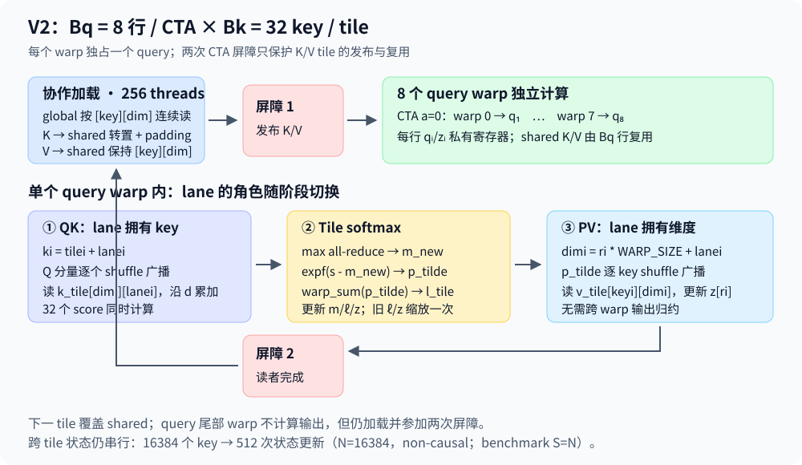

# 1. V2 优化设计：共享 K/V tile 与分块 online softmax

V2 的优先优化对象是 **K/V 加载组织与逐 key 的 softmax 状态依赖链**。首版采用 8 个 query / CTA、32 个 key / tile、FP32 SIMT：CTA 协作加载 K/V，每个 query warp 并行计算 32 个 score，再统一更新一次 `m/l/z`。保持一个 warp 独占一行输出，保持 `expf` 与最终归一化，不引入 Tensor Core、快速指数或跨 CTA 合并。代码位于 [V2 核心实现](../../../../cpp_cuda/fa2/v2/fa2_forward.cu)，构建与采集见 [复现文档](build-and-run.md)，实际结果见 [perf_v2](perf_v2.md)。

本文记录首版结构假设与推导，速度、寄存器和 counters 由实际实验另行判定。建议按 §1.1 证据 → §1.2 数学递推 → §1.3 数据映射 → §1.4 同步与边界 → §1.5 复杂度 → §1.6 假设与验收阅读。

## 1.1 优先级与 V1 证据

### 1.1.1 当前瓶颈的可确定部分

[V1 性能报告](../v1/perf_v1.md#L3-L5) 的主形状为 GTX 1060、FP32、\(S=16384,d=64\)、non-causal：Event 均值 348.178 ms，对照 efficient 37.911 ms。V1 已删除 CTA barrier，`stall_sync=0%`；occupancy 98.5105%、issue utilization 71.425499%，说明继续单纯增加驻留 warp 不具有足够优先级。

| V1 证据 | 可支持的判断 | 对 V2 的要求 |
|---|---|---|
| memory dependency 39.899801% | 加载及其消费者存在显著等待，值得调整请求组织 | 将跨 query 的隐式缓存复用改为 CTA 内显式 K/V 复用 |
| exec dependency 21.597141% | shuffle、指数与递推仍可能限制就绪指令 | 将每 key 更新变为每 tile 更新 |
| DRAM read 0.603042352 GB/s、L2 read 40.276353 GB/s | 没有证据表明 DRAM 带宽饱和 | 不以“128 GiB 全部来自显存”建立带宽模型 |
| global load efficiency 100% | 主形状的合并访存已成立 | 保持连续 global 加载，关注重复请求和依赖 |
| 无 spill、shared 0 B | V1 没有为显式数据复用付出 shared 成本 | 核验 V2 新增 shared、barrier 与资源限制 |

原始来源为 [V1 counters](../v1/data/counters.json)、[吞吐与事务解释](../v1/perf_v1.md#memory-throughput)、[V1 资源](../v1/data/resources.txt)。停顿百分比不是墙钟时间占比，不能按 39.900% 或 21.597% 推导速度上限。V1 的 [key 循环](../../../../cpp_cuda/fa2/v1/fa2_forward.cu#L54-L87) 独立确认：每个 query-key 都加载 K/V、做五级点积归约、两次权重广播，并更新 `m/l/z`。这是优化对象的结构证据。

### 1.1.2 为什么先组合 tiling 与 tile softmax

仅把 K/V 搬入 shared、仍逐 key 更新状态，会保留原递推链并引入 CTA 屏障；仅替换指数近似改变精度与计时因素，却不改变请求重复；仅改变 warp 数也不缩短单行递推。V2 同时修改加载与计算粒度，便于建立完整 tile 协议。它是一个组合实验，不能把全部速度变化单独归因于 shared 或 softmax 中的一项；若需要因果分解，后续可另存消融实验。

[FlashAttention 教材 §4–5](../../../../../notes/03_02_flash_attention_2_beginner_textbook.md#L437-L726) 与 [课程 handout Algorithm 1](../../../../../notes/cs336_assignment2_systems_extracted.md#L1111-L1132) 给出本文采用的分块 online softmax 与未归一化输出累积公式；[FlashAttention-2 §3.3](https://arxiv.org/html/2307.08691v1#S3.SS3) 支持 query 分区以避免输出跨 warp 合并。原论文 arXiv v1 的 accumulator 缩放排版问题见 [FA1→FA2 教材勘误](../../../../../notes/03_04_flash_attention_1_to_2_evolution.md#L435-L455)，本文按教材与 handout 直接乘 \(\alpha\)。Pascal 的优化指南建议减少重复 global 访问、并行化串行代码，同时权衡 shared 和寄存器造成的驻留限制，见 [NVIDIA Pascal Tuning Guide §1.2、§1.4](https://docs.nvidia.com/cuda/archive/12.8.0/pascal-tuning-guide/index.html)。论文的 A100 吞吐不能作为本设备的速度预测。

## 1.2 分块递推与数值契约

### 1.2.1 沿用教材的记号与下标约定

数学记号以 [03_02 教材的向量约定](../../../../../notes/03_02_flash_attention_2_beginner_textbook.md#L63-L78)、[单行递推 §4.5–4.6](../../../../../notes/03_02_flash_attention_2_beginner_textbook.md#L526-L551) 和 [分块递推 §5.1–5.2](../../../../../notes/03_02_flash_attention_2_beginner_textbook.md#L657-L691) 为准。单个 \(q_i,k_j,v_j,z_i,o_i\) 都是列向量，矩阵的第 \(i\) 行存放对应列向量的转置。数学 token 下标 \(i,j\) 与特征下标 \(c\) 从 1 开始；tile 下标 \(a,b\) 和代码下标从 0 开始。

| 教材记号 | 含义与形状 | V2 的对应实现 |
|---|---|---|
| \(N_q,N_k,d\) | query 数、key/value 数、head dimension | 本次 self-attention 为 \(N_q=N_k=N=\texttt{seq\_len}\)，\(d=\texttt{head\_dim}\)；benchmark 的 `S=16384` 指这个 \(N\) |
| \(B_q,B_k\) | query tile 与 key/value tile 大小 | \(B_q=\texttt{WARPS\_PER\_BLOCK}=8\)，\(B_k=\texttt{KEYS\_PER\_TILE}=32\) |
| \(T_q,T_k\) | \(\lceil N/B_q\rceil,\lceil N/B_k\rceil\) | CTA 总数与 non-causal 的每 CTA tile 迭代数 |
| \(Q^{(a)},K^{(b)},V^{(b)}\) | 第 \(a\) 个 query tile、第 \(b\) 个 key/value tile | `query_base=a*WARPS_PER_BLOCK`，`tilei=b*KEYS_PER_TILE`；K/V 的物理 shared 布局见 §1.3 |
| \(s_{ij},S^{(a,b)}\) | 单个 score 与 shape 为 \(B_q\times B_k\) 的 score tile | `s`；score 矩阵记号 \(S\) 与 benchmark 参数名 `S` 分属数学和命令行两个层面 |
| \(m_i,\ell_i,z_i\) | 运行最大值、softmax 分母、未归一化输出分子 | `m`、`l`、`z[ri]`；数学 \(\ell\) 在 C++ 中写为字母 `l` |
| \(m_{i,\mathrm{new}},\alpha_i,\widetilde p_{ij}\) | 新最大值、旧状态缩放、新 tile 未归一化权重 | `m_new`、`alpha`、`p_tilde`；`l_tile` 对应当前 tile 的 \(\sum_j\widetilde p_{ij}\) |
| \(m^{(a)},\ell^{(a)},\alpha^{(a)}\) | 同一 query tile 各行的最大值、分母、缩放因子，均为 \(B_q\) 维向量 | 各 warp 保存自己负责行的标量；all-reduce 后 `m/l` 在该 warp 各 lane 都有副本 |
| \(A^{(a)},\widetilde P^{(a,b)},O^{(a)}\) | query tile 的分子 accumulator、未归一化权重 tile、最终输出 tile | \(A^{(a)}\) 每一行是对应 \(z_i^\top\)；源码按 lane 分散保存 `z`，最终写入 `o` |
| \(L_i=m_i+\log\ell_i\) | 完整一行 scores 的 logsumexp | 保留教材原义；V2 只返回 O，没有计算或保存 L |

[FA1→FA2 演进教材](../../../../../notes/03_04_flash_attention_1_to_2_evolution.md#L72-L83) 与原论文使用 \(B_r,B_c,T_r,T_c\)，对应这里的 \(B_q,B_k,T_q,T_k\)。本文统一使用 forward 教材与 handout 的后一组，不再交替命名。\(B_q,B_k\) 的 B 表示 tile size，不是 batch size。

数学行号与 [代码的所有权映射](../../../../cpp_cuda/fa2/v2/fa2_forward.cu#L47-L55) 满足：

\[
i=\texttt{qi}+1=aB_q+\texttt{warpi}+1,\qquad
j=\texttt{ki}+1=bB_k+\texttt{lanei}+1.
\]

第二式适用于 QK 阶段的 lane-key 映射；协作加载和 PV 阶段使用 `keyi` 选择 tile 内的 key。`tilei` 是 tile 的起始 key 下标，不是教材中的 tile 编号 \(b\)。特征映射为 \(c=\texttt{dimi}+1=\texttt{ri}\cdot\texttt{WARP\_SIZE}+\texttt{lanei}+1\)。其中 `ri` 是 lane 内的寄存器槽编号，不是 query 行号。

### 1.2.2 单行状态与分块更新

保持连续二维 FP32 \(Q,K,V\in\mathbb R^{N\times d}\)，\(1\le d\le128\)，输出为同形状的独立张量，只实现 forward。score 为 \(s_{ij}=q_i^\top k_j/\sqrt d\)。数学行 \(i\) 在 non-causal 下可见 \(j=1,\ldots,N\)，在 causal 下可见 \(j=1,\ldots,i\)；对应代码的 `key_limit=seq_len` 或 `qi+1`。输入同 dtype/device/shape、不修改输入、no-grad 及接口拒绝规则沿用现有入口。

固定 query \(i\)，用 \(\mathrm{seen}_i\) 表示已处理的合法 keys，与教材 §4.6 的 `seen` 同义。状态保持：

\[
m_i=\max_{j\in\mathrm{seen}_i}s_{ij},\qquad
\ell_i=\sum_{j\in\mathrm{seen}_i}\exp(s_{ij}-m_i),\qquad
z_i=\sum_{j\in\mathrm{seen}_i}\exp(s_{ij}-m_i)v_j.
\tag{1}
\]

初始化 \(m_i=-\infty,\ell_i=0,z_i=0\)。用 \(\mathrm{tile}_{i,b}\) 表示第 \(b\) 个 key tile 内对 query \(i\) 合法的 keys，即 tile 区间 \(bB_k+1,\ldots,\min((b+1)B_k,N)\) 与该 query 可见区间的交集。对非空的当前 tile，沿用教材的 `old/new` 状态后缀：

\[
\begin{aligned}
m_{i,\mathrm{new}}&=\max\left(m_{i,\mathrm{old}},\max_{j\in\mathrm{tile}_{i,b}}s_{ij}\right),\\
\alpha_i&=
\begin{cases}
0,&m_{i,\mathrm{old}}=-\infty\ \text{（首次更新）},\\
\exp(m_{i,\mathrm{old}}-m_{i,\mathrm{new}}),&\text{否则},
\end{cases}\\
\widetilde p_{ij}&=\exp(s_{ij}-m_{i,\mathrm{new}}),\quad j\in\mathrm{tile}_{i,b},\\
\ell_{i,\mathrm{new}}&=\alpha_i\ell_{i,\mathrm{old}}+\sum_{j\in\mathrm{tile}_{i,b}}\widetilde p_{ij},\\
z_{i,\mathrm{new}}&=\alpha_i z_{i,\mathrm{old}}+\sum_{j\in\mathrm{tile}_{i,b}}\widetilde p_{ij}v_j.
\end{aligned}
\tag{2}
\]

这里 \(m_i,\ell_i\) 为标量，\(z_i,o_i\in\mathbb R^d\) 为列向量；公式无需增加分量下标。全部 tiles 结束后 \(o_i=z_i/\ell_i\)，矩阵 O 的第 \(i\) 行存放 \(o_i^\top\)。代码原地更新 `m/l/z`，`old/new` 只用于区分更新前后的数学状态，不表示额外保存两套变量。

把同一 CTA 的 \(B_q\) 行叠起来，式 (2) 的分子更新就是教材 §5.2 的

\[
A^{(a)}_{\mathrm{new}}
=\alpha^{(a)}[:,\mathrm{None}]\circ A^{(a)}_{\mathrm{old}}
+\widetilde P^{(a,b)}V^{(b)},\qquad
O^{(a)}=A^{(a)}/\ell^{(a)}[:,\mathrm{None}].
\]

\(\circ\) 是逐元素乘法，`[:, None]` 表示每行标量沿特征维广播。V2 用 SIMT 与分散的寄存器实现这条矩阵公式，没有把 \(A^{(a)}\) 或整个 score tile 另存为 shared 数组。

对任意已处理的旧 key，\(\alpha_i\exp(s_{ij}-m_{i,\mathrm{old}})=\exp(s_{ij}-m_{i,\mathrm{new}})\)。因此旧分母与分子乘同一个 \(\alpha_i\)，加入当前 tile 后式 (1) 继续成立。这是教材 §4.6 的归纳证明；无需存储完整 scores/probabilities 矩阵。

### 1.2.3 FP32 与 mask

有限 scores 和有限 V、FP32 中间结果未溢出是本次数值证明的定义域，沿用 [V1 数值边界](../v1/optimization-design.md#mathematical-model)。`expf` 不变，编译不开启 `--use_fast_math`。tile 点积顺序、分母归约和 \(z_i\) 累加顺序改变，验收仍使用 CPU FP64 的 `rtol=atol=2e-5`，不要求逐 bit 等于 V1。

当前 tile 中不属于 \(\mathrm{tile}_{i,b}\) 的位置，其 score 设为 \(-\infty\)，未归一化权重显式设为 0；代码判定为 `ki >= key_limit`。只有 `tilei < key_limit` 的有效 query warp 计算状态，因此每次状态更新至少包含一个合法 key，不会对全 mask tile 计算 `-inf - -inf`。数学上的 causal 首行 \(i=1\) 只包含 \(j=1\)，故 \(o_1=v_1\)；代码对应 `qi=0`、`ki=0` 和 `o[0,:]=v[0,:]`，避免把输入 value 行误写成版本名 V0。

## 1.3 CTA、lane 与存储布局

### 1.3.1 双阶段 lane 所有权

沿用 §1.2 的 \(B_q=8,B_k=32\)。grid 为 \(T_q=\lceil N/B_q\rceil\)，block 为 `THREADS_PER_BLOCK = WARP_SIZE * WARPS_PER_BLOCK = 256`，`warpi` 负责 `qi = blockIdx.x * WARPS_PER_BLOCK + warpi`。lane 的槽位数为 `DIMS_PER_LANE = ceil(d/WARP_SIZE)`，补齐的物理特征宽度为 `TILE_HEAD_DIM = DIMS_PER_LANE * WARP_SIZE`。这两个名字直接沿用代码，不再另设 R、D。Q 与 \(z_i\) 由 `lanei` 持有 `dimi = ri * WARP_SIZE + lanei` 的 `q_dim[ri]/z[ri]`；数学特征编号 \(c=\texttt{dimi}+1\)，每个输出元素有唯一写入者。

计算 QK 时，`lanei` 改为拥有当前 tile 的 key `ki=tilei+lanei`，沿 d 累加该 key 的完整点积。每个 Q 分量从原持有 lane 用 shuffle 广播；32 个 lane 同时读取 K 的同一维度、不同 key。tile 内的 32 个 score 不依赖上一 tile 的 \(m_i,\ell_i,z_i\)，但每个 lane 的点积内部仍有沿 d 的累加链。

计算 PV 时，lane 返回输出维度所有者角色。依次从 score 所有者 lane 广播 32 个 `p_tilde`，各 lane 累加自己的 V 维度。没有跨 warp 的输出分子归约。

### 1.3.2 K 转置、V 行布局与 bank

shared 声明为 `k_tile[TILE_HEAD_DIM][KEY_STRIDE]`、`v_tile[KEYS_PER_TILE][TILE_HEAD_DIM]`，其中 `KEY_STRIDE = KEYS_PER_TILE + 1 = 33`。协作 global 读取按 `[key][dim]` 线性分配，32 个 lane 读取连续维度；K 写入时转置，V 保持行布局。padding 的 33 不是额外合法 key，`TILE_HEAD_DIM` 是存储补齐宽度，不是新增的数学 head dimension。

Pascal shared bank 为固定 4 B，见 [官方 §1.4.5.2](https://docs.nvidia.com/cuda/archive/12.8.0/pascal-tuning-guide/index.html#shared-memory-bandwidth)。对 K 的协作写入，固定 `keyi` 时，字地址为 \(33\cdot\texttt{dimi}+\texttt{keyi}\)，bank 为 \((\texttt{dimi}+\texttt{keyi})\bmod32\)，避免 stride 32 的同 bank 写入；计算 QK 时固定 `dimi`、32 个 lane 访问连续 `lanei`，也无该冲突。V 写入与 PV 读取都是固定 key、连续维度。该推导使用从 0 开始的物理数组下标，针对本布局的 32 位访问，不替代实测 shared transactions 与编译指令检查。

### 1.3.3 参数的成本

| DIMS_PER_LANE | 支持 d | TILE_HEAD_DIM | K/V shared / CTA |
|---:|---|---:|---:|
| 1 | 1–32 | 32 | 8320 B |
| 2 | 33–64 | 64 | 16640 B |
| 3 | 65–96 | 96 | 24960 B |
| 4 | 97–128 | 128 | 33280 B |

公式为 \(4\cdot\texttt{TILE\_HEAD\_DIM}\cdot(2B_k+1)=260\cdot\texttt{TILE\_HEAD\_DIM}\) bytes。\(B_q=8\) 行复用提高每次 global 加载的利用率，同时用 256 threads 分摊 shared 占用；`DIMS_PER_LANE` 增大时 shared 可能成为驻留限制。寄存器数、实际驻留及最优 \(B_q\) 必须测量；首版固定参数，避免将大范围调参混入版本定义。模板分派继续采用 `dims_per_lane` 计算与四个模板的 launcher 表。

## 1.4 同步、causal 与尾部证明

### 1.4.1 每个 tile 的两个 happens-before 边

所有线程先协作写 K/V，执行第一次 `__syncthreads()`，再让有效 query warp 读取。第二次 `__syncthreads()` 位于计算分支之外，保证全部读者完成后下一 tile 才覆盖 shared。这是跨 warp 的数据复用屏障，不是 V0 每 key 的 shared 点积树形归约；两者的粒度、数量和用途不同。

V1 可以整 warp 提前返回，因为没有 CTA barrier；V2 **禁止 query 尾部 warp 提前返回**。它们不读取 Q、不更新输出，但继续参加协作加载与两个屏障。`block_key_limit` 对整个 CTA 一致，循环迭代数一致，故不存在某些 warp 提前退出 barrier 的路径。warp shuffle 全部放在 warp 一致的计算分支中，维度无效只屏蔽数据算术，32 个 lane 保持完整 mask。

CUDA 的 shared 生产者消费者同步依据见 [CUDA 12.8 synchronization functions](https://docs.nvidia.com/cuda/archive/12.8.0/cuda-c-programming-guide/index.html#synchronization-functions)；Pascal warp 参与规则沿用 [V1 §1.4.4](../v1/optimization-design.md#warp-communication)。shuffle 只交换寄存器，不替代 CTA shared 的内存同步。

### 1.4.2 因果块边界

causal 的 CTA 加载 key 上限为 `min(seq_len, query_base + WARPS_PER_BLOCK)`，数学上为 \(\min(N,(a+1)B_q)\)，即该 CTA 最后一条有效 query 可访问的长度。某个 query 的 `key_limit=qi+1`，数学上等于 \(i\)；位于对角 tile 的未来 keys 虽可能被其他 query 需要并加载到 shared，但对当前 query 的 score/未归一化权重必须 mask。

tile 完全位于某 query 的未来时，该 warp 跳过算术，继续参加屏障。最后的 key tile 不足 \(B_k=32\) 项时，越界 shared 元素零填充；global 地址只在 `ki < block_key_limit && dimi < head_dim` 时访问。输入的 `numel <= INT_MAX` 检查继续保留，并增加 `seq_len <= INT_MAX - KEYS_PER_TILE`，防止极端 d=1 时 tile 步进整数溢出。

## 1.5 工作量、复杂度与可并行性

### 1.5.1 结构计数

为计数，记 query \(i\) 的合法 key 数为 \(n_{\mathrm{keys},i}=N\)（non-causal）或 \(i\)（causal），与 `key_limit` 同义。它不是教材的 logsumexp \(L_i\)。CTA \(a\) 的共同加载长度为 \(n_{\mathrm{keys}}^{(a)}=N\) 或 \(\min(N,(a+1)B_q)\)，与 `block_key_limit` 同义。沿用 query tile 数 \(T_q\)，仅为工作量引入两个有明确含义的计数：

\[
N_{\mathrm{pairs}}=\sum_{i=1}^{N}n_{\mathrm{keys},i},\qquad
N_{\mathrm{updates}}=\sum_{i=1}^{N}\left\lceil\frac{n_{\mathrm{keys},i}}{B_k}\right\rceil.
\]

\(N_{\mathrm{pairs}}\) 是有效 query-key 对数，\(N_{\mathrm{updates}}\) 是全网格有效 query 的 key-tile 状态更新总次数，不用概率矩阵 P 代指工作量。V2 global K/V 有效逻辑读取量为 \(8d\sum_{a=0}^{T_q-1}n_{\mathrm{keys}}^{(a)}\) bytes，其中系数 8 来自 K/V 两个 FP32 输入、每元素各 4 B；CTA 屏障为 \(2\sum_{a=0}^{T_q-1}\lceil n_{\mathrm{keys}}^{(a)}/B_k\rceil\)。这些是源码工作量，不是 DRAM 事务。

| 主形状，non-causal | V1 | V2 首版推导 |
|---|---:|---:|
| query-key 对 | 268435456 | 268435456 |
| CTA 数 / threads per CTA | 4096 / 128 | 2048 / 256 |
| 每行跨 key 的状态更新次数 | 16384 | 512 |
| 全网格状态更新次数 | 268435456 | 8388608 |
| global K/V 有效逻辑读取 | 128 GiB | 16 GiB |
| CTA barrier 动态实例 | 0 | 2097152 |
| 旧 \(z_i\) 的 rescale，每维度 | 268435456 次 | 8388608 次 |
| 源码 warp shuffle collective | 1879064576 | 897581056 |

V2 每 query 每次 key-tile 更新有 `TILE_HEAD_DIM` 次 Q 广播、5 次 max all-reduce、1 次 alpha 广播、5 次 sum all-reduce、\(B_k\) 次 \(\widetilde p\) 广播，即 \(\texttt{TILE\_HEAD\_DIM}+11+B_k=107\) 次（d=64）。最终 \(\ell_i\) 在每 lane 已有副本，无额外广播；这里不是 logsumexp L。全 mask query warp 跳过算术；部分 tile 仍执行固定宽度通信。静态 SASS 位置可能因展开与编译改变，不能等同于动态调用数。

首版在源代码语义上将旧状态缩放的指数从 V1 的 \(N_{\mathrm{pairs}}-N\) 次减少为 \(N_{\mathrm{updates}}-N\) 次；未归一化权重的指数仍每个合法 score 一次，共 \(N_{\mathrm{pairs}}+N_{\mathrm{updates}}-N=276807680\) 次，相比 V1 的 \(2N_{\mathrm{pairs}}-N=536854528\) 次接近减半。指数调用次数并不等于 SFU 指令数，`expf` 的实际展开需检查 SASS；并行计算 tile 内未归一化权重是另一个调度变化。

causal 的 \(N_{\mathrm{pairs}}=134225920\)，\(N_{\mathrm{updates}}=4202496\)，K/V global 逻辑读取为 8.00390625 GiB。CTA 为相邻 query 的共同需求加载，因此 causal 的复用不是对每行严格 8 倍：对角边界存在少量额外加载。非完整 tile 中 QK/PV 仍有固定宽度算术，不能将有效 query-key 对数当成所有执行 FLOP 的精确计数。

### 1.5.2 未消失的工作与新成本

有效 QK 与 PV 工作仍为 \(\Theta(N_{\mathrm{pairs}}d)\)，总 attention 复杂度仍为 \(\Theta(N^2d)\)。Q 读取和 O 写入各 \(4Nd=4\) MiB；全局额外输出为 \(O(Nd)\)，CTA 临时 shared 为 \(O(B_kd)\)，线程寄存器 Q/\(z_i\) 为 \(O(\lceil d/\texttt{WARP\_SIZE}\rceil)\)，不物化 \(N^2\) 中间矩阵。

K/V 从 global 的逻辑加载减少 \(B_q=8\) 倍，但同一 tile 仍由 8 个 query warp 分别读取 shared，主形状的 K/V 消费工作约 128 GiB，不能称为所有存储流量下降 8 倍。Q 广播、转置 stores、shared loads、tile max/sum 与两次 barrier 是新增成本；QK 点积从 warp 内五级归约变为每 lane 沿 d 累加，也是依赖链的迁移。

可并行部分包括 CTA 间 query 块、CTA 内 8 行、每 query 的当前 key tile 内的 32 个 score，以及各 lane 的 \(z_i\) 分量。跨 tile 的 \(m_i,\ell_i,z_i\) 仍串行，PV 的 key 累加和单 lane QK 的维度累加仍有依赖。V2 的依据是缩短跨 tile 状态链并改善数据复用，而非完全消除串行计算。

## 1.6 可证伪假设与验收

| 编号 | 首版假设 | 判定证据 |
|---|---|---|
| H1 | 主形状 global K/V 逻辑加载减少 8 倍 | 索引、加载所有权与 §1.5.1 的逻辑字节公式；DRAM/L2 事务单独记录 |
| H2 | 跨 key 状态更新轮数减少 32 倍 | 外层 tile 循环与 `m/l/z` 更新位置 |
| H3 | 每 CTA tile 两个屏障，尾部线程全员参与 | 源码、SASS、synccheck 与 racecheck |
| H4 | 主形状 shared 16640 B，无 spill | ptxas、cuobjdump；不能以理论槽位代替寄存器数 |
| H5 | 延迟低于归档 V1 的 348.178 ms | 5 warmup × 20 iterations × 5 repeats，无 profiler |
| H6 | memory/exec 等待或发射行为改善 | 同形状 nvprof；不把百分比转换为墙钟成本 |
| H7 | 精度与 causal/tail 契约成立 | 全 d、tile 边界、FP64 长序列抽样、memcheck/synccheck/racecheck |

正式测量只运行 V2 和必要的 efficient 对照，V0/V1 基线及 counters 直接引用归档。数值测试扩展现有 [test_cuda_fa2_forward](../../../../tests/test_cuda_fa2_forward.py)，覆盖 S=8/9/31/32/33/63/64/65、d 尾部、跨 tile max 改变及对角 causal mask。主序列抽样新增行 7/8/31/32，检查 CTA 与 tile 边界；抽样通过不能宣布全行 FP64 验证。

若 H1–H4 成立但 H5 不成立，优先检查 QK 沿 d 依赖、shared stall/bank transactions、展开导致的 instruction fetch、barrier 等待与驻留下降，再决定调整 \(B_q\)、\(B_k\) 或预取。首版不承诺 8 倍或 32 倍加速，这两个倍数分别是逻辑加载与状态更新的减少倍数。
