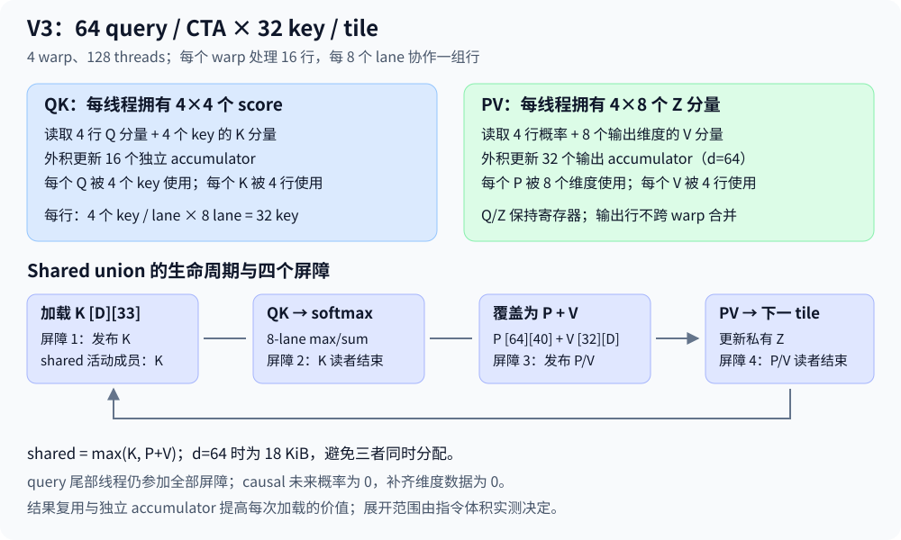

# 1. V3 优化设计：SIMT 寄存器矩阵块与 shared 阶段复用

V3 的主要优化是 **将标量 score 的逐行计算改为每线程持有一小块矩阵结果，并控制展开范围以减少 instruction-fetch 压力**：一个 CTA 处理 64 个 query，四个 warp，每线程持有 4×4 个 score，以及四行的输出分量。Q/K、P/V 操作数一次读取后用于多个乘加，提供更多独立结果与明确的数据复用。K 与 P/V 的 shared 工作区按阶段通过 union 复用。32 key / tile、FP32、`expf`、forward 与原输入契约保持不变。

该方案来自 V2 的实际 counters、源码依赖，以及对 efficient 的 launch、资源、SASS 和 PyTorch v2.6.0 源码交叉检查。先前仅拆四路累加的尝试收益约 1–4%，保留在 `run1/`、`run2/`，不作为最终 V3 的核心方案。实际结果见 [perf_v3](perf_v3.md)，复现见 [build-and-run](build-and-run.md)，最终源码见 [V3 kernel](../../../../cpp_cuda/fa2/v3/fa2_forward.cu)。

阅读顺序：§1.1 证据 → §1.2 所有权与矩阵乘加 → §1.3 shared 与同步 → §1.4 数值与边界 → §1.5 复杂度 → §1.6 验收与消融。

## 1.1 V2 与 efficient 的证据

### 1.1.1 优化对象

[V2 正式计时](../v2/data/benchmark-custom.json) 为 143.560 ms；[V2 counters](../v2/data/counters.json) 的 execution dependency 53.507239%、issue utilization 50.959040%、eligible warps 3.211435、occupancy 62.4171%。源码每 lane 只拥有一个 score，沿 d 累加；PV 每个输出槽位沿 32 个 key 累加。将这两条链拆成四路 partial 虽在 SASS 成立，却只小幅改善时间，说明“更多 partial”还没有充分提高操作数复用和每次发射的有用工作。

stall 是原因分布，不能转成墙钟时间份额；53.507239% 没有定位到具体 QK/PV/exp 指令。因此 V3 以真实实现与 efficient 证据进一步缩小方案范围。

### 1.1.2 efficient 实际做了什么

[efficient 时间线](efficient-reference/timeline.csv) 在同一设备与形状捕获 `fmha_cutlassF_f32_aligned_64x64_rf_sm50`：grid=256、block=(32,4,1)、168 registers/thread、dynamic shared=21.5 KiB。其 [资源与源码分析](efficient-analysis.md) 核验 local/stack 为零，实际架构为 sm_50，在 sm_61 设备兼容执行。

[PyTorch v2.6.0 kernel_forward.h：MM0/MM1](https://github.com/pytorch/pytorch/blob/v2.6.0/aten/src/ATen/native/transformers/cuda/mem_eff_attention/kernel_forward.h#L347-L495) 明确将 QK/PV 作为两个 CUTLASS matmul；[gemm_kernel_utils.h 的默认路径](https://github.com/pytorch/pytorch/blob/v2.6.0/aten/src/ATen/native/transformers/cuda/mem_eff_attention/gemm_kernel_utils.h#L110-L123) 在该架构使用 FP32 SIMT FMA，而不是 Tensor Core。源码还有 [shared union](https://github.com/pytorch/pytorch/blob/v2.6.0/aten/src/ATen/native/transformers/cuda/mem_eff_attention/kernel_forward.h#L523-L570)、[寄存器输出保持](https://github.com/pytorch/pytorch/blob/v2.6.0/aten/src/ATen/native/transformers/cuda/mem_eff_attention/kernel_forward.h#L121-L141) 和 base-2 softmax。

能直接确认的是 tile、资源、SIMT 路径和阶段复用；不能仅凭这些资源数字反推出全部流水线、寄存器分配或每周期行为。V3 采用其中的寄存器矩阵块和 shared 生命周期原则，保留可读的独立实现，不导入整套 CUTLASS。

## 1.2 CTA、warp、lane 与结果所有权

### 1.2.1 一个 warp 处理 16 行

参数为 warp size 32、4 warps/CTA、每行 lane 子组大小 C=8、warp 内行组数 G=32/C=4、每线程行槽位 A=4。每 warp 处理 \(GA=16\) 行，每 CTA 处理 \(B_r=64\) 行，key tile \(B_c=32\)。head dimension 补齐为 \(D=32R,\ R=\lceil d/32\rceil\)，每线程每行输出槽位 \(H=D/C=4R\)。

设 lane \(\lambda\)，定义 `row_lanei=floor(lanei/8)`、`col_lanei=lanei%8`，warp w、行槽位 a 对应：

\[
i_{\mathrm{local}}=16w+\lfloor\lambda/8\rfloor+4a,\qquad
i=64b+i_{\mathrm{local}}.
\tag{1}
\]

固定行 i 的八个 lane 共同处理其 key/维度分片。同一行槽位的合法 key 与输出维度分别为：

\[
j=32t+(\lambda\bmod8)+8r_k,\quad 0\le r_k<4;\qquad
h=(\lambda\bmod8)+8r_h,\quad0\le r_h<H.
\tag{2}
\]

每个合法 query、key 和维度可以唯一写为这些分组索引，故所有 score 与输出只由一个线程槽位拥有。一个线程的 4×4 scores 代表四行 × 四个 key，不是同一个 score 的四个部分和。

### 1.2.2 QK 的寄存器外积

每个维度 h，加载四个 Q 行分量与四个 K key 分量，然后更新 16 个 score：

\[
S_{a,r_k}\mathrel{+}=Q_{a,h}K_{h,r_k}.
\tag{3}
\]

Q 分量由该 8-lane 子组的原持有者 shuffle 广播；同一 Q 值用于四个 key。K 分量从 shared 读取，同一 K 值用于四行。每线程因此有 16 条独立 score accumulator；不用增加对同一 score 的 partial 合并，也不做沿 d 的 warp 点积归约。

### 1.2.3 PV 的寄存器外积

softmax 后每行的概率存入 shared，PV 每 key 读取四行的 P 与 H 个 V 分量，更新 4H 个输出分量：

\[
Z_{a,r_h}\mathrel{+}=\widetilde P_{a,j}V_{j,r_h}.
\tag{4}
\]

每个 V 分量用于四行，每个 P 用于 H 个维度。d=64 时 H=8，每线程有 32 个输出 accumulator。Q 与 Z 都保持寄存器状态，P 通过 shared 在 score 布局和输出布局之间转换；没有跨 warp 的输出归约。

### 1.2.4 控制展开范围

完全展开的矩阵块试验达到约 84 ms，却产生 2304 个静态 FFMA，`stall_inst_fetch=65.072291%`，说明寄存器复用的收益同时受到过大指令体积限制。最终 QK 使用“外层输出槽位 ri 展开、内层 8 个维度的 `dim_lanei` 保留循环”：`q_dim[qri][ri]` 仍是编译期固定索引，避免动态寄存器数组访问导致 local memory。PV 的 key 32 次循环同样保留，内部四行×H 维度微矩阵乘加仍展开。

`#pragma unroll 1` 只控制相应循环，既不取消微矩阵 ILP，也不自动等于最优调度。最终是否减少 code size、无 spill、提升 issue，需要 SASS、资源与新的 counters 联合验证。相关试验固定在 `run6/`，不会混入最终归档身份。

## 1.3 Shared 布局与四次屏障

### 1.3.1 生命周期复用

shared union 的两种活动状态为 K `[D][33]`，或 P `[64][40]` 加 V `[32][D]`。K 的 stride 为 `KEYS_PER_TILE+1`；P 的 stride 为 `KEYS_PER_TILE+LANES_PER_ROW`，让不同 8-lane 行组的行首落在不同 bank 区间。

\[
\mathrm{shared}=\max(4D\cdot33,\ 4\cdot64\cdot40+4\cdot32D).
\tag{5}
\]

| R | 支持 d | D | shared / CTA |
|---:|---|---:|---:|
| 1 | 1–32 | 32 | 14336 B |
| 2 | 33–64 | 64 | 18432 B |
| 3 | 65–96 | 96 | 22528 B |
| 4 | 97–128 | 128 | 26624 B |

union 避免同时分配 K、P、V 的峰值总和，但必须建立覆盖前读者完成的顺序；CUDA 不会自动按 union 成员切换来同步线程。

### 1.3.2 四个 happens-before 边

每 key tile 的协议依次为：协作写 K → barrier 1 发布 → QK/softmax → barrier 2 确认全部 K 读者结束 → 写 P/V 覆盖 union → barrier 3 发布 P/V → PV → barrier 4 确认读者结束，下一 tile 才写 K。

所有线程执行相同 CTA tile 循环，不允许 query 尾部线程提前退出。尾部/causal mask 只改变数值与写入谓词；row max/sum 用 width=8 的 shuffle，完整 warp mask 始终由所有 32 lane 在同一位置参与。互不相交的八-lane 子组只改变路由范围，不允许其他 lane 离开原语。

### 1.3.3 Bank 与 broadcast

K 转置协作写仍使用 stride 33，固定 key 下连续维度落入不同 bank。QK 时四个 row group 读取相同 key 列，可产生同地址 broadcast；PV 中 P 固定 key、不同 row group 的地址由 stride 40 分开，组内八个 lane 同读一个 P；V 固定 key、连续八列，四个 row group 同读可 broadcast。

这些是地址结构推导。实际 compiler 可能生成不同宽度加载，吞吐和 shared transactions/request 必须实测；不能因为 broadcast 原理就承诺所有指标等于 1。

## 1.4 Softmax、causal 与数值

每行每线程先对四个 score 做局部 max，再在八个 lane 中 max all-reduce；分母同样局部求和后八-lane sum all-reduce。每行的 m/l 在八个 lane 保持相同副本，各 lane 对其输出槽位按相同 alpha rescale。每 tile 状态仍满足 [V2 online-softmax 不变式](../v2/optimization-design.md#mathematical-model)，最终 \(O=Z/\ell\)。

causal CTA 的加载上限为 `min(S, query_basei+64)`。每行 key limit 单独为 i+1；未来或越界 score 置 -inf、P 显式置零。完全 mask 的行保持零分母、零输出分子，不参与合法输出写回；`isfinite(m)` 初始处理避免旧最大值的 `-inf - -inf`。合法行在最后至少含 key 0，最终分母非零。

Q/K/V 的补齐维度加载为零，内层矩阵计算可以无维度谓词，最终只写 d 个合法分量。全部输入仍连续二维 FP32、1≤d≤128、finite scores/V 且 FP32 中间结果不溢出；容差 `rtol=atol=2e-5` 不变。没有 Tensor Core、半精度或 fast-math。

`exp2f` 与 log2(e) scale 被单独试验，但结果较差且增加寄存器，最终保留 `expf`；详见 [消融记录](perf_v3.md)。指数名称不能作为速度保证，必须考虑整个编译与资源结果。

## 1.5 工作量、资源与可并行性

### 1.5.1 主形状结构量

| S=16384,d=64，non-causal | V2 | V3 矩阵块 |
|---|---:|---:|
| query / CTA | 8 | 64 |
| threads / CTA | 256 | 128 |
| CTA 数 | 2048 | 256 |
| key tile | 32 | 32 |
| 每行 tile 递推 | 512 | 512 |
| global K/V 有效逻辑读取 | 16 GiB | 2 GiB |
| shared K/V 消费的数据槽位 | 约 128 GiB | 约 32 GiB |
| 每 CTA tile barrier | 2 | 4 |
| 全网格 CTA barrier 实例 | 2097152 | 524288 |
| 每线程 score accumulator | 1 | 16 |
| 每线程 Z accumulator | 2 | 32 |

V3 的八倍 CTA query 复用压缩 global 请求，每次操作数又服务四行，将源码级 K/V shared 消费槽位约减四倍。QK/PV 有效乘积数仍相同，\(\Theta(S^2d)\)；P 工作区新增，cache/事务放大、编译加载宽度和谓词会影响实际流量，不能将上述数据槽位当 DRAM/L2 测量。

Q/O 各 4 MiB，额外全局输出 \(O(Sd)\)，CTA shared 为 \(O(B_rB_c+B_cd)\)，寄存器 Q/Z/score 为 \(O(B_rd+B_rB_c)\) 分摊到线程。没有全局 \(S^2\) 矩阵。causal 的加载复用受对角 tile 边界影响，额外 mask 工作独立于有效 P 的计数。

### 1.5.2 寄存器比 occupancy 更重要的情形

主形状持久 Q/Z 为每线程各 32 个槽位、score 16 个槽位，还需行状态和编译器预取临时值。寄存器明显增多是预期成本，不等于失败。V2 高驻留但 issue 约 51%，efficient 低驻留却 issue 约 67%，支持把更多独立乘加与操作数复用放入单个线程的方向。

Pascal 每 SM 有 65536 registers、98304 B shared、2048 threads。完全展开版的 168 registers/thread 按每 warp 256-register 粒度分配约 5376 registers/warp，四-warp CTA 使用 21504，三个 CTA 共 64512，形成 12 warps/SM、18.75% 上限；178 registers 则落入更高分配档，三个 CTA 放不下。受控展开版降低寄存器需求，具体驻留与分配仍以最终资源和 profiler 为准。

可并行部分包括 CTA 间 query 块、warp 的 16 行、线程的 16 个 score 与 32 个 Z 分量；沿 d/key 的单个 accumulator 链和跨 tile m/l/z 仍存在。V3 利用这些链之间的独立性，不承诺删除全部执行依赖。

## 1.6 假设与实验范围

| 假设 | 判定依据 |
|---|---|
| H1：4×4 score 与多行输出在寄存器标量化，无 spill | ptxas、cuobjdump 的资源与独立目的寄存器 |
| H2：主形状 global K/V 逻辑读取 2 GiB、shared 槽位复用 | 所有权公式、源码加载与 SASS；实际 counters 单独记录 |
| H3：union 复用每 tile 四屏障、尾部全员参与 | 源码、SASS、memcheck/synccheck/racecheck |
| H4：issue/eligible 或等待行为改善 | 同一 29 项指标与 efficient 参照，不转成墙钟周期 |
| H5：正式延迟明显低于 V2，保持完整接口 | 5 warmup×20 iterations×5 repeats、全部 d 和边界验证 |
| H6：FP64 容差不放宽 | 常规数值和主形状十行×两种 mask |

已有 `run1`、`run2`、`run3`、`run4`、`run5`、`run6` 分别保留小幅累加优化、成组操作数、首次矩阵块、64-key 资源失败、base-2 指数退化、完全展开版复测。主目录以受控展开矩阵块的完整验证/计时为准。V0/V1/V2 基线复用历史归档，GPU 任务不并发，CPU/MAX_JOBS 为 1；共用构建、脚本与测试不复制。
