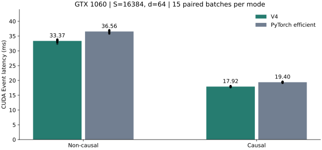
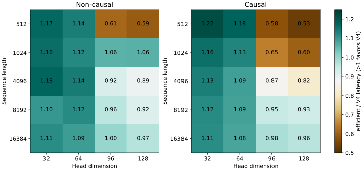

# 1. V4 性能、机制与验证

V4在GTX1060的FP32、S=16384,d=64主形状上超过同轮PyTorch efficient。最终独立计时中位数为32.924 ms，对照36.126 ms；三个seed、两种模式的30组交替计时全部达标。收益来自分阶段预取、寄存器矩阵块、shared生命周期复用、P布局和向量搬运的组合。d>64及部分短序列仍有性能不足，不能把主形状达标表述为全形状领先。

证据入口为[manifest](manifest.json)、[优化依据与消融](optimization-design.md)、[编译复现](build-and-run.md)。原始结果保留全部样本、失败编译和未达标试验；没有使用profiler replay时长替代独立计时。

## 1.1 主形状结果

### 1.1.1 独立计时与历史版本

| 实现 | non-causal CUDA event均值 | 中位数 | 数据 |
|---|---:|---:|---|
| V0 | 2922.297187 ms | 2916.776953 ms | [历史manifest](../v0/manifest.json) |
| V2 | 143.560432 ms | 见原始样本 | [历史计时](../v2/data/benchmark-custom.json) |
| V3 | 47.459282 ms | 见原始样本 | [历史计时](../v3/data/benchmark-custom.json) |
| V4最终run20 | 32.886442 ms | 32.923752 ms | [Custom计时](data/benchmark-custom.json) |
| V4当轮efficient | 36.103030 ms | 36.126306 ms | [对照计时](data/benchmark-efficient.json) |

均值比均值：V4比V3快1.443倍，比本轮efficient快1.098倍。V0–V3是既有归档，没有为本次重跑；历史绝对值会受环境和动态时钟影响。同轮中位数比为1.097倍，即V4耗时约少8.865%。速度提升比例与耗时减少比例的分母不同，不能混用。

### 1.1.2 交替顺序成对复验

[成对JSON](data/benchmark-paired.json) 使用相同Q/K/V输入，seed0/1/7，每种causal模式5组，每组两种实现交替先后顺序。每批5次warmup、20次计时；输入生成、哈希与FP64参考均在计时之外。每种模式共有15对结果。

| 模式 | V4批次均值 | efficient批次均值 | efficient/V4整体比值 | 15对最小/最大比值 |
|---|---:|---:|---:|---:|
| non-causal | 33.367171 ms | 36.556612 ms | 1.0956 | 1.0907 / 1.1041 |
| causal | 17.917243 ms | 19.399056 ms | 1.0827 | 1.0752 / 1.0906 |

三组seed顺序执行，后面的绝对延迟稍高，符合动态时钟条件下温度等因素可能影响计时的限制；本次没有同步采集温度来证明具体原因。每组均快于同轮efficient，未筛掉不利样本。成对比值只证明这张卡、该契约和测量条件下的表现，不代表其他GPU也有同样比例。

## 1.2 优化机制与代码对应

### 1.2.1 Tile、微矩阵与所有权

[常量与布局](file:///home/dengxiao/code_repos/institutionalized/stanford_cs336/assignments/assignment2-systems/FA/cpp_cuda/fa2/v4/fa2_forward.cu#L17-L34) 采用64 query×64 key、4 warp/CTA。两个warp沿query划分，另外两个沿key/output column划分；一个warp处理32×32矩阵子块，lane为4行组×8列组，每线程持有8×4 score微矩阵。d=64时另有8×4 output accumulator，最终各线程直接写回自己拥有的输出列。

[蛇形外积](file:///home/dengxiao/code_repos/institutionalized/stanford_cs336/assignments/assignment2-systems/FA/cpp_cuda/fa2/v4/fa2_forward.cu#L54-L65) 复用Q/K或P/V fragment，保持每个accumulator沿reduction维度的求和顺序。这借鉴[CUTLASS SIMT thread MMA](https://github.com/NVIDIA/cutlass/blob/v3.5.1/include/cutlass/gemm/thread/mma_sm50.h)，并非通过FP16或Tensor Core加速。GTX1060主形状仍为FP32 SIMT乘加。

跨column warp只交换softmax行统计，不归约output accumulator。它并非完全独立的sliced-Q方案；[FA2论文§3](https://arxiv.org/html/2307.08691v1#S3) 的减少通信原则需要结合本卡寄存器预算使用，不能机械照搬A100的warp/tile参数。

### 1.2.2 Stage8、shared union与预取

[SharedStorage](file:///home/dengxiao/code_repos/institutionalized/stanford_cs336/assignments/assignment2-systems/FA/cpp_cuda/fa2/v4/fa2_forward.cu#L201-L227) 将QK的双stage Q/K与PV的P/V工作区放入union。主模板QK工作区8704 B，PV工作区20480 B，五组行统计1280 B，总shared21760 B。d=128增加V stage至8192 B，总shared25856 B。

[QK流水线](file:///home/dengxiao/code_repos/institutionalized/stanford_cs336/assignments/assignment2-systems/FA/cpp_cuda/fa2/v4/fa2_forward.cu#L250-L287) 先发布stage0，再提前加载下一stage到global fragment寄存器，当前stage乘加期间可以等待load完成；随后写入另一shared buffer并通过CTA屏障发布。Q/K reduction stage8来自[PyTorch SIMT配置](https://github.com/pytorch/pytorch/blob/v2.6.0/aten/src/ATen/native/transformers/cuda/mem_eff_attention/gemm_kernel_utils.h#L110-L123)。[PV流水线](file:///home/dengxiao/code_repos/institutionalized/stanford_cs336/assignments/assignment2-systems/FA/cpp_cuda/fa2/v4/fa2_forward.cu#L349-L381) 同样按8个key预取V。

Pascal没有cp.async。本实现用普通global load、独立计算和两套shared stage重叠工作，依据[CUTLASS双层pipelining](https://docs.nvidia.com/cutlass/4.6.0/media/docs/cpp/efficient_gemm.html#pipelining)。最后采用单份源码fragment，让编译器在小范围展开中调度shared loads；显式双fragment消融反而略慢，详见§1.3。SASS中当前FFMA之间出现下一fragment的LDS.128，因此不能把单份源码数组误解成所有load与compute必然完全串行。

每次切换stage的屏障同时结束旧stage读取并发布新stage。结束QK和softmax后才能覆写union，结束PV后才进入下一key tile。这些生命周期规则得到synccheck/racecheck支持，详见§1.5。

### 1.2.3 P布局与aligned搬运

[P访问置换](file:///home/dengxiao/code_repos/institutionalized/stanford_cs336/assignments/assignment2-systems/FA/cpp_cuda/fa2/v4/fa2_forward.cu#L164-L180) 使用`queryi ^ (((keyi / 4) % 8) * 4)`。低两位不变，四元素chunk保持对齐，读写双方使用同一公式。[P向量写入](file:///home/dengxiao/code_repos/institutionalized/stanford_cs336/assignments/assignment2-systems/FA/cpp_cuda/fa2/v4/fa2_forward.cu#L339-L348) 被编译为STS.128。它减少当前所有权模式下的重复bank事务；不能仅把全kernel transactions/request大于1认定为bank conflict，因为LDS.128本身服务宽度更大。

[Q/K global向量搬运](file:///home/dengxiao/code_repos/institutionalized/stanford_cs336/assignments/assignment2-systems/FA/cpp_cuda/fa2/v4/fa2_forward.cu#L67-L105) 让每线程一次取四个连续dimension，再写入转置shared布局。[V搬运](file:///home/dengxiao/code_repos/institutionalized/stanford_cs336/assignments/assignment2-systems/FA/cpp_cuda/fa2/v4/fa2_forward.cu#L120-L162) 同样向量化。主aligned模板静态global load位置由24条scalar变为6条LDG.128，减少加载与地址计算指令。不同模板寄存器与调度也会变化，因此性能不能只归因于减少了18条静态指令。

[Host分派](file:///home/dengxiao/code_repos/institutionalized/stanford_cs336/assignments/assignment2-systems/FA/cpp_cuda/fa2/v4/fa2_forward.cu#L419-L435) 同时检查head_dim被4整除和Q/K/V起始地址16-byte对齐。连续tensor可能带不对齐storage offset，故保留scalar模板；新增offset1/2/3测试验证该回退。

### 1.2.4 数值递推

[Base-2指数](file:///home/dengxiao/code_repos/institutionalized/stanford_cs336/assignments/assignment2-systems/FA/cpp_cuda/fa2/v4/fa2_forward.cu#L36-L51) 对应[PyTorch iterative_softmax](https://github.com/pytorch/pytorch/blob/v2.6.0/aten/src/ATen/native/transformers/cuda/mem_eff_attention/kernel_forward.h#L1214-L1293) 的表示：scale包含log2(e)，行最大值也使用该单位。PTX使用`ex2.approx.f32`，没有`.ftz`；[官方规范](https://docs.nvidia.com/cuda/archive/12.8.0/parallel-thread-execution/index.html#floating-point-instructions-ex2) 给出2 ulp最大误差并支持sm20+次正规结果。本版没有启用全局fast_math，也没有改成低精度Q/K/V。

[Softmax更新](file:///home/dengxiao/code_repos/institutionalized/stanford_cs336/assignments/assignment2-systems/FA/cpp_cuda/fa2/v4/fa2_forward.cu#L289-L337) 先归约tile最大值，再得到新的最大值与alpha，对旧l/z重缩放，然后加入当前P和PV。masked score为负无穷，最终概率为零；无效query行用零最大值避免`-inf-(-inf)`。FP64测试覆盖最大值跨tile改变和概率很小但V很大的情况。

## 1.3 消融与否证

| 实验 | 主要变化 | Custom中位数 | 同轮efficient中位数 | 解释 |
|---|---|---:|---:|---|
| run11 | 完整K、大Q，无stage预取 | 52.345038 ms | 36.193176 ms | shared36 KiB限制驻留 |
| run12 | stage8双缓冲、显式fragment预取、P置换 | 38.212402 ms | 36.133615 ms | 资源与load-use假设得到支持 |
| run13 | 取消P置换 | 40.023807 ms | 36.193582 ms | 相同主尺寸下退化 |
| run14 | global load推迟至当前乘加后 | 39.215649 ms | 36.217175 ms | 预取有净收益 |
| run15 | 取消显式fragment双缓冲 | 37.563776 ms | 36.128717 ms | 否证“源码双fragment必然更快” |
| run17 | base-2指数 | 37.338983 ms | 36.142947 ms | 小幅变化 |
| run18 | 范围检查后走指数快路径 | 38.102527 ms | 36.158823 ms | 删除，无净收益 |
| run20 | aligned global向量搬运，完整边界回退 | 32.923752 ms | 36.126306 ms | 最终选定 |
| run21 | 在最终源码中仅关闭aligned分派 | 37.459711 ms | 36.267859 ms | 向量搬运收益得到控制实验支持 |

各轮原始数据、源码、编译资源和二进制哈希见manifest的`exploratory_runs`。run20/run21经过各自同轮efficient校准的比值为1.1333，即向量方案约快13.33%；这仍包含寄存器分配和编译器调度差异。run1–run11是理论梳理前的未达标探索，保留其结果以说明错误路径；run3和run16编译失败，没有赋予虚构的运行性能。

## 1.4 资源与计数器

### 1.4.1 实际模板资源

| d的pad范围 | aligned registers | scalar registers | shared/CTA | stack/local/spill |
|---|---:|---:|---:|---|
| d≤64，pad64 | 157 | 161 | 21760 B | 全部0 |
| 64<d≤128，pad128 | 162 | 166 | 25856 B | 全部0 |

全部模板为128 threads、三个CTA/SM的资源档位；GTX1060每SM64K registers、96 KiB shared。[Pascal指南](https://docs.nvidia.com/cuda/archive/12.8.0/pascal-tuning-guide/index.html) 和实际launch资源共同支持这一上限，实测occupancy18.626%与12 warp/SM相符。occupancy提高只是条件，不能作为性能目标本身。

### 1.4.2 Counters与解释边界

| 指标 | run11 | run12 | V4最终 | efficient历史参考 |
|---|---:|---:|---:|---:|
| occupancy | 12.4104% | 18.6088% | 18.6260% | 18.6268% |
| eligible warps/cycle | 2.524691 | 4.582738 | 4.668475 | 4.324108 |
| issue | 49.695397% | 70.441669% | 71.987266% | 66.997537% |
| memory dependency | 29.349599% | 5.177093% | 7.675109% | 0.827313% |
| instruction fetch | 7.406104% | 13.113489% | 8.796854% | 12.554382% |
| exec dependency | 43.108759% | 40.431315% | 38.508673% | 37.372316% |
| synchronization | 5.270489% | 11.212192% | 17.453546% | 23.071899% |
| shared load tx/request | 2.576057 | 2.576057 | 2.576057 | 2.796997 |
| shared store tx/request | 3.542663 | 1.191793 | 1.975416 | 3.435517 |

来源：[run11 counters](run11/data/nvprof-diagnostic.csv)、[run12 counters](run12/data/nvprof-diagnostic.csv)、[V4完整29项CSV](data/nvprof-custom-s16384-d64.csv)、[efficient既有证据](../v3/efficient-reference/counters.csv)。efficient参考为历史采集，仅用于结构对照；同轮性能判断使用§1.1计时。

run12把资源上限从2个CTA改成3个并引入预取，memory stall明显降低；最终向量方案减少指令后fetch stall也降低。同步百分比上升不能据此说同步绝对耗时增加：总指令组合和时间都变化，stall不是可以按独立延迟相乘分解的时间账本。

最终DRAM读2.410777 GB/s、写133.152740 MB/s；L2读77.757518 GB/s、写486.539988 MB/s，L2 texture-read hit96.068699%；shared读990.599222 GB/s、写229.707875 GB/s。显存没有饱和，当前结果仍主要受SIMT指令、依赖与同步约束。吞吐统计含实际事务和replay条件，不用它们反推出唯一的算法字节数。

global load efficiency为100%，store efficiency为25%。输出线程以四元素chunk映射，当前源码逐scalar写回产生分散的sector访问；只在所有key tile结束后写4 MiB输出，因此该指标不等同于主循环瓶颈。后续可向量化写回，但本版没有为追高百分比再混入未经验证的改动。

[单次时间线](data/nvprof-timeline.csv) 只有一个custom kernel，grid256×1×1、block128×1×1、157 registers、静态shared21.25 KiB，耗时32.936765 ms。实际扩展SHA-256为`5001866545e06b3648b5097d911bbfa8eb4bb3a90c0bd64e18bcd54faef7d376`，与工作区和归档一致。

## 1.5 泛化与正确性边界

### 1.5.1 多形状性能

[多形状JSON](data/benchmark-matrix.json) 覆盖S=512/1024/4096/8192/16384，d=32/64/96/128，以及S=513、d=31/33/65/97，两种模式共48案例，每个案例3组交替计时。其中25个案例按批次均值领先efficient，所有案例的两种实现均通过FP64抽样行校验。

d=32/64的20个规整案例均领先，速度比约1.078–1.216；d=96/128的部分中长序列接近或超过，但短序列causal及奇数d>64落后明显。S=16384,d=128时，non-causal V4为74.359 ms、efficient71.995 ms，causal为39.458/38.070 ms。不能说所有d都不比efficient差。

该边界与pad128后每线程8×8 output fragment、更多shared load、代码体积和短序列工作分派有关；这里只是模型解释，尚未通过针对d>64的布局消融证明各自贡献。当前优化具有算法与工程上的可迁移性，性能比例仍依赖硬件和形状。跨GPU性能尚未测量。

### 1.5.2 数值与sanitizer

[最终数值日志](data/cuda-final-process.log) 为15项通过，[registry日志](data/registry-process.log) 为5项通过；[memcheck](data/memcheck.log)、[synccheck](data/synccheck.log)、[racecheck](data/racecheck.log) 各执行14项常规测试，全部零错误或hazard。sanitizer没有覆盖S=16384长序列。

S=16384,d=64两种模式各10行[独立FP64抽样](data/row-validation.json) 最大绝对误差1.675507e-7。48案例的V4抽样最大绝对误差5.200559e-7；所有校验使用rtol=atol=2e-5。小shape常规测试做全输出比较，长shape仅抽样，不声称长序列完整矩阵经过验证。

契约保持连续二维FP32、d=1..128、causal/non-causal forward、不修改输入、无反向梯度；不生成S×S global score/probability中间矩阵。起始地址不对齐的连续输入走scalar模板，次正规概率保留默认支持路径。

## 1.6 复杂度、可并行性与剩余工作

非causal算术工作保持约\(4S^2d\) FLOPs，主形状为68.719477 GFLOPs；按最终独立均值计算有效吞吐约2.090 TFLOPs/s。这是attention算法工作量除以总kernel时间，不是独立GEMM峰值测试。causal约减少一半有效矩阵区域，但对角tile仍有masked计算。

渐近算术复杂度为\(O(S^2d)\)，shared为\(O(B_rB_c+Bd)\)，register accumulator为\(O(B_rB_c/T+B_rd/T)\)，global新增输出为\(O(Sd)\)。query CTA相互独立；单CTA内key tile按在线softmax顺序递推，不能任意并行交换其顺序。软件流水线只重叠搬运与独立乘加，不跳过m/l/z依赖。

主形状已有256个CTA、十个SM，故优先改善每CTA指令与就绪工作，而非添加split-K全局归并。下一版若面向所有d全面领先，应针对d>64的output所有权、pad浪费、短序列分派和stage布局建立新的资源模型与消融；本版没有将这些未验证想法伪装成已完成结果。
