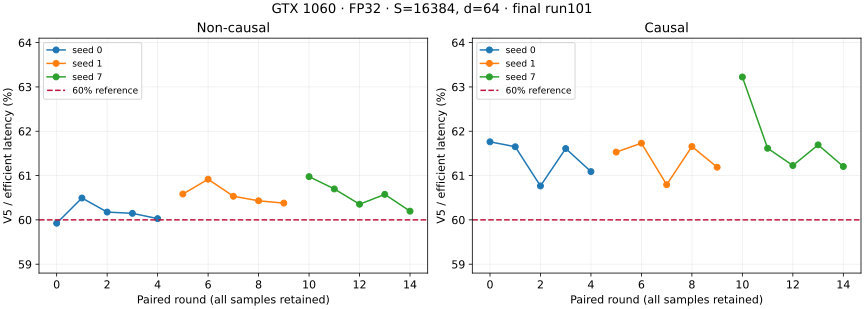
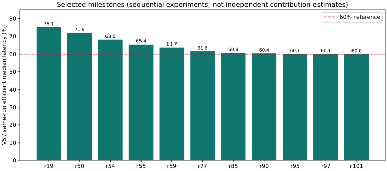
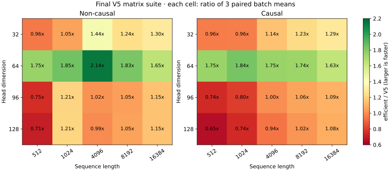

# 1. V5 性能、理论与验证总结

V5在GTX1060的FP32、S=16384,d=64主形状上，将独立计时中位数降至21.626 ms，对照efficient为36.063 ms，耗时减少40.03%，速度约1.668倍。更稳健的三seed交替成对计时中，non-causal整体耗时比为60.43%，causal为61.52%，对应约39.57%和38.48%的耗时减少。用户认可该结果作为本版结束条件；完整报告保留实际比例，不将近似达标表述为所有样本均严格低于60%。

最终实现的关键组合是128query×64key的SIMT矩阵块、有范围证明的固定指数基准、split线性归并、完整48 KiB shared生命周期复用、K/V预取，以及限制Q搬运临时寄存器的局部PTX。主路径保持FP32，没有Tensor Core、概率裁剪或S×S global中间矩阵。正确性覆盖d=1..128和两种causal模式；短序列、奇数d等性能边界仍存在。

阅读顺序为本报告、[逐项理论与消融设计](optimization-design.md)、[编译复现](build-and-run.md)、[证据manifest](manifest.json)。`run1/`至`run99/`保留探索，run100恢复最佳主路径并修复范围外回退，run101完成最终整理与验证。最终开发源码、快照和实测二进制哈希一致。

## 1.1 性能结果与比较口径

### 1.1.1 独立计时与历史版本

| 实现 | non-causal CUDA event均值 | 中位数 | 证据 |
|---|---:|---:|---|
| V1 | 348.178237 ms | 见原始样本 | [V1计时](../v1/data/benchmark-custom.json) |
| V2 | 143.560432 ms | 见原始样本 | [V2计时](../v2/data/benchmark-custom.json) |
| V3 | 47.459282 ms | 见原始样本 | [V3计时](../v3/data/benchmark-custom.json) |
| V4 | 32.886442 ms | 32.923752 ms | [V4计时](../v4/data/benchmark-custom.json) |
| V5最终run101 | 21.637523 ms | 21.626163 ms | [V5计时](data/benchmark-custom.json) |
| V5当轮efficient | 36.020975 ms | 36.063272 ms | [对照计时](data/benchmark-efficient.json) |

V5相对V4的历史中位数约快1.522倍、耗时减少34.31%。V1至V4未在本轮重新运行，跨轮绝对值受动态时钟和测量条件影响；历史值用于呈现迭代进展，同轮efficient用于判断当前性能。相同指标之间比较，均值与中位数不混用。

“速度提高”与“耗时减少”具有不同分母。令\(r=t_{\mathrm{V5}}/t_{\mathrm{efficient}}\)，耗时减少为\(1-r\)，速度倍数为\(1/r\)。原始目标r≤0.60对应至少1.667倍速度；最终独立r=0.59967，但成对测量更接近0.604和0.615。

### 1.1.2 三seed、交替顺序成对计时

[全部成对样本](data/benchmark-paired.json)使用相同Q/K/V、seed0/1/7，每种causal模式各5轮。每轮两实现交替先后顺序，5次warmup、20次测量；每种模式共15对，全部保留。

| 模式 | V5批次均值 | efficient批次均值 | V5/efficient整体比 | 耗时减少 | 单对比值范围 |
|---|---:|---:|---:|---:|---:|
| non-causal | 22.235946 ms | 36.797104 ms | 60.4285% | 39.5715% | 59.9246%–60.9759% |
| causal | 11.987788 ms | 19.487516 ms | 61.5152% | 38.4848% | 60.7655%–63.2241% |

non-causal有1对低于60%，causal没有单对低于60%。该结果说明稳定收益接近目标，同时明确了严格阈值的偏差。独立计时与成对计时的绝对值有所变化；本次未锁频，也未同步记录温度，不将差异归因于未经采集的具体环境原因。原始样本优先于四舍五入后的“约40%”表述。

## 1.2 理论到最终实现

### 1.2.1 从带宽假设转向SIMT指令模型

[V4计数器](../v4/data/nvprof-custom-s16384-d64.csv)中DRAM读仅2.41 GB/s，execution dependency约38.51%、同步约17.45%，并没有显存带宽饱和的证据。V5据此优先减少每次FFMA对应的操作数指令、softmax通信和阶段屏障，而不是以DRAM吞吐百分比为目标。

[FlashAttention-2工作划分](https://arxiv.org/html/2307.08691v1#S3)支持减少warp之间的中间结果通信和非矩阵运算；[CUTLASS SIMT外积](https://github.com/NVIDIA/cutlass/blob/v3.5.1/include/cutlass/gemm/thread/mma_sm50.h)与[MaxAs SGEMM分析](https://github.com/NervanaSystems/maxas/wiki/SGEMM)支持二维register tiling及operand reuse。[Pascal指南](https://docs.nvidia.com/cuda/archive/12.8.0/pascal-tuning-guide/index.html)给出64K registers/SM、96 KiB shared/SM与48 KiB/CTA上限。这些来源提供机制与资源约束，其A100、Hopper或Maxwell SGEMM峰值不作为本卡性能预测。

最终[矩阵映射](../../../../cpp_cuda/fa2/v5/fixed_prefetch.cuh#L88-L108)使用128threads、128query×64key。每两个warp覆盖64query，各线程拥有8×8 score及8×8 output；每dimension读取8个A和8个B，服务64次FFMA。相对4×8微矩阵的12/32 operand/FFMA比例，8×8为16/64，操作数复用更高，但两组64accumulator会显著增加寄存器压力。

该布局仍跨column warp分配key/output列，最终行分母需要跨warp归约。它采用FA2的通信优化原则，同时服从Pascal的SIMT资源预算，不能称为完全warp独立的sliced-Q实现。无跨线程output归约，每个线程最终直接写自己拥有的输出元素。

### 1.2.2 范数上界允许固定softmax基准

对attention的base-2 score定义\(x_{ij}=(Q_i\cdot K_j)\log_2(e)/\sqrt d\)。softmax分子和分母可共同乘任意正的比例：

\[
O_i=\frac{\sum_j 2^{x_{ij}-b}V_j}{\sum_j2^{x_{ij}-b}}.
\]

因此b不必等于实际最大值。传统online softmax选择运行最大值以限制指数范围；V5先证明一个安全范围，在该范围内使用全程b=0，删除每tile最大值归约、alpha计算与已有output/denominator重缩放。

[打包与范数检查](../../../../cpp_cuda/fa2/v5/pack_qk.cuh#L5-L55)在读取Q/K时以向上舍入平方、加法和sqrt得到每行范数上界，并使用atomicMax保存全局最大范数与最大|V|。Cauchy–Schwarz给出\(|Q_i\cdot K_j|\le\|Q_i\|_2\|K_j\|_2\)。[eligibility](../../../../cpp_cuda/fa2/v5/score_bounds.cuh#L5-L17)再加入1.0001倍舍入余量并向上取整；上界≤32且|V|≤1e20时使用快速路径。

该条件下合法P位于\([2^{-32},2^{32}]\)，全部为normal FP32。[指数代码](../../../../cpp_cuda/fa2/v5/fixed_prefetch.cuh#L7-L15)可以使用`ex2.approx.ftz.f32`而不丢失有效概率；masked负无穷对应0。d64输入索引约束使S小于\(2^{25}\)，故分母小于\(2^{57}\)，分子绝对值上界小于\(2^{57}\times10^{20}\approx1.45\times10^{37}\)，低于FP32最大值。该范围证明保证可表示性，求和和指数近似的实际误差仍由2e-5测试验收。

超范围输入使用[严格在线最大值回退](../../../../cpp_cuda/fa2/v5/maxwell_d64.cuh#L176-L222)，不会裁剪score或概率。最终删除实验中的FA4阈值8条件重缩放，因为大V时基准低于实际maximum可能放大未归一化分子并溢出。回退指数用\(2^x=2^{x+64}2^{-64}\)，最后非FTZ乘法保留次正规结果；大V、极小概率与跨tile重缩放均有回归覆盖。

固定基准是本实现从softmax平移不变性与保守范围界推导出的输入相关快速路径，不是FA2或FA4论文承诺的通用FP32算法。FA4的[条件重缩放](https://arxiv.org/html/2603.05451v1#S3.SS1.SSS4)仅作为探索依据，未保留为最终fallback策略。

### 1.2.3 Split attention的线性归并

共同基准使每个key split可独立计算\(N_i^{(p)}=\sum_{j\in p}2^{x_{ij}}V_j\)与\(D_i^{(p)}=\sum_{j\in p}2^{x_{ij}}\)，最后直接相加并做一次除法。无需记录每个split的maximum，也无需归并时重缩放。[combine](../../../../cpp_cuda/fa2/v5/combine.cuh#L7-L31)按固定split顺序相加，不使用atomic浮点累加。

[key范围划分](../../../../cpp_cuda/fa2/v5/fixed_prefetch.cuh#L101-L105)按64key整块使用floor边界，非整除的split5也保证每个key恰被一个part覆盖。causal无合法key的part写0分子/分母，最终统一归一化避免局部0/0。[host分派](../../../../cpp_cuda/fa2/v5/fa2_forward.cu#L425-L458)在S≥512时用5个split，小S用2个。

主形状有128个query块×5part=640CTA。每SM可驻留2CTA、10SM共20CTA一波，640恰好整除；这一模型用于选择可解释的调度粒度，不保证GPU严格按固定波次执行。split4、5、10的后期独立差异较小，明确的早期收益来自将整条长key任务拆分，而不能把split5的每一小差异归因为波次整除。

新增global临时空间为packed Q/K的8 MiB、五份numerator的20 MiB、五份denominator约320 KiB及bounds12 B；加4 MiB输出，实测峰值新增CUDA分配为33,882,624 B，约32.31 MiB。scratch随Sd线性增长，不生成S²矩阵；打包、分配、写回和combine全部进入端到端计时。

### 1.2.4 完整shared tile与跨阶段预取

[Storage union](../../../../cpp_cuda/fa2/v5/fixed_prefetch.cuh#L17-L29)在QK阶段容纳Q128×64的32 KiB和K64×64的16 KiB，在PV阶段容纳P64×128的32 KiB和V64×64的16 KiB，总计48 KiB。两个阶段生命周期互斥，最终分母暂借已消费完的shared区域，不再额外申请1 KiB。

[主循环](../../../../cpp_cuda/fa2/v5/fixed_prefetch.cuh#L110-L156)在QK计算前预取当前V到32float/thread寄存器，使64dimension QK计算隐藏V读取；在PV前预取下一K，用64key PV计算隐藏K读取。Q重复使用同一query工作集，以4float局部拷贝直接搬到shared，避免与nextK同时保持大段global fragment。

完整tile使QK/PV reduction中不再存在stage发布屏障，每tile只保留QK发布、QK结束保护union、PV发布、PV结束保护union四次共同CTA屏障。最后K写入下一轮QK工作区后，由下一轮Q发布屏障一并发布。该协议使用共同控制位置的`__syncthreads`，不使用分离角色循环或shared flag自旋。

[shared→register双fragment](../../../../cpp_cuda/fa2/v5/fixed_prefetch.cuh#L69-L86)提前读取下一dimension，再执行当前8×8外积；按两dimension一对、展开两对，总4dimension，保持每accumulator的RN FMA累加顺序。该软件流水线借鉴[CUTLASS双层pipelining](https://docs.nvidia.com/cutlass/4.6.0/media/docs/cpp/efficient_gemm.html#pipelining)，Pascal没有cp.async、TMA、WGMMA或动态warp寄存器重分配。

### 1.2.5 编译器依赖图与临时寄存器

完整Q的普通C++拷贝在run84产生112 B stack及spill。源码中的4float局部变量没有约束ptxas必须只保留4个物理寄存器；完整展开可提前加载多个批次。[局部PTX拷贝](../../../../cpp_cuda/fa2/v5/fixed_prefetch.cuh#L52-L67)用`ld.global.v4`立即`st.shared.v4`，volatile和memory clobber限制跨拷贝重排，实际run85降至235/233register并消除spill。

[8×8 PTX依赖图](../../../../cpp_cuda/fa2/v5/register_mma.cuh#L5-L39)沿column做蛇形row遍历，连续复用同一B，再在相邻column复用端点A。统一asm描述完整accumulator更新，但物理寄存器、reuse标记和SASS最终顺序仍由ptxas决定。最终不是手写固定register的SASS kernel。

实验过yield、reuse、FFMA重排、dual issue及register bank一一置换。部分模型产生了修改，部分保守检查没有命中，均未取得足够收益而未采用。最终扩展为标准nvcc/ptxas结果，manifest显式记录`sass_binary_patch_applied=false`，避免把源码哈希和被修改机器码混为一谈。

## 1.3 关键消融与否证

下表统一从各轮原始JSON读取CUDA event中位数。它是阶段性组合的轨迹，不能将相邻差值视为独立可加的单项贡献；不同轮的动态时钟与编译调度都可能变化。

| 实验 | 主要机制 | V5中位数 | efficient中位数 | 判定 |
|---|---|---:|---:|---|
| run19 | Maxwell式映射、Q/K打包 | 27.105432 ms | 36.090778 ms | 向量化搬运有效 |
| run50 | 编译期固定基准路径 | 25.948407 ms | 36.090625 ms | 消除逐tile最大值/重缩放 |
| run54 | 128query、stage16 | 24.514745 ms | 36.064914 ms | 大query复用与较少屏障 |
| run55 | split4、线性归并 | 23.557062 ms | 36.034445 ms | 更细key任务有收益 |
| run59 | 双register fragment | 22.972751 ms | 36.055591 ms | 阶段性小幅改善 |
| run61 | 16×8角色微矩阵 | 25.726132 ms | 36.060617 ms | 无净收益，未采用 |
| run64 | 完整tile顺序搬运 | 28.303513 ms | 36.133478 ms | 取消预取退化 |
| run74 | 8×16 score、P分半 | 25.832904 ms | 36.063232 ms | 寄存器溢出，未采用 |
| run77 | 完整K/V、跨tile预取 | 22.189722 ms | 36.029114 ms | 新流水线有收益 |
| run84 | 完整Q普通C++拷贝 | 23.198105 ms | 36.103204 ms | 编译spill，未采用 |
| run85 | 局部PTX Q拷贝 | 21.927673 ms | 36.074582 ms | 消除spill |
| run90 | 固定零指数基准 | 21.824136 ms | 36.125375 ms | 更少状态与舍入路径 |
| run95 | 蛇形PTX、乘法source对偶 | 21.707300 ms | 36.095129 ms | 最终依赖图候选 |
| run97 | 打包合并范数检查 | 21.704550 ms | 36.112177 ms | 无确定独立收益，选作最终组合 |
| run99 | 取消显式双fragment | 22.066995 ms | 36.068472 ms | 无收益，恢复双fragment |
| run101 | 恢复、回退修复与清理 | 21.626163 ms | 36.063272 ms | 最终验证版本 |

其余失败包括过大的stage/global fragment、过度展开、将accumulator放入global/local、P额外置换、完整Q/K顺序读取和更高occupancy的角色流水线。run31/33虽有数值结果，但synccheck指出分离控制位置的跨角色屏障不合法，不能采用；共同循环修复后重新计时，不能沿用有问题版本的更快数字。

run12没有真正重编译，只有run11二进制再次计时；run72只做离线模型并得到identity映射，没有GPU耗时。每轮的状态、实际二进制、源码快照和保留路径见manifest的`exploratory_runs`；重复快照可去重，原始时长、失败状态和不利样本不删除。

## 1.4 资源、计数器与时间线

### 1.4.1 实际编译资源

| 路径 | registers/thread | shared/CTA | threads/CTA | stack/local/spill |
|---|---:|---:|---:|---|
| d64 fixed non-causal | 224 | 49152 B | 128 | 全部0 |
| d64 fixed causal | 230 | 49152 B | 128 | 全部0 |
| d64 online fallback non-causal/causal | 220 / 219 | 21504 B动态 | 64 | 全部0 |
| 通用pad64 scalar/aligned | 255 / 255 | 40960 B | 128 | 全部0 |
| 通用pad128 scalar/aligned | 164 / 165 | 24576 B | 128 | 全部0 |
| pack与bounds | 32 | 4224 B | 256 | 全部0 |
| combine | 42 | 0 | 256 | 全部0 |

两个fixed CTA需要96 KiB shared，寄存器需求约57,344或58,880个，满足64K/SM。实际occupancy12.4929%接近8warp/64warp，shared决定本配置最多两个CTA。V4具有更多驻留warp，但V5减少指令与同步后更快；occupancy是资源条件，不是独立性能目标。

### 1.4.2 最终29项counter

[原始counter CSV](data/nvprof-custom-s16384-d64.csv)分别包含pack、主路径、空返回fallback与combine。以下对比只采用主attention kernel，V4与efficient为既有历史采集，V5为最终二进制本次采集。

| 指标 | V4历史 | V5最终 | 解释边界 |
|---|---:|---:|---|
| achieved occupancy | 18.6260% | 12.4929% | 驻留降低但依赖与指令减少 |
| eligible warps/cycle | 4.668475 | 5.505482 | 更高的可发射工作比例 |
| issue slot utilization | 71.987266% | 84.141209% | 发射改善 |
| execution dependency | 38.508673% | 24.446503% | 包含矩阵/地址/softmax组合影响 |
| synchronization | 17.453546% | 6.111603% | 完整tile减少stage屏障 |
| instruction fetch | 8.796854% | 11.077953% | 静态代码仍有取指成本 |
| memory dependency | 7.675109% | 0.469992% | K/V预取隐藏大部分load等待 |
| shared load tx/request | 2.576057 | 1.968940 | 映射与向量访问改变 |
| shared store tx/request | 1.975416 | 5.319273 | 128-bit事务口径，不能直接等同冲突路数 |

V5主体DRAM读4.519546 GB/s、写934.313040 MB/s，L2读88.714496 GB/s、写964.098473 MB/s，L2 texture read hit95.327265%。global load efficiency99.989988%、store efficiency95.588235%；partial按float4写回改善了store事务。shared读725.397233 GB/s、写181.432311 GB/s。显存仍未饱和，下一版若继续优化应结合SASS与独立消融分析SIMT发射及取指，而非据单一吞吐百分比推断。

stall百分比不是可以乘延迟并逐项相加的时间账本，也不代表某项变化独立贡献多少毫秒。完整29项、各kernel口径及资源静态指令统计均在manifest；profile replay不作为性能比较。

### 1.4.3 单次forward时间线

[时间线CSV](data/nvprof-timeline.csv)与[原始nvprof报告](profiles/forward.nvvp)捕获一个forward。五个kernel依次为bounds清零0.001472 ms、pack/bounds0.135136 ms、fixed主体22.435227 ms、空返回fallback0.004320 ms、combine0.168096 ms。主体grid128×5、block128，224register、48 KiB shared，与实测版本一致。

profile中的主体时长高于独立计时，不能使用该数字替换§1.1。辅助kernel、launch与临时空间确实存在，端到端计时没有隐藏准备或归并成本。实际扩展SHA-256为`52bc53fce133f624796695799d67a69d08de8505d1f5e26ba1bd25844e126f0d`。

## 1.5 泛化与正确性

### 1.5.1 多形状表现

[48案例JSON](data/benchmark-matrix.json)覆盖S=512/1024/4096/8192/16384，d=32/64/96/128，以及S=513、d=31/33/65/97，两种模式。每案例3轮交替计时，并对两种实现先做CPU FP64抽样行检查；V5共29案例按批次均值快于efficient。

规整d64的10案例全部领先，速度比约1.631–2.141倍。S16384,d96的non-causal为53.747/61.791 ms，d128为62.821/72.117 ms；这两个维度使用通用路径，不应将收益归因于d64固定基准主体。S512,d96/128与所有S513奇数d案例仍落后；奇数维度速度比约0.641–0.787。

快速路径要求d64、S被128整除且Q/K/V地址16-byte对齐，随后仍由device范围检查决定fixed/fallback。其他输入走通用online softmax。短序列kernel启动、pad浪费、通用255register和非专用布局可能影响性能，但本版没有通过专项消融分解其各自贡献，不能将该模型解释当作已证明结论。跨GPU尚未测量。

### 1.5.2 数值与三种sanitizer

[最终数值日志](data/cuda-validation.log)17项全部通过，[registry日志](data/registry.log)5项通过。小shape全输出对比CPU FP64，覆盖d1..128、尾部、因果prefix隔离、不对齐连续输入、抵消与最大值改变。[长序列抽样](data/row-validation.json)两种模式各10行最大绝对误差2.384186e-7；48案例V5抽样最大绝对误差5.200559e-7，均使用rtol=atol=2e-5。

[memcheck](data/memcheck.log)、[synccheck](data/synccheck.log)各执行16项常规套件并为0errors；[racecheck](data/racecheck.log)为0hazards、0warnings。sanitizer未执行S16384长序列，长序列只做抽样行精度检查，不声称完整S²参考或全部长序列行已经验证。

新增[大V回退回归](../../../../tests/test_cuda_fa2_forward.py#L186-L197)验证跨tile score提升5、V=1e35时两种模式保持有限且与CPU FP64一致。现有次正规概率×1e36测试同时覆盖规整d64同tile和跨tile回退。范围外策略的修复属于正确性收尾，主形状fixed路径不受影响。

契约保持连续二维FP32、d=1..128、causal/non-causal forward、不修改输入、无反向梯度，不生成S×S global score/probability。精度保证来自范围推导和实测测试的组合，不宣称SFU近似指数与任意输入逐bit一致。

## 1.6 复杂度、并行性与工程结论

non-causal矩阵工作量约为\(4S^2d\)，主形状68.719477 GFLOPs。按最终独立中位数21.626163 ms计算有效吞吐约3.178 TFLOPs/s；这是attention算法工作量除以完整forward耗时，包含准备与归并，不是独立SGEMM峰值。causal有效区域约减半，对角tile仍计算部分masked元素。

算术复杂度保持\(O(S^2d)\)，pack/bounds为\(O(Sd)\)，split归并为\(O(pSd)\)，global临时空间为\(O(pSd)\)，每CTA shared为\(O(B_rd+B_cd+B_rB_c)\)。固定p=5时整体额外空间仍随Sd线性增长。register accumulator为\(O((B_rB_c+B_rd)/T)\)，编译器rename及预取片段会增加实际需求，不能只用数组元素数预测ptxas结果。

query与key split CTA相互独立，combine在同stream中等待其完成；无需CPU同步或跨CTA浮点atomic。单CTA的PV仍按key顺序累加，打包/norm CTA可并行，atomicMax只求非负上界而无浮点求和顺序问题。范围外online softmax按tile顺序维护maximum/denominator，不能任意重排递推。

可复用的经验是：先建立FFMA/operand、shared容量和寄存器生命周期模型，再用实际编译与消融否证；完整tile只有保留合适预取才可能有效；源码scope不能代替物理寄存器证据；数学不变性要与有限精度范围证明配套；更高occupancy、更大tile、更宽展开和机器码模型分数都不是收益本身。

正式开发目录只保留7个职责文件，失败实现移入历史快照，实际二进制与原始计时、验证、profile证据保留。字节相同的重复快照/二进制按manifest路径映射去重，完整SASS和编译缓存可重新生成。本版按用户认可结果完成总结，不继续追加优化，未执行Git提交。
