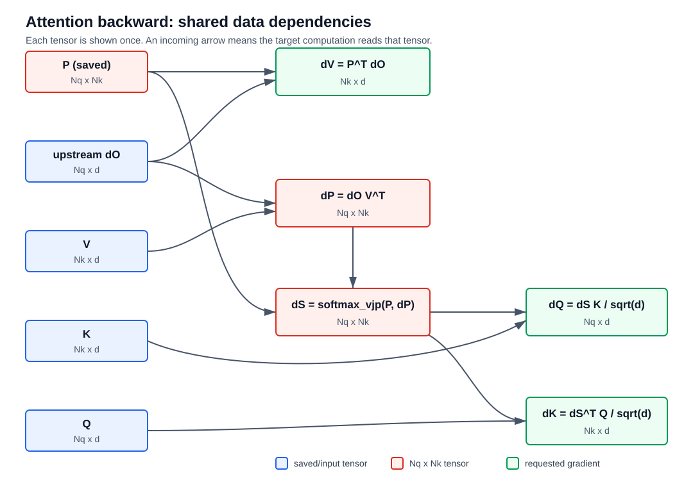
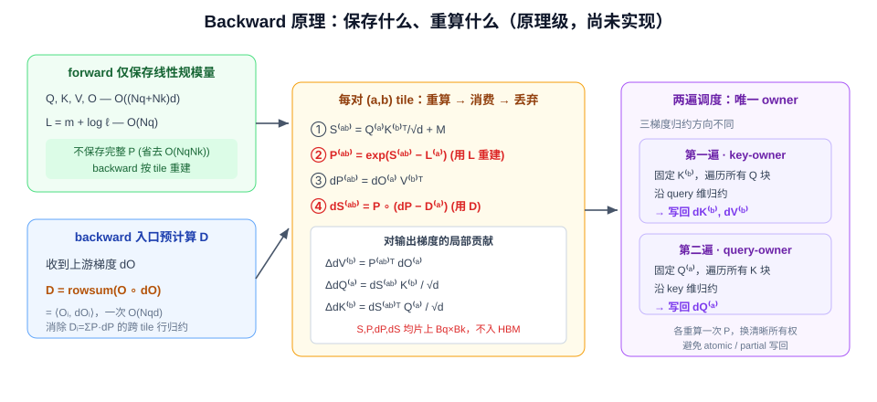

# FlashAttention Forward 的原理与 CUDA 实现演进：从 Online Softmax 到寄存器级 SIMT 流水线

## 摘要

注意力（attention）的朴素实现需要在显存中物化形状为 $(N, N)$ 的分数矩阵 $S$ 与概率矩阵 $P$（$N$ 为序列长度），其容量与 HBM I/O 均随序列长度平方增长，在长序列下既触发显存溢出，又使端到端时延被访存主导。

**FlashAttention（下文简称 FA）的四项核心技术**，在不改变数学结果（精确、非近似）的前提下，避免物化完整 $S/P$，把跨 forward/backward 边界的中间存储由 $O(N^2)$ 压到 $O((N_q+N_k)d)$，并显著降低 HBM 往返：

- **分块**（tiling）：每次只计算 $S$ 的一个 tile；
- **online softmax**：跨 key tile 增量合并 softmax 统计量，而不先物化整行；
- **反向重算**（recomputation）：backward 由 $Q,K,V$ 与保存的行统计量重算 $S,P$，不保存完整 $P$；
- **算子融合**（kernel fusion）：打分、mask、softmax 更新与 $PV$ 累加在同一 kernel 内完成。

**本报告做两件事**。其一，系统推导 FA forward 的全部原理，并完整给出 backward 的数学原理（backward 尚未进入代码实现，仅在原理层描述）。其二，以 GTX 1060（Pascal，CC 6.1）上的一个「正确性优先」FP32 CUDA 基线（v0）为起点，逐版本（v0→v5）记录每一步可独立测量的优化及其数学依据与工程证据。

**主要结果**（主形状 $N=16384,\ d=64$，$N$ 即 benchmark 的 `seq_len`；FP32、GTX 1060、同口径计时）：

- **延迟**：自定义核函数的单次 forward 延迟由 v0 的 $2922.3$ ms 降至 v5 的 $21.6$ ms，约 $135\times$。
- **与基线对比**：在成对计时中，v5 稳定低于 PyTorch 的 memory-efficient 后端（CUTLASS FP32 FMHA，$\approx 36$ ms）。此处以「比值 = V5 耗时 ÷ 同轮 efficient 耗时」度量——non-causal 为 $60.43\%$、causal 为 $61.52\%$，即 **v5 的端到端耗时仅为该后端的约六成**（等价于约 $1.65\times$ 加速）；该后端是本设备上成熟的生产级 FP32 attention 实现，故这一结果尤为值得强调。
- **技术主线**：warp shuffle 归约 → 共享 K/V tile 与分块 softmax → 寄存器微矩阵外积 → 分阶段预取与向量化搬运 → 范数上界固定指数基准 + split attention 线性归并。

需要说明的是，v4/v5 的最快路径是**针对规整形状（$d=64$、$N$ 对齐、地址对齐）的编译期专门化**。这种「只对特定形状/配置深度优化、其余走通用实现」的做法在业界是常见且合理的工程取舍：生产库普遍依赖 autotune（如 Triton、CUTLASS 的 tile/stage 自动搜索）、模板特化与 kernel 分派（按 dtype、head dim、causal、对齐条件选择专用 kernel）、乃至更高层的 CuTe DSL 与 `torch.compile`/编译器融合来覆盖不同输入；本报告在 Pascal 这一受限硬件上手工实现并验证了同一类思路的一个切片。

本报告的记号与符号习惯对齐仓库讲义 [03_02 FlashAttention-2 Forward textbook](../notes/03_02_flash_attention_2_beginner_textbook.md) 与 [03_03 Backward 与实现验证](../notes/03_03_flash_attention_2_backward.md)。代码实现位于 [FA/cpp_cuda/fa2](cpp_cuda/fa2)。

---

## 1. 引言

### 1.1 问题定义

单头 scaled dot-product attention (SDPA) 的输入为 query、key、value 三组向量。遵循讲义的列向量约定，第 $i$ 个 query、第 $j$ 个 key/value 分别记为列向量 $q_i, k_j, v_j \in \mathbb{R}^{d}$。按「打分 → 归一化 → 加权求和」的计算顺序，单条输出 $o_i \in \mathbb{R}^{d}$ 定义为：

$$s_{ij} = \frac{q_i^\top k_j}{\sqrt d},\qquad p_{ij} = \frac{\exp(s_{ij})}{\sum_{u=1}^{N_k}\exp(s_{iu})},\qquad o_i = \sum_{j=1}^{N_k} p_{ij}\, v_j$$

即先算 query 与各 key 的缩放点积 $s_{ij}$，经 softmax 归一化为权重 $p_{ij}$，再对 value 做加权和得 $o_i$。

为批量计算，把每个列向量的转置堆叠成矩阵的行，得 $Q \in \mathbb{R}^{N_q\times d}$、$K, V\in\mathbb{R}^{N_k\times d}$，则矩阵形式为 $S = QK^\top/\sqrt d$、$P = \operatorname{softmax}_{\mathrm{row}}(S)$、$O = PV$。self-attention 中 $N_q=N_k=N$，即 benchmark 中的序列长度 `seq_len`。

本工作求解的是 **forward 的精确计算**：输出 $O$ 与朴素实现在实数算术下逐元素相等，有限精度下仅存在正常的浮点舍入差异（FA 不做稀疏化或近似）。

### 1.2 三笔必须分开的成本：算术、容量与 I/O


*图 1.2-1　左：朴素实现把完整 $S$、$P$（$N\times N$）反复写回并读入 HBM，中间存储 $O(N^2)$；右：FlashAttention 只让当前 tile 与 online softmax 状态在片上存活，$S/P$ tile 消费后即丢弃，HBM 中只保留 $Q,K,V,O,L$，中间存储降为 $O(Nd)$。*

朴素 attention 的代价来自三个互不等价的维度，混为一谈会导致错误的优化判断：

| 成本 | 朴素 attention | FlashAttention 的变化 |
| --- | --- | --- |
| 算术量 | 主项 $O(N^2 d)$ | 仍为精确 dense attention，主项**不**降为线性 |
| $S/P$ 中间存储 | $O(N^2)$ | 不在 HBM 物化完整矩阵 |
| HBM I/O | 多次写回并读入 $S$、$P$ | tile 在片上生成、消费后即丢弃 |

据此可得第一条核心认识：**FA 的本质不是「少算 query-key 对」，而是「以更合适的顺序计算，并避免把完整 $S/P$ 往返 HBM」**。一个 $(B,H,N,N)$ 的中间矩阵占 $BHN^2 e$ 字节（$e$ 为元素字节数）；以 $B{=}1,H{=}32,N{=}8192$、FP16 计，单张分数矩阵即 $4$ GiB，而对应的 $Q$ 仅 $64$ MiB——比例恰为 $N/d$。

这个平方项在长序列下极其恐怖。考虑当前「长上下文」常见的 $N=10^6$（1M token）、单头（$H{=}1,\ B{=}1$）、FP16（$e{=}2$）：若**不使用上下文并行**（context parallelism, CP）把序列切到多卡，则单张 $(N,N)$ 分数矩阵需

$$N^2 e = (10^6)^2 \times 2\ \text{B} = 2\times 10^{12}\ \text{B} \approx 1.82\ \text{TiB}$$

即**单层、单头的一张 $S$（或 $P$）就要约 1.8 TiB**——远超任何单卡显存（H100 也仅 80 GB）；而同配置下一个 $Q$ 仅 $N d e = 10^6\times 128\times 2 \approx 244$ MiB。朴素实现在这一尺度连 forward 都无法物化 $S$，更不论训练还要为 backward 保存 $P$。FA 通过分块把这张 $N\times N$ 矩阵永不整体落地，才使 1M 级上下文在单卡上可行；CP 则是另一正交手段（跨卡切 $N$），二者可叠加。

### 1.3 记号约定

全文沿用下表记号；标量数学公式中的 token 与特征下标 $i,j,u,c$ 从 $1$ 起，tile 与程序循环索引 $a,b$ 从 $0$ 起。

| 记号 | 含义 | 形状 / 取值 |
| --- | --- | --- |
| $N_q, N_k, N, d$ | query 数、key/value 数、self-attention 序列长度、head dimension | self-attention 下 $N_q{=}N_k{=}N$；$N$ 即 benchmark 命令行参数 `seq_len`（部分 perf 文档记作 `S`） |
| $q_i, k_j, v_j, o_i$ | 单个 query/key/value/输出（列向量） | $\mathbb{R}^{d}$ |
| $Q, K, V, O$ | 批量矩阵，第 $i$ 行存对应列向量的转置 | $\mathbb{R}^{N\times d}$ |
| $s_{ij}, S$ | 单个缩放分数、分数矩阵（$S$ **只表分数矩阵，不表序列长度**） | $S\in\mathbb{R}^{N_q\times N_k}$ |
| $p_{ij}, P$ | softmax 概率、概率矩阵 | $P\in\mathbb{R}^{N_q\times N_k}$ |
| $B_q, B_k$ | query tile、key/value tile 大小（block size，非 batch） | 正整数 |
| $T_q, T_k$ | $\lceil N_q/B_q\rceil$、$\lceil N_k/B_k\rceil$ | 正整数 |
| $Q^{(a)}, K^{(b)}, V^{(b)}$ | 第 $a$ 个 query tile、第 $b$ 个 key/value tile | $(B_q,d)$、$(B_k,d)$ |
| $m_i, \ell_i, z_i$ | 运行最大值、softmax 分母、未归一化输出分子 | 标量、标量、$\mathbb{R}^{d}$ |
| $\alpha_i, \widetilde p_{ij}$ | 旧状态缩放因子、新 tile 未归一化权重 | 标量 |
| $A^{(a)}, M^{(a,b)}$ | query tile 的分子 accumulator、mask | $(B_q,d)$、$(B_q,B_k)$ |
| $L_i = m_i + \log\ell_i$ | 一行 scores 的 logsumexp（forward 保存项） | 标量 |
| $D_i = \langle O_i, dO_i\rangle$ | backward 的行标量 | 标量 |

**数学约定与框架张量布局的区分**（强调一次）：数学上向量按列向量书写，线性层记 $y = Wx$，注意力打分记 $q^\top k$；而 PyTorch 等框架张量**特征在最后一维**（如 `(B, H, S, d)`），实际算的是 $y = xW^\top$、`Q @ K.transpose(-2,-1)`。两者是两个层面，不矛盾。本报告公式一律用列向量约定，涉及代码张量形状时按框架真实布局书写。

GPU 片外主存在原理章节统一称 **HBM**（与讲义一致）；在针对 GTX 1060 的硬件实测处，其显存实为 GDDR5，相应处写作「设备显存」以保持准确。片上存储指寄存器与 shared memory/SRAM。

### 1.4 目标硬件与支持范围

全部实测在单张 GTX 1060（GP106，CC 6.1，10 个 SM，标称显存带宽 $192.192$ GB/s，设备 shared 上限 $96$ KiB/SM、$48$ KiB/CTA，寄存器 $64$K/SM）上进行，软件为 CUDA 12.8、PyTorch 2.6.0+cu124。所有版本的支持契约统一为：连续二维 FP32 的 $Q/K/V$，形状 $(S,d)$，$1\le d\le 128$，单头 self-attention，支持 causal 与 non-causal 的 **forward**；不支持 backward、dropout、任意 mask、GQA、KV cache、FP16/BF16 与 Tensor Core 路径。接口约束见 [cuda_fa2_forward.py:L35-L57](src/cuda_fa2_forward.py#L35-L57)。该设备为 Pascal 架构，无 Tensor Core、无 `cp.async`/TMA/WGMMA，故所有矩阵乘均为 FP32 SIMT 乘加（FFMA）。

---

## 2. Forward：精确 Attention 的 IO 感知重排

本章推导 FA forward 的全部原理（§2.1–§2.7），并完整给出 backward 的数学原理（§2.8）。代码实现为 forward-only；backward 一节仅作原理陈述，供后续实现对齐。

### 2.1 为什么「每块各做一次 softmax」是错的

分块计算的核心障碍是 softmax 的**全局归一化**。考察四个分数 `[1,2,3,4]` 被切成两块 `[1,2]` 与 `[3,4]`：两块各自的局部 softmax 均为 $[0.2689, 0.7311]$，直接拼接得到四个数之和为 $2$，不是概率分布；即便整体再除以 $2$，也等于强行规定两块各占 $50\%$ 的概率质量。而真实的 $\operatorname{softmax}([1,2,3,4]) = [0.0321, 0.0871, 0.2369, 0.6439]$ 中，前块合计仅约 $11.92\%$。**局部 softmax 保留了块内相对比例，却丢失了块间相对大小**。因此分块时不能保存「已归一化的局部概率」，而必须保存仍可与后续块合并的信息。

### 2.2 online softmax：三个状态与增量更新

online softmax（Milakov & Gimelshein, 2018）是一个专用术语，指**在单遍、分块的流式遍历中增量计算 softmax 归一化量**的技术：它只维护常数个运行状态，每读入一块就把这些状态「并入」，无需先物化整行 scores，也无需二次遍历。FA 把它从「流式求 softmax 分母」推广到「流式求 softmax 加权和 $\sum_j p_j v_j$」。

#### 2.2.1 把输出改写成「分子除以分母」

固定一个 query，它与 $N_k$ 个 key 产生 scores $\{s_1,\dots,s_{N_k}\}$。softmax 加权输出 $o = \sum_j p_j v_j$（$p_j = \exp(s_j)/\sum_u \exp(s_u)$）在数值上须先减去行最大值 $m = \max_j s_j$ 以防 $\exp$ 上溢——给所有 scores 同减一个常数不改变 softmax（分子分母同乘 $\exp(-m)$）。于是输出改写为

$$o = \frac{\sum_{j}\exp(s_j - m)\,v_j}{\sum_{u}\exp(s_u - m)} = \frac{z}{\ell}$$

由此看出，**计算这一行输出只需要三个标量/向量**，它们正是 online softmax 要流式维护的状态：

- 最大值 $m$：指数基准，保证所有 $\exp$ 的输入 $\le 0$、不上溢；
- 分母 $\ell = \sum_j \exp(s_j - m)$：softmax 的归一化因子（标量）；
- 分子 $z = \sum_j \exp(s_j - m)\,v_j \in \mathbb{R}^{d}$：**尚未除以分母 $\ell$** 的 value 加权和。注意 $z$ 是一个 **$d$ 维向量**（与输出 $o$ 同形），不是标量——它由各 $v_j$（$d$ 维）按权重线性组合而成；而 $m,\ell$ 都是标量。

缺一不可：只有 $m$ 无法加权求和；只有标量 $\ell$ 丢了方向信息；而向量 $z$ 与标量 $\ell$ 若不共享同一个基准 $m$ 就无法相除得到正确的 $o$。这里「未归一化」的确切含义就是：**$z$ 只是分子 $\sum_j \exp(s_j-m)\,v_j$，还没有除以分母 $\ell$**——真正的输出要到最后才由 $o = z/\ell$ 得到。之所以这样刻意推迟那一次除法：若每读一块就先算出归一化的局部输出再去合并，就要反复做除法与再加权（§2.1 已说明局部概率不能直接拼接）；而保留未归一化的 $z$，使跨块合并退化为「向量整体缩放 + 相加」这种廉价且可结合的操作，最后只在全部遍历完成后对 $z$ 除一次 $\ell$。

#### 2.2.2 增量更新式与 $\alpha$ 的来历

初始化 $m=-\infty,\ \ell=0,\ z=0$。读入新 score tile $s\in\mathbb{R}^{B_k}$ 及其 value 矩阵 $V\in\mathbb{R}^{B_k\times d}$ 后，按如下顺序更新（下标 old/new 仅区分同一变量更新前后，不是两套存储）：

$$m_{\mathrm{new}} = \max(m_{\mathrm{old}},\ \max_t s_t),\qquad \alpha = \exp(m_{\mathrm{old}} - m_{\mathrm{new}}),\qquad \widetilde p = \exp(s - m_{\mathrm{new}})$$

$$\ell_{\mathrm{new}} = \alpha\,\ell_{\mathrm{old}} + \textstyle\sum_t \widetilde p_t,\qquad z_{\mathrm{new}} = \alpha\, z_{\mathrm{old}} + V^\top \widetilde p$$

**$\alpha$ 是全部机制的关键，它来自指数基准的改变。** 旧状态 $\ell_{\mathrm{old}}, z_{\mathrm{old}}$ 是以旧基准 $m_{\mathrm{old}}$ 记录的，即每个旧项都含因子 $\exp(s_t - m_{\mathrm{old}})$；当新块带来更大的最大值、基准升到 $m_{\mathrm{new}}$ 时，同一个旧项应当变成 $\exp(s_t - m_{\mathrm{new}})$。两者之比恰为

$$\frac{\exp(s_t - m_{\mathrm{new}})}{\exp(s_t - m_{\mathrm{old}})} = \exp(m_{\mathrm{old}} - m_{\mathrm{new}}) = \alpha$$

且该比值与具体的 $s_t$ **无关**——这就是为什么「换基准」对整个旧状态只需乘一个公共标量 $\alpha$，而不必回头重读任何旧 score。由于 $m_{\mathrm{new}} \ge m_{\mathrm{old}}$，恒有 $\alpha \in (0, 1]$：基准上移即把旧的未归一化量按比例缩小，与新块（已按 $m_{\mathrm{new}}$ 归一）处在同一尺度上，才能直接相加。

关于这组更新式有三点必须强调：

1. **$\ell$ 与 $z$ 必须乘同一个 $\alpha$。** 它们是同一次 softmax 的分母与分子，共享同一基准；只缩放 $\ell$ 而漏乘 $z$（或反之）会让分子分母的基准错位，产生系统性错误而非舍入误差。
2. **顺序不可乱。** 必须先定出 $m_{\mathrm{new}}$，才能据此算 $\alpha$ 与新块权重 $\widetilde p = \exp(s - m_{\mathrm{new}})$；若先用旧 $m$ 算指数再改基准，则新旧两部分基准不一致。
3. **$m_{\mathrm{new}}$ 不变时退化为纯累加。** 若新块的最大值未超过 $m_{\mathrm{old}}$，则 $\alpha = \exp(0) = 1$，更新退化为 $\ell \mathrel{+}= \sum_t\widetilde p_t$、$z \mathrel{+}= V^\top\widetilde p$，即普通累加——重标定只在基准真正改变时才「花钱」。

全部 key tile 处理完后，一次性得到该行输出 $o = z/\ell$，并可顺带得到 logsumexp $L = m + \log\ell$（用途见 §2.7）。整个过程对每行只遍历一遍 scores、只维护常数个状态，故额外存储为 $O(d)$ 而非 $O(N_k)$。


*图 2.2-1（辅助理解，公式以正文为准）　online softmax 的几何直觉：已处理块以旧基准 $m_{\mathrm{old}}$ 维护 $\ell, z$；新块带来更大最大值使基准沿分数轴右移到 $m_{\mathrm{new}}$，旧状态整体乘一个与 $s_t$ 无关的公共因子 $\alpha=\exp(m_{\mathrm{old}}-m_{\mathrm{new}})$ 完成一次重标定，再与新块相加，末尾只除一次 $\ell$。*

### 2.3 更新式的精确性（归纳证明）

**命题**：处理完任意若干 tile 后，状态恒满足

$$m = \max_{t\in\mathrm{seen}} s_t,\qquad \ell = \sum_{t\in\mathrm{seen}}\exp(s_t - m),\qquad z = \sum_{t\in\mathrm{seen}}\exp(s_t - m)\,v_t$$

**证明**：第一块处理后，三式由定义直接成立。设在已见集合上成立，加入新块时，对任一旧项有恒等式 $\alpha\exp(s_t - m_{\mathrm{old}}) = \exp(m_{\mathrm{old}}-m_{\mathrm{new}})\exp(s_t - m_{\mathrm{old}}) = \exp(s_t - m_{\mathrm{new}})$，即旧项恰被改写为相对 $m_{\mathrm{new}}$ 的形式；再加上新块以 $m_{\mathrm{new}}$ 为基准的项，三式在扩大后的集合上继续成立。归纳完成。$\blacksquare$

因此最终 $z/\ell$ 与对全部 scores 一次性做 softmax 加权和完全相同。 online softmax 只改变计算与归约顺序，不删除任何 query-key 对，也非近似。

### 2.4 分块 attention forward：公式到伪代码

设 query tile 大小 $B_q$、数量 $T_q=\lceil N_q/B_q\rceil$，key/value tile 大小 $B_k$、数量 $T_k=\lceil N_k/B_k\rceil$。每个并行任务固定一个 `(batch/head, query_tile)`，把 $Q^{(a)}$ 留在片上，维护该 tile 内 $B_q$ 个 query 的运行状态：最大值 $m^{(a)}\in\mathbb{R}^{B_q}$、分母 $\ell^{(a)}\in\mathbb{R}^{B_q}$，以及未归一化输出 accumulator $A^{(a)}\in\mathbb{R}^{B_q\times d}$。这里 $A^{(a)}$ 就是 §2.2 单 query 分子向量 $z$ 的 tile 版本——把该 tile 内 $B_q$ 个 query 各自的 $z^\top$（$d$ 维行向量）堆成矩阵的 $B_q$ 行（$m^{(a)},\ell^{(a)}$ 同理由各 query 的 $m,\ell$ 堆成），因此下文的矩阵更新式与 §2.2 的标量/向量更新式逐行对应。按下列顺序依次处理每个 key/value tile（$M^{(a,b)}$ 为 §2.5 的 causal/边界 mask，`[:,None]` 表示把每行标量沿 $d$ 维广播、$\circ$ 为逐元素乘）：

$$\textbf{(1)}\quad S^{(a,b)} = Q^{(a)}(K^{(b)})^\top / \sqrt d + M^{(a,b)} \in \mathbb{R}^{B_q\times B_k}$$

$$\textbf{(2)}\quad m^{(a)}_{\mathrm{new}} = \max\big(m^{(a)},\ \operatorname{rowmax} S^{(a,b)}\big)$$

$$\textbf{(3)}\quad \alpha^{(a)} = \exp\big(m^{(a)} - m^{(a)}_{\mathrm{new}}\big)$$

$$\textbf{(4)}\quad \widetilde P^{(a,b)} = \exp\big(S^{(a,b)} - m^{(a)}_{\mathrm{new}}[:,\!\text{None}]\big)$$

$$\textbf{(5)}\quad \ell^{(a)}_{\mathrm{new}} = \alpha^{(a)}\circ\ell^{(a)} + \operatorname{rowsum}\widetilde P^{(a,b)}$$

$$\textbf{(6)}\quad A^{(a)}_{\mathrm{new}} = \alpha^{(a)}[:,\!\text{None}]\circ A^{(a)} + \widetilde P^{(a,b)} V^{(b)}$$

全部 key/value tile 处理完后，再做收尾（除一次分母、存 logsumexp）：

$$\textbf{(7)}\quad O^{(a)} = A^{(a)} / \ell^{(a)}[:,\!\text{None}],\qquad L^{(a)} = m^{(a)} + \log\ell^{(a)}$$

其中步骤 (2)–(6) 与 §2.2 的 online softmax 更新式逐行对应（(2) 定新基准、(3) 得缩放因子、(4) 算新块权重、(5)(6) 用同一 $\alpha^{(a)}$ 重标定旧分母与旧分子再并入新块），只是把单 query 的标量/向量换成了作用于整个 tile 的矩阵运算。该设计体现三条 FA forward 的核心性质：（1）**维护未归一化 accumulator**，仅在最后除以 $\ell$，避免每个 tile 都归一化再合并，从而减少昂贵的非矩阵运算（max/exp/逐元素乘除）；（2）**query tile 在外层、key/value tile 在内层**，不同 query tile 分给不同并行任务，各自独立产出 $O^{(a)}, L^{(a)}$，无需跨任务通信，并行度由 $B\times H$ 提升到 $B\times H\times T_q$；（3）任意时刻只需一个 $B_q\times B_k$ 的临时 score/probability tile，$S^{(a,b)}$ 与 $\widetilde P^{(a,b)}$ 被消费后即丢弃，HBM 中只保留 $Q,K,V,O,L$，不物化 $N_q\times N_k$ 的完整矩阵。

### 2.5 Causal 与边界 mask：哪些 score 可进入 softmax


*图 2.5-1　以 $4\times4$ tile 网格为例（行 = query tile，列 = key tile），对角线为 $c=r$。全可见 tile 直接计算、免逐元素比较；对角 tile 需逐元素 mask；全不可见 tile 整块跳过——其 online softmax 更新是恒等操作（$\alpha{=}1,\ \widetilde P{=}0$），跳过既省两次矩阵乘与 K/V 读取，又规避 $-\infty-(-\infty)$ 的 `NaN`。*

一个位置 $(r,c)$ 有效当且仅当：query 行在界内（$r<N_q$）、key 列在界内（$c<N_k$），且在 causal 下满足 $c\le r$。无效位置的 score 必须在 **rowmax 与指数运算之前**置为 $-\infty$（实现中用足够小的数，如 `-1e6`）：有效时 $S_{rc} = q_r^\top k_c/\sqrt d$，无效时 $S_{rc} = -\infty$。

**不能把无效 score 填 0**：$\exp(0)=1$ 会污染分母，且若无效 score 大于真实最大值还会污染 $m$。按 tile 与 causal 对角线的相对位置，key tile 分三类：（a）**全可见**（$k_1\le q_0$），直接计算、免逐元素比较；（b）**部分可见**（跨对角线），构造 $B_q\times B_k$ 逐元素 mask；（c）**全不可见**（$k_0>q_1$），整块跳过。对全不可见 tile，其对 online softmax 的更新是恒等操作（$\alpha{=}1,\ \widetilde P{=}0$），跳过既省 $O(B_qB_kd)$ 两次矩阵乘与 K/V 读取，又规避了全屏蔽行 $-\infty-(-\infty)$ 的 `NaN` 陷阱。

### 2.6 数值稳定性清单

1. 每轮用最新行最大值 $m_{\mathrm{new}}$ 重标定旧状态与新 tile；
2. 旧 accumulator $A$（即分子 $z$ 的 tile 版，见 §2.4）必须乘 $\alpha$，不能只更新分母；
3. 关键状态 $A,\ell,m$ 使用 FP32，低精度输入在写回前再转 dtype；
4. mask 在 max 之前生效，屏蔽的大 score 不得污染 $m$；
5. 定义并处理全屏蔽行（标准方形 causal self-attention 因可见自身，正常行不会全屏蔽）。

此外，指数可换底：$\exp(x) = 2^{x\log_2 e}$，$\log_2 e \approx 1.4426950408889634$。部分 GPU 对以 2 为底的指数提供高效指令（`ex2.approx`），但「精确」只意味着数学目标与 dense attention 相同，并不保证跨实现逐 bit 一致——并行归约顺序、低精度输入、`exp` 近似都会带来正常浮点差异。

### 2.7 为何保存 logsumexp $L$

由 $L = m + \log\ell$，有 $\exp(L) = \exp(m)\sum_j\exp(s_j-m) = \sum_j\exp(s_j)$，即 $L$ 就是原始 softmax 分母的对数。于是任一概率可由单个标量恢复：

$$p_{ij} = \frac{\exp(s_{ij})}{\exp(L_i)} = \exp(s_{ij} - L_i)$$

因此 backward 只需重算 score $s_{ij}$ 并读取每行一个 $L_i$，即可恢复概率，无需把 forward 的完整 $P$（$N_qN_k$ 个元素）保留到 backward。对 $N_q=N_k=8192,H=32$，完整 BF16 的 $P$ 为 $4$ GiB，而 FP32 的 $L$ 仅 $1$ MiB，相差约 $4096$ 倍。且 $L\ge\max_j s_j$，故 $s_j - L\le 0$，重建时 $\exp$ 不会上溢。forward 保存 $L$ 几乎零额外成本——它只是 online softmax 结束时已有 $m,\ell$ 的合并。

### 2.8 Backward （保存什么、重算什么）

> **实现状态说明**：本节为 backward 的完整数学原理。当前仓库 v0–v5 均为 **forward-only**，backward 尚未进入 CUDA 实现；此处原理供后续实现对齐，不对应已有核函数。

#### 2.8.1 普通 attention backward 的依赖

先把不分块的普通 attention backward 走一遍。forward 是三个连续算子 $S=QK^\top/\sqrt d \to P=\operatorname{rowsoftmax}(S) \to O=PV$；backward 从上游梯度 $dO\in\mathbb{R}^{N_q\times d}$ 出发，严格沿计算图反向，依次经过这三个算子。



*图 2.8-1（取自 backward 讲义）　普通 attention 的 $dQ,dK,dV$ 共享依赖 DAG：每份数据画成一个节点，一条入边表示计算目标节点时必须读取该数据。红色的 $P,dP,dS$ 都有 $N_qN_k$ 个元素；普通 backward 需要让 $P$ 跨越 forward/backward 边界保持存活，而 $dP,dS$ 可在 backward 内部产生并消费；$Q,K,V$ 也需存活，但只有线性规模 $O((N_q+N_k)d)$。*

**先经过矩阵乘 $O=PV$。** 由矩阵乘的 VJP 得

$$dV = P^\top dO \in \mathbb{R}^{N_k\times d},\qquad dP = dO\,V^\top \in \mathbb{R}^{N_q\times N_k}$$

$dV$ 的含义是每个 value 向量对所有 query 输出的影响按 $P$ 加权汇总；$dP$ 的含义是改变权重 $P_{ij}$ 时输出行 $O_i$ 会沿 $V_j$ 方向变化。**这一步已说明普通 backward 为何依赖 $P$：即便暂不考虑 softmax，计算 $dV$ 也要读完整的 attention 概率。**

**再经过逐行 softmax backward**（§2.8.2 详细推导），由 $dP$ 得 $dS$：

$$dS = P\circ\big(dP - \operatorname{rowsum}(P\circ dP)[:,\!\text{None}]\big) \in \mathbb{R}^{N_q\times N_k}$$

**最后经过 $S=QK^\top/\sqrt d$**，把梯度传回两个输入：

$$dQ = \frac{dS\,K}{\sqrt d} \in \mathbb{R}^{N_q\times d},\qquad dK = \frac{dS^\top Q}{\sqrt d} \in \mathbb{R}^{N_k\times d}$$

沿依赖图可读出三条梯度路径：（i）$P,dO \to dV$；（ii）$dO,V \to dP \to dS \to dQ$；（iii）前半段与 $dQ$ 共享同一个 $dP,dS$，最后 $dS,Q \to dK$。其中 $P, dP, dS$ 均含 $N_qN_k$ 个元素——普通实现需让 $P$ 跨 forward/backward 边界存活，这正是 FA 要消除的二次项（§2.8.3、§2.8.4 分别给出「不保存 $P$ 而重建」与「不跨 tile 归约」的办法）。

#### 2.8.2 softmax backward 的逐元素推导

attention 对 $S$ 的每行独立做 softmax。固定行 $i$，记 $Z_i=\sum_r\exp(S_{ir})$、$P_{iu}=\exp(S_{iu})/Z_i$。对分子（仅 $u{=}j$ 时依赖 $S_{ij}$）与分母用商法则：

$$\frac{\partial P_{iu}}{\partial S_{ij}} = \frac{\delta_{uj}\exp(S_{iu})Z_i - \exp(S_{iu})\exp(S_{ij})}{Z_i^2} = \delta_{uj}P_{iu} - P_{iu}P_{ij} = P_{iu}(\delta_{uj} - P_{ij})$$

其中 $\delta_{uj}$ 为 Kronecker delta。由多变量链式法则，$S_{ij}$ 影响整行输出：

$$dS_{ij} = \sum_{u=1}^{N_k} dP_{iu}\,\frac{\partial P_{iu}}{\partial S_{ij}} = \sum_u dP_{iu}P_{iu}\delta_{uj} - P_{ij}\sum_u dP_{iu}P_{iu} = P_{ij}\Big(dP_{ij} - \sum_u P_{iu}dP_{iu}\Big)$$

定义行标量 $D_i = \sum_u P_{iu}dP_{iu} = P_i^\top dP_i$，即得逐元素形式 $dS_{ij} = P_{ij}(dP_{ij} - D_i)$，向量形式 $dS_i = P_i\circ(dP_i - D_i\mathbf 1)$。一个正确性检验是 $\sum_j dS_{ij} = D_i - D_i\sum_j P_{ij} = 0$，对应「给所有 logits 加常数不改变 softmax」。实现无需构造 $N_k\times N_k$ 的 Jacobian，逐元素公式只需 $O(N_k)$。

上面的标量推导已足以实现，这里补充它与常见「VJP」矩阵写法的关系。把 §2.8.2 求出的全部偏导排成 Jacobian $J_i = \partial P_i/\partial S_i \in \mathbb{R}^{N_k\times N_k}$，其第 $(u,j)$ 元为 $\partial P_{iu}/\partial S_{ij} = P_{iu}(\delta_{uj}-P_{ij})$，等价于

$$J_i = \operatorname{diag}(P_i) - P_iP_i^\top$$

（对角项 $P_{ij}(1-P_{ij})$、非对角项 $-P_{iu}P_{ij}$）。softmax backward 即 $dS_i = J_i^\top dP_i$，展开其第 $j$ 分量 $[J_i^\top dP_i]_j = \sum_u (J_i)_{uj} dP_{iu} = \sum_u \tfrac{\partial P_{iu}}{\partial S_{ij}} dP_{iu} = dS_{ij}$，与逐元素式完全一致——这就是「softmax 的 vector–Jacobian product」。实际实现**不构造** $J_i$，因为逐元素式只需 $O(N_k)$ 时间与空间，而显式 Jacobian 需 $O(N_k^2)$。

#### 2.8.3 第一个关键：用 $L$ 按 tile 重建 $P$



*图 2.8-2　backward 的整体原理（原理级，尚未实现）：forward 仅保存线性规模的 $Q,K,V,O,L$；backward 入口以一次 $O(N_qd)$ 预计算 $D=\operatorname{rowsum}(O\circ dO)$；每对 $(a,b)$ tile 用 $L$ 重建 $P$、用 $D$ 算 $dS$，二次中间量 $S,P,dP,dS$ 均片上产生消费、不入 HBM；两遍调度（key-owner 产 $dK,dV$、query-owner 产 $dQ$）使每个输出 tile 只有唯一 owner，以廉价重算换清晰所有权。*

tile 内局部 softmax 的分母只覆盖该 tile 的 keys，与全局分母不同，故不能拼成完整 $P$。但由 §2.7，重算 $S^{(a,b)} = Q^{(a)}(K^{(b)})^\top/\sqrt d + M^{(a,b)}$ 后，用每行一个全局标量 $L^{(a)}$ 即可恢复真实概率切片：

$$P^{(a,b)} = \exp\!\big(S^{(a,b)} - L^{(a)}[:,\!\text{None}]\big) \in \mathbb{R}^{B_q\times B_k}$$

重算时必须复现 forward 完全相同的 scale、causal mask、边界 mask 与指数底数，否则会向 $dV,dS$ 错误传播梯度。

#### 2.8.4 第二个关键：用 $D$ 消除跨 tile 的行归约

$D_i = \sum_{j=1}^{N_k} P_{ij}dP_{ij}$ 沿 key 维求和，单个 tile 只能得到部分和。将 $dP_{ij} = \sum_c dO_{ic}V_{jc}$ 代入并交换求和次序：

$$D_i = \sum_{j} P_{ij}\sum_c dO_{ic}V_{jc} = \sum_c dO_{ic}\Big(\sum_j P_{ij}V_{jc}\Big) = \sum_c dO_{ic}O_{ic} = \langle O_i, dO_i\rangle$$

因此 $D = \operatorname{rowsum}(O\circ dO)\in\mathbb{R}^{N_q}$ 可在进入主 backward 之前以一次 $O(N_qd)$ 预处理算出，只沿长度为 $d$ 的特征维归约，不再需要遍历 $N_qN_k$ 个 score。至此两个全局依赖都压缩为每 query 行一个标量：**$L_i$ 回答「这一行的 $P$ 怎么重建」，$D_i$ 回答「这一行的 $dS$ 怎么计算**」。

#### 2.8.5 二次中间量只按 tile 产生与消费；两遍调度

对每一对 $(a,b)$ tile，依赖链 $S^{(a,b)}\to P^{(a,b)}$、$dP^{(a,b)} = dO^{(a)}(V^{(b)})^\top$、$dS^{(a,b)} = P^{(a,b)}\circ(dP^{(a,b)} - D^{(a)}[:,\!\text{None}])$ 均以 $(B_q,B_k)$ 小块在片上产生、立即消费、随即丢弃；逻辑上 $(N_q,N_k)$ 的 $S,P,dP,dS$ 从不在 HBM 完整物化。各 tile 对输出梯度的贡献为：

$$\Delta dV^{(b)} = (P^{(a,b)})^\top dO^{(a)},\qquad \Delta dQ^{(a)} = \frac{dS^{(a,b)}K^{(b)}}{\sqrt d},\qquad \Delta dK^{(b)} = \frac{(dS^{(a,b)})^\top Q^{(a)}}{\sqrt d}$$

三者归约方向不同：$dQ_i = \tfrac1{\sqrt d}\sum_j dS_{ij}k_j$ 沿 key 归约，$dK_j,dV_j$ 沿 query 归约。为使每个输出 tile 只有唯一 owner（在片上完成全部归约、只写回一次），课程算法采用**两遍调度**：第一遍 key-owner（固定 key tile，遍历 query tiles，产出 $dK,dV$），第二遍 query-owner（固定 query tile，遍历 key tiles，产出 $dQ$）。两遍各重算一次 $P^{(a,b)}$——这是刻意的以廉价重算换取清晰所有权，避免跨 thread block 的 atomic 或大量 partial gradient 写回。最终只写回 $dQ,dK,dV$，元素数 $N_qd+2N_kd = O((N_q+N_k)d)$，仅随序列长度线性增长。

#### 2.8.6 张量生命周期：保存、预计算、重算、丢弃

把 backward 用到的数据按时间边界分四类，可一眼看出哪些是线性规模、哪些二次规模中间量从不整体物化：

| 类别 | 数据 | shape | 生命周期与用途 |
| --- | --- | --- | --- |
| 跨 forward/backward 保存 | $Q,K,V,O$ | $(N_q,d)$ 或 $(N_k,d)$ | 保持已有 storage 存活：重算 $S$、算 $D$、算 $dQ/dK/dV$ |
| 跨 forward/backward 保存 | $L$ | $(N_q,)$ | 按 tile 重建 $P$（§2.8.3），替代了二次项 $P$ |
| backward 入口预计算 | $dO$；$D=\operatorname{rowsum}(O\circ dO)$ | $(N_q,d)$；$(N_q,)$ | $dO$ 为上游输入，$D$ 一次 $O(N_qd)$ 算出供所有 tile 用 |
| tile 内重算、用完丢弃 | $S^{(a,b)},P^{(a,b)},dP^{(a,b)},dS^{(a,b)}$ | $(B_q,B_k)$ | 片上产生、立即消费、随即丢弃，**从不写回 HBM** |
| 输出 accumulator | $dQ^{(a)}$；$dK^{(b)},dV^{(b)}$ | $(B_q,d)$；$(B_k,d)$ | 各由唯一 owner program 在片上归约，最后写回一次 |

关键对照：$S,P,dP,dS$ 在数学上都有 $(N_q,N_k)$ 的完整定义，但 kernel 不为任何一个分配完整 HBM buffer；跨边界真正保存的主项元素数为 $2N_qd+2N_kd+N_q = O((N_q+N_k)d)$，普通实现额外保存完整 $P$ 则多出 $N_qN_k$ 的二次项，FA 用长度 $N_q$ 的 $L$ 将其替代。代价是 backward 要重新执行矩阵乘与指数——这正是 FA1 的核心取舍：**片上重算当前 tile，通常比 forward 把完整 $P$ 写入 HBM、backward 再读回更划算**。

#### 2.8.7 两遍的伪代码与归约所有权

两遍互补的输出所有权可直接写成伪代码。第一遍 **key-owner**（不同 key tile 间并行，每个 program 遍历全部 query tile，沿 query 维完成 $dK,dV$ 的全部归约）：

```text
parallel for key_tile b:
    dK_b = 0 ; dV_b = 0                       # (Bk, d) 片上 accumulator
    for query_tile a:
        S_ab = recompute(Q_a, K_b, mask)      # 重算 score tile
        P_ab = exp(S_ab - L_a[:, None])       # 用 L 重建概率（§2.8.3）
        dP_ab = dO_a @ transpose(V_b)
        dS_ab = P_ab * (dP_ab - D_a[:, None]) # 用 D 得 dS（§2.8.4）
        dV_b += transpose(P_ab) @ dO_a
        dK_b += transpose(dS_ab) @ Q_a / sqrt(d)
    store dK_b, dV_b                          # 唯一 owner，写回一次
```

第二遍 **query-owner**（不同 query tile 间并行，每个 program 遍历全部 key tile，沿 key 维完成 $dQ$ 的归约）：

```text
parallel for query_tile a:
    dQ_a = 0                                  # (Bq, d) 片上 accumulator
    for key_tile b:
        S_ab = recompute(Q_a, K_b, mask)
        P_ab = exp(S_ab - L_a[:, None])
        dP_ab = dO_a @ transpose(V_b)
        dS_ab = P_ab * (dP_ab - D_a[:, None])
        dQ_a += dS_ab @ K_b / sqrt(d)
    store dQ_a
```

同一 $(a,b)$ tile 的 $S,P,dP,dS$ 在两遍中各重算一次——这个重复是**有意**的：它换来清晰的输出所有权（每个梯度 tile 只有一个 owner），从而避免把完整 $P,dP,dS$ 或大量 partial gradient 写入 HBM，也避免 thread block 间的慢速 atomics。

#### 2.8.8 工业实现：共识不变量与可变策略

课程的「两遍」首先是一种**归约与所有权模型**，不等于所有 FlashAttention backward 都启动两个独立 kernel。读生产代码（如 Triton 官方 fused-attention、Dao-AILab CUDA 实现）时，应追踪下面这条**不变量**，而把 kernel 数量、是否重复重算、是否用 atomic/partial buffer 视为实现与运行时 dispatch 的结果：

| 层次 | 稳定不变量 | 可变的工程选择 |
| --- | --- | --- |
| 二次中间量 | $S,P,dP,dS$ 不在 HBM 完整物化，只在当前 tile 内重算、融合、消费 | tile shape、精度转换、寄存器/shared 布局 |
| 行统计量 | backward 先得 $D_i=\langle O_i,dO_i\rangle$（代码常叫 `delta`/`softmax_d`） | 独立 preprocess kernel，或融进主 kernel 某阶段 |
| 工作划分 | $dK,dV$ 沿 query 归约、$dQ$ 沿 key 归约 | 两个 kernel、同一 program 两段扫描，或 key-owner 主 kernel 加 $dQ$ 的 partial/atomic 累加 |
| 重算 | 用保存的 $L$ 与重算 score 恢复局部 $P$，随即形成 $dP,dS$ 送入梯度 GEMM | 为两个 owner 各重算一次，或一次重算同时服务 $dQ,dK,dV$ |

此外，最外层框架（如 PyTorch SDPA）还会按 dtype、head dim、causal、硬件后端再做一层 dispatch，并可能回退到 memory-efficient 或 math 后端；因此从一次 API 调用并不能反推出固定的 backward kernel 拆分。GQA/MQA 还会在 KV head 的 group 维上再加一层求和归约。

---

## 3. 实现路线总览


*图 3-1　v0→v5 的延迟（主形状，对数长度条）与优化主线。每一步都是可独立测量的改动：通信降到 warp（v1）→ 共享 K/V tile + 分块 softmax（v2）→ 寄存器微矩阵 + 受控展开（v3）→ 预取 + 向量化（v4）→ 固定基准 + split 线性归并（v5）；净比值约 $135\times$，v4 起稳定低于 PyTorch efficient（$\approx 36$ ms，紫色虚线）。*

下表汇总 v0→v5 的核心机制与主形状（$N=16384,\ d=64$、FP32、non-causal、GTX 1060、CUDA Event 均值；$N$ 即 benchmark 参数 `seq_len`）实测延迟。**跨版本绝对值取自不同测量轮次**，动态时钟与温度不同，仅同轮 efficient 为当前公平对照；此处跨版本比值用于呈现迭代量级，详见各版本归档 [measurements](docs/cuda-fa2/measurements)。

| 版本 | 核心机制 | 延迟（ms） | 相对前版 | 并行划分 / 关键资源 |
| --- | --- | ---: | ---: | --- |
| v0 | 1 query / CTA，128 线程树形归约，逐 key online softmax | 2922.30 | — | grid $=S$，128 线程/CTA，每 key 10 次 CTA 屏障，17 寄存器 |
| v1 | 1 warp / query，4 query / CTA，warp shuffle 归约 | 348.18 | $8.39\times$ | grid $=\lceil S/4\rceil$，无 shared，无 CTA 屏障 |
| v2 | 8 query / CTA 共享 32-key tile，分块 softmax | 143.56 | $2.43\times$ | 256 线程，shared K/V tile，2 屏障/tile，占用 $62.4\%$ |
| v3 | 64 query / CTA，$4\times4$ 寄存器微矩阵，K/PV shared union | 47.46 | $3.03\times$ | 128 线程，受控展开，128 寄存器，占用 $23.4\%$ |
| v4 | $64\times64$ SIMT tile，stage8 预取，P 置换，float4 搬运 | 32.89 | $1.44\times$ | 2 query + 2 column warp，$8\times4$ 微矩阵，占用 $18.6\%$ |
| v5 | $128\times64$，$8\times8$ 外积，固定指数基准 + split attention | 21.63 | $1.52\times$ | 完整 48 KiB shared，K/V 预取，占用 $12.5\%$ |

同轮 PyTorch 对照：v0 轮 native（朴素）$65.53$ ms、memory-efficient（CUTLASS FP32 FMHA）$35.91$ ms；v4 轮 efficient $36.10$ ms（v4 快 $1.098\times$）；v5 轮 efficient $36.02$ ms。v0→v5 的净比值约 $135\times$。v5 的成对计时中，non-causal 整体耗时为 efficient 的 $60.43\%$、causal 为 $61.52\%$。

一条贯穿始终的方法论：**每一步优化先写下可证伪假设与资源模型，再编译、数值验证、独立计时与计数器采集，分别判定「结构是否成立 / 指标是否支持解释 / 延迟是否改善**」。v0 的 nvprof 证据明确排除了「显存带宽饱和」解释——DRAM 读吞吐仅 $1.589$ GB/s（标称的 $0.827\%$），故优化优先级始终落在同步、依赖链与指令组织，而非盲目增大 tile 或追逐带宽。

---

## 4. V0：正确性优先基线

**源码**：[v0/fa2_forward.cu](cpp_cuda/fa2/v0/fa2_forward.cu)；设计见 [design.md](docs/cuda-fa2/design.md)。

### 4.1 并行划分与算法

v0 为每个 query 行分配一个 128 线程的 CTA（`grid.x = S`，`block.x = 128`）。每个线程持有一个特征维的 $q$ 与输出分子分量 $z$。处理每个可见 key 时：（1）各线程算 $q_{\mathrm{dim}}\cdot k_{\mathrm{dim}}$ 的一个乘积；（2）用 shared memory 树形归约得到完整点积；（3）由 thread 0 更新 online softmax 状态 $m,\alpha,\widetilde p,\ell$；（4）各线程用 $v_{\mathrm{dim}}$ 更新一个输出维度 $z \leftarrow \alpha z + \widetilde p\, v$。核心更新见 [v0/fa2_forward.cu:L48-L64](cpp_cuda/fa2/v0/fa2_forward.cu#L48-L64)，与 §2.2 的更新式逐行对应。

v0 已具备 FA 的核心显存算法：精确、使用 online softmax、不物化 $(N,N)$ 矩阵、支持 causal。全局辅助存储由 $\Theta(N^2)$ 降为 $\Theta(Nd)$，算术仍为 $\Theta(N^2 d)$。

### 4.2 实测诊断与瓶颈

v0 单次 forward 均值 $2922.30$ ms，相对 memory-efficient 慢 $81.37\times$。nvprof 证据指向**计算粒度与通信粒度不匹配**：同步 stall 占比 $45.27\%$、执行依赖 $20.62\%$，而 DRAM 读吞吐仅标称带宽的 $0.827\%$。其根因是，每个 query-key 对的一个长度 $64$ 的点积只产生一个标量，却要通过整个 CTA 的 shared memory 与屏障传播：逐 key 循环含 `1 + 7 + 1 + 1 = 10` 次 `__syncthreads()`，SASS 确认循环区间保留 $10$ 条 `BAR.SYNC` 与 $10$ 条 `MEMBAR.CTA`；non-causal 全网格累计约 $2.68\times10^9$ 次 CTA 屏障实例。此外，$d=64$ 时 128 线程中仅前 $64$ 个承担有效维度计算，另两个 warp 仍参加归约控制与同步。实测 occupancy 已达 $99.80\%$，故**提高驻留不是优化方向**；真正的对象是减少逐 key 同步与递推。

---

## 5. V1：warp 内归约与多 query 工作划分

**源码**：[v1/fa2_forward.cu](cpp_cuda/fa2/v1/fa2_forward.cu)；设计见 [v1/optimization-design.md](docs/cuda-fa2/measurements/v1/optimization-design.md)。

### 5.1 优化原理：把通信范围从 CTA 收缩到 warp


*图 5.1-1　v0 用 4 个 warp 协作一行，一个长度 64 的点积只产生一个标量却要通过整个 CTA 的 shared 归约与屏障传播（每 query-key 对 10 次 CTA 屏障）；v1 让一个 warp 独立处理一行、一个 CTA 处理 4 行，归约改为 warp 内 5 级 shuffle，输出行独立使所有 CTA 屏障可安全删除。*

v0 的病理在于用多个 warp 协作一行，人为引入跨 warp 汇合。v1 的洞察是：**attention 的不同输出行互相独立**，而 $d\le 128$ 时一个 warp（32 lane）足以让每个 lane 持有至多 $R=\lceil d/32\rceil\le 4$ 个维度，独立完成该行的点积、标量递推与向量更新。于是 v1 固定 $W=4$ 个 warp/CTA、128 线程，令**一个 warp 处理一个 query，一个 CTA 处理 4 行**（$grid = \lceil S/4\rceil$）。

线程映射见 [v1/fa2_forward.cu:L34-L52](cpp_cuda/fa2/v1/fa2_forward.cu#L34-L52)。lane $\lambda$ 负责维度集合 $D_\lambda = \{\lambda + 32r \mid 0\le r<R,\ \lambda+32r<d\}$，这些集合两两不相交且并集为全部 $d$ 维，保证输出完整覆盖、唯一写入。

### 5.2 五级 shuffle 归约与 Pascal 的参与约束

点积归约改用 warp shuffle，不经 shared memory。各 lane 先算局部和 $a_\lambda = \sum_{h\in D_\lambda} q_{ih}k_{jh}$，再执行 offset 为 $16,8,4,2,1$ 的五级 `__shfl_down_sync`（[v1/fa2_forward.cu:L22-L27](cpp_cuda/fa2/v1/fa2_forward.cu#L22-L27)），完成后 lane 0 持有完整点积。lane 0 更新 softmax 状态后，用两次 `__shfl_sync` 把 $\alpha,\widetilde p$ 广播给全体 lane。

**Pascal 收敛约束**：Pascal 要求 mask 中的线程在收敛状态执行同一 warp intrinsic。v1 据此满足三条：（1）无效 query 在通信前**整 warp**退出（`qi >= seq_len` 对同 warp 一致），维度越界只屏蔽数据操作、不做 lane 级提前退出；（2）归约与广播位于全体有效 lane 共同经过的程序位置；（3）lane 0 的标量分支结束后才统一广播。核心正确性命题：任意两个不同 query warp 的可写集合只含各自寄存器与不相交的输出行，$Q/K/V$ 只读，故不存在跨 warp 的生产者-消费者边，v0 的全部 CTA 屏障可安全删除。

### 5.3 效果

主形状 non-causal $348.18$ ms，相对 v0 快 $8.39\times$；causal $182.43$ ms。CTA 屏障归零、shared 归约工作区消失、grid 缩为 $4096$。代价是逐 key 递推与逻辑 K/V 重读仍保留（K/V 逻辑读取 $128$ GiB），单行点积并行度由 64 个有效线程降为 32 个 lane 各处理 2 维。

---

## 6. V2：共享 K/V tile 与分块 softmax

**源码**：[v2/fa2_forward.cu](cpp_cuda/fa2/v2/fa2_forward.cu)；设计见 [v2/optimization-design.md](docs/cuda-fa2/measurements/v2/optimization-design.md)。

### 6.1 优化原理：显式 K/V 复用 + 把「逐 key」变「逐 tile」

v1 的两个结构性浪费是：K/V 的跨 query 复用仅靠隐式缓存（每个 warp 独立重读），且 online softmax 仍逐 key 递推（每行 $16384$ 轮）。v2 同时修改**加载粒度与计算粒度**：固定 $B_q = 8$ 个 query/CTA（$8$ 个 warp，256 线程）、$B_k = 32$ 个 key/tile，由整个 CTA 协作把 K/V 搬入 shared，供 8 个 query warp 共享；每个 tile 只做一次 §2.4 的分块状态更新。

数据布局见 [v2/fa2_forward.cu:L43-L45](cpp_cuda/fa2/v2/fa2_forward.cu#L43-L45)：K 转置存为 `k_tile[D][33]`、V 行存为 `v_tile[32][D]`，`KEY_STRIDE = 33` 的 $+1$ padding 消除转置写入的 bank 冲突（固定 `keyi` 时 bank 为 $(\mathrm{dimi}+\mathrm{keyi})\bmod 32$，避开 stride-32 同 bank）。QK 阶段 lane 改为拥有一个 key、沿 $d$ 累加完整点积，32 个 score 并行算出（[L81-L97](cpp_cuda/fa2/v2/fa2_forward.cu#L81-L97)）；用 `warp_max`/`warp_sum` all-reduce 更新状态；PV 阶段广播 32 个概率、各 lane 更新自己的输出维度（[L111-L126](cpp_cuda/fa2/v2/fa2_forward.cu#L111-L126)）。

### 6.2 同步与结构收益

每个 tile 两次 `__syncthreads()`：一次发布 tile、一次保护 shared 复用。query 尾部 warp **禁止提前返回**，须参加协作加载与两次屏障以保证全员到齐。结构收益可精确计数：主形状 global K/V 逻辑读取由 $128$ GiB 降为 $16$ GiB（$B_q=8$ 倍），每行跨 key 状态更新由 $16384$ 次降为 $512$ 次（$32$ 倍）。

### 6.3 效果与边界

non-causal $143.56$ ms，相对 v1 快 $2.425\times$；causal $73.51$ ms。但**硬件流量不等于逻辑流量的倍数变化**：v1 原本已通过缓存实现大量隐式复用，v2 实测 DRAM 读事务反而是 v1 的 $1.563$ 倍（加载方式、调度与缓存改变所致）。占用由 v1 的 $98.5\%$ 降至 $62.4\%$（shared 成为驻留限制），但延迟仍显著下降，再次印证**高占用非目标**。最大 stall 分类转为执行依赖 $53.51\%$，指向 QK/PV 的累加链——这是 v3 的优化对象。

---

## 7. V3：寄存器微矩阵、共享复用与受控展开

**源码**：[v3/fa2_forward.cu](cpp_cuda/fa2/v3/fa2_forward.cu)；性能见 [v3/perf_v3.md](docs/cuda-fa2/measurements/v3/perf_v3.md)。

### 7.1 优化原理：以寄存器微矩阵提高操作数复用


*图 7.1-1　寄存器微矩阵外积（以 v3 的 $4\times4$ 为例）：一次加载 4 个 $a$ 与 4 个 $b$（8 个操作数）服务 16 次乘加，单个操作数被多个 FFMA 复用，摊薄 shared 读取与地址计算、打断长依赖链。微矩阵越大，operand/FFMA 比越低（v3 $0.5$ → v4 $0.375$ → v5 $0.25$），代价是寄存器压力上升（v5 两组 $8\times8$ 占约 224 寄存器、occupancy 仅 $12.5\%$ 却更快）。*

v2 的执行依赖瓶颈源于每个 lane 的点积/累加是一条长串行链、且每次 shared 读取只服务一次乘加。v3 引入 **$4\times4$ 寄存器微矩阵外积**：固定 $64$ query/CTA（4 warp，`LANES_PER_ROW=8`、`ROWS_PER_THREAD=4`，每 warp 16 行），每个线程持有 4 行 query 与 4 个 key 的 score 子块（QK 共 16 个 score/线程），PV 持有 4 行 $\times$ 8 维（32 个 $z$/线程）。关键在于：外积 $\text{scores}[q][k]\mathrel{+}= q_{\mathrm{val}}[q]\cdot k_{\mathrm{val}}[k]$ 中，一次加载的 4 个 $q$ 与 4 个 $k$（8 个操作数）服务 16 次乘加——**单个操作数被多个 FFMA 复用**，摊薄 shared 读取与地址计算，打断单一的长依赖链。寄存器外积见 [v3/fa2_forward.cu:L115-L123](cpp_cuda/fa2/v3/fa2_forward.cu#L115-L123)。

### 7.2 共享 union 的生命周期复用与受控展开

shared 以 union 复用：QK 阶段存 K（`k[TILE_HEAD_DIM][KEY_STRIDE]`），全部读者结束后覆写为 P/V（`p[...][...]` 与 `v[...][...]`），见 [v3/fa2_forward.cu:L53-L60](cpp_cuda/fa2/v3/fa2_forward.cu#L53-L60)。四次屏障按阶段（K 发布、K 读完、P/V 发布、PV 读完）保护生命周期。

**受控展开是 v3 的关键否证式发现**：完全展开版（run6）达 $83.95$ ms，但 $168$ 寄存器、occupancy 仅 $17.98\%$、instruction-fetch stall 高达 $65.07\%$。将 QK/PV 的内层维度循环**保留滚动**（`#pragma unroll` 仅作用于寄存器槽位与外积，`#pragma unroll 1` 保留维度循环，见 [L100-L101](cpp_cuda/fa2/v3/fa2_forward.cu#L100-L101)）后，静态 FFMA 由 $2304$ 降至 $416$、寄存器降至 $128$、occupancy 升至 $23.44\%$、fetch stall 降至 $9.17\%$，延迟降至 $47.46$ ms。此外，直接改用 `exp2f`（run5）因寄存器升至 $178$、occupancy 跌至 $12.31\%$ 而退化，故 v3 保留 `expf`——**不能按函数名推断替换必然有利**。

### 7.3 效果

non-causal $47.46$ ms，相对 v2 快 $3.025\times$，距同轮 efficient（$36.17$ ms）仅 $1.312\times$；causal $25.76$ ms。全部模板零 spill，global K/V 逻辑读取 $16\to2$ GiB。

---

## 8. V4：64×64 SIMT tile、分阶段预取与向量搬运

**源码**：[v4/fa2_forward.cu](cpp_cuda/fa2/v4/fa2_forward.cu)；性能见 [v4/perf_v4.md](docs/cuda-fa2/measurements/v4/perf_v4.md)。

### 8.1 优化原理：更大 tile + 软件流水线 + 向量化访存


*图 8.1-1　v4 的分阶段预取（stage8）：Pascal 无 `cp.async`，用普通 global load + 双 shared buffer 重叠搬运与计算——当前 stage 乘加期间把下一 stage 预取到寄存器 fragment，屏障同时结束旧 stage 读取并发布新 stage；配合 float4（LDG.128）向量搬运与 P 置换，使 v4 成为首个在主形状超过 PyTorch efficient 的版本。*

v4 采用 $64\times64$ 的 CTA tile（4 warp：2 个沿 query 划分、2 个沿 key/output column 划分），每线程持有 $8\times4$ 的 score 微矩阵与输出 accumulator。相对 v3，每个 reduction dimension 加载 8 个 Q + 4 个 K（12 个操作数）服务 32 次 FFMA（operand/FFMA $=12/32=0.375$），复用比进一步提高。外积采用**蛇形（serpentine）遍历**（[v4/fa2_forward.cu:L54-L65](cpp_cuda/fa2/v4/fa2_forward.cu#L54-L65)），复用 Q/K 或 P/V fragment 并保持每个 accumulator 沿 reduction 维的求和顺序。

**分阶段预取**（stage8）：Pascal 无 `cp.async`，v4 用普通 global load + 双 shared buffer 重叠搬运与计算——先发布 stage0，再提前把下一 stage 加载到寄存器 fragment，当前 stage 乘加期间等待 load 完成，随后写入另一 buffer 并经 CTA 屏障发布（[QK 流水线 L262-L287](cpp_cuda/fa2/v4/fa2_forward.cu#L262-L287)、[PV 流水线 L354-L382](cpp_cuda/fa2/v4/fa2_forward.cu#L354-L382)）。

**向量化搬运与 P 置换**：当 `head_dim % 4 == 0` 且输入地址 16 字节对齐时，走 `float4`（LDG.128/STS.128）路径（host 分派见 [L423-L434](cpp_cuda/fa2/v4/fa2_forward.cu#L423-L434)），每线程一次取 4 个连续维度，主对齐模板的静态 global load 由 24 条 scalar 降为 6 条 LDG.128；不对齐的连续输入回退 scalar 模板。P 的 shared 访问用置换 $\text{queryi} \oplus (((\text{keyi}/4)\bmod 8)\cdot 4)$（[L164-L166](cpp_cuda/fa2/v4/fa2_forward.cu#L164-L166)），低两位不变、四元素 chunk 对齐，减少重复 bank 事务。指数改用 `ex2.approx.f32`，scale 吸收 $\log_2 e$（[L36-L41](cpp_cuda/fa2/v4/fa2_forward.cu#L36-L41)）。

### 8.2 效果与消融

v4 是首个在主形状超过 PyTorch efficient 的版本：独立计时中位数 $32.92$ ms 对 efficient $36.13$ ms；两种模式的多组成对计时全部领先（non-causal 整体比 $1.0956$，causal $1.0827$）。消融确证各机制贡献：取消 P 置换退化至 $40.02$ ms、取消预取退化至 $39.22$ ms、关闭向量搬运退化至 $37.46$ ms。边界诚实陈述：$d>64$（pad128 后每线程 $8\times8$ output、更多 shared load）与部分短序列仍落后 efficient。

---

## 9. V5：固定指数基准、split attention 与完整 shared 流水线

**源码**：[v5/fa2_forward.cu](cpp_cuda/fa2/v5/fa2_forward.cu) 及 7 个职责头文件；理论见 [v5/optimization-design.md](docs/cuda-fa2/measurements/v5/optimization-design.md)、总结见 [v5/perf_v5.md](docs/cuda-fa2/measurements/v5/perf_v5.md)。

v5 在规整 $d=64$ 主路径上组合四项机制：$8\times8$ 寄存器外积、范数上界固定指数基准、split attention 线性归并、完整 48 KiB shared union 与 K/V 跨阶段预取；范围外输入回退到严格 online softmax（取真实运行最大值）。


*图 9-1（辅助理解，公式与推导以正文 §9.2–§9.3 为准）　v5 两项核心机制的流程：① 打包时求 Q/K 范数上界，判定能否全程用固定指数基准 $b=0$（省去每 tile 最大值归约、$\alpha$ 与重缩放），超范围则回退 online softmax；②③④ 由共同基准，各 key split 的未归一化状态可直接相加，split 独立计算后线性归并（无需逐 split 重缩放、无浮点 atomic），提高 CTA 调度粒度并摊平 causal 负载不均。*

### 9.1 $8\times8$ 外积与手写 PTX 依赖图

主路径用 $128$ query $\times 64$ key、128 线程，每线程持有 $8\times8$ 的 score 与 output accumulator。每个 reduction dimension 读取 8 个 A 与 8 个 B（16 个操作数）服务 64 次 FFMA（operand/FFMA $=16/64=0.25$），复用比高于 v4，代价是两组 64 accumulator 显著增加寄存器压力。$8\times8$ 更新以手写 PTX 依赖图表达为 64 条 `fma.rn.f32`，沿 column 做蛇形 row 遍历，连续复用同一 B、相邻 column 复用端点 A（[register_mma.cuh:L20-L39](cpp_cuda/fa2/v5/register_mma.cuh#L20-L39)）。统一 asm 只提供 ptxas 一张依赖图，**物理寄存器、reuse 标记与 SASS 顺序仍由 ptxas 决定**，最终构建为标准 nvcc/ptxas 产物（`sass_binary_patch_applied=false`），不含机器码补丁。

### 9.2 范数上界允许固定 softmax 基准（核心推导）

softmax 的平移不变性意味着指数基准 $b$ 不必等于实际行最大值：对 base-2 分数 $x_{ij} = (q_i^\top k_j)\log_2(e)/\sqrt d$，

$$O_i = \frac{\sum_j 2^{\,x_{ij}-b}\,v_j}{\sum_j 2^{\,x_{ij}-b}}$$

对任意 $b$ 成立。传统 online softmax 取运行最大值以限制指数范围；v5 则**先证明一个安全范围，在范围内全程取 $b=0$**，从而删除每 tile 的最大值归约、$\alpha$ 计算与 output/denominator 重缩放。

安全性由 Cauchy–Schwarz 保证：$|q_i^\top k_j| \le \|q_i\|_2\|k_j\|_2$。打包 kernel 在读取 Q/K 时以**向上舍入**的平方、加法与 `sqrt` 求得每行范数上界，用 `atomicMax` 保存全局最大范数与最大 $|V|$（[pack_qk.cuh:L18-L54](cpp_cuda/fa2/v5/pack_qk.cuh#L18-L54)）。eligibility 判据再乘 $1.0001$ 余量并向上取整以覆盖 64 次有序 FP32 FMA 的舍入（[score_bounds.cuh:L5-L17](cpp_cuda/fa2/v5/score_bounds.cuh#L5-L17)）：

$$\text{base} = \big\lceil \|Q\|_{\max}\,\|K\|_{\max}\cdot \text{scale}\cdot 1.0001\big\rceil,\qquad \text{eligible} \iff \text{base}\le 32\ \wedge\ |V|_{\max}\le 10^{20}$$

**可表示性证明**：当 $\text{base}\le 32$ 时合法概率 $P\in[2^{-32}, 2^{32}]$，全为 normal FP32；$d{=}64$ 的 32 位索引约束使 $N<2^{25}$，故分母 $<2^{57}$、未归一化分子绝对值 $< 2^{57}\times 10^{20}\approx 1.45\times 10^{37}$，低于 FP32 最大值 $3.4\times 10^{38}$。因此固定路径可用 `ex2.approx.ftz.f32` 而不丢失有效概率，masked $-\infty$ 对应 $0$。范围证明只保证可表示性，求和与指数近似的实际误差仍由 $\text{rtol}=\text{atol}=2\times10^{-5}$ 的 CPU FP64 测试验收。超范围输入走严格 online softmax（取真实运行最大值）回退（[maxwell_d64.cuh](cpp_cuda/fa2/v5/maxwell_d64.cuh)），不裁剪 score 或概率。

### 9.3 Split attention 的线性归并

共同基准使不同 key split 的未归一化状态可**直接相加**：每个 split $p$ 独立计算未归一化分子 $\tilde o_i^{(p)} = \sum_{j\in p} 2^{\,x_{ij}} v_j$ 与分母 $\ell_i^{(p)} = \sum_{j\in p} 2^{\,x_{ij}}$（此处分子记 $\tilde o$、分母记 $\ell$，以免与序列长度 $N$、backward 行标量 $D_i$ 撞名），最后相加再做一次除法，无需记录每 split 的最大值、也无需归并时重缩放：

$$O_i = \frac{\sum_p \tilde o_i^{(p)}}{\sum_p \ell_i^{(p)}}$$

归并 kernel 按固定 split 顺序相加、不用浮点 atomic（[combine.cuh:L9-L31](cpp_cuda/fa2/v5/combine.cuh#L9-L31)）；causal 下无合法 key 的 split 写 $0$ 分子/分母，由最终统一归一化避免局部 $0/0$。host 在 $N\ge 512$ 时用 5 个 split（主形状 $128$ query 块 $\times 5 = 640$ CTA，恰整除本卡 $20$ CTA/波的调度粒度），提高 CTA 调度粒度并摊平 causal 负载不均。新增 global 临时空间（打包 Q/K 8 MiB、5 份 numerator 20 MiB 等，实测峰值约 $32.31$ MiB）随 $Nd$ 线性增长，不生成 $N^2$ 矩阵，且打包、分配、写回、combine 全部计入端到端计时。split 划分与 host 分派见 [fixed_prefetch.cuh:L101-L105](cpp_cuda/fa2/v5/fixed_prefetch.cuh#L101-L105) 与 [fa2_forward.cu:L424-L458](cpp_cuda/fa2/v5/fa2_forward.cu#L424-L458)。

### 9.4 完整 shared tile、跨阶段预取与局部 PTX 搬运

固定基准删除了每 tile 的最大值归约，使 shared 得以容纳**完整 tile**：QK 阶段存 Q($128\times64$，32 KiB）+ K($64\times64$，16 KiB），PV 阶段存 P($64\times128$，32 KiB）+ V($64\times64$，16 KiB），两阶段 union 恰 48 KiB（[fixed_prefetch.cuh:L17-L29](cpp_cuda/fa2/v5/fixed_prefetch.cuh#L17-L29)）。主循环在 QK 计算前预取当前 V、在 PV 前预取下一 K，使 64-dimension 的计算隐藏 K/V 读取；完整 tile 使 QK/PV reduction 内不再有 stage 发布屏障，每 tile 仅保留四次共同 CTA 屏障。Q 工作集复用同一组，以 4-float 局部 PTX（`ld.global.v4` 立即 `st.shared.v4`，volatile + memory clobber，[L52-L67](cpp_cuda/fa2/v5/fixed_prefetch.cuh#L52-L67)）直接搬入 shared——源码的 4-float 局部变量不约束 ptxas 只用 4 个物理寄存器，普通 C++ 拷贝（run84）曾产生 112 B stack 与 spill，局部 PTX 把临时值限制在 asm 内，消除了 spill（寄存器 $235/233$）。

### 9.5 效果与诚实边界

独立计时中位数 $21.63$ ms 对 efficient $36.06$ ms（耗时减少 $40.03\%$，约 $1.668\times$）。更稳健的成对计时下，V5 对同轮 efficient 的耗时比（= V5 耗时 ÷ efficient 耗时）为 non-causal $60.43\%$、causal $61.52\%$，用户认可为本版结束条件。计数器显示 issue slot utilization 升至 $84.14\%$、同步 stall 降至 $6.11\%$、memory dependency 降至 $0.47\%$（K/V 预取隐藏了大部分 load 等待），而 occupancy 仅 $12.49\%$——**再次确证低占用下仍可通过减少指令与同步取得收益**。边界：规整 $d=64$ 的 10 个案例全部领先（$1.631$–$2.141\times$），但 $d=96/128$ 走通用路径、$N=513$ 等奇数维度仍落后（$0.641$–$0.787\times$）；长序列仅做抽样行 FP64 校验（最大绝对误差 $2.38\times10^{-7}$），非全行验证；跨 GPU 未测量。

---

## 10. 复杂度、可并行性与数值正确性综述

### 10.1 复杂度

全部版本的算术复杂度恒为 $O(N^2 d)$（FA 不降算术主项）。跨 forward 的关键改变是中间存储：由朴素的 $O(N^2)$ 降为 $O(Nd)$（forward 不物化 $S/P$，仅保存 $Q,K,V,O$ 与长度 $N$ 的 $L$）；若实现 §2.8 的 tiled backward，跨边界保存量为 $O((N_q+N_k)d)$，二次中间量 $S,P,dP,dS$ 均「按 tile 产生、立即消费、随即丢弃」。v5 的 split attention 额外引入 $O(pNd)$ 的 global 临时空间（$p$ 为 split 数），仍随 $Nd$ 线性。主形状有效吞吐（算法工作量 $4N^2 d = 68.72$ GFLOP 除以完整 forward 耗时，含准备与归并）：v4 约 $2.09$ TFLOP/s、v5 约 $3.18$ TFLOP/s——此为完成同一 attention 工作的效率度量，非独立 GEMM 峰值。

### 10.2 可并行性

query tile（或 CTA）之间完全独立，可任意并行；单 tile 内的 QK 外积、score 指数与行归约可并行；但**同一 query 行跨 key tile 的 $m,\ell,z$ 递推存在串行依赖**，软件流水线只重叠搬运与独立乘加，不改变该数值依赖、不跨 key 做近似。v5 的 split attention 把一条长 key 任务拆成互相独立的 split（combine 在同 stream 内等待），是在保持串行语义下提高调度粒度；其 `atomicMax` 只求非负上界、无浮点求和顺序问题。

### 10.3 数值正确性

全部版本以 $\text{rtol}=\text{atol}=2\times10^{-5}$ 对 CPU FP64 参考验收，覆盖 $d=1..128$、tile/CTA 尾部、causal 对角隔离、跨 tile 最大值改变、极小概率 $\times$ 大 $V$、符号抵消等用例，并经 memcheck/synccheck/racecheck 零错误。「精确」指数学目标与 dense attention 相同，不承诺跨实现逐 bit 一致——点积重排、FMA 生成、`exp` 近似与并行归约顺序都会带来正常浮点差异。v5 的固定基准路径额外以范数范围证明保证可表示性，并新增「大 $V$ 回退」回归（跨 tile score 提升 5、$V=10^{35}$ 两模式均保持有限且与 FP64 一致）。

### 10.4 贯穿演进的工程教训

1. **高占用非目标**：v0 占用 $99.8\%$ 却最慢，v5 占用 $12.5\%$ 却最快；占用是资源条件，真正要改善的是「有效工作与就绪指令」。
2. **逻辑流量 ≠ 硬件事务**：v2 把 K/V 逻辑读取砍到 $1/8$，DRAM 读事务却上升（隐式缓存复用被改变）；结构承诺与硬件计数必须分别验证。
3. **stall 百分比不是时间账本**：不能把 stall 占比乘以延迟当作绝对耗时，也不能据此预测加速比。
4. **源码 scope 不代替物理寄存器证据**：局部变量、PTX 依赖图都不固定 ptxas 的寄存器分配与 SASS 顺序；必须以编译资源、SASS 与实测否证。
5. **「越大越快」是伪命题**：更大 tile、更宽展开、更激进指数替换都可能因寄存器压力、spill、fetch 退化或驻留下降而变慢（v3 完全展开、v3 的 `exp2f`、v4 显式双 fragment 均被否证）。
6. **数学不变性要与有限精度范围证明配套**：v5 的固定基准依赖 softmax 平移不变性，但只有加上保守的范数上界与范围外回退，才在 FP32 下既快又正确。

---

## 11. 结论

本报告给出了 FlashAttention forward 的完整原理推导（ online softmax 的三状态更新与归纳证明、分块 forward、causal/边界 mask、数值稳定性、logsumexp 保存），以及 backward 的完整数学原理（softmax backward 的商法则推导、用 $L$ 重建 $P$、用 $D=\langle O,dO\rangle$ 消除跨 tile 行归约、二次中间量的 tile 内生命周期与两遍调度所有权模型；backward 为原理级、尚未实现）。在实现侧，以 GTX 1060 上的 FP32 CUDA 基线为起点，经 warp shuffle 归约（v1）、共享 K/V tile 与分块 softmax（v2）、寄存器微矩阵与受控展开（v3）、$64\times64$ SIMT tile 与分阶段预取（v4）、范数上界固定指数基准与 split attention（v5）五步可独立测量的优化，将主形状单次 forward 由 $2922.3$ ms 降至 $21.6$ ms（约 $135\times$），并在成对计时中稳定低于 PyTorch memory-efficient 后端的约 $60\%$。整条路线的方法论价值在于：每一步都以可证伪假设与资源模型驱动，严格区分「结构成立 / 指标支持 / 延迟改善」，并对失败路径与性能边界保持诚实记录。
