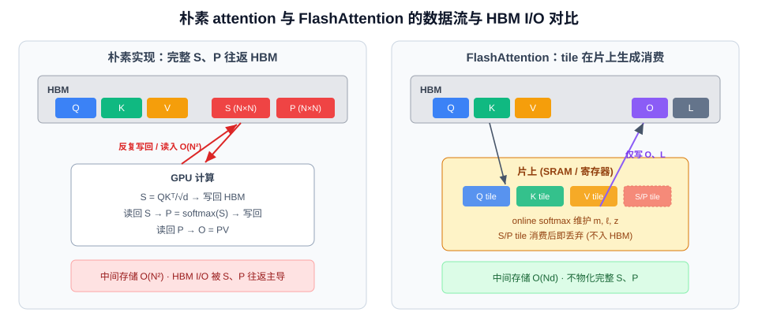
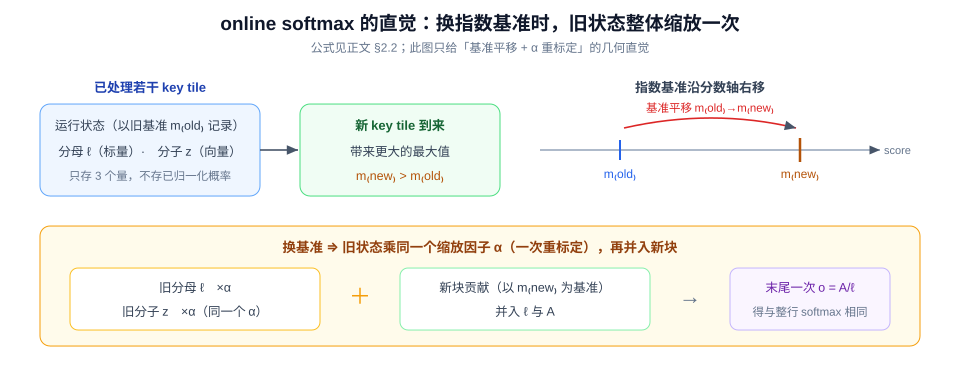
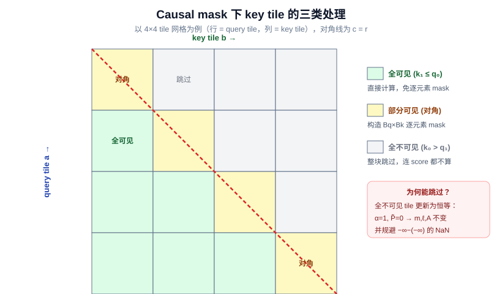
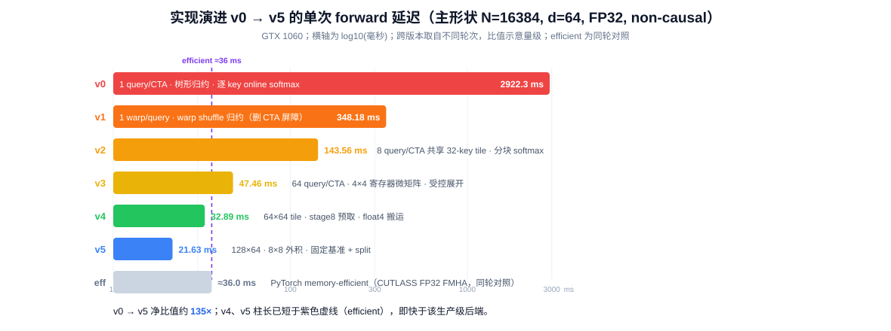
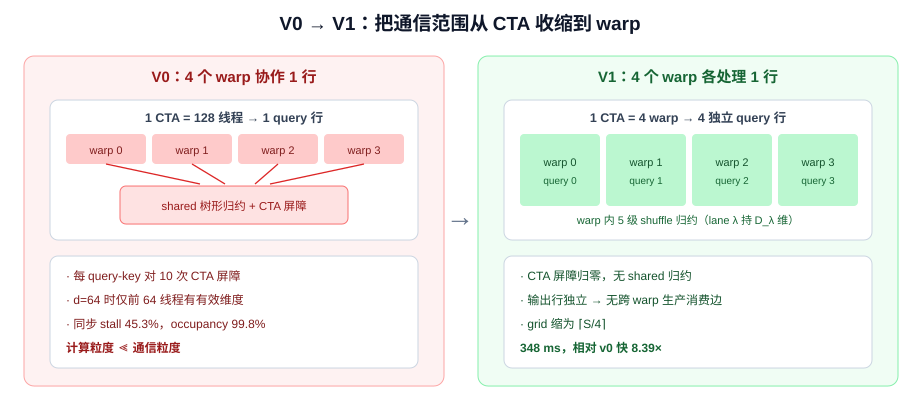
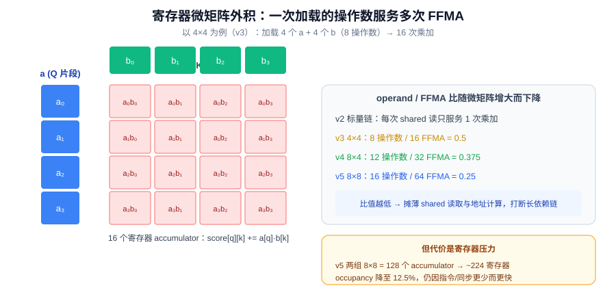
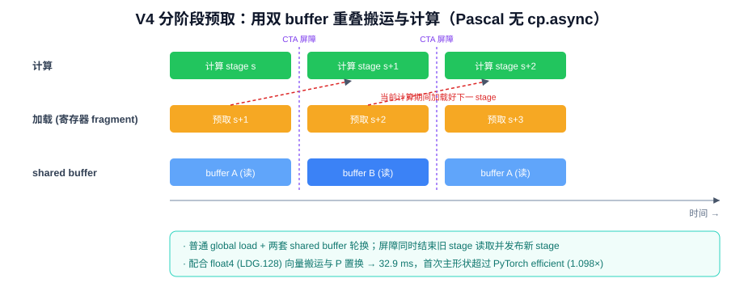
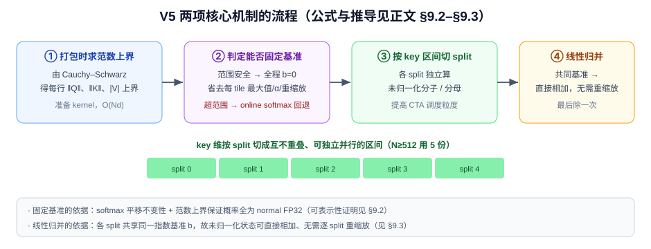

# FlashAttention Forward 的原理与 CUDA 实现演进：从 Online Softmax 到寄存器级 SIMT 流水线

## 摘要

注意力（attention）的朴素实现需要在显存中物化形状为 $(N, N)$ 的分数矩阵 $S$ 与概率矩阵 $P$（$N$ 为序列长度），其容量与 HBM I/O 均随序列长度平方增长，在长序列下既触发显存溢出，又使端到端时延被访存主导。

**FlashAttention（下文简称 FA）的四项核心技术**，在不改变数学结果（精确、非近似）的前提下，避免物化完整 $S/P$，把跨 forward/backward 边界的中间存储由 $O(N^2)$ 压到 $O((N_q+N_k)d)$，并显著降低 HBM 往返：

- **分块**（tiling）：每次只计算 $S$ 的一个 tile；
- **online softmax**：跨 key tile 增量合并 softmax 统计量，而不先物化整行；
- **反向重算**（recomputation）：backward 由 $Q,K,V$ 与保存的行统计量重算 $S,P$，不保存完整 $P$；
- **算子融合**（kernel fusion）：打分、mask、softmax 更新与 $PV$ 累加在同一 kernel 内完成。

**本报告做两件事**。其一，系统推导 FA forward 的全部原理，并完整给出 backward 的数学原理（backward 尚未进入代码实现，仅在原理层描述）。其二，以 GTX 1060（Pascal，CC 6.1）上的一个「正确性优先」FP32 CUDA 基线（v0）为起点，逐版本（v0→v5）记录每一步可独立测量的优化及其数学依据与工程证据。

**主要结果**（主形状 $N=16384,\ d=64$，$N$ 即 benchmark 的 `seq_len`；FP32、GTX 1060、同口径计时）：

- **延迟**：自定义核函数的单次 forward 延迟由 v0 的 $2922.3$ ms 降至 v5 的 $21.6$ ms，约 $135\times$。
- **与基线对比**：在成对计时中，v5 稳定低于 PyTorch 的 memory-efficient 后端（CUTLASS FP32 FMHA，$\approx 36$ ms）。此处以「比值 = V5 耗时 ÷ 同轮 efficient 耗时」度量——non-causal 为 $60.43\%$、causal 为 $61.52\%$，即 **v5 的端到端耗时仅为该后端的约六成**（等价于约 $1.65\times$ 加速）；该后端是本设备上成熟的生产级 FP32 attention 实现，故这一结果尤为值得强调。
- **技术主线**：warp shuffle 归约 → 共享 K/V tile 与分块 softmax → 寄存器微矩阵外积 → 分阶段预取与向量化搬运 → 范数上界固定指数基准 + split attention 线性归并。

需要说明的是，v4/v5 的最快路径是**针对规整形状（$d=64$、$N$ 对齐、地址对齐）的编译期专门化**。这种「只对特定形状/配置深度优化、其余走通用实现」的做法在业界是常见且合理的工程取舍：生产库普遍依赖 autotune（如 Triton、CUTLASS 的 tile/stage 自动搜索）、模板特化与 kernel 分派（按 dtype、head dim、causal、对齐条件选择专用 kernel）、乃至更高层的 CuTe DSL 与 `torch.compile`/编译器融合来覆盖不同输入；本报告在 Pascal 这一受限硬件上手工实现并验证了同一类思路的一个切片。

本报告的记号与符号习惯对齐仓库讲义 [03_02 FlashAttention-2 Forward textbook](../notes/03_02_flash_attention_2_beginner_textbook.md) 与 [03_03 Backward 与实现验证](../notes/03_03_flash_attention_2_backward.md)。代码实现位于 [FA/cpp_cuda/fa2](cpp_cuda/fa2)。

---

## 1. 引言

### 1.1 问题定义

单头 scaled dot-product attention (SDPA) 的输入为 query、key、value 三组向量。遵循讲义的列向量约定，第 $i$ 个 query、第 $j$ 个 key/value 分别记为列向量 $q_i, k_j, v_j \in \mathbb{R}^{d}$。按「打分 → 归一化 → 加权求和」的计算顺序，单条输出 $o_i \in \mathbb{R}^{d}$ 定义为：

$$s_{ij} = \frac{q_i^\top k_j}{\sqrt d},\qquad p_{ij} = \frac{\exp(s_{ij})}{\sum_{u=1}^{N_k}\exp(s_{iu})},\qquad o_i = \sum_{j=1}^{N_k} p_{ij}\, v_j$$

即先算 query 与各 key 的缩放点积 $s_{ij}$，经 softmax 归一化为权重 $p_{ij}$，再对 value 做加权和得 $o_i$。

为批量计算，把每个列向量的转置堆叠成矩阵的行，得 $Q \in \mathbb{R}^{N_q\times d}$、$K, V\in\mathbb{R}^{N_k\times d}$，则矩阵形式为 $S = QK^\top/\sqrt d$、$P = \operatorname{softmax}_{\mathrm{row}}(S)$、$O = PV$。self-attention 中 $N_q=N_k=N$，即 benchmark 中的序列长度 `seq_len`。

本工作求解的是 **forward 的精确计算**：输出 $O$ 与朴素实现在实数算术下逐元素相等，有限精度下仅存在正常的浮点舍入差异（FA 不做稀疏化或近似）。

### 1.2 三笔必须分开的成本：算术、容量与 I/O



*图 1.2-1　左：朴素实现把完整 $S$、$P$（$N\times N$）反复写回并读入 HBM，中间存储 $O(N^2)$；右：FlashAttention 只让当前 tile 与 online softmax 状态在片上存活，$S/P$ tile 消费后即丢弃，HBM 中只保留 $Q,K,V,O,L$，中间存储降为 $O(Nd)$。*

朴素 attention 的代价来自三个互不等价的维度，混为一谈会导致错误的优化判断：

| 成本 | 朴素 attention | FlashAttention 的变化 |
| --- | --- | --- |
| 算术量 | 主项 $O(N^2 d)$ | 仍为精确 dense attention，主项**不**降为线性 |
| $S/P$ 中间存储 | $O(N^2)$ | 不在 HBM 物化完整矩阵 |
| HBM I/O | 多次写回并读入 $S$、$P$ | tile 在片上生成、消费后即丢弃 |

据此可得第一条核心认识：**FA 的本质不是「少算 query-key 对」，而是「以更合适的顺序计算，并避免把完整 $S/P$ 往返 HBM」**。一个 $(B,H,N,N)$ 的中间矩阵占 $BHN^2 e$ 字节（$e$ 为元素字节数）；以 $B{=}1,H{=}32,N{=}8192$、FP16 计，单张分数矩阵即 $4$ GiB，而对应的 $Q$ 仅 $64$ MiB——比例恰为 $N/d$。

这个平方项在长序列下极其恐怖。考虑当前「长上下文」常见的 $N=10^6$（1M token）、单头（$H{=}1,\ B{=}1$）、FP16（$e{=}2$）：若**不使用上下文并行**（context parallelism, CP）把序列切到多卡，则单张 $(N,N)$ 分数矩阵需

$$N^2 e = (10^6)^2 \times 2\ \text{B} = 2\times 10^{12}\ \text{B} \approx 1.82\ \text{TiB}$$

即**单层、单头的一张 $S$（或 $P$）就要约 1.8 TiB**——远超任何单卡显存（H100 也仅 80 GB）；而同配置下一个 $Q$ 仅 $N d e = 10^6\times 128\times 2 \approx 244$ MiB。朴素实现在这一尺度连 forward 都无法物化 $S$，更不论训练还要为 backward 保存 $P$。FA 通过分块把这张 $N\times N$ 矩阵永不整体落地，才使 1M 级上下文在单卡上可行；CP 则是另一正交手段（跨卡切 $N$），二者可叠加。

### 1.3 记号约定

全文沿用下表记号；标量数学公式中的 token 与特征下标 $i,j,u,c$ 从 $1$ 起，tile 与程序循环索引 $a,b$ 从 $0$ 起。

| 记号 | 含义 | 形状 / 取值 |
| --- | --- | --- |
| $N_q, N_k, N, d$ | query 数、key/value 数、self-attention 序列长度、head dimension | self-attention 下 $N_q{=}N_k{=}N$；$N$ 即 benchmark 命令行参数 `seq_len`（部分 perf 文档记作 `S`） |
| $q_i, k_j, v_j, o_i$ | 单个 query/key/value/输出（列向量） | $\mathbb{R}^{d}$ |
| $Q, K, V, O$ | 批量矩阵，第 $i$ 行存对应列向量的转置 | $\mathbb{R}^{N\times d}$ |
| $s_{ij}, S$ | 单个缩放分数、分数矩阵（$S$ **只表分数矩阵，不表序列长度**） | $S\in\mathbb{R}^{N_q\times N_k}$ |
| $p_{ij}, P$ | softmax 概率、概率矩阵 | $P\in\mathbb{R}^{N_q\times N_k}$ |
| $B_q, B_k$ | query tile、key/value tile 大小（block size，非 batch） | 正整数 |
| $T_q, T_k$ | $\lceil N_q/B_q\rceil$、$\lceil N_k/B_k\rceil$ | 正整数 |
| $Q^{(a)}, K^{(b)}, V^{(b)}$ | 第 $a$ 个 query tile、第 $b$ 个 key/value tile | $(B_q,d)$、$(B_k,d)$ |
| $m_i, \ell_i, z_i$ | 运行最大值、softmax 分母、未归一化输出分子 | 标量、标量、$\mathbb{R}^{d}$ |
| $\alpha_i, \widetilde p_{ij}$ | 旧状态缩放因子、新 tile 未归一化权重 | 标量 |
| $A^{(a)}, M^{(a,b)}$ | query tile 的分子 accumulator、mask | $(B_q,d)$、$(B_q,B_k)$ |
| $L_i = m_i + \log\ell_i$ | 一行 scores 的 logsumexp（forward 保存项） | 标量 |
| $D_i = \langle O_i, dO_i\rangle$ | backward 的行标量 | 标量 |

**数学约定与框架张量布局的区分**（强调一次）：数学上向量按列向量书写，线性层记 $y = Wx$，注意力打分记 $q^\top k$；而 PyTorch 等框架张量**特征在最后一维**（如 `(B, H, S, d)`），实际算的是 $y = xW^\top$、`Q @ K.transpose(-2,-1)`。两者是两个层面，不矛盾。本报告公式一律用列向量约定，涉及代码张量形状时按框架真实布局书写。

GPU 片外主存在原理章节统一称 **HBM**（与讲义一致）；在针对 GTX 1060 的硬件实测处，其显存实为 GDDR5，相应处写作「设备显存」以保持准确。片上存储指寄存器与 shared memory/SRAM。

### 1.4 目标硬件与支持范围

全部实测在单张 GTX 1060（GP106，CC 6.1，10 个 SM，标称显存带宽 $192.192$ GB/s，设备 shared 上限 $96$ KiB/SM、$48$ KiB/CTA，寄存器 $64$K/SM）上进行，软件为 CUDA 12.8、PyTorch 2.6.0+cu124。所有版本的支持契约统一为：连续二维 FP32 的 $Q/K/V$，形状 $(S,d)$，$1\le d\le 128$，单头 self-attention，支持 causal 与 non-causal 的 **forward**；不支持 backward、dropout、任意 mask、GQA、KV cache、FP16/BF16 与 Tensor Core 路径。接口约束见 [cuda_fa2_forward.py:L35-L57](src/cuda_fa2_forward.py#L35-L57)。该设备为 Pascal 架构，无 Tensor Core、无 `cp.async`/TMA/WGMMA，故所有矩阵乘均为 FP32 SIMT 乘加（FFMA）。

---

## 2. Forward：精确 Attention 的 IO 感知重排

本章推导 FA forward 的全部原理（§2.1–§2.7），并完整给出 backward 的数学原理（§2.8）。代码实现为 forward-only；backward 一节仅作原理陈述，供后续实现对齐。

### 2.1 为什么「每块各做一次 softmax」是错的

分块计算的核心障碍是 softmax 的**全局归一化**。考察四个分数 `[1,2,3,4]` 被切成两块 `[1,2]` 与 `[3,4]`：两块各自的局部 softmax 均为 $[0.2689, 0.7311]$，直接拼接得到四个数之和为 $2$，不是概率分布；即便整体再除以 $2$，也等于强行规定两块各占 $50\%$ 的概率质量。而真实的 $\operatorname{softmax}([1,2,3,4]) = [0.0321, 0.0871, 0.2369, 0.6439]$ 中，前块合计仅约 $11.92\%$。**局部 softmax 保留了块内相对比例，却丢失了块间相对大小**。因此分块时不能保存「已归一化的局部概率」，而必须保存仍可与后续块合并的信息。

### 2.2 online softmax：三个状态与增量更新

online softmax（Milakov & Gimelshein, 2018）是一个专用术语，指**在单遍、分块的流式遍历中增量计算 softmax 归一化量**的技术：它只维护常数个运行状态，每读入一块就把这些状态「并入」，无需先物化整行 scores，也无需二次遍历。FA 把它从「流式求 softmax 分母」推广到「流式求 softmax 加权和 $\sum_j p_j v_j$」。

#### 2.2.1 把输出改写成「分子除以分母」

固定一个 query，它与 $N_k$ 个 key 产生 scores $\{s_1,\dots,s_{N_k}\}$。softmax 加权输出 $o = \sum_j p_j v_j$（$p_j = \exp(s_j)/\sum_u \exp(s_u)$）在数值上须先减去行最大值 $m = \max_j s_j$ 以防 $\exp$ 上溢——给所有 scores 同减一个常数不改变 softmax（分子分母同乘 $\exp(-m)$）。于是输出改写为

$$o = \frac{\sum_{j}\exp(s_j - m)\,v_j}{\sum_{u}\exp(s_u - m)} = \frac{z}{\ell}$$

由此看出，**计算这一行输出只需要三个标量/向量**，它们正是 online softmax 要流式维护的状态：

- 最大值 $m$：指数基准，保证所有 $\exp$ 的输入 $\le 0$、不上溢；
- 分母 $\ell = \sum_j \exp(s_j - m)$：softmax 的归一化因子（标量）；
- 分子 $z = \sum_j \exp(s_j - m)\,v_j \in \mathbb{R}^{d}$：**尚未除以分母 $\ell$** 的 value 加权和。注意 $z$ 是一个 **$d$ 维向量**（与输出 $o$ 同形），不是标量——它由各 $v_j$（$d$ 维）按权重线性组合而成；而 $m,\ell$ 都是标量。

缺一不可：只有 $m$ 无法加权求和；只有标量 $\ell$ 丢了方向信息；而向量 $z$ 与标量 $\ell$ 若不共享同一个基准 $m$ 就无法相除得到正确的 $o$。这里「未归一化」的确切含义就是：**$z$ 只是分子 $\sum_j \exp(s_j-m)\,v_j$，还没有除以分母 $\ell$**——真正的输出要到最后才由 $o = z/\ell$ 得到。之所以这样刻意推迟那一次除法：若每读一块就先算出归一化的局部输出再去合并，就要反复做除法与再加权（§2.1 已说明局部概率不能直接拼接）；而保留未归一化的 $z$，使跨块合并退化为「向量整体缩放 + 相加」这种廉价且可结合的操作，最后只在全部遍历完成后对 $z$ 除一次 $\ell$。

#### 2.2.2 增量更新式与 $\alpha$ 的来历

初始化 $m=-\infty,\ \ell=0,\ z=0$。读入新 score tile $s\in\mathbb{R}^{B_k}$ 及其 value 矩阵 $V\in\mathbb{R}^{B_k\times d}$ 后，按如下顺序更新（下标 old/new 仅区分同一变量更新前后，不是两套存储）：

$$m_{\mathrm{new}} = \max(m_{\mathrm{old}},\ \max_t s_t),\qquad \alpha = \exp(m_{\mathrm{old}} - m_{\mathrm{new}}),\qquad \widetilde p = \exp(s - m_{\mathrm{new}})$$

$$\ell_{\mathrm{new}} = \alpha\,\ell_{\mathrm{old}} + \textstyle\sum_t \widetilde p_t,\qquad z_{\mathrm{new}} = \alpha\, z_{\mathrm{old}} + V^\top \widetilde p$$

**$\alpha$ 是全部机制的关键，它来自指数基准的改变。** 旧状态 $\ell_{\mathrm{old}}, z_{\mathrm{old}}$ 是以旧基准 $m_{\mathrm{old}}$ 记录的，即每个旧项都含因子 $\exp(s_t - m_{\mathrm{old}})$；当新块带来更大的最大值、基准升到 $m_{\mathrm{new}}$ 时，同一个旧项应当变成 $\exp(s_t - m_{\mathrm{new}})$。两者之比恰为

$$\frac{\exp(s_t - m_{\mathrm{new}})}{\exp(s_t - m_{\mathrm{old}})} = \exp(m_{\mathrm{old}} - m_{\mathrm{new}}) = \alpha$$

且该比值与具体的 $s_t$ **无关**——这就是为什么「换基准」对整个旧状态只需乘一个公共标量 $\alpha$，而不必回头重读任何旧 score。由于 $m_{\mathrm{new}} \ge m_{\mathrm{old}}$，恒有 $\alpha \in (0, 1]$：基准上移即把旧的未归一化量按比例缩小，与新块（已按 $m_{\mathrm{new}}$ 归一）处在同一尺度上，才能直接相加。

关于这组更新式有三点必须强调：

1. **$\ell$ 与 $z$ 必须乘同一个 $\alpha$。** 它们是同一次 softmax 的分母与分子，共享同一基准；只缩放 $\ell$ 而漏乘 $z$（或反之）会让分子分母的基准错位，产生系统性错误而非舍入误差。
2. **顺序不可乱。** 必须先定出 $m_{\mathrm{new}}$，才能据此算 $\alpha$ 与新块权重 $\widetilde p = \exp(s - m_{\mathrm{new}})$；若先用旧 $m$ 算指数再改基准，则新旧两部分基准不一致。
3. **$m_{\mathrm{new}}$ 不变时退化为纯累加。** 若新块的最大值未超过 $m_{\mathrm{old}}$，则 $\alpha = \exp(0) = 1$，更新退化为 $\ell \mathrel{+}= \sum_t\widetilde p_t$、$z \mathrel{+}= V^\top\widetilde p$，即普通累加——重标定只在基准真正改变时才「花钱」。

全部 key tile 处理完后，一次性得到该行输出，并可顺带得到 logsumexp（用途见 §2.7）：

$$o = \frac{z}{\ell},\qquad L = m + \log\ell$$

整个过程对每行只遍历一遍 scores、只维护常数个状态，故额外存储为 $O(d)$ 而非 $O(N_k)$。



*图 2.2-1（辅助理解，公式以正文为准）　online softmax 的几何直觉：已处理块以旧基准 $m_{\mathrm{old}}$ 维护 $\ell, z$；新块带来更大最大值使基准沿分数轴右移到 $m_{\mathrm{new}}$，旧状态整体乘一个与 $s_t$ 无关的公共因子 $\alpha=\exp(m_{\mathrm{old}}-m_{\mathrm{new}})$ 完成一次重标定，再与新块相加，末尾只除一次 $\ell$。*

### 2.3 更新式的精确性（归纳证明）

**命题**：处理完任意若干 tile 后，状态恒满足

$$m = \max_{t\in\mathrm{seen}} s_t,\qquad \ell = \sum_{t\in\mathrm{seen}}\exp(s_t - m),\qquad z = \sum_{t\in\mathrm{seen}}\exp(s_t - m)\,v_t$$

**证明**：第一块处理后，三式由定义直接成立。设在已见集合上成立，加入新块时，对任一旧项有恒等式 $\alpha\exp(s_t - m_{\mathrm{old}}) = \exp(m_{\mathrm{old}}-m_{\mathrm{new}})\exp(s_t - m_{\mathrm{old}}) = \exp(s_t - m_{\mathrm{new}})$，即旧项恰被改写为相对 $m_{\mathrm{new}}$ 的形式；再加上新块以 $m_{\mathrm{new}}$ 为基准的项，三式在扩大后的集合上继续成立。归纳完成。$\blacksquare$

因此最终 $z/\ell$ 与对全部 scores 一次性做 softmax 加权和完全相同。 online softmax 只改变计算与归约顺序，不删除任何 query-key 对，也非近似。

### 2.4 分块 attention forward：公式到伪代码

设 query tile 大小 $B_q$、数量 $T_q=\lceil N_q/B_q\rceil$，key/value tile 大小 $B_k$、数量 $T_k=\lceil N_k/B_k\rceil$。每个并行任务固定一个 `(batch/head, query_tile)`，把 $Q^{(a)}$ 留在片上，维护该 tile 内 $B_q$ 个 query 的运行状态：最大值 $m^{(a)}\in\mathbb{R}^{B_q}$、分母 $\ell^{(a)}\in\mathbb{R}^{B_q}$，以及未归一化输出 accumulator $A^{(a)}\in\mathbb{R}^{B_q\times d}$。这里 $A^{(a)}$ 就是 §2.2 单 query 分子向量 $z$ 的 tile 版本——把该 tile 内 $B_q$ 个 query 各自的 $z^\top$（$d$ 维行向量）堆成矩阵的 $B_q$ 行（$m^{(a)},\ell^{(a)}$ 同理由各 query 的 $m,\ell$ 堆成），因此下文的矩阵更新式与 §2.2 的标量/向量更新式逐行对应。按下列顺序依次处理每个 key/value tile（$M^{(a,b)}$ 为 §2.5 的 causal/边界 mask，`[:,None]` 表示把每行标量沿 $d$ 维广播、$\circ$ 为逐元素乘）：

$$\textbf{(1)}\quad S^{(a,b)} = Q^{(a)}(K^{(b)})^\top / \sqrt d + M^{(a,b)} \in \mathbb{R}^{B_q\times B_k}$$

$$\textbf{(2)}\quad m^{(a)}_{\mathrm{new}} = \max\big(m^{(a)},\ \operatorname{rowmax} S^{(a,b)}\big)$$

$$\textbf{(3)}\quad \alpha^{(a)} = \exp\big(m^{(a)} - m^{(a)}_{\mathrm{new}}\big)$$

$$\textbf{(4)}\quad \widetilde P^{(a,b)} = \exp\big(S^{(a,b)} - m^{(a)}_{\mathrm{new}}[:,\!\text{None}]\big)$$

$$\textbf{(5)}\quad \ell^{(a)}_{\mathrm{new}} = \alpha^{(a)}\circ\ell^{(a)} + \operatorname{rowsum}\widetilde P^{(a,b)}$$

$$\textbf{(6)}\quad A^{(a)}_{\mathrm{new}} = \alpha^{(a)}[:,\!\text{None}]\circ A^{(a)} + \widetilde P^{(a,b)} V^{(b)}$$

全部 key/value tile 处理完后，再做收尾（除一次分母、存 logsumexp）：

$$\textbf{(7)}\quad O^{(a)} = A^{(a)} / \ell^{(a)}[:,\!\text{None}]$$

$$\phantom{\textbf{(7)}}\quad L^{(a)} = m^{(a)} + \log\ell^{(a)}$$

其中步骤 (2)–(6) 与 §2.2 的 online softmax 更新式逐行对应（(2) 定新基准、(3) 得缩放因子、(4) 算新块权重、(5)(6) 用同一 $\alpha^{(a)}$ 重标定旧分母与旧分子再并入新块），只是把单 query 的标量/向量换成了作用于整个 tile 的矩阵运算。该设计体现三条 FA forward 的核心性质：（1）**维护未归一化 accumulator**，仅在最后除以 $\ell$，避免每个 tile 都归一化再合并，从而减少昂贵的非矩阵运算（max/exp/逐元素乘除）；（2）**query tile 在外层、key/value tile 在内层**，不同 query tile 分给不同并行任务，各自独立产出 $O^{(a)}, L^{(a)}$，无需跨任务通信，并行度由 $B\times H$ 提升到 $B\times H\times T_q$；（3）任意时刻只需一个 $B_q\times B_k$ 的临时 score/probability tile，$S^{(a,b)}$ 与 $\widetilde P^{(a,b)}$ 被消费后即丢弃，HBM 中只保留 $Q,K,V,O,L$，不物化 $N_q\times N_k$ 的完整矩阵。

### 2.5 Causal 与边界 mask：哪些 score 可进入 softmax



*图 2.5-1　以 $4\times4$ tile 网格为例（行 = query tile，列 = key tile），对角线为 $c=r$。全可见 tile 直接计算、免逐元素比较；对角 tile 需逐元素 mask；全不可见 tile 整块跳过——其 online softmax 更新是恒等操作（$\alpha{=}1,\ \widetilde P{=}0$），跳过既省两次矩阵乘与 K/V 读取，又规避 $-\infty-(-\infty)$ 的 `NaN`。*

一个位置 $(r,c)$ 有效当且仅当：query 行在界内（$r<N_q$）、key 列在界内（$c<N_k$），且在 causal 下满足 $c\le r$。无效位置的 score 必须在 **rowmax 与指数运算之前**置为 $-\infty$（实现中用足够小的数，如 `-1e6`）：有效时 $S_{rc} = q_r^\top k_c/\sqrt d$，无效时 $S_{rc} = -\infty$。

**不能把无效 score 填 0**：$\exp(0)=1$ 会污染分母，且若无效 score 大于真实最大值还会污染 $m$。按 tile 与 causal 对角线的相对位置，key tile 分三类：（a）**全可见**（$k_1\le q_0$），直接计算、免逐元素比较；（b）**部分可见**（跨对角线），构造 $B_q\times B_k$ 逐元素 mask；（c）**全不可见**（$k_0>q_1$），整块跳过。对全不可见 tile，其对 online softmax 的更新是恒等操作（$\alpha{=}1,\ \widetilde P{=}0$），跳过既省 $O(B_qB_kd)$ 两次矩阵乘与 K/V 读取，又规避了全屏蔽行 $-\infty-(-\infty)$ 的 `NaN` 陷阱。

### 2.6 数值稳定性清单

1. 每轮用最新行最大值 $m_{\mathrm{new}}$ 重标定旧状态与新 tile；
2. 旧 accumulator $A$（即分子 $z$ 的 tile 版，见 §2.4）必须乘 $\alpha$，不能只更新分母；
3. 关键状态 $A,\ell,m$ 使用 FP32，低精度输入在写回前再转 dtype；
4. mask 在 max 之前生效，屏蔽的大 score 不得污染 $m$；
5. 定义并处理全屏蔽行（标准方形 causal self-attention 因可见自身，正常行不会全屏蔽）。

此外，指数可换底：$\exp(x) = 2^{x\log_2 e}$，$\log_2 e \approx 1.4426950408889634$。部分 GPU 对以 2 为底的指数提供高效指令（`ex2.approx`），但「精确」只意味着数学目标与 dense attention 相同，并不保证跨实现逐 bit 一致——并行归约顺序、低精度输入、`exp` 近似都会带来正常浮点差异。

### 2.7 为何保存 logsumexp $L$

由 $L = m + \log\ell$，有 $\exp(L) = \exp(m)\sum_j\exp(s_j-m) = \sum_j\exp(s_j)$，即 $L$ 就是原始 softmax 分母的对数。于是任一概率可由单个标量恢复：

$$p_{ij} = \frac{\exp(s_{ij})}{\exp(L_i)} = \exp(s_{ij} - L_i)$$

因此 backward 只需重算 score $s_{ij}$ 并读取每行一个 $L_i$，即可恢复概率，无需把 forward 的完整 $P$（$N_qN_k$ 个元素）保留到 backward。对 $N_q=N_k=8192,H=32$，完整 BF16 的 $P$ 为 $4$ GiB，而 FP32 的 $L$ 仅 $1$ MiB，相差约 $4096$ 倍。且 $L\ge\max_j s_j$，故 $s_j - L\le 0$，重建时 $\exp$ 不会上溢。forward 保存 $L$ 几乎零额外成本——它只是 online softmax 结束时已有 $m,\ell$ 的合并。

### 2.8 Backward 原理（保存什么、重算什么）

> **实现状态说明**：本节为 backward 的完整数学原理。当前仓库 v0–v5 均为 **forward-only**，backward 尚未进入 CUDA 实现；此处原理供后续实现对齐，不对应已有核函数。

### 9.1 普通 backward 为什么依赖大矩阵

令上游梯度为 $dO\in\mathbb{R}^{N_q\times d}$。忽略 mask 的不可见位置后，标准矩阵形式是：

$$dV=P^\top dO,\quad dP=dOV^\top,\quad dS=P\circ\left(dP-\operatorname{rowsum}(P\circ dP)[:,None]\right)$$

其余两个输入梯度为 $dQ=dSK/\sqrt d$ 和 $dK=dS^\top Q/\sqrt d$。

下面的依赖图中，每份数据只画成一个节点；一条入边表示计算目标节点时必须读取该数据。


**图 9-1：普通 attention 的 $dQ,dK,dV$ 共享依赖 DAG。** 图中红色的 $P,dP,dS$ 都有 $N_qN_k$ 个元素；普通 backward 需要让 $P$ 跨越 forward/backward 边界保持存活，而 $dP,dS$ 可在 backward 内部产生并消费。$Q,K,V$ 也需要保持存活，但它们只有线性规模 $O((N_q+N_k)d)$。

沿依赖图读取，可以得到三条梯度路径：

1. $P,dO\rightarrow dV$；
2. $dO,V\rightarrow dP$，再由 $P,dP\rightarrow dS$，最后由 $dS,K\rightarrow dQ$；
3. 前半段与 $dQ$ 共享同一个 $dP,dS$，最后由 $dS,Q\rightarrow dK$。

如果 forward 保存完整 $P$，其元素数是 $N_qN_k$；若不保存，就必须能廉价重建它。handout 的标准 backward 展开见 [L1039-L1053](./cs336_assignment2_systems_extracted.md#L1039-L1053)。

### 9.2 预备知识：普通 attention backward 按什么顺序计算

在理解 FlashAttention backward 之前，先把不分 tile 的普通 attention backward 走一遍。这里统一约定：

$$dX\equiv\frac{\partial\mathcal J}{\partial X}$$

其中 $\mathcal J$ 是整个模型最终产生的标量 loss，$dX$ 表示该 loss 关于张量 $X$ 的梯度。

#### 9.2.1 Forward 有三个连续算子

忽略 batch、head 和 mask 后，单头 attention forward 是：

$$S=\frac{QK^\top}{\sqrt d}$$

$$P=\operatorname{rowsoftmax}(S)$$

$$O=PV$$

各张量 shape 为：

| 张量 | shape | 含义 |
|---|---:|---|
| $Q$ | $(N_q,d)$ | query |
| $K,V$ | $(N_k,d)$ | key 与 value |
| $S$ | $(N_q,N_k)$ | softmax 前的 score |
| $P$ | $(N_q,N_k)$ | 每个 query 对所有 keys 的概率 |
| $O$ | $(N_q,d)$ | attention 输出 |

backward 从上游给出的 $dO$ 开始，严格沿计算图反向经过：

```text
dO  -->  O = P V  -->  得到 dP、dV
                       |
                       v
                P = softmax(S)  -->  得到 dS
                                      |
                                      v
                              S = Q K^T / sqrt(d)
                                      |
                                      v
                                  得到 dQ、dK
```

#### 9.2.2 先经过矩阵乘 $O=PV$

给定上游梯度 $dO\in\mathbb R^{N_q\times d}$，矩阵乘 backward 得到：

$$dV=P^\top dO\in\mathbb R^{N_k\times d}$$

$$dP=dOV^\top\in\mathbb R^{N_q\times N_k}$$

$dV$ 的含义是：每个 value 向量对所有 query 输出的影响需要按 $P$ 加权汇总。$dP$ 的含义是：改变某个权重 $P_{ij}$ 时，输出行 $O_i$ 会沿 value $V_j$ 的方向变化。

这一步已经说明普通 backward 为什么依赖 $P$：即使暂时不考虑 softmax，计算 $dV$ 也需要读取完整的 attention probability。

#### 9.2.3 再经过普通 softmax backward

attention 对 $S$ 的每一行独立执行 softmax。固定第 $i$ 个 query 行：

阅读本小节时，应把 $i$ 看作已经固定的行标签：它始终指同一个 query，不参与后面的求和，也不会在求导过程中变化。真正变化的下标是 $u$ 和 $j$：$u$ 枚举这一行的 softmax 输出位置，$j$ 表示当前求导所针对的 score 输入位置。

$$S_i=\begin{bmatrix}S_{i1}&\cdots&S_{iN_k}\end{bmatrix}^\top,\qquad P_i=\operatorname{softmax}(S_i)\in\mathbb R^{N_k}$$

其中：

$$P_{ij}=\frac{\exp(S_{ij})}{\sum_{u=1}^{N_k}\exp(S_{iu})}$$

由上一节的 $O=PV$ backward，已经得到 loss 关于 softmax 输出行 $P_i$ 的上游梯度：

$$dP_i=\nabla_{P_i}\mathcal J\in\mathbb R^{N_k}$$

softmax backward 要计算 loss 关于输入 score 行 $S_i$ 的梯度：

$$dS_i=\nabla_{S_i}\mathcal J\in\mathbb R^{N_k}$$

也就是说，它的局部接口是：

```text
forward:   S_i  --> softmax --> P_i
backward:  dS_i <-- backward(P_i, dP_i) <-- dP_i
```

同一行的所有 $P_{iu}$ 都共享一个分母，所以改变一个输入 $S_{ij}$ 会影响这一行的全部输出概率。下面从 softmax 定义开始推导这种耦合关系。

先把第 $i$ 行的 softmax 分母记为：

$$Z_i=\sum_{r=1}^{N_k}\exp(S_{ir})$$

于是第 $u$ 个输出概率为：

$$P_{iu}=\frac{\exp(S_{iu})}{Z_i}$$

这里故意使用两个不同的下标：

- $u$ 表示正在求导的 softmax **输出分量** $P_{iu}$；
- $j$ 表示被改变的 softmax **输入分量** $S_{ij}$。

为了统一表示 $u=j$ 和 $u\ne j$ 两种情况，定义 Kronecker delta：

$$\delta_{uj}=\begin{cases}1,&u=j\\0,&u\ne j\end{cases}$$

先分别计算分子和分母关于 $S_{ij}$ 的导数。分子只有在 $u=j$ 时依赖 $S_{ij}$：

$$\frac{\partial\exp(S_{iu})}{\partial S_{ij}}=\delta_{uj}\exp(S_{iu})$$

分母 $Z_i$ 包含整行所有指数项，但只有第 $j$ 项依赖 $S_{ij}$：

$$\frac{\partial Z_i}{\partial S_{ij}}=\exp(S_{ij})$$

现在对 $P_{iu}=\exp(S_{iu})/Z_i$ 使用商法则。商法则的一般形式是：

$$\frac{\partial(a/b)}{\partial x}=\frac{(\partial a/\partial x)b-a(\partial b/\partial x)}{b^2}$$

在这里，$a=\exp(S_{iu})$、$b=Z_i$、$x=S_{ij}$。把刚才得到的两个导数逐项代入：

$$\frac{\partial P_{iu}}{\partial S_{ij}}=\frac{\delta_{uj}\exp(S_{iu})Z_i-\exp(S_{iu})\exp(S_{ij})}{Z_i^2}$$

先把右侧的两个分式拆开：

$$\frac{\partial P_{iu}}{\partial S_{ij}}=\frac{\delta_{uj}\exp(S_{iu})Z_i}{Z_i^2}-\frac{\exp(S_{iu})\exp(S_{ij})}{Z_i^2}$$

第一项约掉一个 $Z_i$，第二项把 $Z_i^2$ 拆成 $Z_iZ_i$：

$$\frac{\partial P_{iu}}{\partial S_{ij}}=\delta_{uj}\frac{\exp(S_{iu})}{Z_i}-\frac{\exp(S_{iu})}{Z_i}\frac{\exp(S_{ij})}{Z_i}$$

根据 $P_{iu}=\exp(S_{iu})/Z_i$ 和 $P_{ij}=\exp(S_{ij})/Z_i$，逐项替换：

$$\frac{\partial P_{iu}}{\partial S_{ij}}=\delta_{uj}P_{iu}-P_{iu}P_{ij}$$

最后提取公因子 $P_{iu}$：

$$\frac{\partial P_{iu}}{\partial S_{ij}}=\delta_{uj}P_{iu}-P_{iu}P_{ij}=P_{iu}(\delta_{uj}-P_{ij})$$

分成两种情况看更直观：

1. 当 $u=j$ 时，$\delta_{uj}=1$，所以 $\partial P_{ij}/\partial S_{ij}=P_{ij}(1-P_{ij})$。增大 $S_{ij}$ 会增大它自己的概率；
2. 当 $u\ne j$ 时，$\delta_{uj}=0$，所以 $\partial P_{iu}/\partial S_{ij}=P_{iu}(0-P_{ij})=-P_{iu}P_{ij}$。增大 $S_{ij}$ 会增大公共分母，从而压低其他概率。

#### 9.2.4 沿所有路径应用链式法则

现在固定一个输入 score $S_{ij}$，目标是计算：

$$dS_{ij}=\frac{\partial\mathcal J}{\partial S_{ij}}$$

$S_{ij}$ 会同时影响这一行的全部输出 $P_{i1},\ldots,P_{iN_k}$。按照多变量链式法则，需要把经过每个 $P_{iu}$ 的路径贡献相加：

$$dS_{ij}=\sum_{u=1}^{N_k}\frac{\partial\mathcal J}{\partial P_{iu}}\frac{\partial P_{iu}}{\partial S_{ij}}$$

根据 $dP_{iu}=\partial\mathcal J/\partial P_{iu}$：

$$dS_{ij}=\sum_{u=1}^{N_k}dP_{iu}\frac{\partial P_{iu}}{\partial S_{ij}}$$

代入上一小节得到的 softmax 偏导数：

$$dS_{ij}=\sum_{u=1}^{N_k}dP_{iu}P_{iu}(\delta_{uj}-P_{ij})$$

把括号中的两项拆开。$P_{ij}$ 与求和下标 $u$ 无关，因此可以移到第二个求和符号外：

$$dS_{ij}=\sum_{u=1}^{N_k}dP_{iu}P_{iu}\delta_{uj}-P_{ij}\sum_{u=1}^{N_k}dP_{iu}P_{iu}$$

第一项中的 $\delta_{uj}$ 只在 $u=j$ 时等于 1，其余项全部为 0，所以第一个求和只留下 $u=j$ 这一项：

$$dS_{ij}=dP_{ij}P_{ij}-P_{ij}\sum_{u=1}^{N_k}dP_{iu}P_{iu}$$

最后提取公因子 $P_{ij}$：

$$dS_{ij}=P_{ij}\left(dP_{ij}-\sum_{u=1}^{N_k}P_{iu}dP_{iu}\right)$$

定义该行共享的标量：

$$D_i=P_i^\top dP_i=\sum_{u=1}^{N_k}P_{iu}dP_{iu}$$

就得到逐元素形式的 softmax backward：

$$dS_{ij}=P_{ij}(dP_{ij}-D_i)$$

把一行中的全部 $j$ 合在一起，可写成向量形式：

$$dS_i=P_i\circ(dP_i-D_i\mathbf 1)$$

到这里已经得到了实现 softmax backward 所需的全部公式，不需要先理解或构造 Jacobian。对应代码是：

```python
def softmax_backward(grad_p, p):
    softmax_correction = (p * grad_p).sum(dim=-1, keepdim=True)
    return p * (grad_p - softmax_correction)
```

其中，参数 `p` 对应 $P$，参数 `grad_p` 对应已经由后续算子传回的 $dP$。函数不负责计算 $dP$，而是接收 $dP$ 并返回 $dS$。

所以这两行代码就是逐元素公式 $dS_{ij}=P_{ij}(dP_{ij}-D_i)$ 的批量实现。

单行长度为 $N_k$ 时，时间复杂度为 $O(N_k)$。

一个重要的正确性检查是：

$$\sum_{j=1}^{N_k}dS_{ij}=\sum_{j=1}^{N_k}P_{ij}(dP_{ij}-D_i)=D_i-D_i\sum_{j=1}^{N_k}P_{ij}=0$$

这是因为给所有 logits 同时加一个常数不会改变 softmax：

$$\operatorname{softmax}(S_i+c\mathbf 1)=\operatorname{softmax}(S_i)$$

#### 9.2.5 可选补充：Jacobian 与 VJP 的矩阵写法

前面的标量推导已经足以理解和实现 backward。本节只说明这些标量公式为什么经常被简写成 $dS_i=J_i^\top dP_i$。

Jacobian 并不是一种新的运算，它只是把 9.2.3 节求出的所有偏导数排成一个表格。定义：

$$J_i=\frac{\partial P_i}{\partial S_i}\in\mathbb R^{N_k\times N_k}$$

这个矩阵的行下标对应输出，列下标对应输入。因此，第 $u$ 行、第 $j$ 列存放：

$$\left(J_i\right)_{uj}=\frac{\partial P_{iu}}{\partial S_{ij}}$$

9.2.3 节已经分别得到：

- 对角线位置 $u=j$ 的元素是 $P_{ij}(1-P_{ij})$；
- 非对角线位置 $u\ne j$ 的元素是 $-P_{iu}P_{ij}$。

$\operatorname{diag}(P_i)$ 表示把向量 $P_i$ 的元素依次放到主对角线上，并把其他位置全部填成 0。假设这一行只有三个概率：

$$P_i=\begin{bmatrix}P_{i1}\\P_{i2}\\P_{i3}\end{bmatrix}\quad\Longrightarrow\quad\operatorname{diag}(P_i)=\begin{bmatrix}P_{i1}&0&0\\0&P_{i2}&0\\0&0&P_{i3}\end{bmatrix}$$

因此，$\operatorname{diag}(P_i)$ 的第 $(u,j)$ 个元素为：

$$[\operatorname{diag}(P_i)]_{uj}=\begin{cases}P_{iu},&u=j\\0,&u\ne j\end{cases}=\delta_{uj}P_{iu}$$

另一方面，外积 $P_iP_i^\top$ 的第 $(u,j)$ 个元素是 $P_{iu}P_{ij}$。两者相减得到：

$$\delta_{uj}P_{iu}-P_{iu}P_{ij}=P_{iu}(\delta_{uj}-P_{ij})=\frac{\partial P_{iu}}{\partial S_{ij}}$$

所以整张 Jacobian 表可以简写为：

$$J_i=\operatorname{diag}(P_i)-P_iP_i^\top$$

下面验证 $J_i^\top dP_i$ 与前面的标量链式法则相同。$J_i^\top$ 的 shape 是 $(N_k,N_k)$，$dP_i$ 的 shape 是 $(N_k,1)$，所以乘积 $J_i^\top dP_i$ 是一个包含 $N_k$ 个元素的列向量。

要计算这个结果向量的第 $j$ 个元素，需要取 $J_i^\top$ 的第 $j$ 行，与 $dP_i$ 做点积：

$$[J_i^\top dP_i]_j=\sum_{u=1}^{N_k}(J_i^\top)_{ju}dP_{iu}$$

矩阵转置会交换行列下标：

$$(J_i^\top)_{ju}=(J_i)_{uj}$$

而 Jacobian 的第 $(u,j)$ 个元素已经定义为：

$$(J_i)_{uj}=\frac{\partial P_{iu}}{\partial S_{ij}}$$

把这两个等式依次代入矩阵乘法：

$$[J_i^\top dP_i]_j=\sum_{u=1}^{N_k}(J_i)_{uj}dP_{iu}=\sum_{u=1}^{N_k}\frac{\partial P_{iu}}{\partial S_{ij}}dP_{iu}=dS_{ij}$$

这个等式对每个 $j$ 都成立，所以：

$$dS_i=J_i^\top dP_i$$

这就是 softmax 的 vector-Jacobian product（VJP）。实际实现不会构造 $N_k\times N_k$ 的 $J_i$，因为 9.2.4 节的逐元素公式只需要 $O(N_k)$ 时间和空间。

#### 9.2.6 继续传播到 $Q$ 和 $K$

前两步已经依次得到 $dP$ 和 $dS$。最后经过 $S=QK^\top/\sqrt d$：

$$dQ=\frac{dSK}{\sqrt d},\qquad dK=\frac{dS^\top Q}{\sqrt d}$$

至此，普通 attention backward 的完整计算顺序是：

1. 从 $dO,P,V$ 得到 $dV,dP$；
2. 从 $P,dP$ 得到每行的 $D$ 和 $dS$；
3. 从 $dS,Q,K$ 得到 $dQ,dK$。

下一节开始讨论 FlashAttention 面临的矛盾：这些公式需要 $P$，但 forward 为了节省 HBM 恰恰没有保存完整 $P$。[Handout：L1039-L1053](./cs336_assignment2_systems_extracted.md#L1039-L1053)

### 9.3 第一个关键：用 $L$ 按 tile 重建 $P$

普通 backward 需要 $P$，但 FlashAttention forward 没有把完整 $P$ 写入 HBM。它只额外保存每个 query 行的 log-sum-exp：

$$L_i=\log\left(\sum_{u=1}^{N_k}\exp(S_{iu})\right)$$

本节要回答：

> 为什么重新算出一个局部 score tile 后，只读取每行一个 $L_i$，就能恢复这个 tile 在全局 softmax 中的真实概率？

#### 9.3.1 局部 softmax 为什么不正确

假设当前只重算了索引为 $b$ 的 key tile 所对应的 key 集合 $\mathcal T_b$。如果直接在 tile 内做 softmax，得到的是：

$$\widehat P_{ic}^{(b)}=\frac{\exp(S_{ic})}{\sum_{u\in\mathcal T_b}\exp(S_{iu})}$$

但真实 attention probability 的分母覆盖全部 $N_k$ 个 keys：

$$P_{ic}=\frac{\exp(S_{ic})}{\sum_{u=1}^{N_k}\exp(S_{iu})}$$

一般情况下两个分母不同，所以每个 tile 各自做 local softmax 后不能拼成完整 $P$。backward 必须使用 forward 已经算出的全局行归一化信息。

#### 9.3.2 $L_i$ 保存了完整分母

由 $L_i$ 的定义：

$$\exp(L_i)=\sum_{u=1}^{N_k}\exp(S_{iu})$$

代回 softmax 定义：

$$P_{ij}=\frac{\exp(S_{ij})}{\exp(L_i)}=\exp(S_{ij}-L_i)$$

因此恢复一个概率元素只需要：

1. 用单个 query 向量 $q_i$ 和 key 向量 $k_j$ 重算 $S_{ij}$；
2. 读取该 query 行的全局 $L_i$；
3. 计算 $\exp(S_{ij}-L_i)$。

$L_i$ 之所以只需一个标量，是因为同一 query 行的所有 softmax 元素共享同一个分母。

forward 的 online softmax 最终已有：

$$L_i=m_i+\log\ell_i$$

所以保存 $L_i$ 不需要额外扫描完整 score 行，只需在 forward 结束时把已有的 running maximum 和分母状态合并。

#### 9.3.3 按 tile 重建的具体步骤

对 query tile $Q^{(a)}\in\mathbb R^{B_q\times d}$ 和 key tile $K^{(b)}\in\mathbb R^{B_k\times d}$：

从这里开始严格区分两类下标：

- $i,j$ 表示单个 query/key 的行号，例如 $q_i,k_j,S_{ij}$；
- $a,b$ 表示从 0 开始的 tile 索引，即 $a\in\{0,\ldots,T_q-1\}$、$b\in\{0,\ldots,T_k-1\}$；
- $Q^{(a)}$ 表示索引为 $a$ 的 query tile；
- $K^{(b)},V^{(b)}$ 表示索引为 $b$ 的 key/value tile；
- 括号上标 $(a),(b)$ 只是分块标签，**不表示乘方**；
- $S^{(a,b)},P^{(a,b)}$ 表示 query tile $a$ 与 key tile $b$ 共同形成的 $(B_q,B_k)$ tile。

这样，单个向量 $q_i,k_j,v_j$ 与包含多行向量的 tile $Q^{(a)},K^{(b)},V^{(b)}$ 不会混淆。

1. 重算当前 score tile：

$$S^{(a,b)}=\frac{Q^{(a)}(K^{(b)})^\top}{\sqrt d}+M^{(a,b)}$$

2. 加载 query tile $a$ 中各行对应的 $L^{(a)}\in\mathbb R^{B_q}$；
3. 将 $L^{(a)}$ 广播到当前 tile 的 $B_k$ 列并恢复：

$$P^{(a,b)}=\exp\left(S^{(a,b)}-L^{(a)}[:,None]\right)\in\mathbb R^{B_q\times B_k}$$

这里的 $P^{(a,b)}$ 是完整概率矩阵 $P$ 的真实切片。它不同于 forward 中相对当前 running maximum 构造的临时未归一化量 $\widetilde P^{(a,b)}$。

#### 9.3.4 Mask 和指数底数必须与 forward 一致

重算 $S^{(a,b)}$ 时必须恢复与 forward 完全相同的：

- score scale；
- causal mask；
- 非整除边界 mask；
- 指数底数和对应缩放。

若某位置在 forward 被 mask，则 backward 重建时也必须令其 $P_{ij}=0$，否则该位置会错误地向 $dV$ 和 $dS$ 传播梯度。

如果实现内部使用 `exp2`，$S$ 与保存的 $L$ 必须处于同一底数体系。对外若约定 $L$ 为自然 log-sum-exp，则写回或读取时必须做一致换算。

#### 9.3.5 从内存角度看为什么值得

完整 $P$ 有 $N_qN_k$ 个元素，而 $L$ 只有 $N_q$ 个元素：

$$O(N_qN_k)\text{ 个保存元素}\quad\longrightarrow\quad O(N_q)\text{ 个行统计量}$$

backward 当前只物化一个 $B_q\times B_k$ 的 $P^{(a,b)}$ tile，用完即可丢弃。代价是重新执行 $Q^{(a)}(K^{(b)})^\top$，也就是用额外 FLOPs 换取更少 HBM 容量和 I/O。

现在已经解决了“当前 $P$ tile 从哪里来”。下一节还要解决另一个全局依赖：普通 softmax backward 中的 $D_i=\sum_jP_{ij}dP_{ij}$ 跨越整行 keys，不能从单个 tile 独立算出。

### 9.4 第二个关键：用 $D$ 消除跨 tile 的行归约

上一节已经解决了“当前 $P$ tile 从哪里来”，但 softmax backward 还有一个看似无法局部计算的量：

$$D_i=\sum_{j=1}^{N_k}P_{ij}dP_{ij}$$

这里的 key 特指 attention 输入矩阵 $K$ 中的 key 向量 $k_1,\ldots,k_{N_k}$。对固定 query $q_i$，$P_{ij}$ 是它分配给 key $k_j$ 的概率，所以 $P$ 的第 $j$ 列与第 $j$ 个 key 一一对应。于是，$D_i$ 沿 $j$ 求和，就是沿 $P$ 的列轴，也就是沿全部 key 位置求和。

但是 tiled backward 每次只加载一段连续的 key 向量。这里让 tile 索引 $b$ 从 0 开始，而本节标量公式中的 key 行号仍按数学惯例从 1 开始。索引为 $b$ 的 key tile 对应：

$$\mathcal T_b=\{bB_k+1,\ldots,\min((b+1)B_k,N_k)\},\qquad b=0,\ldots,T_k-1$$

若当前 program 只持有 $\mathcal T_b$ 中的 keys，它也只能访问 $P_i$ 和 $dP_i$ 在这些列上的元素，因此最多只能得到部分和：

$$D_i^{(b)}=\sum_{u\in\mathcal T_b}P_{iu}dP_{iu}$$

完整结果需要把全部 $T_k$ 个 key tiles 的部分和再次相加：

$$D_i=\sum_{b=0}^{T_k-1}D_i^{(b)}$$

因此一般有 $D_i^{(b)}\ne D_i$。不能把单个 tile 的部分和直接代入 $dS_{iu}=P_{iu}(dP_{iu}-D_i)$；那会把全局 softmax 错误地当成 tile 内 softmax。

#### 9.4.1 先从 $dP$ 的元素公式出发

由 $O=PV$ 的矩阵乘 backward：

$$dP=dOV^\top$$

所以第 $i$ 个 query 与第 $j$ 个 key/value 对应的元素为：

$$dP_{ij}=\sum_{c=1}^{d}dO_{ic}V_{jc}$$

这里 $c$ 遍历 value/output 的特征维。将它代入 $D_i$：

$$D_i=\sum_{j=1}^{N_k}P_{ij}\left(\sum_{c=1}^{d}dO_{ic}V_{jc}\right)$$

先使用乘法对加法的分配律，把外层的 $P_{ij}$ 乘进内层求和：

$$D_i=\sum_{j=1}^{N_k}\sum_{c=1}^{d}P_{ij}dO_{ic}V_{jc}$$

这表示要把所有 $(j,c)$ 组合对应的项 $P_{ij}dO_{ic}V_{jc}$ 相加。因为两个求和都是有限求和，先遍历 $j$ 再遍历 $c$，与先遍历 $c$ 再遍历 $j$ 会访问完全相同的一组 $(j,c)$，所以可以交换顺序：

$$D_i=\sum_{c=1}^{d}\sum_{j=1}^{N_k}P_{ij}dO_{ic}V_{jc}$$

现在固定外层的 $i,c$。$dO_{ic}$ 只由 query 行 $i$ 和特征位置 $c$ 决定，不随内层求和变量 $j$ 改变，因此可以把它提到关于 $j$ 的求和外：

$$D_i=\sum_{c=1}^{d}dO_{ic}\left(\sum_{j=1}^{N_k}P_{ij}V_{jc}\right)$$

forward 的输出元素恰好满足：

$$O_{ic}=\sum_{j=1}^{N_k}P_{ij}V_{jc}$$

因此：

$$D_i=\sum_{c=1}^{d}O_{ic}dO_{ic}=\langle O_i,dO_i\rangle$$

对所有 query 行同时计算，就是：

$$D=\operatorname{rowsum}(O\circ dO)\in\mathbb R^{N_q}$$

这个等式不是近似，也不是 FlashAttention 特有的新梯度公式；它只是把 $D_i=\sum_jP_{ij}dP_{ij}$ 中的 $dP=dOV^\top$ 展开，再利用了 forward 已有的 $O=PV$。

#### 9.4.2 为什么改写后适合 tiled backward

原定义沿 key 维归约，需要先得到整行 $P_i$ 和 $dP_i$。改写后的表达式只沿长度为 $d$ 的特征维归约，而且只依赖：

- forward 输出 $O\in\mathbb R^{N_q\times d}$；
- backward 入口收到的 $dO\in\mathbb R^{N_q\times d}$。

因此可以在进入主要 backward kernel 前，用一次 $O(N_qd)$ 的预处理算出全部 $D$，无需额外遍历 $N_qN_k$ 个 score 元素：

```python
D = (O.float() * dO.float()).sum(dim=-1)
```

实际实现通常让乘法和归约在 FP32 中进行，避免长度为 $d$ 的求和过早丢失精度。将 $D$ 按 query tile 切成 $D^{(a)}\in\mathbb R^{B_q}$ 后，任意一对 query/key tiles 都能独立计算正确的：

$$dS^{(a,b)}=P^{(a,b)}\circ\left(dP^{(a,b)}-D^{(a)}[:,None]\right)$$

这里广播到每一列的是 $D^{(a)}$ 中各 query 行的**完整 $D_i$**，不是当前 key tile 的部分和。若某个位置被 mask，则重建出的 $P_{ij}=0$，相应的 $dS_{ij}$ 也自然为 0。

至此，单个 backward tile 所需的两个全局 softmax 信息都已变成每个 query 行一个标量：

| 行统计量 | 来自哪里 | 在 backward 中解决什么问题 |
|---|---|---|
| $L_i$ | forward 的 log-sum-exp | 从重算的 $S_{ij}$ 恢复全局概率 $P_{ij}$ |
| $D_i$ | backward 开始时的 $\langle O_i,dO_i\rangle$ | 从局部 $P,dP$ tile 得到正确的 $dS$ tile |

handout 的 tiled backward 也先计算 $D=\operatorname{rowsum}(O\circ dO)$，再把对应的 $D^{(a)}$ 用于每个 $dS^{(a,b)}$。[Handout：L1242-L1280](./cs336_assignment2_systems_extracted.md#L1242-L1280)

### 9.5 核心：所有二次矩阵都只按 tile 产生和消费

FA backward 的主旨不只是“不保存 $P$”，而是：**逻辑上具有 $(N_q,N_k)$ shape 的 $S,P,dP,dS$ 都不在 HBM 中物化成完整矩阵。** 对每一对 query/key tiles $(a,b)$，它们按照依赖顺序以 $(B_q,B_k)$ 小块产生，被后续计算立即消费，然后丢弃。

| 逻辑矩阵 | 完整 shape | 当前 tile 怎样得到 | 当前 tile 立即服务于什么 |
|---|---:|---|---|
| $S$ | $(N_q,N_k)$ | $Q^{(a)}(K^{(b)})^\top/\sqrt d+M^{(a,b)}$ | 用 $L^{(a)}$ 重建 $P^{(a,b)}$ |
| $P$ | $(N_q,N_k)$ | $\exp(S^{(a,b)}-L^{(a)}[:,None])$ | 计算 $\Delta dV^{(b)}$ 和 $dS^{(a,b)}$ |
| $dP$ | $(N_q,N_k)$ | $dO^{(a)}(V^{(b)})^\top$ | 计算 $dS^{(a,b)}$ |
| $dS$ | $(N_q,N_k)$ | $P^{(a,b)}\circ(dP^{(a,b)}-D^{(a)}[:,None])$ | 计算 $\Delta dQ^{(a)}$ 和 $\Delta dK^{(b)}$ |

因此，数学上的完整依赖链虽然是：

$$S\longrightarrow P,\qquad dO\longrightarrow dP\longrightarrow dS\longrightarrow dQ,dK,\qquad P,dO\longrightarrow dV$$

实现时却反复执行下面的局部流水线：

```text
生成 S_tile
  -> 重建 P_tile
  -> 计算 dP_tile
  -> 计算 dS_tile
  -> 累加到 dQ/dK/dV 的输出 tile
  -> 丢弃 S_tile、P_tile、dP_tile、dS_tile
```

最终必须写回 HBM 的是 $dQ,dK,dV$，它们的总元素数为 $N_qd+2N_kd$，只随序列长度线性增长。不会写回 HBM 的完整中间矩阵是 $S,P,dP,dS$，每一个原本都有 $N_qN_k$ 个元素。

下面固定索引为 $a$ 的 query tile 和索引为 $b$ 的 key/value tile，逐步展开这一对 tiles 的计算；至于不同 programs 如何分工和归约，将在 9.7 节说明。

#### 9.5.1 进入 tile 前已经有哪些数据

当前计算读取：

| 数据 | shape | 作用 |
|---|---:|---|
| $Q^{(a)},dO^{(a)}$ | $(B_q,d)$ | 当前 query tile 与其输出梯度 |
| $K^{(b)},V^{(b)}$ | $(B_k,d)$ | 当前 key/value tile |
| $L^{(a)},D^{(a)}$ | $(B_q,)$ | 当前 query tile 中每一行的两个全局标量 |
| $M^{(a,b)}$ | $(B_q,B_k)$ 或隐式生成 | causal 与边界 mask |

$L^{(a)},D^{(a)}$ 的 shape 都只有 $(B_q,)$。在公式中写成 `[:,None]`，表示沿当前 tile 的 $B_k$ 列广播，并不复制出一个持久的大矩阵。

#### 9.5.2 先重建 $S$ 与 $P$

$$S^{(a,b)}=\frac{Q^{(a)}(K^{(b)})^\top}{\sqrt d}+M^{(a,b)}\in\mathbb R^{B_q\times B_k}$$

$$P^{(a,b)}=\exp\left(S^{(a,b)}-L^{(a)}[:,None]\right)\in\mathbb R^{B_q\times B_k}$$

这里必须复现 forward 的 scale、mask 和指数底数。全不可见的 future tile 可以直接跳过；与 causal 对角线相交的 tile 则必须逐元素应用 mask。

#### 9.5.3 $dP$ 也按同一张 tile 网格计算

完整的 $dP=dOV^\top$ 确实是一个 $(N_q,N_k)$ 矩阵，但 FlashAttention 不会先把它完整算出并写入 HBM。它与 $S$、$P$ 使用相同的二维分块方式：query tile 索引为 $a$，key/value tile 索引为 $b$，当前切片记为 $dP^{(a,b)}$。

先看单个元素。对于 query 行 $r$ 和 key/value 行 $c$：

$$dP_{rc}=\sum_{t=1}^{d}dO_{rt}V_{ct}$$

这里的求和只发生在长度为 $d$ 的特征维 $t$ 上，不需要读取其他 query 行或其他 key/value 行。因此，要计算 $(a,b)$ 位置的整个 $dP$ tile，只需当前的 $dO^{(a)}$ 和 $V^{(b)}$：

$$dP^{(a,b)}=dO^{(a)}(V^{(b)})^\top\in\mathbb R^{B_q\times B_k}$$

也就是说，逻辑上存在完整矩阵 $dP$，实现中却只生成当前的 $B_q\times B_k$ 切片。这个切片保留在当前 program 的片上临时状态中，不写回 HBM。

#### 9.5.4 生成 $dP$ 后立即计算同位置的 $dS$

当前 program 已经拥有：

- 由 $S^{(a,b)}$ 和 $L^{(a)}$ 重建的 $P^{(a,b)}$；
- 刚计算出的 $dP^{(a,b)}$；
- backward 开始时预先计算的完整行统计量 $D^{(a)}$。

因此可以立即逐元素计算同一个位置的 $dS$ tile：

$$dS^{(a,b)}=P^{(a,b)}\circ\left(dP^{(a,b)}-D^{(a)}[:,None]\right)\in\mathbb R^{B_q\times B_k}$$

对应的数据流是：

```python
dP_tile = dO_tile @ transpose(V_tile)
dS_tile = P_tile * (dP_tile - D_tile[:, None])
```

$dP^{(a,b)}$ 产生后立刻被 $dS^{(a,b)}$ 消费，之后即可与 $S^{(a,b)}$、$P^{(a,b)}$ 一起丢弃。因此 $dP$ 虽然在数学上有 $N_qN_k$ 个元素，任意时刻实际存活的仍只有当前 $B_qB_k$ 个元素。

这一步之所以能完全在 tile 内完成，关键是 $D^{(a)}$ 中保存的是每个 query 行的完整 $D_i=\langle O_i,dO_i\rangle$。若临时改用当前 tile 的 `sum(P_tile * dP_tile)`，得到的只是 key 维归约的一部分，不是全局 softmax 的梯度。

#### 9.5.5 消费 $P$ 和 $dS$ tile

$dS$ 不是 attention backward 的最终输出。它是 loss 对内部 score 矩阵 $S$ 的梯度，作用是把梯度继续传回产生 $S$ 的两个输入 $Q$ 和 $K$。完整依赖链是：

```text
dO -> dP -> dS -> dQ
              \-> dK

dO + P -------> dV
```

先看 $dS$ 为什么能计算 $dQ$ 和 $dK$。单个 score 元素来自：

$$S_{rc}=\frac{q_r^\top k_c}{\sqrt d}$$

固定 query $q_r$ 时，每个 key $k_c$ 都通过 $S_{rc}$ 向它贡献梯度。将全部 key 位置的贡献相加：

$$dq_r=\frac{1}{\sqrt d}\sum_{c=1}^{N_k}dS_{rc}k_c$$

固定 key $k_c$ 时，每个 query $q_r$ 都通过 $S_{rc}$ 向它贡献梯度。将全部 query 位置的贡献相加：

$$dk_c=\frac{1}{\sqrt d}\sum_{r=1}^{N_q}dS_{rc}q_r$$

因此，当前 $(a,b)$ tile 的 $dS^{(a,b)}$ 分别产生：

$$\Delta dQ^{(a)}=\frac{dS^{(a,b)}K^{(b)}}{\sqrt d}\in\mathbb R^{B_q\times d}$$

$$\Delta dK^{(b)}=\frac{(dS^{(a,b)})^\top Q^{(a)}}{\sqrt d}\in\mathbb R^{B_k\times d}$$

其中 $\Delta$ 强调这只是一个 tile 提供的局部贡献：$dQ^{(a)}$ 还要累加其他 key tiles 的贡献，$dK^{(b)}$ 还要累加其他 query tiles 的贡献。

另一条支路不经过 $dS$。由 $O=PV$，当前 $P$ tile 直接对 $dV^{(b)}$ 产生：

$$\Delta dV^{(b)}=(P^{(a,b)})^\top dO^{(a)}\in\mathbb R^{B_k\times d}$$

当前 tile 对 $dQ,dK,dV$ 的贡献都累加完成后，$dS^{(a,b)}$ 和 $P^{(a,b)}$ 就完成了使命，可以直接丢弃，不需要写回 HBM。

把这一对 tiles 的局部数据流连起来就是：

```text
Q_a, K_b, mask   ->  S_ab
S_ab, L_a        ->  P_ab
dO_a, V_b        ->  dP_ab
P_ab, dP_ab, D_a ->  dS_ab

P_ab, dO_a       ->  contribution to dV_b
dS_ab, Q_a       ->  contribution to dK_b
dS_ab, K_b       ->  contribution to dQ_a
```

伪代码标识符中的 `_a`、`_b` 分别对应数学记号的 tile 上标 $(a)$、$(b)$。$S^{(a,b)},P^{(a,b)},dP^{(a,b)},dS^{(a,b)}$ 都只在处理当前 tile 时存在。剩下的工程问题是：不同 tile 会共同贡献同一个输出梯度，应当由谁负责累加这些贡献？

### 9.6 保存、预计算、重算与丢弃：张量生命周期

先按时间边界区分四类数据：

1. **跨越 forward/backward 保存**：backward 以后还要读取，forward 结束时不能释放；
2. **backward 入口预计算**：收到 $dO$ 后算一次，供所有 tile 使用；
3. **tile 内重算**：只在处理当前 tile 时短暂存在；
4. **输出梯度 accumulator**：一个 program 在片上累加，完成后写回 HBM。

完整列表如下：

| 数据 | shape | 生命周期与用途 |
|---|---:|---|
| $Q$ | $(N_q,d)$ | 跨 forward/backward 保存；重算 $S$，并计算 $dK$ |
| $K,V$ | $(N_k,d)$ | 跨 forward/backward 保存；重算 $S$，并计算 $dQ,dP$ |
| $O$ | $(N_q,d)$ | 跨 forward/backward 保存；与 $dO$ 共同计算 $D$ |
| $L$ | $(N_q,)$ | 跨 forward/backward 保存；按 tile 重建 $P$ |
| scale、causal 等参数 | 标量或小型元数据 | 跨边界保存；保证重算与 forward 语义一致 |
| $dO$ | $(N_q,d)$ | 上游在 backward 入口传入 |
| $D$ | $(N_q,)$ | backward 入口由 $\operatorname{rowsum}(O\circ dO)$ 预计算 |
| $S^{(a,b)},P^{(a,b)}$ | $(B_q,B_k)$ | tile 内重算，用完丢弃 |
| $dP^{(a,b)},dS^{(a,b)}$ | $(B_q,B_k)$ | tile 内产生和消费，用完丢弃 |
| $dQ^{(a)}$ accumulator | $(B_q,d)$ | query-owner program 私有 |
| $dK^{(b)},dV^{(b)}$ accumulators | $(B_k,d)$ | key-owner program 私有 |

需要特别区分“逻辑 shape”和“实际物化”：

- $S,P,dP,dS$ 在数学上都有 $(N_q,N_k)$ 的完整定义；
- kernel 不为其中任何一个分配完整的 HBM buffer；
- kernel 每次只产生对应位置的 $(B_q,B_k)$ tile，并在片上完成从 $S$ 到 $P$、从 $dP$ 到 $dS$、再到输出梯度贡献的计算；
- 最终只有线性规模的 $dQ,dK,dV$ 作为 backward 输出写回 HBM。

这里“保存 $Q,K,V,O$”通常表示 autograd 保持已有 Tensor storage 存活，不代表一定复制一份。$O$ 虽然是 forward 的输出，但 backward 计算 $D$ 时仍需要读取它，因此也必须保证对应值没有被释放或非法原地修改。

忽略少量元数据，跨越 forward/backward 边界的主要元素数为：

$$N_qd+2N_kd+N_qd+N_q=2N_qd+2N_kd+N_q=O((N_q+N_k)d)$$

普通实现若额外保存完整 $P$，还会增加 $N_qN_k$ 个元素。FlashAttention 用长度为 $N_q$ 的 $L$ 替代了这个二次项；$D$ 是 backward 开始后才产生的另一个长度为 $N_q$ 的向量。

任意时刻，score/probability 级别的活跃中间量只有一个或少数几个 $B_qB_k$ tile，而不是完整的 $N_qN_k$ 矩阵。代价是 backward 重新执行矩阵乘和指数运算。FA1 的核心取舍正是：在片上重算当前 tile，通常比 forward 把完整 $P$ 写入 HBM、backward 再读回来更划算。[FA1 §3.1 Recomputation](https://papers.neurips.cc/paper_files/paper/2022/file/67d57c32e20fd0a7a302cb81d36e40d5-Paper-Conference.pdf)

若 forward 包含 dropout，backward 还必须重现同一 dropout mask。常见做法是保存随机数种子或 counter，而不是保存完整 $N_q\times N_k$ mask；本文和当前 handout 的核心算法不展开这部分。

### 9.7 为什么课程版 tiled backward 使用两遍调度

9.5 已经说明，一个 $(a,b)$ tile 会同时产生 $\Delta dQ^{(a)}$、$\Delta dK^{(b)}$ 和 $\Delta dV^{(b)}$。数学上可以在一次遍历中算出它们，工程上却还要决定：哪个 program 最终拥有并写回每个输出 tile？

#### 9.7.1 三个梯度的归约方向不同

对固定的 query 行 $i$：

$$dQ_i=\frac{1}{\sqrt d}\sum_{j=1}^{N_k}dS_{ij}K_j$$

$dQ_i$ 必须汇总所有 keys 的贡献，所以最自然的是固定 query tile，遍历全部 key tiles。

对固定的 key/value 行 $j$：

$$dK_j=\frac{1}{\sqrt d}\sum_{i=1}^{N_q}dS_{ij}Q_i$$

$$dV_j=\sum_{i=1}^{N_q}P_{ij}dO_i$$

$dK_j,dV_j$ 必须汇总所有 queries 的贡献，所以最自然的是固定 key tile，遍历全部 query tiles。

由此得到两种互补的输出所有权：

| program 拥有的输出 tile | 内层遍历 | 能在片上完成的完整归约 |
|---|---|---|
| $dQ^{(a)}$ | 所有 key tiles $b$ | 沿 key 维归约 |
| $dK^{(b)},dV^{(b)}$ | 所有 query tiles $a$ | 沿 query 维归约 |

两遍的存储行为可以直接对照：

| pass | program 固定并持有的输出 accumulator | 内层每轮临时生成 | 循环结束时写回 |
|---|---|---|---|
| key-owner | $dK^{(b)},dV^{(b)}$，大小均为 $(B_k,d)$ | $S^{(a,b)},P^{(a,b)},dP^{(a,b)},dS^{(a,b)}$ | 当前 $dK^{(b)},dV^{(b)}$ |
| query-owner | $dQ^{(a)}$，大小为 $(B_q,d)$ | $S^{(a,b)},P^{(a,b)},dP^{(a,b)},dS^{(a,b)}$ | 当前 $dQ^{(a)}$ |

两遍都只让当前 $(B_q,B_k)$ 中间 tiles 短暂存活。区别不是“哪一遍物化哪个大矩阵”，而是“哪一遍负责把哪个线性规模的输出梯度 tile 完整归约并写回”。

#### 9.7.2 为什么一个遍历方向不能无代价地写完三者

假设只使用 query-owner programs。每个 program 可以独占 $dQ^{(a)}$，但所有 query programs 都会向同一个 $dK^{(b)},dV^{(b)}$ 写部分和。反过来，只使用 key-owner programs 时，多个 programs 又会同时向同一个 $dQ^{(a)}$ 写部分和。

不同 GPU thread blocks 不能直接共享一个片上 accumulator。单遍并非数学上不可能，但通常需要以下至少一种机制：

- 对全局输出做 atomic add；
- 先写出大量 partial gradients，再启动额外 kernel 归约；
- 引入更复杂的跨 program 同步与工作划分。

课程算法选择两遍，是为了让每个输出 tile 都只有一个 owner：该 program 在片上完成全部归约，最后只写回一次。

#### 9.7.3 第一遍：key-owner 计算 $dK,dV$

```python
parallel for key_tile b:
    dK_b = zeros((Bk, d), fp32)
    dV_b = zeros((Bk, d), fp32)

    for query_tile a:
        S_ab = recompute_score(Q_a, K_b, mask)
        P_ab = exp(S_ab - L_a[:, None])
        dP_ab = dO_a @ transpose(V_b)
        dS_ab = P_ab * (dP_ab - D_a[:, None])

        dV_b += transpose(P_ab) @ dO_a
        dK_b += transpose(dS_ab) @ Q_a / sqrt(d)

    store dK_b, dV_b
```

不同 key tiles 之间可以并行。每个 program 遍历全部 query tiles 后，已经得到自己所负责 $dK^{(b)},dV^{(b)}$ 的完整结果，不需要其它 programs 再修改它们。

#### 9.7.4 第二遍：query-owner 计算 $dQ$

```python
parallel for query_tile a:
    dQ_a = zeros((Bq, d), fp32)

    for key_tile b:
        S_ab = recompute_score(Q_a, K_b, mask)
        P_ab = exp(S_ab - L_a[:, None])
        dP_ab = dO_a @ transpose(V_b)
        dS_ab = P_ab * (dP_ab - D_a[:, None])

        dQ_a += dS_ab @ K_b / sqrt(d)

    store dQ_a
```

不同 query tiles 之间可以并行。每个 program 遍历全部 key tiles 后，一次写回自己负责的 $dQ^{(a)}$。

同一个 $(a,b)$ tile 对应的 $S^{(a,b)},P^{(a,b)},dP^{(a,b)},dS^{(a,b)}$ 在两遍中各算一次。这个重复是有意的：它换来了清晰的输出所有权，并避免把完整 $P,dP,dS$ 或大量 partial gradients 写入 HBM。课程的可选 Triton backward 正是用两次重建 $P$ 来避免 thread blocks 之间的同步和慢速 atomics。[Handout：L1242-L1280](./cs336_assignment2_systems_extracted.md#L1242-L1280)

#### 9.7.5 工业实现：算法共识不等于两个独立 kernel

课程的“两遍”首先是一种**归约与所有权模型**，不能直接理解为所有 FlashAttention backward 都会启动两个彼此独立、完整重算所有 tiles 的主 kernel。当前一手实现体现出的稳定共识与可变策略如下：

| 层次 | 稳定内容 | 可能变化的工程选择 |
|---|---|---|
| 中间量 | 不在 HBM 中完整物化 $S,P,dP,dS$；只在当前 tile 内重算、融合并消费 | tile shape、精度转换、寄存器/shared-memory 布局 |
| 行统计量 | backward 先得到 $D_i=\langle O_i,dO_i\rangle$（代码中也常叫 `Delta` 或 `softmax_d`） | 独立 preprocess kernel，或融合进主 kernel 的特定阶段 |
| 工作划分 | $dK,dV$ 需要沿 query 方向归约，$dQ$ 需要沿 key 方向归约 | 两个 kernel、同一 program 内两段扫描，或 key-owner 主 kernel 加 `dQ` partial/atomic accumulation |
| 重算 | 用保存的 log-sum-exp 与重算 score 恢复局部 $P$，立即形成 $dP,dS$ 并送入梯度 GEMM | 为两个 owner 各重算一次，或一次重算同时服务 $dQ,dK,dV$ |

这些共同点可以直接从 Triton 官方教程看到：preprocess kernel 先计算 `delta = sum(O * dO)`；`_attn_bwd_dkdv` 与 `_attn_bwd_dq` 都在循环内重算 `p`，随即计算 `dp`、`ds` 和目标梯度，没有全局 `S/P/dP/dS` buffer。[Triton preprocess：L249-L262](https://github.com/triton-lang/triton/blob/85609ca2481c7a98b87e305a6104e26bdb66fa8d/python/tutorials/06-fused-attention.py#L249-L262) [Triton $dK/dV$：L265-L315](https://github.com/triton-lang/triton/blob/85609ca2481c7a98b87e305a6104e26bdb66fa8d/python/tutorials/06-fused-attention.py#L265-L315) [Triton $dQ$：L318-L363](https://github.com/triton-lang/triton/blob/85609ca2481c7a98b87e305a6104e26bdb66fa8d/python/tutorials/06-fused-attention.py#L318-L363)

**Triton 官方教程的具体选择。** `_attn_bwd` 在同一个 program 中先固定 key tile 调用 `_attn_bwd_dkdv`，写回 $dK,dV$，再固定 query tile 调用 `_attn_bwd_dq`，写回 $dQ$；wrapper 只启动一次这个 main kernel。因此它有两种逻辑扫描方向，但不是两个独立的 main-kernel launch，而且两段会分别重建所需的 $P,dP,dS$。[Triton main kernel：L366-L500](https://github.com/triton-lang/triton/blob/85609ca2481c7a98b87e305a6104e26bdb66fa8d/python/tutorials/06-fused-attention.py#L366-L500) [Triton wrapper：L575-L614](https://github.com/triton-lang/triton/blob/85609ca2481c7a98b87e305a6104e26bdb66fa8d/python/tutorials/06-fused-attention.py#L575-L614)

**Dao-AILab CUDA 实现的具体选择。** 当前 seq-k-parallel 路径先以独立 kernel 计算 $D$，随后用 key-block 并行的组合 kernel 在一次 tile 重算后同时消费局部 $P,dS$：$dK,dV$ 留在该 key owner 中归约，$dQ$ 则写入 FP32 `dQaccum`，最后由转换 kernel 归约并转换 dtype。[Dao launch：L52-L125](https://github.com/Dao-AILab/flash-attention/blob/fb97d25ea8dd6586f6a184a21491d1e23a3a1428/csrc/flash_attn/src/flash_bwd_launch_template.h#L52-L125) [Dao tile 计算：L520-L595](https://github.com/Dao-AILab/flash-attention/blob/fb97d25ea8dd6586f6a184a21491d1e23a3a1428/csrc/flash_attn/src/flash_bwd_kernel.h#L520-L595) [Dao 梯度消费与 `atomicAdd`：L635-L690](https://github.com/Dao-AILab/flash-attention/blob/fb97d25ea8dd6586f6a184a21491d1e23a3a1428/csrc/flash_attn/src/flash_bwd_kernel.h#L635-L690) 非确定性路径可对共享的 `dQaccum` 做 atomic add；确定性路径改用分离的累加区再归约，所以官方接口明确说明 deterministic backward 稍慢且占用更多内存。[Dao README：L243-L292](https://github.com/Dao-AILab/flash-attention/blob/fb97d25ea8dd6586f6a184a21491d1e23a3a1428/README.md#L243-L292)

**Dispatch 也是算法的一部分。** Dao CUDA 路径按 dtype、head dimension 和 causal 标志选择模板，再按序列是否整齐、local mask、ALiBi、softcap 等条件继续特化；其公开支持范围还随 NVIDIA/AMD backend 和架构而异。[Dao 顶层 backward dispatch：L790-L798](https://github.com/Dao-AILab/flash-attention/blob/fb97d25ea8dd6586f6a184a21491d1e23a3a1428/csrc/flash_attn/flash_api.cpp#L790-L798) [Dao mask/shape 特化：L91-L115](https://github.com/Dao-AILab/flash-attention/blob/fb97d25ea8dd6586f6a184a21491d1e23a3a1428/csrc/flash_attn/src/flash_bwd_launch_template.h#L91-L115) [Dao 硬件与 head-dim 支持：L136-L166](https://github.com/Dao-AILab/flash-attention/blob/fb97d25ea8dd6586f6a184a21491d1e23a3a1428/README.md#L136-L166) 对 MQA/GQA，CUDA wrapper 先按 query-head 产生展开的 $dK,dV$，再沿共享同一 KV head 的 group 维求和，这又增加了一层归约。[Dao GQA 检查与临时量：L858-L970](https://github.com/Dao-AILab/flash-attention/blob/fb97d25ea8dd6586f6a184a21491d1e23a3a1428/csrc/flash_attn/flash_api.cpp#L858-L970) [Dao GQA 归约：L1001-L1005](https://github.com/Dao-AILab/flash-attention/blob/fb97d25ea8dd6586f6a184a21491d1e23a3a1428/csrc/flash_attn/flash_api.cpp#L1001-L1005)

最外层框架还会再次 dispatch。PyTorch `scaled_dot_product_attention` 会根据输入与运行环境在可用的 cuDNN、FlashAttention、memory-efficient 和 math 等 backend 中选择；各 fused backend 有各自限制，可用 `sdpa_kernel` 显式约束或设置 backend 优先级，GQA 的可用 backend 也受限制。因此从一次 PyTorch API 调用不能反推出固定的 backward kernel 拆分。[PyTorch SDPA](https://docs.pytorch.org/docs/stable/generated/torch.nn.functional.scaled_dot_product_attention.html) [PyTorch `sdpa_kernel`](https://docs.pytorch.org/docs/stable/generated/torch.nn.attention.sdpa_kernel.html)

所以，读生产代码时应追踪的是“不物化二次中间量、预计算 $D$、两种归约方向、tile 内重算与融合”这条不变量；kernel 数量、是否重复重算、是否使用 atomic/partial buffer，以及最终选中哪个 backend，都是实现和运行时 dispatch 的结果。

#### 9.7.6 这项取舍改变了什么

- **算术量**：两遍都重算 score 和 $P$，常数因子增加，但总体仍是 $\Theta(N_qN_kd)$。
- **跨边界保存量**：保持为 $O((N_q+N_k)d)$，没有完整 $P$ 的 $O(N_qN_k)$ 二次项。
- **tile 临时量**：每个 program 只持有 $O(B_qB_k)$ 的 score/probability 级别中间状态，以及自己的线性规模 accumulator。
- **可并行性**：第一遍可在 key tiles 间并行，第二遍可在 query tiles 间并行。
- **同步**：每个输出 tile 由唯一 program 写回，不依赖大规模 atomics。

这不是“计算越少越好”的方案，而是用 GPU 相对便宜的重算换取更少的 HBM 流量和更简单的同步。

### 9.8 从 forward 到 backward 的完整顺序

现在可以按时间顺序串起整章：

1. **Forward 计算输出。** 按 tile 运行 online softmax，得到 $O$，同时为每个 query 行得到 $L_i=\operatorname{logsumexp}(S_i)$。
2. **保存线性规模状态。** 保持 $Q,K,V,O,L$ 及重算所需的 scale、causal 等参数存活，不保存完整 $S$ 或 $P$。
3. **接收上游梯度。** 后续网络把 $dO$ 传入 attention backward。
4. **预计算 $D$。** 用 $D=\operatorname{rowsum}(O\circ dO)$ 得到每个 query 行的 softmax-backward 标量。
5. **执行 key-owner pass。** 每个 program 固定一个 key tile，遍历所有 query tiles；每次用 $L$ 重建 $P$、用 $D$ 计算 $dS$，最终写出该 tile 的 $dK,dV$。
6. **执行 query-owner pass。** 每个 program 固定一个 query tile，遍历所有 key tiles；再次重建 $P,dP,dS$，最终写出该 tile 的 $dQ$。
7. **返回梯度。** autograd 将 $dQ,dK,dV$ 继续传给更早的算子。

对第 9.5-9.7 节描述的 **tiled backward 实现**，从存储位置看，整个过程可以归纳为：

| 存储类别 | 数据 |
|---|---|
| HBM 中的输入、保存量和输出 | $Q,K,V,O,L,dO,D,dQ,dK,dV$ |
| program 内短暂存在的 tile | $S^{(a,b)},P^{(a,b)},dP^{(a,b)},dS^{(a,b)}$ |
| 从不在 HBM 中完整物化 | $S,P,dP,dS$ |

因此，tiled FA backward 的核心不是只省掉某一个 $P$ 矩阵，而是让反向传播所需的全部二次规模中间量 $S,P,dP,dS$ 都遵循“按 tile 生成、立即消费、随即丢弃”。最终结果 $dQ,dK,dV$ 仍被完整写回，但它们只有 $O((N_q+N_k)d)$ 个元素。

可以把其中两个最容易混淆的标量记成：

- $L_i$ 回答“这一行的 $P$ 怎么重建”；
- $D_i$ 回答“这一行的 $dS$ 怎么计算”。

对每一个 $(a,b)$ tile，都可以用下面四问检查推导是否闭合：

1. $S^{(a,b)}$ 是否用与 forward 相同的 scale 和 mask 重算？
2. $P^{(a,b)}$ 是否使用 query-tile 行统计量 $L^{(a)}$，而不是 tile 内 softmax？
3. $dS^{(a,b)}$ 是否使用 $D^{(a)}$ 中各 query 行的完整标量 $D_i=\langle O_i,dO_i\rangle$，而不是 tile 部分和？
4. 当前 program 是否完整拥有它要写回的梯度 tile，避免未处理的跨 program 归约？

#### 9.8.1 课程必做的普通 PyTorch backward 不是内存高效版本

当前作业的必做 backward 允许先用普通 PyTorch 函数配合 `torch.compile` 实现，不要求一开始就手写 Triton backward。[Handout：L1222-L1230](./cs336_assignment2_systems_extracted.md#L1222-L1230)

这里的“普通 PyTorch”是指直接调用 `matmul`、`exp`、逐元素运算和 `sum` 等高层 Tensor 算子。例如它可以一次性计算：

```python
scores = Q @ K.transpose(-2, -1) * scale
probs = torch.exp(scores - L[..., None])
grad_probs = grad_output @ V.transpose(-2, -1)
grad_scores = probs * (grad_probs - D[..., None])
```

在语义上，`scores`、`probs`、`grad_probs` 和 `grad_scores` 分别对应完整的 $S,P,dP,dS$，shape 都是 $(N_q,N_k)$；self-attention 中就是通常所说的 $S^2$ 级别。eager PyTorch 可以为它们分配完整 Tensor。`torch.compile` 可能融合部分逐元素操作、缩短中间量生命周期或复用 buffer，但课程接口并不保证编译器会把整段计算自动改写成 FlashAttention 式 tiling，因此不能据此宣称消除了 $O(N_qN_k)$ backward workspace。

两种实现的边界如下：

| 实现 | 是否从 forward 保存完整 $P$ | backward 执行时是否可能物化完整 $S,P,dP,dS$ | 主要目的 |
|---|---|---|---|
| 必做 PyTorch + `torch.compile` | 否；使用 $L$ 重建 $P$ | 是；可能产生 $(N_q,N_k)$ Tensor | 先验证 backward 公式和 autograd 接口 |
| 可选 tiled Triton / 生产型 FlashAttention | 否 | 否；只保留当前 $(B_q,B_k)$ tiles | 同时获得正确性与线性规模 HBM 中间存储 |

因此必须区分两句话：

1. **必做 PyTorch 版本没有跨越 forward/backward 边界保存完整 $P$**；
2. **但它仍可能在 backward 内部重新物化完整 $S,P,dP,dS$**。

第 9.5-9.7 节描述的是第二种真正 tiled 的 backward。它是课程的可选扩展，也是前文“不在 HBM 中物化二次中间量”这一结论所针对的实现。

---

## 3. 实现路线总览



*图 3-1　v0→v5 的延迟（主形状，对数长度条）与优化主线。每一步都是可独立测量的改动：通信降到 warp（v1）→ 共享 K/V tile + 分块 softmax（v2）→ 寄存器微矩阵 + 受控展开（v3）→ 预取 + 向量化（v4）→ 固定基准 + split 线性归并（v5）；净比值约 $135\times$，v4 起稳定低于 PyTorch efficient（$\approx 36$ ms，紫色虚线）。*

下表汇总 v0→v5 的核心机制与主形状（$N=16384,\ d=64$、FP32、non-causal、GTX 1060、CUDA Event 均值；$N$ 即 benchmark 参数 `seq_len`）实测延迟。**跨版本绝对值取自不同测量轮次**，动态时钟与温度不同，仅同轮 efficient 为当前公平对照；此处跨版本比值用于呈现迭代量级，详见各版本归档 [measurements](docs/cuda-fa2/measurements)。

| 版本 | 核心机制 | 延迟（ms） | 相对前版 | 并行划分 / 关键资源 |
| --- | --- | ---: | ---: | --- |
| v0 | 1 query / CTA，128 线程树形归约，逐 key online softmax | 2922.30 | — | grid $=S$，128 线程/CTA，每 key 10 次 CTA 屏障，17 寄存器 |
| v1 | 1 warp / query，4 query / CTA，warp shuffle 归约 | 348.18 | $8.39\times$ | grid $=\lceil S/4\rceil$，无 shared，无 CTA 屏障 |
| v2 | 8 query / CTA 共享 32-key tile，分块 softmax | 143.56 | $2.43\times$ | 256 线程，shared K/V tile，2 屏障/tile，占用 $62.4\%$ |
| v3 | 64 query / CTA，$4\times4$ 寄存器微矩阵，K/PV shared union | 47.46 | $3.03\times$ | 128 线程，受控展开，128 寄存器，占用 $23.4\%$ |
| v4 | $64\times64$ SIMT tile，stage8 预取，P 置换，float4 搬运 | 32.89 | $1.44\times$ | 2 query + 2 column warp，$8\times4$ 微矩阵，占用 $18.6\%$ |
| v5 | $128\times64$，$8\times8$ 外积，固定指数基准 + split attention | 21.63 | $1.52\times$ | 完整 48 KiB shared，K/V 预取，占用 $12.5\%$ |

同轮 PyTorch 对照：v0 轮 native（朴素）$65.53$ ms、memory-efficient（CUTLASS FP32 FMHA）$35.91$ ms；v4 轮 efficient $36.10$ ms（v4 快 $1.098\times$）；v5 轮 efficient $36.02$ ms。v0→v5 的净比值约 $135\times$。v5 的成对计时中，non-causal 整体耗时为 efficient 的 $60.43\%$、causal 为 $61.52\%$。

一条贯穿始终的方法论：**每一步优化先写下可证伪假设与资源模型，再编译、数值验证、独立计时与计数器采集，分别判定「结构是否成立 / 指标是否支持解释 / 延迟是否改善**」。v0 的 nvprof 证据明确排除了「显存带宽饱和」解释——DRAM 读吞吐仅 $1.589$ GB/s（标称的 $0.827\%$），故优化优先级始终落在同步、依赖链与指令组织，而非盲目增大 tile 或追逐带宽。

---

## 4. V0：正确性优先基线

**源码**：[v0/fa2_forward.cu](cpp_cuda/fa2/v0/fa2_forward.cu)；设计见 [design.md](docs/cuda-fa2/design.md)。

### 4.1 并行划分与算法

v0 为每个 query 行分配一个 128 线程的 CTA（`grid.x = S`，`block.x = 128`）。每个线程持有一个特征维的 $q$ 与输出分子分量 $z$。处理每个可见 key 时：（1）各线程算 $q_{\mathrm{dim}}\cdot k_{\mathrm{dim}}$ 的一个乘积；（2）用 shared memory 树形归约得到完整点积；（3）由 thread 0 更新 online softmax 状态 $m,\alpha,\widetilde p,\ell$；（4）各线程用 $v_{\mathrm{dim}}$ 更新一个输出维度 $z \leftarrow \alpha z + \widetilde p\, v$。核心更新见 [v0/fa2_forward.cu:L48-L64](cpp_cuda/fa2/v0/fa2_forward.cu#L48-L64)，与 §2.2 的更新式逐行对应。

v0 已具备 FA 的核心显存算法：精确、使用 online softmax、不物化 $(N,N)$ 矩阵、支持 causal。全局辅助存储由 $\Theta(N^2)$ 降为 $\Theta(Nd)$，算术仍为 $\Theta(N^2 d)$。

### 4.2 实测诊断与瓶颈

v0 单次 forward 均值 $2922.30$ ms，相对 memory-efficient 慢 $81.37\times$。nvprof 证据指向**计算粒度与通信粒度不匹配**：同步 stall 占比 $45.27\%$、执行依赖 $20.62\%$，而 DRAM 读吞吐仅标称带宽的 $0.827\%$。其根因是，每个 query-key 对的一个长度 $64$ 的点积只产生一个标量，却要通过整个 CTA 的 shared memory 与屏障传播：逐 key 循环含 `1 + 7 + 1 + 1 = 10` 次 `__syncthreads()`，SASS 确认循环区间保留 $10$ 条 `BAR.SYNC` 与 $10$ 条 `MEMBAR.CTA`；non-causal 全网格累计约 $2.68\times10^9$ 次 CTA 屏障实例。此外，$d=64$ 时 128 线程中仅前 $64$ 个承担有效维度计算，另两个 warp 仍参加归约控制与同步。实测 occupancy 已达 $99.80\%$，故**提高驻留不是优化方向**；真正的对象是减少逐 key 同步与递推。

---

## 5. V1：warp 内归约与多 query 工作划分

**源码**：[v1/fa2_forward.cu](cpp_cuda/fa2/v1/fa2_forward.cu)；设计见 [v1/optimization-design.md](docs/cuda-fa2/measurements/v1/optimization-design.md)。

### 5.1 优化原理：把通信范围从 CTA 收缩到 warp



*图 5.1-1　v0 用 4 个 warp 协作一行，一个长度 64 的点积只产生一个标量却要通过整个 CTA 的 shared 归约与屏障传播（每 query-key 对 10 次 CTA 屏障）；v1 让一个 warp 独立处理一行、一个 CTA 处理 4 行，归约改为 warp 内 5 级 shuffle，输出行独立使所有 CTA 屏障可安全删除。*

v0 的病理在于用多个 warp 协作一行，人为引入跨 warp 汇合。v1 的洞察是：**attention 的不同输出行互相独立**，而 $d\le 128$ 时一个 warp（32 lane）足以让每个 lane 持有至多 $R=\lceil d/32\rceil\le 4$ 个维度，独立完成该行的点积、标量递推与向量更新。于是 v1 固定 $W=4$ 个 warp/CTA、128 线程，令**一个 warp 处理一个 query，一个 CTA 处理 4 行**（$grid = \lceil S/4\rceil$）。

线程映射见 [v1/fa2_forward.cu:L34-L52](cpp_cuda/fa2/v1/fa2_forward.cu#L34-L52)。lane $\lambda$ 负责维度集合 $D_\lambda = \{\lambda + 32r \mid 0\le r<R,\ \lambda+32r<d\}$，这些集合两两不相交且并集为全部 $d$ 维，保证输出完整覆盖、唯一写入。

### 5.2 五级 shuffle 归约与 Pascal 的参与约束

点积归约改用 warp shuffle，不经 shared memory。各 lane 先算局部和 $a_\lambda = \sum_{h\in D_\lambda} q_{ih}k_{jh}$，再执行 offset 为 $16,8,4,2,1$ 的五级 `__shfl_down_sync`（[v1/fa2_forward.cu:L22-L27](cpp_cuda/fa2/v1/fa2_forward.cu#L22-L27)），完成后 lane 0 持有完整点积。lane 0 更新 softmax 状态后，用两次 `__shfl_sync` 把 $\alpha,\widetilde p$ 广播给全体 lane。

**Pascal 收敛约束**：Pascal 要求 mask 中的线程在收敛状态执行同一 warp intrinsic。v1 据此满足三条：（1）无效 query 在通信前**整 warp**退出（`qi >= seq_len` 对同 warp 一致），维度越界只屏蔽数据操作、不做 lane 级提前退出；（2）归约与广播位于全体有效 lane 共同经过的程序位置；（3）lane 0 的标量分支结束后才统一广播。核心正确性命题：任意两个不同 query warp 的可写集合只含各自寄存器与不相交的输出行，$Q/K/V$ 只读，故不存在跨 warp 的生产者-消费者边，v0 的全部 CTA 屏障可安全删除。

### 5.3 效果

主形状 non-causal $348.18$ ms，相对 v0 快 $8.39\times$；causal $182.43$ ms。CTA 屏障归零、shared 归约工作区消失、grid 缩为 $4096$。代价是逐 key 递推与逻辑 K/V 重读仍保留（K/V 逻辑读取 $128$ GiB），单行点积并行度由 64 个有效线程降为 32 个 lane 各处理 2 维。

---

## 6. V2：共享 K/V tile 与分块 softmax

**源码**：[v2/fa2_forward.cu](cpp_cuda/fa2/v2/fa2_forward.cu)；设计见 [v2/optimization-design.md](docs/cuda-fa2/measurements/v2/optimization-design.md)。

### 6.1 优化原理：显式 K/V 复用 + 把「逐 key」变「逐 tile」

v1 的两个结构性浪费是：K/V 的跨 query 复用仅靠隐式缓存（每个 warp 独立重读），且 online softmax 仍逐 key 递推（每行 $16384$ 轮）。v2 同时修改**加载粒度与计算粒度**：固定 $B_q = 8$ 个 query/CTA（$8$ 个 warp，256 线程）、$B_k = 32$ 个 key/tile，由整个 CTA 协作把 K/V 搬入 shared，供 8 个 query warp 共享；每个 tile 只做一次 §2.4 的分块状态更新。

数据布局见 [v2/fa2_forward.cu:L43-L45](cpp_cuda/fa2/v2/fa2_forward.cu#L43-L45)：K 转置存为 `k_tile[D][33]`、V 行存为 `v_tile[32][D]`，`KEY_STRIDE = 33` 的 $+1$ padding 消除转置写入的 bank 冲突（固定 `keyi` 时 bank 为 $(\mathrm{dimi}+\mathrm{keyi})\bmod 32$，避开 stride-32 同 bank）。QK 阶段 lane 改为拥有一个 key、沿 $d$ 累加完整点积，32 个 score 并行算出（[L81-L97](cpp_cuda/fa2/v2/fa2_forward.cu#L81-L97)）；用 `warp_max`/`warp_sum` all-reduce 更新状态；PV 阶段广播 32 个概率、各 lane 更新自己的输出维度（[L111-L126](cpp_cuda/fa2/v2/fa2_forward.cu#L111-L126)）。

### 6.2 同步与结构收益

每个 tile 两次 `__syncthreads()`：一次发布 tile、一次保护 shared 复用。query 尾部 warp **禁止提前返回**，须参加协作加载与两次屏障以保证全员到齐。结构收益可精确计数：主形状 global K/V 逻辑读取由 $128$ GiB 降为 $16$ GiB（$B_q=8$ 倍），每行跨 key 状态更新由 $16384$ 次降为 $512$ 次（$32$ 倍）。

### 6.3 效果与边界

non-causal $143.56$ ms，相对 v1 快 $2.425\times$；causal $73.51$ ms。但**硬件流量不等于逻辑流量的倍数变化**：v1 原本已通过缓存实现大量隐式复用，v2 实测 DRAM 读事务反而是 v1 的 $1.563$ 倍（加载方式、调度与缓存改变所致）。占用由 v1 的 $98.5\%$ 降至 $62.4\%$（shared 成为驻留限制），但延迟仍显著下降，再次印证**高占用非目标**。最大 stall 分类转为执行依赖 $53.51\%$，指向 QK/PV 的累加链——这是 v3 的优化对象。

---

## 7. V3：寄存器微矩阵、共享复用与受控展开

**源码**：[v3/fa2_forward.cu](cpp_cuda/fa2/v3/fa2_forward.cu)；性能见 [v3/perf_v3.md](docs/cuda-fa2/measurements/v3/perf_v3.md)。

### 7.1 优化原理：以寄存器微矩阵提高操作数复用



*图 7.1-1　寄存器微矩阵外积（以 v3 的 $4\times4$ 为例）：一次加载 4 个 $a$ 与 4 个 $b$（8 个操作数）服务 16 次乘加，单个操作数被多个 FFMA 复用，摊薄 shared 读取与地址计算、打断长依赖链。微矩阵越大，operand/FFMA 比越低（v3 $0.5$ → v4 $0.375$ → v5 $0.25$），代价是寄存器压力上升（v5 两组 $8\times8$ 占约 224 寄存器、occupancy 仅 $12.5\%$ 却更快）。*

v2 的执行依赖瓶颈源于每个 lane 的点积/累加是一条长串行链、且每次 shared 读取只服务一次乘加。v3 引入 **$4\times4$ 寄存器微矩阵外积**：固定 $64$ query/CTA（4 warp，`LANES_PER_ROW=8`、`ROWS_PER_THREAD=4`，每 warp 16 行），每个线程持有 4 行 query 与 4 个 key 的 score 子块（QK 共 16 个 score/线程），PV 持有 4 行 $\times$ 8 维（32 个 $z$/线程）。关键在于：外积 $\text{scores}[q][k]\mathrel{+}= q_{\mathrm{val}}[q]\cdot k_{\mathrm{val}}[k]$ 中，一次加载的 4 个 $q$ 与 4 个 $k$（8 个操作数）服务 16 次乘加——**单个操作数被多个 FFMA 复用**，摊薄 shared 读取与地址计算，打断单一的长依赖链。寄存器外积见 [v3/fa2_forward.cu:L115-L123](cpp_cuda/fa2/v3/fa2_forward.cu#L115-L123)。

### 7.2 共享 union 的生命周期复用与受控展开

shared 以 union 复用：QK 阶段存 K（`k[TILE_HEAD_DIM][KEY_STRIDE]`），全部读者结束后覆写为 P/V（`p[...][...]` 与 `v[...][...]`），见 [v3/fa2_forward.cu:L53-L60](cpp_cuda/fa2/v3/fa2_forward.cu#L53-L60)。四次屏障按阶段（K 发布、K 读完、P/V 发布、PV 读完）保护生命周期。

**受控展开是 v3 的关键否证式发现**：完全展开版（run6）达 $83.95$ ms，但 $168$ 寄存器、occupancy 仅 $17.98\%$、instruction-fetch stall 高达 $65.07\%$。将 QK/PV 的内层维度循环**保留滚动**（`#pragma unroll` 仅作用于寄存器槽位与外积，`#pragma unroll 1` 保留维度循环，见 [L100-L101](cpp_cuda/fa2/v3/fa2_forward.cu#L100-L101)）后，静态 FFMA 由 $2304$ 降至 $416$、寄存器降至 $128$、occupancy 升至 $23.44\%$、fetch stall 降至 $9.17\%$，延迟降至 $47.46$ ms。此外，直接改用 `exp2f`（run5）因寄存器升至 $178$、occupancy 跌至 $12.31\%$ 而退化，故 v3 保留 `expf`——**不能按函数名推断替换必然有利**。

### 7.3 效果

non-causal $47.46$ ms，相对 v2 快 $3.025\times$，距同轮 efficient（$36.17$ ms）仅 $1.312\times$；causal $25.76$ ms。全部模板零 spill，global K/V 逻辑读取 $16\to2$ GiB。

---

## 8. V4：64×64 SIMT tile、分阶段预取与向量搬运

**源码**：[v4/fa2_forward.cu](cpp_cuda/fa2/v4/fa2_forward.cu)；性能见 [v4/perf_v4.md](docs/cuda-fa2/measurements/v4/perf_v4.md)。

### 8.1 优化原理：更大 tile + 软件流水线 + 向量化访存



*图 8.1-1　v4 的分阶段预取（stage8）：Pascal 无 `cp.async`，用普通 global load + 双 shared buffer 重叠搬运与计算——当前 stage 乘加期间把下一 stage 预取到寄存器 fragment，屏障同时结束旧 stage 读取并发布新 stage；配合 float4（LDG.128）向量搬运与 P 置换，使 v4 成为首个在主形状超过 PyTorch efficient 的版本。*

v4 采用 $64\times64$ 的 CTA tile（4 warp：2 个沿 query 划分、2 个沿 key/output column 划分），每线程持有 $8\times4$ 的 score 微矩阵与输出 accumulator。相对 v3，每个 reduction dimension 加载 8 个 Q + 4 个 K（12 个操作数）服务 32 次 FFMA（operand/FFMA $=12/32=0.375$），复用比进一步提高。外积采用**蛇形（serpentine）遍历**（[v4/fa2_forward.cu:L54-L65](cpp_cuda/fa2/v4/fa2_forward.cu#L54-L65)），复用 Q/K 或 P/V fragment 并保持每个 accumulator 沿 reduction 维的求和顺序。

**分阶段预取**（stage8）：Pascal 无 `cp.async`，v4 用普通 global load + 双 shared buffer 重叠搬运与计算——先发布 stage0，再提前把下一 stage 加载到寄存器 fragment，当前 stage 乘加期间等待 load 完成，随后写入另一 buffer 并经 CTA 屏障发布（[QK 流水线 L262-L287](cpp_cuda/fa2/v4/fa2_forward.cu#L262-L287)、[PV 流水线 L354-L382](cpp_cuda/fa2/v4/fa2_forward.cu#L354-L382)）。

**向量化搬运与 P 置换**：当 `head_dim % 4 == 0` 且输入地址 16 字节对齐时，走 `float4`（LDG.128/STS.128）路径（host 分派见 [L423-L434](cpp_cuda/fa2/v4/fa2_forward.cu#L423-L434)），每线程一次取 4 个连续维度，主对齐模板的静态 global load 由 24 条 scalar 降为 6 条 LDG.128；不对齐的连续输入回退 scalar 模板。P 的 shared 访问用置换 $\text{queryi} \oplus (((\text{keyi}/4)\bmod 8)\cdot 4)$（[L164-L166](cpp_cuda/fa2/v4/fa2_forward.cu#L164-L166)），低两位不变、四元素 chunk 对齐，减少重复 bank 事务。指数改用 `ex2.approx.f32`，scale 吸收 $\log_2 e$（[L36-L41](cpp_cuda/fa2/v4/fa2_forward.cu#L36-L41)）。

### 8.2 效果与消融

v4 是首个在主形状超过 PyTorch efficient 的版本：独立计时中位数 $32.92$ ms 对 efficient $36.13$ ms；两种模式的多组成对计时全部领先（non-causal 整体比 $1.0956$，causal $1.0827$）。消融确证各机制贡献：取消 P 置换退化至 $40.02$ ms、取消预取退化至 $39.22$ ms、关闭向量搬运退化至 $37.46$ ms。边界诚实陈述：$d>64$（pad128 后每线程 $8\times8$ output、更多 shared load）与部分短序列仍落后 efficient。

---

## 9. V5：固定指数基准、split attention 与完整 shared 流水线

**源码**：[v5/fa2_forward.cu](cpp_cuda/fa2/v5/fa2_forward.cu) 及 7 个职责头文件；理论见 [v5/optimization-design.md](docs/cuda-fa2/measurements/v5/optimization-design.md)、总结见 [v5/perf_v5.md](docs/cuda-fa2/measurements/v5/perf_v5.md)。

v5 在规整 $d=64$ 主路径上组合四项机制：$8\times8$ 寄存器外积、范数上界固定指数基准、split attention 线性归并、完整 48 KiB shared union 与 K/V 跨阶段预取；范围外输入回退到严格 online softmax（取真实运行最大值）。



*图 9-1（辅助理解，公式与推导以正文 §9.2–§9.3 为准）　v5 两项核心机制的流程：① 打包时求 Q/K 范数上界，判定能否全程用固定指数基准 $b=0$（省去每 tile 最大值归约、$\alpha$ 与重缩放），超范围则回退 online softmax；②③④ 由共同基准，各 key split 的未归一化状态可直接相加，split 独立计算后线性归并（无需逐 split 重缩放、无浮点 atomic），提高 CTA 调度粒度并摊平 causal 负载不均。*

### 9.1 $8\times8$ 外积与手写 PTX 依赖图

主路径用 $128$ query $\times 64$ key、128 线程，每线程持有 $8\times8$ 的 score 与 output accumulator。每个 reduction dimension 读取 8 个 A 与 8 个 B（16 个操作数）服务 64 次 FFMA（operand/FFMA $=16/64=0.25$），复用比高于 v4，代价是两组 64 accumulator 显著增加寄存器压力。$8\times8$ 更新以手写 PTX 依赖图表达为 64 条 `fma.rn.f32`，沿 column 做蛇形 row 遍历，连续复用同一 B、相邻 column 复用端点 A（[register_mma.cuh:L20-L39](cpp_cuda/fa2/v5/register_mma.cuh#L20-L39)）。统一 asm 只提供 ptxas 一张依赖图，**物理寄存器、reuse 标记与 SASS 顺序仍由 ptxas 决定**，最终构建为标准 nvcc/ptxas 产物（`sass_binary_patch_applied=false`），不含机器码补丁。

### 9.2 范数上界允许固定 softmax 基准（核心推导）

softmax 的平移不变性意味着指数基准 $b$ 不必等于实际行最大值：对 base-2 分数 $x_{ij} = (q_i^\top k_j)\log_2(e)/\sqrt d$，

$$O_i = \frac{\sum_j 2^{\,x_{ij}-b}\,v_j}{\sum_j 2^{\,x_{ij}-b}}$$

对任意 $b$ 成立。传统 online softmax 取运行最大值以限制指数范围；v5 则**先证明一个安全范围，在范围内全程取 $b=0$**，从而删除每 tile 的最大值归约、$\alpha$ 计算与 output/denominator 重缩放。

安全性由 Cauchy–Schwarz 保证：$|q_i^\top k_j| \le \|q_i\|_2\|k_j\|_2$。打包 kernel 在读取 Q/K 时以**向上舍入**的平方、加法与 `sqrt` 求得每行范数上界，用 `atomicMax` 保存全局最大范数与最大 $|V|$（[pack_qk.cuh:L18-L54](cpp_cuda/fa2/v5/pack_qk.cuh#L18-L54)）。eligibility 判据再乘 $1.0001$ 余量并向上取整以覆盖 64 次有序 FP32 FMA 的舍入（[score_bounds.cuh:L5-L17](cpp_cuda/fa2/v5/score_bounds.cuh#L5-L17)）：

$$\text{base} = \big\lceil \|Q\|_{\max}\,\|K\|_{\max}\cdot \text{scale}\cdot 1.0001\big\rceil,\qquad \text{eligible} \iff \text{base}\le 32\ \wedge\ |V|_{\max}\le 10^{20}$$

**可表示性证明**：当 $\text{base}\le 32$ 时合法概率 $P\in[2^{-32}, 2^{32}]$，全为 normal FP32；$d{=}64$ 的 32 位索引约束使 $N<2^{25}$，故分母 $<2^{57}$、未归一化分子绝对值 $< 2^{57}\times 10^{20}\approx 1.45\times 10^{37}$，低于 FP32 最大值 $3.4\times 10^{38}$。因此固定路径可用 `ex2.approx.ftz.f32` 而不丢失有效概率，masked $-\infty$ 对应 $0$。范围证明只保证可表示性，求和与指数近似的实际误差仍由 $\text{rtol}=\text{atol}=2\times10^{-5}$ 的 CPU FP64 测试验收。超范围输入走严格 online softmax（取真实运行最大值）回退（[maxwell_d64.cuh](cpp_cuda/fa2/v5/maxwell_d64.cuh)），不裁剪 score 或概率。

### 9.3 Split attention 的线性归并

共同基准使不同 key split 的未归一化状态可**直接相加**：每个 split $p$ 独立计算未归一化分子 $\tilde o_i^{(p)} = \sum_{j\in p} 2^{\,x_{ij}} v_j$ 与分母 $\ell_i^{(p)} = \sum_{j\in p} 2^{\,x_{ij}}$（此处分子记 $\tilde o$、分母记 $\ell$，以免与序列长度 $N$、backward 行标量 $D_i$ 撞名），最后相加再做一次除法，无需记录每 split 的最大值、也无需归并时重缩放：

$$O_i = \frac{\sum_p \tilde o_i^{(p)}}{\sum_p \ell_i^{(p)}}$$

归并 kernel 按固定 split 顺序相加、不用浮点 atomic（[combine.cuh:L9-L31](cpp_cuda/fa2/v5/combine.cuh#L9-L31)）；causal 下无合法 key 的 split 写 $0$ 分子/分母，由最终统一归一化避免局部 $0/0$。host 在 $N\ge 512$ 时用 5 个 split（主形状 $128$ query 块 $\times 5 = 640$ CTA，恰整除本卡 $20$ CTA/波的调度粒度），提高 CTA 调度粒度并摊平 causal 负载不均。新增 global 临时空间（打包 Q/K 8 MiB、5 份 numerator 20 MiB 等，实测峰值约 $32.31$ MiB）随 $Nd$ 线性增长，不生成 $N^2$ 矩阵，且打包、分配、写回、combine 全部计入端到端计时。split 划分与 host 分派见 [fixed_prefetch.cuh:L101-L105](cpp_cuda/fa2/v5/fixed_prefetch.cuh#L101-L105) 与 [fa2_forward.cu:L424-L458](cpp_cuda/fa2/v5/fa2_forward.cu#L424-L458)。

### 9.4 完整 shared tile、跨阶段预取与局部 PTX 搬运

固定基准删除了每 tile 的最大值归约，使 shared 得以容纳**完整 tile**：QK 阶段存 Q($128\times64$，32 KiB）+ K($64\times64$，16 KiB），PV 阶段存 P($64\times128$，32 KiB）+ V($64\times64$，16 KiB），两阶段 union 恰 48 KiB（[fixed_prefetch.cuh:L17-L29](cpp_cuda/fa2/v5/fixed_prefetch.cuh#L17-L29)）。主循环在 QK 计算前预取当前 V、在 PV 前预取下一 K，使 64-dimension 的计算隐藏 K/V 读取；完整 tile 使 QK/PV reduction 内不再有 stage 发布屏障，每 tile 仅保留四次共同 CTA 屏障。Q 工作集复用同一组，以 4-float 局部 PTX（`ld.global.v4` 立即 `st.shared.v4`，volatile + memory clobber，[L52-L67](cpp_cuda/fa2/v5/fixed_prefetch.cuh#L52-L67)）直接搬入 shared——源码的 4-float 局部变量不约束 ptxas 只用 4 个物理寄存器，普通 C++ 拷贝（run84）曾产生 112 B stack 与 spill，局部 PTX 把临时值限制在 asm 内，消除了 spill（寄存器 $235/233$）。

### 9.5 效果与诚实边界

独立计时中位数 $21.63$ ms 对 efficient $36.06$ ms（耗时减少 $40.03\%$，约 $1.668\times$）。更稳健的成对计时下，V5 对同轮 efficient 的耗时比（= V5 耗时 ÷ efficient 耗时）为 non-causal $60.43\%$、causal $61.52\%$，用户认可为本版结束条件。计数器显示 issue slot utilization 升至 $84.14\%$、同步 stall 降至 $6.11\%$、memory dependency 降至 $0.47\%$（K/V 预取隐藏了大部分 load 等待），而 occupancy 仅 $12.49\%$——**再次确证低占用下仍可通过减少指令与同步取得收益**。边界：规整 $d=64$ 的 10 个案例全部领先（$1.631$–$2.141\times$），但 $d=96/128$ 走通用路径、$N=513$ 等奇数维度仍落后（$0.641$–$0.787\times$）；长序列仅做抽样行 FP64 校验（最大绝对误差 $2.38\times10^{-7}$），非全行验证；跨 GPU 未测量。

---

## 10. 复杂度、可并行性与数值正确性综述

### 10.1 复杂度

全部版本的算术复杂度恒为 $O(N^2 d)$（FA 不降算术主项）。跨 forward 的关键改变是中间存储：由朴素的 $O(N^2)$ 降为 $O(Nd)$（forward 不物化 $S/P$，仅保存 $Q,K,V,O$ 与长度 $N$ 的 $L$）；若实现 §2.8 的 tiled backward，跨边界保存量为 $O((N_q+N_k)d)$，二次中间量 $S,P,dP,dS$ 均「按 tile 产生、立即消费、随即丢弃」。v5 的 split attention 额外引入 $O(pNd)$ 的 global 临时空间（$p$ 为 split 数），仍随 $Nd$ 线性。主形状有效吞吐（算法工作量 $4N^2 d = 68.72$ GFLOP 除以完整 forward 耗时，含准备与归并）：v4 约 $2.09$ TFLOP/s、v5 约 $3.18$ TFLOP/s——此为完成同一 attention 工作的效率度量，非独立 GEMM 峰值。

### 10.2 可并行性

query tile（或 CTA）之间完全独立，可任意并行；单 tile 内的 QK 外积、score 指数与行归约可并行；但**同一 query 行跨 key tile 的 $m,\ell,z$ 递推存在串行依赖**，软件流水线只重叠搬运与独立乘加，不改变该数值依赖、不跨 key 做近似。v5 的 split attention 把一条长 key 任务拆成互相独立的 split（combine 在同 stream 内等待），是在保持串行语义下提高调度粒度；其 `atomicMax` 只求非负上界、无浮点求和顺序问题。

### 10.3 数值正确性

全部版本以 $\text{rtol}=\text{atol}=2\times10^{-5}$ 对 CPU FP64 参考验收，覆盖 $d=1..128$、tile/CTA 尾部、causal 对角隔离、跨 tile 最大值改变、极小概率 $\times$ 大 $V$、符号抵消等用例，并经 memcheck/synccheck/racecheck 零错误。「精确」指数学目标与 dense attention 相同，不承诺跨实现逐 bit 一致——点积重排、FMA 生成、`exp` 近似与并行归约顺序都会带来正常浮点差异。v5 的固定基准路径额外以范数范围证明保证可表示性，并新增「大 $V$ 回退」回归（跨 tile score 提升 5、$V=10^{35}$ 两模式均保持有限且与 FP64 一致）。

### 10.4 贯穿演进的工程教训

1. **高占用非目标**：v0 占用 $99.8\%$ 却最慢，v5 占用 $12.5\%$ 却最快；占用是资源条件，真正要改善的是「有效工作与就绪指令」。
2. **逻辑流量 ≠ 硬件事务**：v2 把 K/V 逻辑读取砍到 $1/8$，DRAM 读事务却上升（隐式缓存复用被改变）；结构承诺与硬件计数必须分别验证。
3. **stall 百分比不是时间账本**：不能把 stall 占比乘以延迟当作绝对耗时，也不能据此预测加速比。
4. **源码 scope 不代替物理寄存器证据**：局部变量、PTX 依赖图都不固定 ptxas 的寄存器分配与 SASS 顺序；必须以编译资源、SASS 与实测否证。
5. **「越大越快」是伪命题**：更大 tile、更宽展开、更激进指数替换都可能因寄存器压力、spill、fetch 退化或驻留下降而变慢（v3 完全展开、v3 的 `exp2f`、v4 显式双 fragment 均被否证）。
6. **数学不变性要与有限精度范围证明配套**：v5 的固定基准依赖 softmax 平移不变性，但只有加上保守的范数上界与范围外回退，才在 FP32 下既快又正确。

---

## 11. 结论

**原理层面**，本报告给出了 FlashAttention forward 的完整推导：online softmax 的三状态更新与归纳证明、分块 forward、causal/边界 mask、数值稳定性清单、logsumexp 的保存动机；并完整给出 backward 的数学原理——softmax backward 的商法则逐元素推导与 VJP 写法、用 $L$ 按 tile 重建 $P$、用 $D=\langle O,dO\rangle$ 消除跨 tile 行归约、二次中间量的 tile 内生命周期与两遍调度所有权模型（backward 为原理级，尚未进入代码实现）。

**实现层面**，以 GTX 1060 上的 FP32 CUDA 基线为起点，经 warp shuffle 归约（v1）、共享 K/V tile 与分块 softmax（v2）、寄存器微矩阵与受控展开（v3）、$64\times64$ SIMT tile 与分阶段预取（v4）、范数上界固定指数基准与 split attention（v5）五步可独立测量的优化，将主形状单次 forward 由 $2922.3$ ms 降至 $21.6$ ms（约 $135\times$），并在成对计时中稳定低于 PyTorch memory-efficient 后端（耗时约为其六成）。

**方法论层面**，整条路线的价值在于：每一步都以可证伪假设与资源模型驱动，严格区分「结构成立 / 指标支持 / 延迟改善」三类判定，并对失败路径与性能边界保持诚实记录——高占用非目标、逻辑流量不等于硬件事务、stall 占比不是时间账本、源码 scope 不代替物理寄存器证据等教训贯穿始终。

---

## 12. 参考文献

### 论文

1. Tri Dao, Daniel Y. Fu, Stefano Ermon, Atri Rudra, Christopher Ré. **FlashAttention: Fast and Memory-Efficient Exact Attention with IO-Awareness.** NeurIPS 2022. <https://arxiv.org/abs/2205.14135>
2. Tri Dao. **FlashAttention-2: Faster Attention with Better Parallelism and Work Partitioning.** 2023. <https://arxiv.org/abs/2307.08691>
3. Maxim Milakov, Natalia Gimelshein. **Online normalizer calculation for softmax.** 2018. <https://arxiv.org/abs/1805.02867>

### 工具、库与官方文档

4. NVIDIA. **CUTLASS**（SIMT GEMM 的 thread-level MMA、split-K 并行归约、双层 pipelining）与 **CuTe DSL**. <https://github.com/NVIDIA/cutlass>
5. OpenAI. **Triton**（fused-attention 教程、autotune、block pointer 语义）. <https://triton-lang.org>
6. PyTorch. **`torch.nn.functional.scaled_dot_product_attention`** 与 **`torch.nn.attention.sdpa_kernel`**（后端选择与数值说明）. <https://docs.pytorch.org/docs/stable/generated/torch.nn.functional.scaled_dot_product_attention.html>
7. NVIDIA. **CUDA C++ Programming Guide / Best Practices Guide / Pascal Tuning Guide / PTX ISA**（warp shuffle、`ex2.approx`、shared bank、指令调度等）. <https://docs.nvidia.com/cuda/>
8. Scott Gray. **MaxAs — Maxwell SGEMM**（寄存器 bank、operand reuse、swirl 遍历与控制码）. <https://github.com/NervanaSystems/maxas/wiki/SGEMM>

### 仓库内部一手资料

9. 本仓库讲义：[03_02 FlashAttention-2 Forward textbook](../notes/03_02_flash_attention_2_beginner_textbook.md)、[03_03 Backward 与实现验证](../notes/03_03_flash_attention_2_backward.md)。
10. 各版本设计与实测归档：[docs/cuda-fa2/measurements](docs/cuda-fa2/measurements)（v0–v5 的 optimization-design、perf、manifest 与原始计数器/计时证据）。
